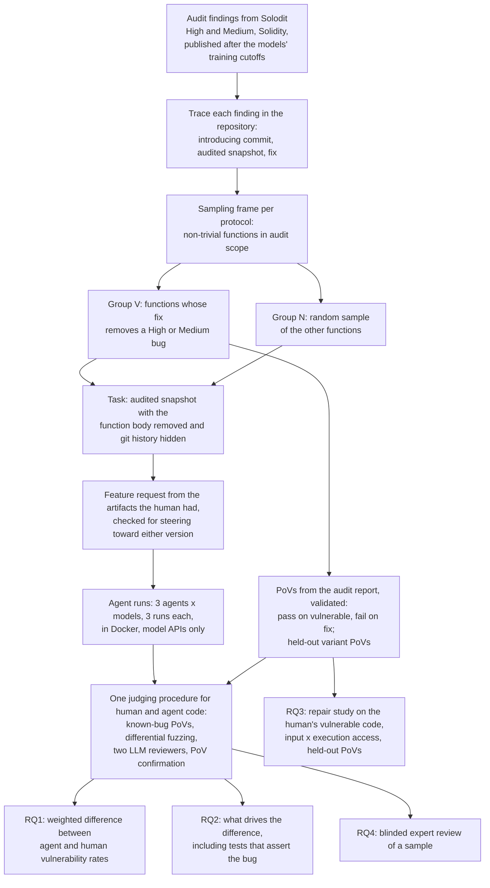

# DRAFT (literature-independent parts). Citations marked [CITE: ...] are filled from lit_review.md before this becomes proposal_v1.md.

# Same Feature, Same Exploit: Do AI Coding Agents Write Less Secure Smart Contracts Than Human Developers?

## 1. Abstract

AI coding agents now write production code, and in a smart contract one bug can drain every user's funds. Benchmarks show that agent-written code is often insecure. But they build their tasks only from code where a human wrote a bug, so they cannot say whether agents are more or less secure than the developers they replace. We propose a matched comparison on audited Solidity protocols. Each task removes one function from the audited code, and an agent rewrites it from a feature request that carries only what the human knew. Functions are sampled from two groups whose sizes we know: functions where the audit found a High or Medium bug, and all the others. The same checks judge the human's code and the agent's code: executable exploits, differential fuzzing against the human's code, and two LLM reviewers whose reports count only when an exploit confirms them. We also test how a repair agent uses an exploit, with held-out exploits that catch repairs that only block the exploit shown.

## 2. Problem and motivation

[To be completed with verified evidence from lit_review.md, section on significance.]

1. Developers increasingly hand whole functions to coding agents. [CITE: adoption evidence]
2. In smart contracts, a bug is a direct loss. Contracts hold user funds, anyone can call them, and they are hard to change after deployment. Most costly bugs are logic and accounting errors that automated tools miss. [CITE: Zhang ICSE 2023; loss statistics]
3. What we know about agent code: [CITE: SusVibes, SecureVibeBench numbers]. What we know about humans versus AI: [CITE: Asare EMSE 2023; Perry CCS 2023; Sandoval USENIX 2023; Asare ICSE 2024]. In Solidity, generation benchmarks grade security with static analysers or an LLM judge [CITE: SolEval, SolAgent], which miss about half of real bugs [CITE: Li FSE 2024].
4. The question practitioners need answered is comparative. A team that lets an agent write a function wants to know whether the code will carry more or fewer exploitable bugs than if one of its own developers had written it. That decides how much review the team must keep. No existing study answers it for any language with executable evidence, and none for smart contracts. [Check against lit_review.md.]

## 3. Key insight and contributions

**Insight 1: the comparative question needs both kinds of features, weighted by how common each is.** Compare an agent with the human developer over the same set of functions. Two things can differ. The agent can avoid a bug the human wrote, or it can add a bug where the human wrote correct code. Benchmarks built only from vulnerability-introducing commits see only the first. They measure how often the agent repeats the human's bug. The second needs functions the human got right. The overall answer also depends on how many functions of each kind there are. In an audited codebase, most functions have no High or Medium finding, so a small rate of new bugs on those functions can outweigh a large rate of avoided bugs on the few vulnerable ones. Audited codebases give us everything we need. The audit report says which functions had a High or Medium bug. The repository holds every function the developers wrote, so we can count both groups and sample from each.

**Insight 2: the repository can carry the human's mistake to the agent.** In a real repository, the developer's own tests and comments often describe the vulnerable behaviour as intended. An agent reads them, and an agent that can run tests tries to keep them passing. Our pilot shows this on one finding. On finding 63008, the audited test file has four tests that assert the buggy behaviour, and the function's comment calls the start tick "exclusive", which is the bug. In a repair study with GPT-5.4-mini under OpenHands, the agent repaired the bug in 10 of 12 runs when it could run nothing, and in 2 of 12 runs when it had a terminal. With the terminal, it kept the four bug-asserting tests passing (7 of 12 runs). If this holds across findings, two things follow. First, part of what looks like "the agent repeats the human's bug" is the agent following the human's tests. Second, more execution feedback can make a security repair worse.

**Insight 3: the feature request can decide the outcome.** In our 8-finding pilot, every request written from the vulnerable function passed either the human's design or the fix's rule to the agent. When the request described the human's design, all 13 compiled runs wrote the bug. When it stated the rule the fix restores, 3 of 15 did. A fair comparison must give the agent only what the human knew, and must check that the request does not steer toward either version.

**Contributions.**

1. **A benchmark and the method that builds it.** Tasks come from audit-contest findings in real Solidity repositories. Each finding is traced to its introducing commit and its fix. Functions are sampled from two groups with known sizes. Each vulnerable function has executable PoVs that pass on the human's vulnerable code and fail on the human's fix, plus held-out variant PoVs. Each feature request is built from the artifacts the human had and checked for steering. Each task records whether the repository's tests or comments assert the vulnerable behaviour.
2. **One judging procedure for human and agent code.** It runs the known-bug PoVs, stateful differential fuzzing against the human's code, and two LLM reviewers from different vendors. A reported flaw counts only when a PoV confirms it. We measure how often this procedure rediscovers the human's audit-confirmed bugs, so we know how many bugs it misses, and a blinded expert review checks a sample.
3. **An estimate of how much more or less often agents write High or Medium vulnerabilities than human developers on the same functions,** with a confidence interval, for six agent configurations and one frontier configuration, and an analysis of what drives the difference, including a controlled test of Insight 2.
4. **A controlled repair study.** It varies what the agent is told (location, written report, PoV) and what it can run (nothing, or a full terminal). Held-out PoVs judge each repair, and tests that assert the vulnerable behaviour are a planned moderator.

## 4. Threat model and problem setting

**Setting.** A protocol team develops a Solidity codebase. A developer asks a coding agent to implement one function inside the existing codebase, from a feature request. The agent can read the repository. In some configurations it can also run the compiler and tests. The resulting code is deployed, possibly after review. We compare this with the same function written by the team's own developer, at the same point in the codebase.

**Assets.** User funds held or accounted for by the protocol, the protocol's solvency, and the availability of its core functions.

**Attacker.** Any external account. The attacker can deploy contracts, call any public or external function, borrow with flash loans, choose the order of its own transactions within a block, and act across several blocks. The attacker cannot break cryptography, steal keys, act as a privileged role (owner, admin, keeper) unless the finding's own severity assessment assumes it, compromise the developer's machine or the agent, or change the deployed code.

**The agent and the developer are honest.** We study accidental vulnerabilities. Prompt injection into the agent, malicious dependencies and poisoned training data are a different threat model and out of scope.

**What counts as a vulnerability.** A version of the function is vulnerable if an unprivileged attacker can send a sequence of transactions that causes a High or Medium impact, and the same sequence does not cause it on the reference version. High and Medium follow the audit platforms' severity rules: theft or loss of funds, permanently frozen funds, insolvency, or denial of a core function. A vulnerability is confirmed only by an executable PoV: a Foundry test that passes on the version and fails on the reference, run offline on a local copy of the protocol with mock tokens. The reference is the human's fix for a vulnerable function and the human's code for any other function.

**Out of scope.** Low and informational findings, gas use, centralization risk, and bugs in code the agent did not write. The PoV runs against the whole protocol, so the effect of the agent's function on other code is counted.

## 5. Approach

### 5.1 Selecting findings

We use the existing selection pipeline (IDEA.md, "How findings are selected"). It downloads High and Medium Solidity findings from Solodit, keeps findings that link to a whole Solidity file, checks that the file is complete and the report matches the code, and keeps findings dated after the models' training data. Of 19,666 findings downloaded, 7,826 link a whole file and 77 are dated September 2025 to January 2026. 43 of the 77 have a public history that lets us trace the bug.

The current pool is too small and too concentrated: 59 of the 77 findings are from Code4rena, and they come from 20 protocols. We will refresh the download to cover findings published up to the start of the study, and add findings whose report links the contest repository rather than a whole file. [Estimate the yield per month from the 77: about 19 findings per month after all filters, of which about 56% have public history.] The target is at least 60 vulnerable functions from at least 25 protocols.

### 5.2 Two groups with known sizes

For each protocol, the sampling frame is every function in the audit scope that (a) changes state or computes a value that other code uses, (b) has at least five statements, and (c) is reached by the repository's tests or by an external call path. Plain getters and one-line wrappers are left out, because they would make agents look safer than they are.

- **Group V** holds the frame functions whose fix removes a High or Medium bug, as found by tracing (section 5.3).
- **Group N** holds all other frame functions. We sample N at random within each protocol, two per vulnerable function from that protocol.

We count both groups for every protocol, including the vulnerable functions we could not turn into tasks. This gives the share of vulnerable functions, π. The weights in the analysis (section 6.2) come from these counts. We record which sampled N functions came from the same commit as a vulnerable function, so that we can check whether that matters.

### 5.3 Tracing a finding

We reuse the pilot's history search, which works like SZZ [CITE: Sliwerski MSR 2005; V-SZZ ICSE 2022]: it finds the audited file in the history by exact content, runs `git blame` on the lines the report names, and lists later commits that touch the file as fix candidates. Squash merges hide many fix commits, so a person confirms the introducing commit and the fix by reading the diffs. Each finding is labelled by bug kind: a bad line that the fix changes, or a missing check that the fix adds.

### 5.4 Task framing

Each task starts from the audited snapshot, with the target function's body replaced by `revert("not implemented")`. The signature stays, so the code compiles. The git history is replaced by a single commit, so the agent cannot read the human's code from history. The pilot found one agent doing exactly that before we hid it.

We start from the audited snapshot and not from the parent of the introducing commit. In 7 of the 8 pilot findings, the parent already had the bug or did not have the feature yet. This choice has a cost. The agent sees code and tests that were written after the human wrote the bug, and some of them describe the bug as intended (Insight 2). We measure this effect directly (section 6.3, RQ2) instead of assuming it away.

### 5.5 Feature requests

A request may contain only information that the human developer had before writing the code. Its sources are:
- the function's signature and the code around it at the snapshot, without the target function's body;
- the issue, pull request description and commit message of the introducing commit, when they exist;
- the protocol's documentation and specification, when they predate the commit.

The writer (an LLM that is not one of the models under study, checked by a person) never sees the target function's body, the finding or the fix. Each sentence of the request is tagged with its source.

Then we check each request in three ways:
1. **Separating points.** An LLM lists each point of the request and says whether the human's vulnerable version and the human's fix each satisfy it. A point that only one version satisfies is a hint. We remove or rewrite it, unless a source the human had states it. In that case it stays, and we record it.
2. **Steering test.** A panel of three LLMs from vendors other than the ones under test sees the two versions in random order, with and without the request, and says which version better implements the function. If the request moves the panel toward either version by more than a set margin, the request steers. We rewrite it. Comparing "with" against "without" removes the panel's own preference for the version that looks safer.
3. **Human check.** A person answers the pilot's two questions for every request. Does it prescribe the check that the attack gets around? Does it state the rule that the fix adds?

For functions in group N, there is no vulnerable version. We run checks 1 and 3 against the human's code only.

As a robustness condition on a subset, we also give agents a minimal request: the signature and the function's existing comments only. This is the common "masked function" framing [CITE: SusVibes].

### 5.6 PoVs and held-out variants

For each vulnerable function, we adapt the audit report's proof of concept into a Foundry test. A PoV is kept only if it passes on the human's vulnerable code and fails on the human's fix, offline, at the assertion that carries the vulnerability. We record that assertion. On a new version, an attack counts as blocked only if the PoV fails at that same place. Any other failure (compile error, setup failure, an unrelated assertion) is invalid and goes to a person. This rule exists because the pilot found agent code that broke the function, so the attack could not finish, and the old judge had counted that as "avoided".

For each finding we also write at least one held-out variant PoV from the security property, not from the report: another boundary, another state, or another call path. Variants are validated the same way. They are written before any agent run and kept outside every workspace.

### 5.7 Labelling tests and comments that assert the bug

For each vulnerable function, we run the snapshot's test suite on the human's fix. Tests that pass on the vulnerable code and fail on the fix assert the vulnerable behaviour. We also search the target file and its callers for comments that describe the vulnerable behaviour as intended, and a person confirms each one. Finding 63008 has both: four downward iterator tests that expect the start tick to be skipped, and the comment `@param startTick The starting tick (exclusive)`.

### 5.8 Agents and models

Three agents (Aider 0.86.2, OpenHands SDK 1.53.0, Codex CLI 0.160.1) with two models (GPT-5.4-mini and Claude Sonnet 4.5) give six configurations. Their training data ends before September 2025 [CITE: model cards]. We add one frontier configuration on the tasks published after its training cutoff, so the results do not describe only older models. Each configuration runs three times on each task. The pilot's intraclass correlation of 0.69 means more tasks help far more than more runs, so three runs is enough to estimate run-to-run variation.

Agents run in Docker with 6 GB of memory and a 20-minute limit. Their only network access is a proxy that allows the two model APIs. Codex's hosted web search is off, and Codex gets a note asking it to work offline, because the other agents have no web tool. The run harness, the safety rules and the logging are those of the pilot (IDEA.md, Method).

### 5.9 One judging procedure for human and agent code

Every version is judged the same way, whether a human or an agent wrote it. The judge does not know who wrote it.

1. **Build and functional tests.** The project's tests for the function, without the tests that assert the vulnerable behaviour (they are reported separately).
2. **Known-bug PoVs and variants** (group V). They run on the human's version as well, by construction.
3. **Differential fuzzing.** A harness deploys two copies of the protocol that differ only in the target function: the version under test and the reference. It sends both the same transaction sequences, generated by Foundry's stateful fuzzer and seeded with the project's tests and the PoVs. It compares what an outside party can see: token balances, return values, reverts, and the storage the function writes. Each difference is grouped with similar ones and sent to step 5. An LLM writes the harness for each function, and we validate it. It must report no difference when both copies are the reference, and it must find the difference between each human vulnerable version and its fix.
4. **LLM review.** Two reviewers from different vendors read the function, its callers, the requirement and the known findings, and report every High or Medium flaw as JSON with a concrete attack sequence. The prompt is the same for every version and does not say who wrote the code. This is prompt 4 of the pilot, which found two real new vulnerabilities in agent code.
5. **Confirmation.** Each difference and each review report becomes an attempt to write a PoV, by an LLM agent working offline. A flaw counts only if a PoV passes on the version and fails on the reference. A person reads every confirmed PoV.
6. **Sensitivity.** We run steps 3 to 5 on the human's vulnerable functions without telling the reviewers about the finding. The share of known bugs that the procedure finds again estimates its sensitivity. We report the agent and human rates with and without correction for it.
7. **Expert review** of a blinded sample (RQ4).

### 5.10 Repair study

The repair study starts every agent from the human's vulnerable code, so all agents start equal. It changes two things:
- **What the agent is told:** only the function's location (L), the audit report without its proof of concept and recommended fix (R), or the shown PoV as a failing test with its output (P).
- **What the agent can run:** nothing (E0), or a full terminal (E2). A third level, only the shown test (E1), runs on a subset.

A repair succeeds only if it compiles, blocks every frozen attack at its recorded assertion (the shown PoV, the held-out PoVs and the variants), passes the functional tests, and has no confirmed new High or Medium flaw. The pilot ran this design on finding 63008 with 144 runs (section 6.4).

### 5.11 Worked example: finding 63008

**The finding.** Sorella L2 Angstrom, a Uniswap v4 hook audited by Cyfrin, published October 2025 (High): "All rewards can be stolen due to incorrect active liquidity calculations when the current tick is an exact multiple of the tick spacing at the upper end of a liquidity range."

**Tracing.** The audited snapshot is `386baff`. `git blame` pointed at a later rewrite. Reading the history showed that the faulty line was written in commit `661468b`. The fix is commit `c01b6c7`, which changes `TickIterator.sol`.

**Groups.** The bug is in `reset(TickIteratorDown)`: the downward tick walk sets `currentTick = startTick` and then advances, so it skips the start tick. That function is in group V. The same commit also wrote `reset(TickIteratorUp)`, the mirror function, correctly, and `calldataToId`. Both are in group N.

**Request.** It describes what the walk must return, as a check: start from the active liquidity at the start tick, subtract the net liquidity of each tick the walk returns, and the result must equal the active liquidity at the end tick. The pilot's request was not built with the full procedure of section 5.5, because its writer had read the finding.

**PoVs.** The report has three proofs of concept. P1 swaps to a boundary, adds liquidity and swaps back. P2 swaps down from a boundary tick and reverts. P3 steals all rewards. All three pass on `386baff` and fail with the fix's `TickIterator.sol`. In the loss scenario, an honest liquidity provider has 49 ETH of pending rewards. The attacker takes 48.88 ETH net. With the fix, the attacker ends 0.098 ETH down.

**Tests and comments that assert the bug.** Four downward tests in `test/libraries/TickIterator.t.sol` expect the start tick to be skipped, and the parameter comment says "exclusive".

**Agent runs.** Six configurations, one run each. Four of six wrote the human's bug. Two wrote the fix's line, `self.currentTick = startTick + 1`. Codex with Sonnet 4.5 ran the human's iterator tests twice and saw all 28 pass, because the downward tests expect the bug.

**Judging the control functions.** The two LLM reviewers reviewed the human's code and every agent version that compiles. Two of 11 agent versions of the N functions added the same new vulnerability: a swap that stays on one tick reverts, and a position that is not active takes rewards. Two new PoVs confirmed it on both versions and failed on the human's code. One other report was rejected, because the human's code behaves the same way.

**Weighted comparison (illustration only, one finding).** On this finding, the agents repeated the human's bug in 4 of 6 runs and added a new vulnerability in 2 of 11 runs on correct human functions. If 10% of frame functions were vulnerable, the agents' vulnerability rate would be 0.1 × 4/6 + 0.9 × 2/11 ≈ 23%, against the human's 10% plus whatever the checks find in the human's other functions. One finding cannot support a conclusion. The example shows why the second term matters.

**Repair.** In the masked-PoV repair round, one repair blocked the shown P2 but held-out P3 still took 48.88 ETH. In the 144-run repair study, OpenHands succeeded in 10 of 12 runs with nothing to run and 2 of 12 with a terminal.

## 6. Research questions and evaluation plan

### 6.1 Research questions

- **RQ1 (comparison).** On the same functions, do AI coding agents write High or Medium vulnerabilities more or less often than the human developers did?
- **RQ2 (causes).** What makes an agent write a vulnerability: the request, tests and comments that assert the vulnerable behaviour, the agent's ability to run code, or the model?
- **RQ3 (repair).** Does a shown PoV give more complete repairs than a written report, and does a terminal help or hurt?
- **RQ4 (judges).** How well do the automatic checks agree with blinded expert auditors?

### 6.2 RQ1: measures and estimate

For each configuration, the outcome of one run is whether the function it wrote has a confirmed High or Medium vulnerability. Versions that do not compile, or that fail the functional tests, are reported separately and not counted as secure.

Let π be the share of frame functions in group V. Let a_V and a_N be the agent's vulnerability rates in groups V and N, and h_N the human's rate in group N (found by the same checks; the human's rate in group V is 1). Then the difference between agent and human is

Δ = π (a_V − 1) + (1 − π) (a_N − h_N).

The first term is what the agent gains by avoiding the human's bugs. The second is what it loses by adding new ones. We estimate π, a_V, a_N and h_N with the stratified sampling of section 5.2, and get a 95% interval for Δ with a bootstrap that resamples protocols, then functions within them, then runs. The pilot's numbers show why the second term needs many N functions: it carries most of the weight.

**Sample size.** [Fill from a power table.] With π near 0.1 and a_N near 0.15, the standard error of Δ is about 0.9 × sqrt(a_N(1 − a_N)/n_N) at the function level. With 120 N functions it is about 0.03, enough to detect a difference of 0.09 with 80% power.

### 6.3 RQ2: causes, with one controlled test

We fit a mixed-effects logistic regression of "the version is vulnerable" on: group (V or N), the steering score of the request, whether tests or comments assert the vulnerable behaviour, agent, model, and the agent's actions taken from its log (whether it read or ran the tests), with random effects for protocol and function.

**Controlled test of Insight 2.** For every vulnerable function whose repository asserts the bug, we run the agents twice: with the repository as it is, and with the bug-asserting tests and comments removed. Everything else stays the same. If removing them lowers the rate at which agents write the bug, and more so for agents that can run tests, Insight 2 holds. This is the planned primary test of RQ2.

### 6.4 RQ3: repair

Tasks are the vulnerable functions with at least one held-out PoV. Arms: L-E2, R-E2, P-E2 and P-E0, each with two configurations and two runs. Primary contrasts, fixed before the runs and corrected with Holm's method: P-E2 against R-E2 (does a PoV beat a report?), and P-E0 against P-E2 (does a terminal help or hurt?). The presence of bug-asserting tests is a planned moderator. The pilot on 63008 found, for OpenHands with GPT-5.4-mini: L-E2 0 of 12, R-E2 5 of 12, P-E2 2 of 12, P-E0 10 of 12. These are from one finding and only motivate the design.

### 6.5 RQ4: agreement with experts

Two auditors with contest experience, paid, review a blinded, stratified sample of about 150 versions (human and agent, both groups, judged vulnerable and not). They see the function, its callers and the request. We report Cohen's κ between each automatic check and the experts, and between the two experts, and the sensitivity and specificity of the full procedure against the experts' consensus.

### 6.6 Baselines

- For RQ1, the human developer is the baseline.
- For the judge, we compare our procedure with the judges used by prior Solidity benchmarks: a static analyser (Slither) and a single LLM judge [CITE: SolEval; SolAgent]. We report how RQ1's answer changes with each weaker judge.
- For RQ3, arm L is the baseline, and arm R is the written-report repair setting of prior work [CITE: Pearce S&P 2023].
- Agents: Aider, OpenHands and Codex CLI are among the strongest open agents [CITE]. The frontier configuration covers the strongest current models on the tasks that its training cutoff allows.

### 6.7 Ablations

- Minimal request against checked request (section 5.5).
- Repository as is against bug-asserting tests and comments removed (section 6.3).
- Each judging step removed in turn, to show what it adds.

### 6.8 Threats to validity

- **Contamination.** A finding published after a model's cutoff can still have code that was public earlier. We record the date each introducing commit became public, analyse tasks whose code postdates the cutoff separately, and run a memorization probe: we give the model the code before the function and check whether it completes the human's body word for word.
- **The agent sees more than the human did.** The audited snapshot includes later code and tests (section 5.4). RQ2's controlled test measures the main effect of this.
- **The audit misses bugs.** Some group N functions are vulnerable. The judging procedure runs on the human's group N functions too, and capture-recapture between the audit and our checks estimates how many both miss [CITE: capture-recapture in software inspection].
- **The checks miss bugs in agent code.** We measure their sensitivity on known human bugs (section 5.9, step 6) and with the experts (RQ4).
- **Which vulnerable functions become tasks.** Findings with a proof of concept in the report are easier to turn into PoVs. We report how the tasks differ from all vulnerable functions in the frame.
- **One language and ecosystem.** The results hold for audited Solidity protocols.
- **Agents and models change fast.** We pin versions, keep every log, and release the harness so that new agents can be run on the same tasks.

## 7. Related work

[To be written from lit_review.md, with a comparison table.]

## 8. Risks, limitations and fallback plans

| Risk | Sign | Fallback |
|---|---|---|
| Too few traceable findings | fewer than 40 vulnerable functions after the refresh | add findings that link contest repositories; widen the date window for the older models; report RQ1 with a wider interval |
| PoV construction too slow | more than 2 days per finding on average | restrict group V to findings whose report has a proof of concept (47 of the 77), and report the selection |
| Differential fuzzing too noisy | most differences are harmless | keep it as a source of candidates only; confirmation by PoV decides |
| Requests keep steering | more than a third need three rewrites | fall back to the minimal request for those functions and analyse them separately |
| Experts unavailable | fewer than two auditors | trained PhD students, with lower confidence stated |
| New flaws in deployed human code | a confirmed PoV on a human N function | responsible disclosure first (section 9) |

## 9. Ethics and responsible disclosure

- Every PoV runs offline on a local copy with mock tokens. No test touches a live chain or a deployed address.
- The PoVs for known findings come from public audit reports of bugs that were fixed before deployment.
- If our checks confirm a new vulnerability in a human's code that is deployed, we report it to the protocol through its security contact or bug bounty before any publication, and we hold back its PoV until it is fixed or 90 days pass.
- New flaws in agent code are not deployed anywhere. We publish them in aggregate.
- We release the tasks, requests, harnesses and PoVs of public findings. We do not release an automatic exploit generator.
- The expert reviewers are paid. We ask the university's ethics board whether the expert study needs review.
- All LLM use in building the benchmark is disclosed.

## 10. Venues and 12-month timeline

[Primary: ICSE 2028. Backup: USENIX Security 2028 or ACM CCS 2027. Check the calls for deadlines.]

| Months | Work |
|---|---|
| 1-2 | Refresh findings; build the request checks; build the judge's invalid state and expected-failure matching; build and validate the differential fuzzing harness on the 8 pilot findings |
| 2-5 | Build group V and group N tasks, PoVs and variants; label bug-asserting tests; preregister the analysis |
| 5-7 | First-round agent runs and judging; sensitivity runs |
| 6-9 | Repair study runs and judging; controlled test of Insight 2 |
| 7-8 | Expert review |
| 9-10 | Analysis |
| 10-11 | Writing and submission |
| 12 | Artifact release; disclosure follow-up |
