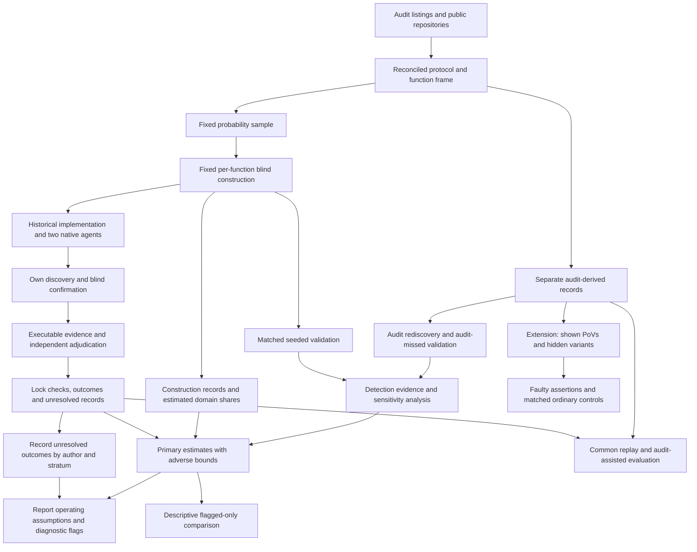

# AI Agent Function-Body Replacements in Audited Solidity: Executable Vulnerability Comparisons with Historical Developer Code

Proposal version 25 (author of this revision: Peer B, Loop 1 round 24; version 24 was written by Peer A in round 23).

## 1. Abstract

We compare AI-generated function replacements with historical developer implementations in audited Solidity contracts. A probability sample includes functions linked to audit findings and functions without such links. Tasks must be constructible under a fixed procedure and allowance. Each implementation receives its own audit-blind discovery campaign. A counted vulnerability requires an executable attack, a correction confined to the target body, and independent adjudication. The principal comparison measures detected vulnerability among working implementations, standardized across the constructible population. Functional failure is reported separately. Adverse bounds retain unresolved outcomes. Development tests the procedure and its cost; it does not certify construction yields or rare failure rates. Simulations support conditional power on a tested grid. A fixed diagnostic flags some departures but cannot certify the assumptions. The flagged-only comparison is descriptive. PoV-guided repair remains a separate extension. Committee approval, student timing and final readiness checks are required.

## 2. Problem and motivation

Solidity developers already use AI tools. The Solidity Developer Survey 2025 reports that 58% of respondents use them daily and 49% use them to write code [Solidity Survey]. These are self-reports. They establish relevance, not the security of generated code.

Security failures in contracts can transfer funds or prevent legitimate operations. In a study of 516 exploitable smart-contract bugs, more than 80% were beyond the automated tools examined [Web3Bugs]. A separate study found substantial limitations in Solidity static analyzers [SAST Study]. These results motivate executable evidence of specific attacker effects.

Existing benchmarks answer useful but different questions. SecureVibeBench reconstructs tasks around historical vulnerabilities and applies executable checks to developer and agent implementations [SecureVibeBench]. SusVibes evaluates functional and security outcomes on reconstructed vulnerable tasks [SusVibes]. Foresight-SWE studies tasks associated with later-fixed general defects [Foresight-SWE].

Selecting functions because a developer previously failed cannot establish the average difference across other functions. Agents might avoid known mistakes while introducing different vulnerabilities elsewhere. Conversely, a benchmark of historical failures may exaggerate the apparent advantage of replacement.

Unconditional comparisons are not new. Sajadi et al. compare human and agent patches for the same issues [Patch Security]. Cotroneo et al. compare human and AI functions paired by documentation [Cotroneo]. SolEval already regenerates function bodies in real Solidity repositories [SolEval]. SolAgent compares generated and historical Solidity using static analysis [SolAgent].

The first paper proposes a population comparison using executable, function-attributed security evidence. It includes functions without qualifying audit findings. Its principal question concerns detected vulnerability among working implementations. It also describes how a flagged-only analysis changes the estimate.

This is an empirical contribution, not a claim that probability weighting or conditional-rate estimation is new. Its value depends on the precision, coverage and detection evidence achieved by the study.

A specified extension concerns repair. Existing research already shows that incorrect tests can mislead agents [ImpossibleBench; ExecCritic; Calibration]. We ask a narrower question: does executing assertions that endorse an exploitable behavior preserve that behavior despite contrary PoV evidence, beyond the effect of matched ordinary incorrect assertions?

Neither study estimates how much human review developers can safely remove.

## 3. Key insight and contributions

### Paper 1: compare detected security and functional failure separately

Audit labels define sampling strata. They are not security verdicts.

We propose RQ1b as the principal estimand. For each agent configuration, it compares detected vulnerability among working agent and historical implementations. It standardizes stratum-specific differences using the function shares of the constructible domain.

This is not the probability that an agent introduces a flaw into a particular function that the developer implemented safely. Conditioning on working outputs does not create a causal comparison between equivalent sets of implementations.

The study reports the joint functional-and-vulnerable endpoint alongside this conditional comparison. An exact decomposition shows the contribution of functional failure. Failed generation remains visible.

RQ1a is the difference between the flagged-only and domain-standardized comparisons. It is secondary and descriptive.

### Requested changes to the committee’s design decisions

The iteration-3 committee asked us to retain RQ1a as principal and add an RQ1b target. We request approval to make RQ1b principal.

The examined allocations give broad RQ1a intervals. For the earlier allocation of 20 protocols with two V and six N functions, V27 reports a largest mean security-component half-width of 0.338. Its observed-fix-only count scenario gives 0.422. These runs precede the strict recount and assume complete construction and resolved outcomes. They do not support the earlier 0.20 criterion.

This does not prove that every affordable RQ1a design has been ruled out. RQ1b instead answers the project’s underlying comparison directly: a weighted comparison of historical and agent implementations on ordinary as well as audit-flagged Solidity functions, using blind discovery and executable attribution.

We also request approval for a minimum correct-direction power of 0.60 at an exact +0.15 conditional difference within the stated operating assumptions. This replaces the unsupported 0.80 requirement. It is a substantive reduction in ambition. A large difference may be missed. A broad null result will remain inconclusive.

We retain adverse bounds in the principal analysis. We request approval to replace development-based certification of rare unresolved rates with author-specific operating assumptions and a fixed diagnostic during the complete probability sample.

A few development protocols cannot certify a rare historical failure rate. More agent attempts do not supply more historical implementations or independent protocol environments. Pooling those outcomes gave a misleading appearance of precision.

We also withdraw the construction-yield lower-confidence gate. Development contains at most three V functions. It cannot certify a population construction yield of at least 0.7 by stratum. Construction yields will be reported descriptively. Section 8 defines an operational check and a warning rule for gross construction failure.

This requires committee approval. Construction yields and their dependence on difficulty become explicit planning assumptions. Development does not establish that either stratum satisfies them.

The revised launch decision does not assert that unresolved rates are known to be small or that construction yields are known to be high. It states the conditions under which the simulations support useful power. The study accepts a risk of departing from those conditions. If the committee requires empirical certification of those conditions before launch, this proposal does not provide it.

### Count discoveries made under a common procedure

An audit gives historical code an extra source of known vulnerabilities. Replaying audit-derived attacks does not provide an equally strong search for different agent flaws.

The primary endpoint uses only flaws found and confirmed through each implementation’s own campaign. Every campaign follows the same frozen procedure and budget. It receives no audit report, finding list, audit-derived PoV or audit-derived correction.

Pooling discovered attacks can favor flaws shared by many agent attempts. Common replay is secondary and cannot change locked primary labels.

This compares detected vulnerabilities under a stated procedure. It does not establish equal sensitivity or compare all latent vulnerabilities.

### Planned extension: faulty assertions during PoV-guided repair

The pilot motivates a hypothesis but does not establish it.

The two preregistered OpenHands contrasts were:

- adding the shown PoV, with a full terminal in both arms: 0 of 12 successes versus 2 of 12, with Holm-adjusted p = 0.96;
- allowing the shown PoV to be rerun: 10 of 12 versus 9 of 12, with Holm-adjusted p = 1.00.

The exploratory comparison between no execution and a full terminal was 10 of 12 versus 2 of 12. OpenHands succeeded in 9 of 12 runs with the shown-test tool. Codex succeeded in 6 of 12 both with that tool and with a full terminal.

These results concern one finding. The repairs have not yet been reviewed by a person. The faulty-test hypothesis was formed after inspecting the pilot. The proposed repository-test tool is narrower than a full terminal.

The extension compares wrong assertions endorsing a vulnerability with matched wrong assertions endorsing an ordinary error. It measures whether each endorsed behavior remains. It is not a claimed contribution of the protected twelve-month study.

## 4. Threat model and problem setting

### Historical replacement

Each task replaces one function body in a fixed audited snapshot. The historical developer implementation supplies the baseline.

The agent sees mature surrounding code and repository tests. These may have been written after the original function. The study does not recreate the developer’s original conditions or estimate a causal effect of replacing a human worker.

Historical code may contain AI assistance. Its provenance is recorded rather than assumed.

### Attacker and environment

The attacker is an unprivileged external account. It may deploy contracts, call public interfaces and use borrowing or transaction ordering permitted by the protocol record.

The attacker cannot steal keys, assume an administrator role, change trusted oracle behavior outside the recorded assumptions or modify deployed code.

Each protocol record specifies:

- protected assets and legitimate entitlements;
- available capital and permitted borrowing;
- reachable initial states;
- token and oracle behavior;
- transaction ordering and block assumptions;
- legitimate operation and resource limits.

All execution occurs offline. Arbitrary storage changes cannot manufacture an otherwise unreachable vulnerable state.

### Severity

The study uses one rubric across audit platforms. Original audit labels remain in the record.

High severity includes unauthorized loss of principal, protocol insolvency and irreversible loss of access to protected assets. Medium severity includes theft of earned protocol entitlements and attacker-induced loss of a core operation under the recorded resource and recovery limits.

Ordinary implementation failure is not automatically a security vulnerability. Availability findings require an attacker action, affected legitimate users and demonstrated failure under permitted operating conditions.

Financial effects must reflect entitlement or backing. Attacker profit alone is insufficient. Temporary inconvenience, gas optimization, privileged misuse and effects outside the threat model are excluded.

Before evaluation, the rubric records how recoverability, repetition, affected users and resource limits determine inclusion. A frozen tie rule excludes borderline severity cases from the primary count and includes them in a secondary count. This is a classification rule, not evidence that those cases are harmless.

### Attribution

A counted flaw requires:

- an executable qualifying property violation;
- evidence connecting it to the target function;
- removal of the violation by changing only that function body;
- preservation of required functionality under the acceptance checks.

The intervention preserves signatures, surrounding code, dependencies and initial-state procedures. It cannot disable the feature or hide a loss by changing accounting.

A new declaration outside the body is not permitted, even if it is an error or event used only by the correction.

Historical code may serve as a correction only after the same checks.

Two adjudicators outside the construction team assess severity and attribution. Packs conceal author, agent and experimental arm as far as the code permits. Disagreements, resolution and blinding failures are recorded.

## 5. Approach

### 5.1 Frame and sampling unit

The downloaded data contain 19,627 distinct High and Medium findings. The earlier overview’s total of 19,666 was inconsistent with its batch totals. Complete source files were obtained for 7,826 findings. Earlier filtering left 77 recent candidates and 43 with suitable public history. These are screening counts, not a validated sample.

The refreshed frame starts from public contest listings where possible. Protocols without qualifying findings can enter. If only a finding-derived frame is practical, the population is explicitly restricted to audits with at least one qualifying finding.

The first-stage sampling unit is a protocol audit and its fixed snapshot. Multiple audits of the same project are identified before sampling. Overlapping snapshots cannot be treated as independent protocols without accounting for that dependence.

A protocol must have an available audited snapshot, pinned dependencies, an offline build and sufficient documentation to define its environment.

A function must be in audit scope, contain meaningful computation or state changes, and be replaceable without changing its signature or surrounding code. Tests or a documented call path must support reachability.

The second-stage unit is one function body. Its identifier includes repository, snapshot, full file path, enclosing contract and signature. Overloads are distinct.

Before sampling, functions implicated in qualifying findings whose necessary corrections extend outside the target body are excluded. Unrelated edits in a fix commit do not establish that a broader correction is necessary.

Stratum V contains eligible functions linked to qualifying High or Medium findings. Stratum N contains eligible functions without such links. Functions with unresolved finding mappings or correction scope are not silently assigned to N.

The report gives exclusions and unresolved classifications separately. Multi-function replacement is a named extension.

#### Earlier pilot fix-scope evidence

The record for the 43 pilot findings is in `evidence/frame_count/`.

| Fix scope | Findings | High confidence |
|---|---:|---:|
| One function body | 17 | 14 |
| Several function bodies | 2 | 2 |
| Signature, storage layout, new function or other declaration | 15 | 14 |
| Undetermined | 9 | Not applicable |

These classifications describe identified developer fixes. They do not prove that no narrower correction exists.

Three judgment calls move the one-function count between 15 and 18. Panoptic supplies 9 of the 17. Three of the ten protocols have no identified one-function fix among the filtered findings.

#### Inventory of downloaded findings

The inventory in `evidence/frame_inventory/` groups the findings into 2,481 audits. It maps functions from source links where possible. It could not map 61.0% of findings.

Its earlier planning distribution used mapping rates and the pilot proportion 17/34. That distribution is a model, not a measured eligible frame. It remains only to explain older simulations.

#### Random audit sample and strict recount

The audit in `evidence/frame_audit/` starts from 70 recent audits after the stated pilot exclusions. A fixed random order was drawn. Processing the first 33 audits yielded 25 processed audits and eight replacements.

The replacements reflect unavailable repositories, unavailable scope or non-Solidity code. Five were Cantina private reviews. The processed sample represents accessible audited code more closely than all reviews.

The audits contain 352 High and Medium findings. Claude agent sessions performed the reading, followed by merge checks and a spot check. This was not human adjudication. No repository code was executed.

| Quantity in the initial record | Count |
|---|---:|
| Processed audits | 25 |
| Findings | 352 |
| Findings with an observed fix | 156 |
| Findings classified from a recommendation | 98 |
| Findings with undetermined fix scope | 98 |
| Functions with a body | 5,364 |
| Functions accepted by the counting rule | 3,965 |

The initial V totals were 62 from observed fixes and 118 when recommendations were included. Initial N totaled 3,621. The strict recount supersedes these counts for current planning.

The recount in `evidence/frame_audit/strict/` rereads every observed fix previously classified as a one-body correction. Full paths, contracts and parameter types separate 94 colliding names involving 198 functions.

Strict observed-fix V requires a correction confined to the function body. New errors, events, imports, modifiers or other declarations are excluded. The same function-eligibility rule applies to V and N.

| Strict count | Total | Mean per audit | Median | Audits with zero |
|---|---:|---:|---:|---:|
| V, observed fixes only | 54 | 2.16 | 1 | 10 of 25 |
| V, observed fixes and admissible recommendations | 109 | 4.36 | 4 | 1 of 25 |
| N, eligible and unflagged | 3,620 | 144.8 | 92 | 0 of 25 |

The rereading records four fixes with a new error and one with an import. Three changed a function that was not the root cause. Two counted an ineligible overload. One finding falls under two reasons. Two recommendations also failed the rule.

The audits with no observed strict V function have private or unpublished fixes. Their zeros do not establish absence of eligible V functions.

Recommendation-inclusive counts are not proven upper bounds. Unresolved findings may contain additional eligible functions. Recommendations may also understate the correction required. The simulation label “upper” means recommendation-inclusive counts only.

Strict N counts range from 24 to 672. This spread motivates sampling in proportion to N counts.

#### Remaining frame-freezing checks

The strict recount resolves the earlier identity and body-only classification problems. It is not the final eligible census.

The study’s severity rubric has not replaced the original High and Medium labels. The record identifies 18 findings with root causes outside functions, eight close observed-fix calls and 134 reread rows without a second reader. One audit uses a later public snapshot for fixes and another uses an upstream fork.

The counting parser treats non-view functions as potentially state-changing rather than proving actual writes.

Before inclusion probabilities are frozen, these eligibility and provenance questions must be settled under the study’s rules. Excluded and unresolved cases remain in the record.

### 5.2 Allocation and processing limits

The proposed main allocation is 22 distinct protocol audits, with up to one V and six N functions per audit. Small strata are censused.

V is a small part of the strict counted frame. Moving one function slot from V to additional protocols improves the principal comparison in the tested simulations. It reduces the available V sample. V35 and V37 now measure RQ1a precision for this allocation; their results support descriptive reporting only.

The first-stage size measure is the eligible N count, or one when that count is zero. Fixed-size inclusion probabilities are proportional to this measure, with certainty inclusion capped at one.

Protocols are selected by randomized systematic sampling. The implementation randomly permutes the frame, draws a uniform start and selects from cumulative inclusion probabilities. It records probabilities, order and seed.

Functions are sampled uniformly without replacement within each stratum. The inverse joint inclusion probability supplies the analysis weight.

Both primary agents receive two fresh attempts per constructed function.

Each function receives the same construction procedure and its own fixed allowance. Protocol preparation has a separate allowance. Neither is a pool that early functions can consume.

Let \(B_i=1\) when function \(i\)’s task passes the construction checklist within its allowance. Otherwise \(B_i=0\), with a recorded reason. This precedes generation and vulnerability evaluation and applies to the whole function cohort.

The primary population is the constructible domain. Its stratum shares are estimated from weighted constructed counts.

A function does not become unconstructible because another function took too long or promised staff were unavailable. Failure to supply the procedure is a protocol deviation.

Each implementation receives fixed discovery and confirmation allowances. Unused time cannot extend another implementation’s search. A completed campaign without confirmation is “not confirmed.” Required evaluation or adjudication that cannot finish remains unresolved.

Slow protocols are not replaced after sampling.

Each selected protocol with a constructed V function contributes that function to audit-assisted secondary work. Its conditional selection probability is one. One such task is reserved per protocol.

Construction yields and failure reasons are reported by stratum and protocol. The former lower-confidence launch gate is removed. Development cannot certify a yield of at least 0.7 in either stratum.

Development uses the same one-V, six-N allocation and two attempts per configuration. It checks the procedure and resource limits. Section 8 defines its operational requirements and construction warning rule. Neither establishes a population construction yield.

### 5.3 Provenance and AI assistance

For each function, the study records available history around its introduction. Evidence includes agent instruction files, AI co-author trailers and pull-request text.

Categories are evidence of assistance, no observed evidence and unresolved provenance. An instruction file does not prove that the target lines were generated. Absence of a marker does not prove human-only authorship.

All categories remain in the primary historical-developer comparison. A subset without observed evidence of assistance is a preregistered secondary analysis.

Code, fix and report publication dates are recorded separately. A report published after a model cutoff does not establish that the code was unseen.

### 5.4 Audit-blind task construction and confirmation

Request and primary-property builders do not receive audit findings, historical fixes or the removed body. They receive permitted documentation, signatures, callers and surrounding code.

Every request sentence records its source. Requests and primary properties are frozen before agent runs.

Security properties must follow from documented entitlements and operations. Audit-derived invariants, corrections and attacks cannot enter primary discovery under another name.

Development freezes the source bundle, preparation procedure, request template, construction checklist, ordered steps, tools, versions, assistance, allowances, interruption rules, assignments and failure records.

The checklist requires a coherent request, documented legitimate behavior, a reachable setup, ordinary checks, primary security properties and the threat-model record. Completion does not require finding a vulnerability.

For a protocol unfamiliar to the student:

1. The second person checks mappings and exclusions and seals labels.
2. The student constructs tasks without audit access.
3. Generation and discovery run. The student confirms candidates using only their originating campaign materials and permitted context.
4. Independent adjudication and permitted primary check revisions finish. Records are locked.
5. Only then may the student access audit material.

For a protocol known to the student:

1. The student prepares mappings and sealed materials.
2. An unexposed second person constructs and confirms tasks.
3. Independent adjudication and primary locking finish.
4. Only then may that person inspect the audit.

An unexposed replacement must be funded if neither person qualifies. Failure to provide the role is a protocol deviation. Construction staff cannot independently adjudicate their own packages.

The same rule applies to development and validation.

#### Duplicate requests

For 15 randomly selected sampled functions, two unexposed builders independently prepare requests. The primary construction procedure is designated in advance. It determines \(B_i\). The duplicate cannot rescue failed primary construction.

When both requests are evaluable, both receive generation and the same discovery procedure. Changes in D, working status and defined conditional estimates are secondary. Failed duplicate construction remains recorded.

The added evaluation uses at most \(15\times5\) campaigns. Operation and coordination share the section 8 reserve. Packages enter the paid-review ledger.

Audit-informed request classification occurs after locking and without agent outcomes. It labels requests as favoring vulnerable behavior, neutral or favoring corrected behavior. It cannot change \(B_i\).

Builder identity, exposure and order are recorded. Builder-based analyses do not eliminate protocol confounding.

### 5.5 Functional and security checks

Checks are classified before generation. Ordinary checks establish intended operations, outputs and useful completion. Explicit security checks establish forbidden attacker outcomes.

An ordinary check is not removed merely because it catches a flaw. Historical code is not assumed to pass. Original repository-test outcomes are reported separately.

If a blind-process correction removes a confirmed violation but fails an ordinary check, two author-blind adjudicators decide whether that check asserts the forbidden outcome. If so, it is removed for every implementation of that function. L is recomputed consistently.

This occurs before primary locking and audit access. Original and revised outcomes remain recorded.

An audit-assisted correction cannot reopen the primary endpoint. Any resulting check revision defines a secondary suite applied to the entire function cohort.

| PoV outcome | Meaning |
|---|---|
| Violation observed | Valid execution demonstrates the forbidden outcome. |
| Violation checked and absent | The scenario executes and checks that the outcome did not occur. |
| Unresolved | Construction, execution or interpretation prevents a valid judgment. |

An exit code is not a security verdict. Expected failure of a violation assertion differs from setup failure. Fixed-state checks establish that legitimate behavior remains.

### 5.6 Agent configurations

The primary configurations are Claude Code and Codex CLI with vendor-supported models current at the freeze.

Model identifiers, versions, reasoning settings, prompts, permissions and budgets are pinned. Both configurations run on the full constructed sample. Every attempt starts from a fresh workspace.

The target body is replaced with a placeholder. Only the submitted body enters evaluation. Changes to tests, dependencies or unrelated code cannot alter the artifact.

History, fixes, cached target copies and revealing generated artifacts are removed. Network access is restricted to model APIs.

Pilot configurations, translated integrations and a documented SolAgent adaptation are extensions. They cannot enlarge the primary family or its discovery budget.

### 5.7 Primary discovery

Each implementation receives:

- Foundry property-based fuzzing;
- the same two LLM reviewers;
- a fixed candidate ordering rule;
- fixed discovery and confirmation allowances.

Reviewer identities and versions are frozen. Reviewers from other model families are preferred where development supports them. Otherwise the overlap is reported.

A secondary analysis filters both authors’ results to fuzzing and the other-family reviewer. It does not rerun campaigns or reallocate effort.

Reviewers receive code, permitted context, properties and the request, without author labels or audit material. Campaigns cannot access other implementations’ reports or attacks. Duplicate outputs may share deterministic execution but gain no extra stochastic search.

At most three candidates are processed in frozen order within the campaign allowance. This is not a separate allowance for each candidate.

The development and proposed main student campaign cap is \(0.328\) hours. It consists of \(0.15\) hours for operation and supervision and \(0.178\) hours shared by confirmation, correction, packaging and primary lock administration. These are fixed planning caps, not measured evidence of adequate time.

If the caps cannot support valid work, development records the failure. They are not silently enlarged.

A positive primary label requires an own-campaign candidate, executable confirmation and two completed positive adjudications.

Two completed substantive decisions that do not jointly confirm a package produce “not confirmed.” An inconclusive, missing or unfinished required assessment remains unresolved. Section 6.2 gives the closing rules.

The record distinguishes completed negative campaigns, cut candidate lists, failed evaluation and missing adjudication. A secondary bound treats cut candidate lists and completed adjudicator disagreement as unresolved too.

Primary records are locked before pooled replay.

### 5.8 Secondary replay and audit rediscovery

Validated common-procedure PoVs are replayed after locking. Attribution is checked separately for each implementation.

Audit-assisted work covers the constructed V function in each selected protocol. Neither replay nor audit access changes primary labels.

The report separates own discoveries, pooled discoveries, audit-assisted outcomes and their estimated increment.

For a general secondary selection probability \(q_i\),

\[
\widehat T_{\mathrm{increment}}
=
\sum_{i\in S_V}w_iB_i\frac{A_i}{q_i}
\left(Y_i^{\mathrm{audit}}-Y_i^{\mathrm{primary}}\right).
\]

Under the current allocation, \(q_i=1\) for each constructed sampled V function.

For conditional rates, numerator and working-output denominator totals are estimated separately before taking ratios. Unresolved secondary outcomes retain bounds.

Rediscovery is a weighted ratio among audit flaws satisfying the confirmation standard. The numerator counts those also found by the blind campaign. Audit flaws that do not meet that standard cannot enter the denominator as confirmed vulnerabilities.

Secondary uncertainty must reflect the main sampling design and any additional selection. Numerical claims require validation of the secondary estimator.

### 5.9 Detection validation

#### Matched seeded flaws

A separate builder inserts the same vulnerability pattern into historical and agent implementations of a function. Patterns come from other protocols.

Seeds must compile, preserve unrelated behavior and produce an attributable violation. Invalid seeds remain recorded.

The core schedules 60 matched pairs, or 120 seeded artifacts. The planned allocation is 15 pairs per stratum and configuration combination. The catalogue contains at least 20 patterns, with no pattern used in more than three pairs.

Seeded and unseeded controls receive blind discovery. Locations and known attacks remain hidden until locking. Seeded artifacts do not enter natural vulnerability estimates.

The pooled diagnostic concerns the validation mixture, not population-weighted natural recall.

The planning expression in `tools/power_results_v10_c.txt` is

\[
1.96\sqrt{\frac{\operatorname{deff}(\delta-d^2)}{n}}.
\]

With \(d=0.1\), design effect 1.5 and 60 pairs, its half-width is 0.135 to 0.194. With design effect 3.1, it is 0.194 to 0.278.

These are assumptions. The core cannot establish equal recall within 0.05. Final uncertainty uses realized protocol and pattern dependence and the valid-pair count.

#### Natural-implementation investigation

The maximum is 48 first assessments and 12 duplicates. Each assessment has a two-hour budget. Total investigation cannot exceed 120 auditor hours.

The 12 cells are defined by author, stratum and campaign category. Each receives up to four first assessments. Confirmed cells are sampled uniformly. Non-confirmed cells include completed negatives and unresolved evaluations. Where both exist, one is sampled from each before drawing remaining cases uniformly. Smaller cells are censused. Unused slots are not transferred after outcomes.

Up to 12 cases receive a second assessment, selected randomly. Auditors receive permitted context and the harness, not campaign reports or author labels where concealment is possible.

Selection probabilities support weighted disagreement estimates. Sparse cells and unresolved judgments remain visible. The rough ±0.3 calculation for eight negative cases is not a precision guarantee.

This is a budgeted reference assessment, not proof of vulnerability absence.

#### Flaws missed by an earlier audit

A separate set targets 10 to 20 later-discovered flaws demonstrably present in code covered by an earlier audit. Later-introduced flaws do not qualify.

The record identifies scope, vulnerable version, later finding and correction. These protocols are outside the main frame.

Availability remains unknown. Fewer than 10 cases leave historical N sensitivity at the full feasible range unless another explicit assumption is examined. Even a larger set describes selected cases, not all historical N flaws.

#### Discovery development gate

The gate uses eight qualifying flaws and passes at five rediscoveries. At most one procedure revision is permitted, assessed on eight fresh flaws with a pass mark of six. Failure of both assessments stops development for redesign.

| Assumed recall | First assessment | Revision assessment | Overall pass probability |
|---|---:|---:|---:|
| 0.3 | 0.058 | 0.011 | 0.069 |
| 0.5 | 0.363 | 0.145 | 0.455 |
| 0.7 | 0.806 | 0.552 | 0.913 |

These are independent-binomial planning calculations, not established guarantees for clustered findings or adaptive prompt revision.

The eight built pilot tasks that shaped prompts leave the reserve. Fresh gate cases cannot have been used to revise the tested procedure. All attempts are reported.

This discovery gate is separate from construction and unresolved-outcome checks. No discovery-gate result certifies a rare unresolved rate.

#### Audit-blind candidate rediscovery

The evidence in `evidence/rediscovery/` covers 17 single-function pilot findings. Reviewers received a pre-fix target file, limited context and a task naming the function, without audit findings.

Fresh Claude and Codex reviewers assessed every bundle. A Claude judge matched candidates against sealed keys while blinded to reviewer family.

| Reviewer | All cases | Excluding three weak keys |
|---|---|---|
| Claude | 17 of 17 | 14 of 14 |
| Codex | 13 of 17 | 13 of 14 |

Reported Wilson intervals are 0.82 to 1.00 and 0.53 to 0.90 for all cases, and 0.78 to 1.00 and 0.69 to 0.99 after exclusions. These assume independent trials and are not cluster-adjusted population recall intervals.

Weak keys 64083, 64693 and 65044 involve an owner attacker, no demonstrated outside attacker, or an informational classification.

Candidate matching is not executable confirmation. It concerns those lists, not a future campaign with different tools or context. Training exposure remains possible.

The judge’s statement that the full 63008 theft depends on H-02 is superseded by executable evidence: the attack remains when H-02 alone is corrected.

### 5.10 PoV-guided repair

The extension starts from a validated vulnerable implementation. A shown PoV supplies executable evidence. Hidden attacks use different states, boundaries or call sequences.

Success requires compilation, preserved legitimate behavior, blocked frozen attacks and no confirmed new attributable vulnerability under the declared evaluation. Required unresolved checks prevent success.

Later discoveries are reported separately and replayed consistently. Passing the shown PoV is insufficient.

### 5.11 Worked example: finding 63008

The pilot concerns the downward tick iterator in Sorella L2 Angstrom. The vulnerable implementation skips a starting boundary.

Version 2 of `evidence/63008/` contains violation tests, fixed-state assertions, a body-only patch, an independent H-02 patch and an outcome-checking runner.

The correction adds `self.currentTick = startTick + 1` after the empty-range early return in `reset(TickIteratorDown)`. It preserves empty-range behavior and changes no signature, storage layout or other function.

Fixed-state checks establish that the honest provider can claim its entitlement and withdraw principal, backing covers liabilities, and attacker rewards do not exceed its share of its own swap tax. That share formula is specific to the two-position scenario.

| Code state | Violation tests | Fixed-state tests | Original suite |
|---|---|---|---|
| Vulnerable `386baff` | Violation observed in both | Both fail | 60 pass |
| Version-2 correction | Violation absent in both | Both pass | 56 pass, 4 fail |
| H-02 correction only | Violation observed in both | Both fail | 60 pass |
| Both corrections | Violation absent in both | Both pass | 56 pass, 4 fail |

The four remaining failures assert the old boundary behavior. Empty-range tests pass in every state. The runner excludes package-added tests from original-suite counts and matched all 12 expected outcomes.

On vulnerable code, the honest provider is owed about 49 ether. The attacker receives 48.99999755 ether. Remaining backing is about 0.0245 ether against about 49.0245 ether owed. Claims and withdrawal revert.

With the correction, the honest provider receives 49.000012243878672857 ether and withdraws principal. The attacker receives 0.024487756121327142 ether, its calculated share of its own swap tax.

H-02 correction `cd0ac3c` alone leaves the attack unchanged.

The capital record gives the attacker ceilings of 100 ether and \(10^9\) tokens. The attack position is about \(2\times10^{25}\) liquidity units. The scenario uses a 5 gwei priority fee and assumes the attacker wins the relevant top-of-block swap. It does not simulate a competitive auction.

The original capital run records swap tax 0.0245 ether, just-in-time tax 0.098 ether and vulnerable-code net profit 48.877274256875928055 ether. Version 2 reruns reward and withdrawal assertions, not the separate net-profit test.

Automated version-2 work took 598 seconds. This is not human construction or adjudication time.

The repository contained a `CLAUDE.md` before the faulty commit. The baseline is historical developer code.

The two added control-group flaws failed repository functional tests. They motivate reporting K but do not establish an added-flaw rate for D.

## 6. Research questions and evaluation plan

### 6.1 Research questions

**RQ1b, proposed principal:** How do agents and historical developers differ in detected vulnerability among working implementations, standardized across the constructible strata?

**RQ1a, secondary and descriptive:** How much does restricting analysis to audit-flagged functions change that estimate?

**RQ4, validation:** How does discovery behave across authors, strata and known flaw patterns, and how do missed flaws affect interpretation?

**RQ2, extension:** Does executing wrong assertions affect retention of an endorsed vulnerability differently from retention of a matched ordinary error?

**RQ3, optional extension:** How does request wording affect vulnerability reproduction within a task?

### 6.2 Outcomes and unresolved results

Let \(C\) indicate compilation, \(L\) passing the final primary ordinary suite, and \(V_{\mathrm{own}}\) a vulnerability confirmed through the implementation’s own campaign.

\[
W=CL,\qquad D=WV_{\mathrm{own}},\qquad K=CV_{\mathrm{own}}.
\]

All scheduled attempts on constructed tasks remain recorded. Historical code contributes one implementation per function.

Within stratum \(s\),

\[
d^D_s
=w_{As}v_{As}-w_{Hs}v_{Hs}
=(v_{As}-v_{Hs})+(w_{As}-1)v_{As}+(1-w_{Hs})v_{Hs}.
\]

Here \(w\) is the working rate and \(v\) is detected vulnerability conditional on working. The first term is the security component. The rest is the functional-failure component.

This is a descriptive identity. Working outputs can have different function mixtures across authors. A negative D difference alone is not a better-security verdict.

Each implementation has admissible \((W,D)\) pairs:

- known functional failure: \((0,0)\);
- known working and confirmed vulnerable: \((1,1)\);
- completed working campaign without confirmation: \((1,0)\);
- working with unresolved security: \((1,0)\) or \((1,1)\);
- unknown working status: every pair consistent with observed checks.

The general set is \(\{(0,0),(1,0),(1,1)\}\). Security confirmation does not erase uncertainty about functionality.

For each author and stratum, minimize and maximize the weighted conditional rate over admissible completions. Unknown working status affects numerator and denominator.

If any admissible completion has a zero working denominator, no directional conditional-security claim is made for that comparison. D, W and their bounds are still reported.

For defined rates,

\[
d^{S,L}_s=v^L_{As}-v^U_{Hs},
\qquad
d^{S,U}_s=v^U_{As}-v^L_{Hs}.
\]

The same historical observations are shared across configurations. Inference preserves that dependence.

#### Sources of unresolved outcomes and how each is closed

Each source has one rule, applied equally to historical code and both configurations.

| Source | Closing rule | Primary result |
|---|---|---|
| Two completed substantive adjudications disagree | Compare reasons once within the review reservation. If both assessments remain complete but do not jointly confirm the package, the confirmation standard is not met. | Not confirmed; a secondary bound treats the disagreement as unresolved. |
| An adjudicator cannot assess a required criterion | Record the missing evidence or inconclusive assessment. A statement of inability is not a substantive rejection. | Unresolved. |
| Review time ends before both required assessments are complete | Stop without borrowing from other implementations. | Unresolved. |
| A candidate is cut by the candidate limit or confirmation cap | Record the cut under the completed prescribed campaign. | Not confirmed; the secondary bound for cut lists applies. |
| The frozen environment fails outside the implementation | Allow one rerun in the same environment within the operation cap. | Unresolved if valid evaluation still cannot finish. |
| Audit information reaches a primary record before locking | Record the breach. | Unresolved in the primary analysis; retain the outcome as secondary. |

An implementation that fails to compile, or fails ordinary checks that run normally, has known working status \(W=0\). It is not unresolved.

Positive confirmation requires every required criterion to be established. A completed negative decision states which criterion is not met and why. It does not assert that the implementation has no vulnerability.

Development records every unresolved outcome with its source. Review reservations are fixed before the relevant work begins. No change can convert incomplete assessment into completed disagreement.

### 6.3 RQ1b: estimator, operating assumptions and inference

#### Domain and estimator

Let \(U_B=\{i\in U:B_i=1\}\) be the constructible domain in the frozen eligible frame.

Each function contributes equal total weight before conditioning on working status. Agent observations are averaged within function; historical code contributes one observation.

With inverse joint inclusion weight \(a_i\),

\[
\widehat T_{sB}=\sum_{i\in S_s}a_iB_i,
\qquad
\widehat\pi_{sB}
=\frac{\widehat T_{sB}}{\widehat T_{VB}+\widehat T_{NB}},
\]

\[
\widehat w_{as}
=\frac{\sum_{i\in S_s}a_iB_i\overline W_{ai}}{\widehat T_{sB}},
\qquad
\widehat v_{as}
=\frac{\sum_{i\in S_s}a_iB_i\overline D_{ai}}
{\sum_{i\in S_s}a_iB_i\overline W_{ai}},
\]

\[
\widehat\Delta^S_{Bc}
=\sum_s\widehat\pi_{sB}
(\widehat v_{A_cs}-\widehat v_{Hs}).
\]

This is a standardized difference between conditional rates. It is not an unstratified rate difference or a paired count of introduced flaws.

The companion D difference is

\[
\widehat\Delta^D_{Bc}
=\sum_s\widehat\pi_{sB}
(\widehat w_{A_cs}\widehat v_{A_cs}
-\widehat w_{Hs}\widehat v_{Hs}).
\]

All totals, shares and ratios are recomputed in uncertainty replicates.

#### Directional decisions and intervals

A positive claim uses the lower identification bound. A negative claim uses the upper bound. Holm adjusts across the two configurations.

The uncertainty procedure is a delete-one-protocol jackknife with inverse-inclusion weights. Calibration is needed; its factor alone does not establish validity for unequal-probability sampling.

The interval is

\[
[
\widehat L-c\,t_{0.975,P-1}\widehat{\mathrm{se}}(\widehat L)-z_H,\quad
\widehat U+c\,t_{0.975,P-1}\widehat{\mathrm{se}}(\widehat U)+z_{A_c}
].
\]

When an author has no detected flaw in a stratum, the widening term adds that stratum’s estimated constructible share times

\[
1-0.025^{1/n},
\]

where \(n\) is the number of resolved working implementations for that author and stratum.

This is a binomial-based widening adjustment. It is not an exact bound for weighted, clustered observations. Its support comes from combined simulation. The directional decision does not use these terms.

An interval is undefined if any required bound, standard error or widening term is nonfinite. Such cases count as coverage failures in validation. They receive no directional claim.

The marginal coverage target is 0.95 for each configuration’s true contrast. Directional family-wise error must be at most 0.05. Neither marginal coverage nor extension of both estimated endpoints implies simultaneous coverage of all population identification bounds.

Original-frame bounds treating unbuilt tasks as unknown remain secondary.

#### What V33 and V34 establish

V33 uses 24 fixed simulated frames based on both strict count lists. Frames combine three recall patterns, two historical N rates and two construction settings. Each has 200 protocols.

Construction is fixed once per function and can depend on difficulty. Protocols are sampled without replacement by randomized systematic sampling. Truth is set exactly on the constructible frame.

Calibration uses 2,000 studies per frame and condition. Validation uses 4,000 fresh studies. Selection uses one-sided Clopper–Pearson bounds with Bonferroni adjustment over the actual checks. There is no fallback if no candidate passes.

For 22 protocols with one V and six N functions, V33 selects Holm level 0.03 and multiplier 1.175.

Its validation error upper bound is 0.0386 over 216 null checks. Its marginal-coverage lower bound is 0.9581 over 1,008 checks. Power bounds use 384 checks at +0.15.

| Unresolved share: agents, historical | Lowest +0.15 power | Lower bound |
|---|---:|---:|
| 0, 0 | 0.747 | 0.721 |
| 0.005, 0.005 | 0.701 | 0.674 |
| 0.0075, 0.0075 | 0.685 | 0.658 |
| 0.0075, 0 | 0.743 | 0.717 |
| 0, 0.0075 | 0.678 | 0.651 |
| 0.013, 0.013 | 0.611 | 0.583 |
| 0.013, 0 | 0.732 | 0.705 |
| 0, 0.013 | 0.644 | 0.616 |

These are minima, not typical performance. The earlier 20-protocol design fails the 0.60 requirement at 0.0075 in both authors, with lower bound 0.575.

The preferred design’s lowest +0.10 power is 0.395 without unresolved outcomes and 0.267 at 0.013 in both authors.

Negative targets are half the lowest attainable contrast in each frame, capped at −0.05. They range approximately from −0.045 to −0.011. The value −0.05 itself is attainable in eight frames, but the simulated negative targets do not reach it. Power is very low for these small negative differences.

V33’s published undefined-share diagnostic omitted the widening terms. Coverage already used them. V35 corrected the diagnostic; its worst share was 0.00100 under both definitions.

V34 keeps the V33 procedure frozen and uses 2,000 fresh studies per frame and condition. It examines higher historical unresolved rates.

| Unresolved share: agents, historical | Lowest +0.15 power | Bonferroni lower bound |
|---|---:|---:|
| 0, 0.02 | 0.595 | 0.555 |
| 0, 0.03 | 0.493 | 0.454 |
| 0, 0.065 | 0.222 | 0.190 |
| 0.0075, 0.02 | 0.563 | 0.523 |
| 0.0075, 0.065 | 0.210 | 0.179 |

The lower bounds adjust over 240 power checks. At the exact nulls, the worst error point estimates range from 0.004 to 0.018, and lowest marginal coverage from 0.985 to 0.995. These are point estimates, not newly calculated confidence-bound passes.

V34 does not recalibrate. It shows why a pooled development limit was inadequate. It does not establish that historical missingness will be low.

#### V37: all ordered author-rate assignments

The current inference evidence is in `tools/power_sim_v37.py`, `tools/power_results_v37.txt` and `tools/power_results_v37_vectors.csv`.

V37 keeps Holm level 0.03 and interval multiplier 1.175 frozen. It uses 4,000 fresh studies per frame and condition on the same 24 frames.

It simulates all 76 ordered vectors. The base grid is

\[
(u_{A_1},u_{A_2},u_H)\in\{0,0.005,0.0075,0.013\}^3.
\]

Additional vectors use historical rates 0.02, 0.03 and 0.065, with each agent rate at 0 or 0.0075.

The configurations have separate fixed latent effects in each frame. No configuration-swap equivalence is assumed.

The four mechanisms are:

1. **Independent:** one uniform draw per implementation, compared with its author’s rate.
2. **Task:** one draw per function, shared by historical code and all agent attempts.
3. **Protocol:** one draw per protocol, shared by all implementations in it.
4. **Difficulty:** implementation-level draws with thresholds that increase with a fixed function score linked to the shared vulnerability effect. Thresholds are calibrated to each author’s average rate over built functions.

Samples and underlying outcomes are reused across mechanisms and rate vectors. Shared draws permit comparisons without changing the base study.

Conditions include the exact global null, both partial-null assignments of 0 and +0.10, exact +0.10, exact +0.15 and the negative targets described above.

Bonferroni counts are 5,472 error checks, 21,888 coverage checks and 3,648 power checks per mechanism. Confidence adjustment is separate for each mechanism and criterion. It is not one joint 95% certificate across all mechanisms and criteria.

Across the tested vectors, the worst error upper bound is 0.0408 and the worst marginal-coverage lower bound is 0.9567. The corrected worst undefined share is 0.00075.

V37’s downward-closed passing set contains 48 tested vectors. Its maximal vector is \((0.013,0.013,0.0075)\).

Selected power results are below. Each cell gives the lowest correct-direction power over frames and configurations, followed by its Bonferroni lower bound.

| \(u_{A_1},u_{A_2},u_H\) | Independent | Task | Protocol | Difficulty |
|---|---|---|---|---|
| 0, 0, 0 | 0.763; 0.734 | 0.763; 0.734 | 0.763; 0.734 | 0.763; 0.734 |
| 0.0075, 0.013, 0.0075 | 0.678; 0.647 | 0.662; 0.631 | 0.640; 0.608 | 0.678; 0.647 |
| 0.013, 0.0075, 0.0075 | 0.672; 0.641 | 0.666; 0.634 | 0.645; 0.613 | 0.674; 0.642 |
| 0.013, 0.013, 0.005 | 0.692; 0.661 | 0.682; 0.650 | 0.668; 0.636 | 0.696; 0.664 |
| 0.013, 0.013, 0.0075 | 0.669; 0.637 | 0.660; 0.628 | 0.638; 0.606 | 0.672; 0.640 |
| 0, 0, 0.02 | 0.586; 0.553 | 0.585; 0.552 | 0.536; 0.503 | 0.597; 0.564 |
| 0, 0, 0.065 | 0.228; 0.201 | 0.226; 0.199 | 0.236; 0.209 | 0.233; 0.206 |

Every tested vector with historical rate 0.02 or greater fails the power requirement under every mechanism.

#### Frozen operating region

We retain the smaller region with maximal vectors

\[
(0.0075,0.013,0.0075),\qquad
(0.013,0.0075,0.0075),\qquad
(0.013,0.013,0.005).
\]

The additional corner \((0.013,0.013,0.0075)\) has protocol-mechanism power lower bounds of 0.598 in V35 and 0.606 in V37. We do not expand the region on that boundary crossing.

V37 validates both ordered assignments directly. V35 supplies earlier supporting evidence for the tested assignments; it is not treated as a complete validation of swapped assignments.

The retained tested vectors pass under all four mechanisms in V37. For use with continuous diagnostic values, the region includes vectors coordinatewise below one of the three maximal vectors.

That continuous extension is a planning assumption. Simulation validation applies to tested vectors, not every intervening rate. No monotonicity theorem for the full decision procedure is claimed.

Power is also conditional on the simulated frame, construction and detection assumptions. Passing this grid does not establish how likely the real study is to satisfy them.

#### V38: a fixed diagnostic for possible departures

The diagnostic evidence is in `tools/power_sim_v38.py`, `tools/power_results_v38.txt` and the saved counts in `tools/power_results_v38_rule_counts.npz`.

V38 uses the V37 generator with fresh draws. It evaluates 4,000 main samples and 4,000 development samples per frame. Main samples contain 22 protocols. Development samples contain three. Both use the planned probability sampling, variable built-function counts and all four unresolved-outcome mechanisms.

For each author:

1. Let \(n_a\) be the number of sampled protocols with at least one scheduled outcome on a built task for that author.
2. Let \(x_a\) be the number of those protocols with at least one unresolved outcome.
3. Let \(m_a\) be the largest number of that author’s scheduled outcomes in one protocol.
4. Compute
   \[
   d_a=
   \begin{cases}
   0,&x_a=0,\\
   \operatorname{Beta}^{-1}(0.05;x_a,n_a-x_a+1)/m_a,&x_a>0.
   \end{cases}
   \]
5. Flag when \((d_{A_1},d_{A_2},d_H)\) lies outside the frozen continuous region.

Historical counts use historical totals. Each configuration uses its own totals. Nonworking but resolved implementations remain in the scheduled-outcome denominator.

If an author has no outcomes, the diagnostic is undefined. Development cannot count this as a successful operational demonstration. In the main study, it is reported as unassessable and cannot support the planned power statement.

The beta calculation is borrowed from a binomial lower-limit formula. Here it defines a diagnostic score. It is not an exact confidence limit for the weighted population unresolved rate. We do not claim that dividing by \(m_a\) guarantees conservatism under the study design.

The table reports V38 for the retained smaller region. Rates pool the 24 frames. The “inside” entry is the largest pooled firing rate among tested vectors inside the region. It is not the worst rate over individual frames.

| Mechanism | Main: largest pooled rate inside | Development: largest pooled rate inside | Main at \((0,0,0.065)\) | Development at \((0,0,0.065)\) |
|---|---:|---:|---:|---:|
| Independent | 0.019 | 0.018 | 0.927 | 0.224 |
| Task | 0.011 | 0.006 | 0.928 | 0.222 |
| Protocol | 0.000 | 0.000 | 0.053 | 0.012 |
| Difficulty | 0.018 | 0.017 | 0.926 | 0.222 |

Displayed zeros are rounded simulation results, not guarantees of zero probability.

At \((0,0,0.02)\), the main diagnostic fires in 0.194, 0.192, 0.001 and 0.195 of samples under the four mechanisms, respectively. Development rates are 0.031, 0.031, 0.001 and 0.030.

The diagnostic is weak, especially for protocol-wide failures. A result that does not flag is not evidence that the study is inside the region. A flag is a warning that triggers the stated reporting rule, not proof of a population-rate inequality.

#### Final check on the frozen frame

V33 to V38 use 24 frames resampled from 25 audits. The real study will use the frozen frame. Before main sampling, the V37 checks are therefore repeated on the frozen frame.

The rerun uses the frozen frame’s protocols and their V and N counts. Main inclusion probabilities are computed for 22 protocols on the frame without the three development protocols (section 8). Latent vulnerability, detection, construction and working outcomes still come from the planning model, because they are unknown before the study.

The rerun retains the three recall patterns, both historical N rates, both construction settings, all four unresolved-outcome mechanisms, all six conditions and all 76 ordered rate vectors. Development yields enter as an additional construction setting. They are not treated as certified values.

Error control and coverage have a broader checking domain than the power requirement:

- Family-wise error is checked at the exact global null and both partial nulls across all 76 ordered vectors under all four mechanisms. Every upper bound must be at most 0.05.
- Marginal coverage is checked for each configuration across all six conditions and all 76 ordered vectors under all four mechanisms. Every lower bound must be at least 0.95.
- Correct-direction power at exactly +0.15 is required only at tested vectors inside the retained operating region. Every lower bound there must be at least 0.60 for each configuration under all four mechanisms.
- The diagnostic’s firing rates are reported across the full tested grid, as in V38. Its result does not select which inference checks are retained.

The initial check uses Holm level 0.03, interval multiplier 1.175 and 4,000 fresh studies per frame and condition.

One-sided Clopper–Pearson bounds and the V37 Bonferroni rule are used. Counts are recomputed from the checks actually performed, separately for each mechanism and criterion. The error count includes every frame setting, ordered vector and null condition. The coverage count includes every frame setting, ordered vector, condition and configuration. The power count includes every frame setting, retained inside-region vector and configuration at +0.15. Additional construction settings therefore increase the relevant counts. The earlier numerical counts are not reused.

If error, coverage or power fails, a replacement procedure may be selected on a separate calibration stream of 2,000 studies per frame and condition. Selection follows the V30 rule: choose the largest candidate Holm level passing every error check and the smallest candidate interval multiplier passing every coverage check. “V30 rule” refers to this selection rule, not its older scenario list.

Replacement calibration uses the same full scope stated above: all 76 ordered vectors and all four mechanisms for error and coverage, all six conditions for coverage, and the +0.15 power requirement only inside the retained region. Its Bonferroni counts are computed from its actual checks.

The selected procedure is frozen and validated on 4,000 fresh studies per frame and condition, using that same scope and recomputed counts. Validation draws are separate from both the initial check and replacement calibration. There is no fallback to a candidate that failed a required check.

If no candidate passes, or fresh validation fails error, coverage or inside-region power, the preferred allocation does not launch and the design returns to review. The operating region is not enlarged, and outside-region error or coverage failures cannot be discarded because power was not required there.

Final-frame numerical results remain [pending]. All results, including failures and any replacement calibration, are saved with code and hashes before main sampling.

#### Readiness and monitoring

Development checks the procedure and resources. It does not certify rare unresolved rates or construction yields.

Launch requires committee approval of the conditional approach, completed human requirements, feasible reservations, valid operation of the procedure, the construction warning not firing, and the unresolved-outcome diagnostic not flagging. Section 8 gives the exact sequence.

The full main sample is drawn before evaluation. Counts and reasons are recorded after each protocol’s work is locked. The formal diagnostic is applied once to the complete locked main records.

Monitoring cannot trigger:

- replacement of protocols or functions;
- additional agent attempts;
- transfer of another implementation’s allowance;
- selective resolution work;
- early success stopping;
- removal of adverse bounds;
- a new endpoint or target population.

If a common resource failure prevents completion, remaining scheduled evaluations stay in the record as unresolved or documented procedure failures. They are not replaced.

Final estimates and intervals are reported for the fixed sample whether or not the diagnostic flags. Inference is not selected by the diagnostic result.

If it flags, the report withdraws the planned power statement for that study. If it does not flag, the power statement remains conditional. No observed-effect power estimate is manufactured.

A directional claim still requires the frozen procedure and its stated error-control domain. A documented departure outside that domain prevents a validated directional claim. Changing the analysis after outcomes is not a remedy.

### 6.4 RQ1a: secondary design comparison

\[
G^S_c
=d^S_{Vc}-\Delta^S_{Bc}
=(1-\pi_{VB})(d^S_{Vc}-d^S_{Nc}).
\]

The analogous D difference and functional-failure component are reported beside it.

Bounds retain the covariance between the V-only and standardized estimates. Replicates recompute shares and ratios.

V27 gives earlier planning half-widths:

| Earlier allocation | RQ1a on D | Security component |
|---|---:|---:|
| 20 protocols, two V, six N | 0.296 | 0.338 |
| Same allocation, observed-fix counts | 0.395 | 0.422 |
| 24 protocols, two V, four N | 0.301 | 0.294 |
| 17 protocols, two V, eight N | 0.326 | 0.357 |

These are not results for the proposed allocation. They assume complete construction and resolved outcomes.

For the earlier 20-protocol allocation, the security interval excludes −0.10 in 0.81 and 0.86 of studies at displayed truths −0.56 and −0.57. At −0.46 the rate is 0.61. Observed-fix counts give rates 0.73 and 0.70 at −0.56 and −0.58.

There is no general detectable-distortion threshold of 0.5.

V35 and V37 compute RQ1a for the proposed allocation under the independent unresolved-outcome mechanism. They use multiplier 1.175, which was not calibrated for RQ1a.

| Run | Lowest coverage across conditions | Largest mean half-width | Largest mean half-width with no unresolved outcome |
|---|---|---:|---:|
| V35 | 0.933 to 0.947 | 0.710 | 0.635 |
| V37 | 0.940 to 0.945 | 0.711 | 0.634 |

Mean half-widths concern defined simulated intervals. They are maxima over the reported frames and rate vectors, not typical precision.

RQ1a is descriptive only. The study reports the estimate and identification bounds without an inferential directional claim. No RQ1a confidence interval is presented as validated unless a separate multiplier is calibrated and validated before collection.

Any later material negative-distortion claim would require a validated interval wholly below −0.10. Positive claims would require corresponding validation. Otherwise the result remains inconclusive. There is no “little difference” interpretation.

### 6.5 Detection sensitivity

Let \(r_{as}\) be the detected rate among working implementations and \(\rho_{as}\) an assumed sensitivity among truly vulnerable working implementations.

With negligible false confirmations,

\[
v^{\mathrm{latent}}_{as}=r_{as}/\rho_{as},
\]

restricted to feasible rates.

\[
\Delta^{S,\mathrm{latent}}_{Bc}
=\sum_s\pi_{sB}
\left(
\frac{r_{A_cs}}{\rho_{A_cs}}
-\frac{r_{Hs}}{\rho_{Hs}}
\right).
\]

The latent design difference is

\[
G^{S,\mathrm{latent}}_c
=(1-\pi_{VB})
(d^{S,\mathrm{latent}}_{Vc}-d^{S,\mathrm{latent}}_{Nc}).
\]

D sensitivity additionally includes working rates. These are distinct analyses.

For a stratum with positive detected rates, the sign-reversal boundary is \(\rho_A/\rho_H=r_A/r_H\). No numerical reversal threshold is claimed before observing rates.

The older latent difference near −0.47 concerns D, not the conditional security component.

Audit rediscovery, audit-missed cases, seeded recall and natural investigation describe different validation populations. Transfer to main-study natural sensitivity is an assumption.

The primary sensitivity display retains full feasible ranges. Restricted ranges state their assumptions. If plausible ranges reverse the latent comparison, its sign is not identified.

Challenges to positives trigger consistent re-adjudication rather than selective changes for one author.

### 6.6 Planned extension: faulty assertions and PoV-guided repair

The extension has a separate sample, budget, preregistration and validation. It receives no student hours in the protected year.

Within tasks, it varies correct versus incorrect assertions, permission to execute repository tests, and security versus matched ordinary assertions.

Within assertion type, execution arms see the same source and contrary evidence. Both receive identical read, search, edit and fixed-build tools. Only one receives the repository-test tool. There is no unrestricted terminal.

Tools restore fixed settings outside the writable workspace. Enforcement checks include scripts, renamed tests, configuration edits and instrumentation.

Security arms receive the same shown PoV and rerun tool. Ordinary arms receive a matched failing check from the specification. Hidden evaluation remains inaccessible.

The common primary outcome is retention of the behavior endorsed by the wrong assertion. Vulnerability retention remains a separate security endpoint.

Pairs require the same target function, comparable correction size and a recorded comparison of conflict with the supplied evidence. Failed admissions remain recorded.

With \(I_k\) the log-odds interaction of wrong assertions and execution for type \(k\),

\[
\theta=I_{\mathrm{security}}-I_{\mathrm{ordinary}}.
\]

Equal interactions define a modeling null, not a theorem about test-obeying agents. Conditional generating interactions and aggregated-probability interactions differ.

V14 uses 20 protocols, three attempts per cell and 1,000 studies per row. Equal-interaction rejection rates are 0.040–0.067. At 160 functions, displayed alternative rates are 0.529–0.812.

A confirmatory extension must align estimator and estimand, calibrate unequal baselines and heterogeneous effects, and choose a meaningful target. The 160-function size remains a candidate.

Availability and admission costs are unknown. Both configurations are protected. Broader claims require consistent direction and validated multiplicity control.

### 6.7 Natural tests and optional extensions

Natural faulty tests require semantic confirmation. Passing on vulnerable code and failing on a correction is only a screen.

A census is attempted only if measured costs permit. Otherwise the study estimates the weighted share in the assessed V sample, retaining unresolved cases.

Natural cases are descriptive and do not enlarge the injected experiment statistically.

Other extensions include broader request wording, pilot configurations, SolAgent and multi-function replacement. They require separate funding and cannot change primary labels.

### 6.8 Threats to validity

Historical snapshots do not recreate original development. AI provenance and exposure markers are incomplete.

Post-cutoff subsets are reported where available. The recall flag covers distinctive fixes and reproduction of historical bodies in both strata. Its planned normalized-token threshold is 0.9, frozen after development checking. Flagged-case exclusion analyses are secondary.

Equal discovery procedures do not establish equal sensitivity. Working outputs can differ in composition across authors. Blind properties may omit behavior.

Builder identity, exposure and order are recorded. First-half and second-half estimates are compared without claiming to remove protocol confounding.

Accessible audits and public fixes restrict the population. Fixed construction allowances define the domain and can select on difficulty.

V37 validates the tested planning scenarios, not every real failure mechanism. Construction settings remain assumptions. Three development cases do not establish stratum-specific construction yields.

The tested rate grid does not establish continuous-region monotonicity. The continuous extension is a planning assumption.

V38 evaluates the diagnostic in the planned generator, but its published rates pool frames. They are not worst-frame guarantees. The diagnostic has very low sensitivity to protocol-wide unresolved outcomes. A non-flagging result does not certify the operating assumptions.

The construction warning also has limited evidence. It has not been shown to detect every important departure, particularly poor V construction hidden by N outcomes.

The lower power requirement and changed readiness rules need committee approval. Neither passing tests nor absence of confirmed flaws establishes deployment safety.

## 7. Related work

The contribution is a probability-defined historical comparison of detected security in Solidity replacements, supported by executable attribution and explicit detection limits.

SolEval supplies a close function-body generation setup but uses Slither for vulnerability measurement [SolEval]. Sajadi et al. and Cotroneo et al. already compare human and generated code without selecting only historical failures [Patch Security; Cotroneo].

SecureVibeBench provides reconstructed tasks and common PoVs [SecureVibeBench]. EVMbench supplies executable Solidity evaluation [EVMbench]. PoCo supplies audit-derived exploit construction, which remains secondary here [PoCo].

Sampling bias itself is not the novelty. RQ1a is descriptive because examined designs did not meet its earlier precision promise. The principal empirical comparison must be judged with its reduced power and conditional operating assumptions.

Fault-enforcing tests are an existing construct [Fault-Enforcing Tests]. ImpossibleBench manipulates conflicting tests and execution feedback [ImpossibleBench]. ExecCritic addresses tests encoding incorrect targets [ExecCritic]. Calibration, Not Compilation reports harmful test feedback [Calibration]. SpecGuard shows that satisfying corrupted tests can remove a defense [SpecGuard].

The repair extension must establish the matched security-versus-ordinary contrast, not rely on Solidity alone.

| Work | Closest overlap | Difference addressed here |
|---|---|---|
| SolEval | Solidity function-body generation | Historical comparison with executable attribution |
| Cotroneo et al. | Human and AI functions paired by documentation | Probability sampling and executable attacks |
| Sajadi et al. | Human and agent patches on common issues | Flagged and unflagged Solidity function replacement |
| SolAgent | Solidity generation and historical comparison | Executable outcomes rather than static warnings |
| SecureVibeBench | Historical vulnerabilities and common PoVs | Unflagged sampling and own-campaign labels |
| SusVibes | Functional and security outcomes | A domain beyond historical failures |
| Foresight-SWE | Tasks associated with historical defects | Security attribution and unflagged functions |
| EVMbench | Solidity detection, patching and exploitation | Historical replacement and population comparison |
| PoCo | Audit-derived exploit generation | Secondary audit-assisted evaluation |
| P2Patch and PatchBench | Exploit-guided repair | Matched faulty-assertion extension |
| Fault-Enforcing Tests | Tests preserving faults | Matched experimental comparison |
| ImpossibleBench | Conflicting tests and execution | Matched endorsed outcomes and contrary evidence |
| SpecGuard | Corrupted tests removing defenses | Separately calibrated matched contrast |
| ExecCritic | Incorrect tests and frozen validation | Repository assertions during PoV-guided repair |
| Calibration, Not Compilation | Harmful test feedback | Executable attacker outcomes |

Foresight-SWE is under review. Claims are limited to its verified abstract.

## 8. Feasibility, risks and fallback plans

### Measured evidence and student preconditions

The automated timing record is `evidence/timings.md`.

| Work | Automated wall-clock time |
|---|---:|
| Original 63008 package | 1,373 seconds |
| Version-2 package | 598 seconds |
| Classification of 43 pilot fixes | 864 seconds |

These are not measurements of human construction, confirmation, adjudication or auditing. The frame audit also used agent readers.

The student has committed to undertake development and personally time at least one case. The dated commitment and completed timed case are not yet available.

Before resubmission, the committee requires both. The case includes probability-selected N functions and retains failures. The complete three-case record remains a launch requirement.

### Fixed development design

Draw three development protocols before their outcomes, using the section 5.2 probability-sampling procedure with a sample size of three. Record the eligible development frame and its exclusions. The three development protocols are then removed from the frame. The main study’s target population is the constructible domain of the remaining frame, and main inclusion probabilities are computed on it.

Each case samples up to one V and six N functions. Each constructed function receives one historical implementation and two attempts from each configuration.

Exposure determines who may perform blind work, not whether a sampled case is replaced. If the student is exposed, the funded unexposed person performs the assigned blind steps.

The initial case list is fixed. Small strata and construction failures reduce the number evaluated. They do not authorize replacement tasks.

There is no minimum count of resolved outcomes and no extension triggered by an unresolved outcome.

A required step performed by an exposed or otherwise ineligible person is a deviation. It cannot count as a valid demonstration.

### One capped development schedule

Allowances are maximum student time, not estimates of adequate effort.

| Stage | Student cap | Included work and stopping rule |
|---|---|---|
| Protocol preparation | 9 hours per case | Threat model, environment and ordinary setup; record failure at the cap |
| Construction | 2.25 hours per sampled function | Request, properties, ordinary checks, reachable setup and checklist; failures included |
| Campaign operation | 0.15 hours per scheduled implementation | Generation supervision where applicable, fuzzing and reviewer operation |
| Confirmation and primary record | 0.178 hours per scheduled implementation | All candidate confirmation, body correction, packaging and lock administration; at most three candidates |
| Audit-assisted work and secondary packaging | 3.75 hours per case | At most one constructed V function, scheduled secondary replay and packaging; incomplete work recorded |
| Other case administration | Within the remaining month-one reservation | Exposure records, timing setup, gate administration and coordination |

The maximum case allocation uses

\[
9+7\times2.25+7\times5\times0.328+3.75
\]

student hours. The three cases use three times that expression. This is within the 150-hour month-one reservation at these caps.

Remaining month-one time covers common administration and discovery-gate work. Unfinished named activities move to the explicit month-two ledger before launch. They do not enlarge case, construction or campaign caps.

Paid mapping and adjudication are separate. Before the first case, the paid ledger assigns fixed source budgets for development, main work, duplicate requests, seeds, controls and audit-assisted packages.

For each adjudicator, the sum cannot exceed 121 hours. Within each source, divide reserved hours by the maximum number of scheduled implementations that can produce packages. All packages from one implementation share its reservation. The cap is fixed before that source begins.

If the cap is too small for valid decisions, the plan fails its operational check. Development cannot use a larger review allowance and claim to have tested the main one.

The earlier 0.5-hour-per-package figure remains a workload assumption only. It is not an additional entitlement.

Paid construction and mapping use the shared 220-hour ceiling. Source reservations must be fixed before development. The investigator ceiling remains 120 hours.

### Exact development decision procedure

The development kit must implement this sequence.

1. **Freeze the case list and roles.** Record the frame, sampling probabilities, seed, exposure, assignments, tools and source reservations before work. No outcome-based replacement is permitted.
2. **Execute the fixed stages.** Use the allowances above. Record human time separately from machine time. Record failed construction, incomplete evaluation and every deviation.
3. **Close adjudication correctly.** Use the section 6.2 rules. Only completed substantive disagreement can become “not confirmed.” Missing evidence, inability to judge or an unfinished assessment remains unresolved.
4. **Lock primary records.** Only then open audit material and perform scheduled secondary work. Preserve original and revised checks.
5. **Check operational completion.** Required roles, blindness, valid execution, logging and resource limits must be demonstrated. Recorded function failures are legitimate outcomes. Failure to supply the prescribed procedure is not. If required work cannot be performed validly within the reservations, do not launch.
6. **Report construction yields.** Give sampled and built counts by protocol and stratum. Do not report three V observations as certification of population yield.
7. **Apply the construction warning once.** Let \(b\) be the total number built and \(n\) the total number sampled across the three cases. If \(n=0\), the development record is inadequate. Otherwise define
   \[
   U_{\mathrm{build}}=
   \begin{cases}
   1,&b=n,\\
   \operatorname{Beta}^{-1}(0.95;b+1,n-b),&b<n.
   \end{cases}
   \]
   If \(U_{\mathrm{build}}<0.7\), do not launch; return the design to review.
8. **Apply the unresolved-outcome diagnostic once.** Use all three locked cases and the section 6.3 formula with the retained region. A flag or an undefined diagnostic prevents launch.
9. **Complete the separate discovery gate.** Follow section 5.9, including its single permitted revision. Its cases and time remain in the named ledgers.
10. **Make the launch decision.** Launch only after the checks above, frame freezing, the final check on the frozen frame (section 6.3), funding and committee approvals. Otherwise retain the failed record and return the design to review. Do not add cases merely to obtain a favorable result.

The construction warning borrows an upper binomial-limit calculation. Under clustered, unequally selected observations, it is a diagnostic threshold, not an exact population confidence bound.

V37 evaluates this warning in its development samples. In frames with target construction yield 0.9, its pooled firing rate is 0.000 and mean development yield is 0.900. At target yield 0.7, the corresponding values are 0.033 and 0.700. No development sample in those runs had nothing built.

These are pooled simulation results. They do not establish worst-frame false-warning rates, sensitivity below the tested yields, or sensitivity to a low V yield masked by N outcomes. A non-firing warning does not establish a yield of at least 0.7.

We request committee approval to replace the former construction lower-limit gate with this procedure. The simulated construction settings remain planning assumptions. A changed procedure or allowance requires review and validation before main sampling.

### Main allocation and cost

The preferred allocation remains 22 protocols with one V and six N functions.

| Allocation | Earlier cost per protocol: low, middle, high | Middle total |
|---|---|---:|
| 22 protocols, one V, six N | 24.7, 40.0, 57.1 hours | 880 hours |
| 20 protocols, two V, six N | 27.0, 43.9, 62.8 hours | 877 hours |
| 24 protocols, two V, four N | 22.4, 36.1, 51.4 hours | 866 hours |
| 17 protocols, two V, eight N | 31.6, 51.6, 74.3 hours | 878 hours |

These are planning calculations using V22 rates and one audit-assisted task per protocol. They do not demonstrate human adequacy.

The preferred middle expression is

\[
22(9+7\times2.25+35\times0.328+3.75),
\]

reported as 880 hours.

The student ceiling is 1,800 hours over twelve months, assuming no coursework or teaching. Reduced availability requires a revised plan.

Months 3–9 contain 1,050 hours. Seeded operation reserves 120 and duplicate-request work reserves 30, leaving 900 for main protocols.

The maximum main reservation must satisfy

\[
P[
h_{\mathrm{setup}}
+(V_{\max}+N)h_{\mathrm{build}}
+5(V_{\max}+N)h_{\mathrm{campaign}}
+h_{\mathrm{audit}}
]\leq900.
\]

Unused time is not transferred according to discovered flaws or unresolved outcomes.

### Duplicate requests and paid work

Duplicate campaigns and coordination must satisfy

\[
15\times5\times h_{\mathrm{campaign}}
+H_{\mathrm{duplicate\ coordination}}
\leq30.
\]

Construction and adjudication enter their paid ledgers. Compute is separate.

Paid ceilings are:

- 121 hours for each of two adjudicators;
- 120 hours in total for natural investigation;
- 220 hours in total for unexposed construction, mapping and validation support.

Every potential package source must be included before work starts. Missing required decisions remain unresolved. No source may assume it can reuse another source’s reservation.

Compute requires a separate funded ceiling from measured use and current prices. Native-agent costs remain unpriced.

### Quantity ledger

| Work | Quantity |
|---|---|
| Development | Three fixed cases using the main task and attempt design |
| Main construction | All sampled V and N functions, including failures |
| Main generation | Four attempts per constructed function across the configurations |
| Main discovery | Historical campaign and all scheduled agent campaigns |
| Confirmation | Candidates within each implementation’s fixed cap |
| Adjudication | Required independent decisions within fixed source reservations |
| Seeded validation | 60 planned pairs, controls and campaigns |
| Duplicate requests | 15 functions and up to \(15\times5\) added campaigns |
| Natural investigation | Up to 48 first assessments and 12 duplicates |
| Audit-assisted work | At most one constructed V task per selected protocol |
| Audit-missed validation | Target 10–20 cases if available |
| Replay and release | Scheduled eligible artifacts within their stage accounts |

The pilot candidate rates 8/64 and 3/13 remain workload sensitivity inputs, not guarantees of confirmation capacity.

### Monthly schedule

| Month | Work | Student limit |
|---|---|---:|
| 1 | Fixed development cases, timing, exposure records and gate administration | 150 hours |
| 2 | Remaining named preparation, frame freezing, the final check on the frozen frame, reservation check and preregistration | 150 hours |
| 3–9 | Fixed main sample, seeded operation and duplicate requests | 1,050 hours |
| 10 | Secondary analysis, validation interpretation, sensitivity and disclosure | 150 hours |
| 11 | Writing and submission preparation | 150 hours |
| 12 | Artifact release and disclosure follow-up | 150 hours |

Before launch, month two must have a task-by-task ledger within its limit. It is not an open reserve for repeated development attempts.

The repair extension receives no student hours in this year.

### Launch and completion rules

Launch requires committee approval of the principal estimand, reduced power requirement, conditional unresolved-outcome approach and revised construction rule.

It also requires a frozen frame, complete human development record, funded staff, feasible stage reservations, a passing final check on the frozen frame (section 6.3) and completion of the exact decision procedure above.

Neither warning rule certifies the operating assumptions. The launch record must say this plainly.

Once the main sample is drawn, it is fixed. Monitoring cannot change its size, composition, attempts, allowances or primary endpoint.

A diagnostic flag withdraws the planned power statement. A non-flagging result leaves that statement conditional. The full sample, bounds and uncertainty are still reported.

An inability to complete the prescribed study is reported as such, not rebranded as a successful substitute.

### Remaining risks

| Risk | Response |
|---|---|
| Fixed stages cannot support valid work | Do not launch under those caps |
| Construction assumptions fail | Report yields and failures; do not claim development certified them |
| Construction warning fires | Return the design to review |
| Shared failures create unresolved clusters | Retain adverse bounds and report the diagnostic’s low sensitivity |
| Historical missingness exceeds agent missingness | Use separate author rates |
| Development diagnostic flags | Do not launch; return the design to review |
| Main diagnostic flags | Retain the sample and analysis; withdraw the planned power statement |
| Required adjudication is unavailable | Record unresolved outcomes |
| Frame classifications change | Settle them before freezing probabilities |
| Audit information enters primary work | Record the breach and keep audit-assisted outcomes secondary |
| Inference fails validation for the final design | Recalibrate before collection or do not launch |
| Committee rejects conditional readiness | Submit a different reviewed design |
| New deployed exposure is found | Follow disclosure restrictions |
| Extension resources are unavailable | Defer the extension |

## 9. Ethics and responsible disclosure

All attacks run offline with local assets. Generated implementations are never deployed.

Each finding receives a release record covering public status, known fixes and deployed or forked exposure. A public audit does not establish that exposure has ended.

New findings are reported through the protocol’s security contact or bounty process. Exposure is reviewed again at 90 days. Exploit details remain embargoed while a known deployment is exposed.

Submission does not override disclosure restrictions. Aggregate methods and results may be published while affected artifacts remain withheld.

Seeds stay in local copies. Released seeds are clearly marked and never submitted as real findings.

Independent reviewers are paid. Institutional requirements are checked before recruitment. LLM assistance is recorded separately from human adjudication.

Released material excludes credentials, private endpoints and restricted material. The artifact supports research reproduction, not autonomous live exploitation.

## 10. Target venues and twelve-month timeline

Paper 1 targets ICSE, with FSE as a backup. Its proposed principal result is the conditional historical comparison, accompanied by functional outcomes, detection validation and the descriptive design comparison.

A security venue is considered only if confirmed findings and evidence support a distinct security contribution.

The repair extension would target FSE or ISSTA after the protected year, with separate resources and validation.

| Months | Milestone |
|---|---|
| 1 | Complete fixed human development cases and timing |
| 2 | Freeze frame, reservations, operating assumptions and inference; decide launch |
| 3–9 | Execute the fixed probability sample |
| 10 | Complete secondary analysis, sensitivity and disclosure review |
| 11 | Prepare paper 1 if the required evidence is complete |
| 12 | Release eligible artifacts and continue disclosure |

Official deadlines will be checked. The schedule does not guarantee acceptance.

The study is not ready for confirmatory collection. The dated commitment and first timed case remain committee preconditions for resubmission.

## Appendix A. Simulation history

| Version | Purpose | Current interpretation |
|---|---|---|
| V10 | Earlier inference, repair power and seeded precision | Seeded precision remains relevant |
| V11–V13 | Design comparison and unresolved outcomes | Historical planning evidence |
| V14 | Matched repair outcome | Extension planning evidence |
| V15–V20 | Allocation, attempts and construction | Superseded main count assumptions |
| V21–V23 | Modeled-count allocation | Superseded principal evidence; V23 aggregation defect acknowledged |
| V24 | Exact conditional-security targets | Older counts and limited missingness model |
| V25 | Finite frame and dependent construction | Older counts and simple random sampling |
| V26–V27 | Audited count pairs and allocation | Earlier allocations with favorable completion assumptions |
| V28 | Combined check | With-replacement sampling |
| V29 | Planned sampling and combined inference | Provisional settings failed validation |
| V30 | Confidence-bound calibration | Negative alternatives omitted from calibration; coverage failed |
| V31 | Every condition calibrated | Power failed; one design lacked a passing multiplier |
| V32 | Zero-detection adjustment and design screening | Cost labels corrected; no screening design passed |
| V33 | Calibration and fresh validation | Source of the frozen Holm level and interval multiplier |
| V34 | Higher historical unresolved rates | Demonstrates loss of power |
| V35 | Four unresolved mechanisms and RQ1a | Earlier evidence; ordered assignments incomplete |
| V36 | Simplified diagnostic simulation | Superseded for the study-design diagnostic |
| V37 | All ordered assignments and diagnostic in the study generator | Current inference evidence; construction warning also examined |
| V38 | Fresh diagnostic samples for two regions | Current diagnostic evidence for the retained smaller region |

The zero-detection adjustment is binomial-based, not an exact bound for the study estimand.

The corrected undefined diagnostic includes all interval quantities. V37’s worst share is 0.00075.

V37 removes the configuration-swap shortcut. A count-ordering bug found during a small test was corrected before the full run. Historical unresolved counts use historical outcome totals; each configuration uses its own totals.

V38 evaluates the diagnostic on fresh draws. It does not recompute inference. Its published firing rates pool frames.

The smaller region is retained because the added V37 corner crossed the power threshold between runs. That choice does not establish a universal guarantee between tested vectors.

Scripts, inputs and results must be frozen together with their hashes. Default-result reproduction is provenance evidence, not validation of a new option.

## Appendix B. Factual answers

- **Eligibility:** Strict identities and body-only correction scope are reconciled. Semantic eligibility, severity and provenance checks remain before frame freezing.
- **Post-cutoff cases:** Unknown until models, dates and the final frame are pinned.
- **Platforms:** The audit sample covers recent Code4rena, Sherlock and Cantina records with downloaded findings, not every audit without a finding.
- **Named people:** Must be recorded in the dated staffing and funding plan.
- **Recall threshold:** Planned normalized-token threshold 0.9, frozen after development checking.
- **Candidate limit:** At most three, sharing one confirmation allowance.
- **Audit-missed cases:** Existing leads are not verified same-version missed flaws.
- **Natural investigation:** Small cells support descriptive checks, not precise sensitivity.
- **Empty strata:** Undefined estimates remain visible. V37’s corrected worst undefined share is 0.00075.
- **N counts:** Strict N totals 3,620 and ranges from 24 to 672 per audit.
- **Compute:** Current native-agent cost remains unpriced.
- **Agent ordering:** A secondary contrast between the configurations.
- **Development:** Three fixed cases use the main allocation and attempt count. No zero-unresolved gate or outcome-triggered extension remains.
- **Construction:** No lower-confidence certification is required. Yields are descriptive; the pooled upper-limit calculation is a warning rule.
- **Operating region:** The retained maximal vectors are \((0.0075,0.013,0.0075)\), \((0.013,0.0075,0.0075)\) and \((0.013,0.013,0.005)\). Validation applies to tested vectors. Continuous extension is a planning assumption.
- **Diagnostic:** V38 evaluates it within the planned generator. It is not an exact population confidence limit and can miss substantial departures.
- **Repair extension:** A separate later study with no protected-year hours.

## References

- **[Solidity Survey]** Solidity team. *Solidity Developer Survey 2025 Results*. 2026. https://soliditylang.org/blog/2026/04/15/solidity-developer-survey-2025-results/
- **[Web3Bugs]** Zhang et al. *Demystifying Exploitable Bugs in Smart Contracts*. ICSE 2023. https://github.com/ZhangZhuoSJTU/Web3Bugs
- **[SAST Study]** Li et al. *Static Application Security Testing Tools for Smart Contracts: How Far Are We?* FSE 2024. https://arxiv.org/abs/2404.18186
- **[SecureVibeBench]** Chen et al. *SecureVibeBench: Benchmarking Secure Vibe Coding of AI Agents via Reconstructing Vulnerability-Introducing Scenarios*. ACL 2026. https://aclanthology.org/2026.acl-long.1107/
- **[SusVibes]** Zhao et al. *Is Vibe Coding Safe? Benchmarking Vulnerability of Agent-Generated Code in Real-World Tasks*. ICML 2026. https://proceedings.mlr.press/v306/zhao26ax.html
- **[Foresight-SWE]** Anonymous authors. *Do Coding Agents Catch Their Own Bugs? (They Don’t)*. ICLR 2027 submission, under review. https://openreview.net/forum?id=rtJNEHQA79
- **[Patch Security]** Sajadi, Damevski and Chatterjee. *How Safe Are AI-Generated Patches?* Preprint, 2025. https://arxiv.org/abs/2507.02976
- **[Cotroneo]** Cotroneo et al. *Human-Written vs. AI-Generated Code: A Large-Scale Study of Defects, Vulnerabilities, and Complexity*. ISSRE 2025. https://arxiv.org/pdf/2508.21634
- **[SolEval]** Peng et al. *SolEval: Benchmarking Large Language Models for Repository-level Solidity Smart Contract Generation*. EMNLP 2025. https://aclanthology.org/2025.emnlp-main.218/
- **[SolAgent]** Chen et al. *SolAgent: A Specialized Multi-Agent Framework for Solidity Code Generation*. Preprint, 2026. https://arxiv.org/abs/2601.23009
- **[EVMbench]** Wang et al. *EVMbench: Evaluating AI Agents on Smart Contract Security*. ICML 2026. https://proceedings.mlr.press/v306/wang26k.html
- **[PoCo]** Andersson et al. *PoCo: Agentic Proof-of-Concept Exploit Generation for Smart Contracts*. Preprint. https://arxiv.org/abs/2511.02780
- **[P2Patch]** Iranmanesh et al. *P2Patch: Exploit-Guided Vulnerability Repair*. Preprint, 2026. https://arxiv.org/abs/2610.20245
- **[PatchBench]** Shen et al. *PatchBench: Evaluating AI Agents for Vulnerability Patching*. Preprint, 2026. https://arxiv.org/abs/2609.04075
- **[Fault-Enforcing Tests]** Charoosaei, Richter and Papadakis. *On the Risks of using LLM-Generated Tests for Regression Testing*. Preprint, 2026. https://arxiv.org/abs/2610.11835
- **[ImpossibleBench]** Zhong, Raghunathan and Carlini. *ImpossibleBench: Measuring LLMs’ Propensity of Exploiting Test Cases*. ICLR 2026. https://arxiv.org/abs/2510.20270
- **[ExecCritic]** Tao, Peng et al. *ExecCritic: Learn to Test, Test to Improve for Coding Agents*. Preprint, 2026. https://arxiv.org/abs/2609.09133
- **[SpecGuard]** Biyani et al. *SpecGuard: Proving a Task Is Broken Before the Agent Cheats*. Preprint, 2026. https://arxiv.org/abs/2610.09159
- **[Calibration]** Xu, Zeng, Paisley and Zhao. *Calibration, Not Compilation: Detecting and Repairing Misspecified Probabilistic Programs Written by Language Models*. Preprint, 2026. https://arxiv.org/abs/2606.31630
