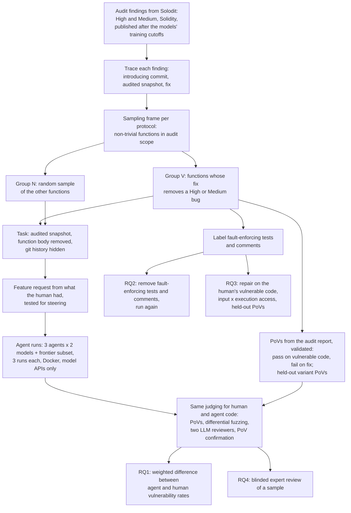

# Same Feature, Same Exploit: Do AI Coding Agents Write Less Secure Smart Contracts Than Human Developers?

Proposal version 1, 21 October 2026. Author: Peer A (Claude Code). Literature: `proposal_workspace/lit_review.md` and the search files in `proposal_workspace/lit/`.

## 1. Abstract

AI coding agents now write production code, and in a smart contract one bug can drain user funds. Benchmarks show that agent-written code is often insecure. But they build their tasks only from code where a human wrote a bug, so they cannot say whether agents are more or less secure than the developers they replace. We propose a matched comparison on audited Solidity protocols. Each task removes one function from the audited code, and an agent rewrites it from a feature request that carries only what the human knew. We sample functions from two groups whose sizes we know: functions where the audit found a High or Medium bug, and all others. The same checks judge the human's code and the agent's code: executable exploits, differential fuzzing, and two LLM reviewers whose reports count only when an exploit confirms them. We also test whether the repository's own tests, which sometimes assert the bug, carry the human's mistake to the agent.

## 2. Problem and motivation

**Developers hand code to agents, including smart-contract code.** In the Solidity Developer Survey 2025 (1,095 responses), 58% of respondents use AI tools daily and 49% use them to write code; 61% name Claude Code as their preferred assistant, and 45% distrust the output [Solidity 2026]. On GitHub, the AIDev dataset already holds 932,791 pull requests written by coding agents [Li et al. 2026, AIDev].

**In a smart contract, a bug is a direct loss.** Contracts hold user funds, anyone can call them, and they are hard to change after deployment. Losses now come mostly from code logic. DeFi protocols lost $680 million in 2025, and infrastructure failures such as key compromise fell from 30.7% of DeFi losses in 2022 to 10.3% in 2025 [Immunefi 2026]. From DeFiLlama's public incident data (downloaded 21 October 2026), Solidity DeFi protocols lost $411.5 million in 2025, and 45.1% of it came from logic and accounting bugs [DeFiLlama, our computation]. These bugs are hard for tools: over 80% of 516 exploitable bugs from audit contests were beyond existing tools [Zhang et al., ICSE 2023], static analysers miss about half of labelled Solidity vulnerabilities at no more than 10% precision [Li et al., FSE 2024], and tools would have stopped attacks worth only 8% of the losses in 127 incidents [Chaliasos et al., ICSE 2024].

**The first loss linked to agent-assisted Solidity has happened.** In February 2026, a Moonwell governance proposal priced cbETH with the raw cbETH/ETH rate and left the protocol with $1.78 million of bad debt. The pull request behind it had commits co-authored by Claude Opus 4.6. News reports and the OECD AI Incidents Monitor linked the incident to AI-assisted code; Moonwell itself did not blame AI [Moonwell 2026].

**What we know about agent code, and what we do not.** Benchmarks built from real vulnerabilities show that agent code is often insecure. In SusVibes, the best setup passes the functional tests on 57.0% of 186 Python tasks, but only 11.8% of its solutions are also secure [Zhao et al., ICML 2026]. In SecureVibeBench, the best setup is correct and secure on 23.8% of 105 C/C++ tasks [Chen et al., ACL 2026]. The Last Secure Code Benchmark reports 16.4% to 25.1% across seven languages [Wu et al. 2026]. These numbers do not say whether agents are worse than the developers they replace. All three benchmarks build every task from code where a human wrote a vulnerability, so the human's failure rate on them is 100% by construction. Earlier studies that compare a model with the human at the place where the human erred have the same limit: Copilot repeated 33.3% of 153 human C/C++ vulnerabilities [Asare et al., EMSE 2023], and a fine-tuned GPT-J repeated 71% of 173 Solidity vulnerabilities [Storhaug et al., ISSRE 2023]. Studies that mine agent and human pull requests disagree: one finds 1.14 times the human rate of Semgrep findings in agent code [Xia and Miller 2026], another finds agents less likely to have security smells (odds ratio 0.63) [Kraishan 2026], and a third finds Semgrep findings in 11.5% of 21,454 agent pull requests against 12.8% of 8,103 human ones [Le et al., FPS 2026]. All three judge with static analysers, on different tasks for the two sides.

**The question a team needs answered is comparative.** A team that lets an agent write a function wants to know whether the code will carry more or fewer exploitable bugs than if one of its own developers had written it. That decides how much review the team must keep. We found no study, in any language, that compares agents with human developers on the same functions with a control group of functions the human wrote correctly, and none that judges both sides with the same executable exploit (literature review, section 3).

## 3. Key insight and contributions

**Insight 1. The comparative question needs both kinds of functions, weighted by how common each kind is.** Compare an agent with the human developer over the same set of functions. Two things can differ. The agent can avoid a bug the human wrote, or it can add a bug where the human wrote correct code. Benchmarks built from vulnerability-introducing commits see only the first. They measure how often the agent repeats the human's bug. The second needs functions the human got right. The overall answer also depends on how many functions of each kind there are. In an audited codebase, most functions have no High or Medium finding, so a small rate of new bugs on those functions can outweigh a large rate of avoided bugs on the few vulnerable ones. Audited codebases give everything needed to measure both. The audit report says which functions had a High or Medium bug. The repository holds every function the developers wrote, so we can count both groups and sample from each. This is stratified sampling with known group sizes, a standard design in statistics that, as far as we found, no study of AI-written code has used.

**Insight 2. The repository can carry the human's mistake to the agent.** In a real repository, the developer's own tests and comments often describe the vulnerable behaviour as intended. A test that passes on the faulty code and fails on the correct code is called a fault-enforcing test [Charoosaei et al. 2026]. An agent reads such tests, and an agent that can run them tries to keep them passing. Our pilot shows this on one finding. In finding 63008, the audited test file has four fault-enforcing tests, and the function's parameter comment calls the start tick "exclusive", which is the bug. In a repair study with GPT-5.4-mini under OpenHands, the agent repaired the bug in 10 of 12 runs when it could run nothing and in 2 of 12 runs when it had a terminal. With the terminal, 7 of 12 repairs still passed all four fault-enforcing tests. Other evidence points the other way. A controlled study of execution access found almost no effect on SWE-bench [Lin et al., ISSTA 2026], and a general-purpose agent with full tools repaired more Java vulnerabilities than restricted agents [Xu et al. 2026]. Fault-enforcing tests can explain the difference: running tests helps when the tests are right and hurts when they assert the bug. Agents also tend to keep flawed work they find in the repository: started from an earlier agent's wrong solution, they kept 86% to 99% of its lines in failed runs [Li et al. 2026, SWE-Residual]. If this holds across findings, two things follow. Part of what looks like "the agent repeats the human's bug" is the agent following the human's tests and comments. And more execution feedback can make a security repair worse.

**Insight 3. The feature request can decide the outcome.** In our 8-finding pilot, every request written from the vulnerable function passed either the human's design or the fix's rule to the agent. When the request described the human's design, all 13 compiled runs wrote the bug. When it stated the rule the fix restores, 3 of 15 did (Fisher's exact p = 0.00002). Other work finds that a change of one character in a prompt can turn secure generated code into vulnerable code [Sternfeld et al. 2026]. Existing benchmarks write requests from the human's patch [Chen et al., ACL 2026] or require the request to justify every line of the fixed code [Zhao et al., ICML 2026], which can steer the agent toward one version. A fair comparison must give the agent only what the human knew, and must measure whether the request steers.

**Contributions.**

1. **A matched design for comparing agents with human developers.** Two groups with known sizes from audited codebases, the same judging for both authors, and a weighted estimate of the difference in vulnerability rates with a confidence interval. The design removes the selection problem of benchmarks built only from human mistakes.
2. **A benchmark of audited Solidity functions built with this design.** Each vulnerable function has executable proofs of vulnerability (PoVs) that pass on the human's code and fail on the human's fix, plus held-out variant PoVs. Each feature request is built only from what the human had, and is tested for steering. Each task records whether the repository's tests or comments assert the vulnerable behaviour.
3. **One judging procedure for human and agent code,** with its sensitivity measured on the human's audit-confirmed bugs and its misses estimated with capture-recapture between the audit and our checks.
4. **Results for six agent configurations and a frontier subset,** a controlled test of Insight 2 on first-round writing, and a repair study that tests whether fault-enforcing tests decide when execution access helps or hurts, judged by held-out PoVs and the funds an attacker can still take.

## 4. Threat model and problem setting

**Setting.** A protocol team develops a Solidity codebase. A developer asks a coding agent to implement one function inside the existing codebase, from a feature request. The agent can read the repository. In some configurations it can also run the compiler and the tests. The code is then deployed, possibly after review. We compare it with the same function written by the team's own developer, at the same point in the codebase.

**Assets.** User funds held or accounted for by the protocol, the protocol's solvency, and the availability of its core functions.

**Attacker.** Any external account. The attacker can deploy contracts, call any public or external function, borrow with flash loans, choose the order of its own transactions within a block, and act across several blocks. The attacker cannot break cryptography, steal keys, act as a privileged role (owner, admin, keeper) unless the finding's own severity assessment assumes it, compromise the developer's machine or the agent, or change the deployed code.

**The agent and the developer are honest.** We study accidental vulnerabilities. Prompt injection into the agent, malicious dependencies and poisoned training data are a different threat model and out of scope.

**What counts as a vulnerability.** A version of the function is vulnerable if an unprivileged attacker can send a sequence of transactions that causes a High or Medium impact, and the same sequence does not cause it on the reference version. High and Medium follow the audit platforms' severity rules: theft or loss of funds, permanently frozen funds, insolvency, or denial of a core function. A vulnerability counts only when an executable PoV confirms it: a Foundry test that passes on the version and fails on the reference, run offline on a local copy of the protocol with mock tokens. The reference is the human's fix for a vulnerable function, and the human's code for any other function.

**Out of scope.** Low and informational findings, gas use, centralization risk, and bugs in code the agent did not write. The PoV runs against the whole protocol, so the effect of the agent's function on other code counts.

## 5. Approach

### 5.1 Selecting findings

We reuse the project's selection pipeline (IDEA.md, "How findings are selected"). It downloads High and Medium Solidity findings from Solodit, keeps findings that link to a whole Solidity file, checks that the file is complete and that the report matches the code, and keeps findings published after the models' training data. Of 19,666 findings downloaded, 7,826 link a whole file, and 77 are dated September 2025 to January 2026. 43 of the 77 have a public history that lets us trace the bug.

This pool is too small and too concentrated: 59 of the 77 findings come from Code4rena, from 20 protocols. We will refresh the download to cover findings published up to the start of the study. We will also add findings whose report links the contest repository rather than a whole file. The 77 findings came from about four months, so the refresh over the nine months since January 2026 should add roughly twice as many, of which about half will have public history [estimate from the pilot's yield; to be measured]. The target is at least 60 vulnerable functions from at least 25 protocols. If the yield falls short, section 8 gives the fallback.

### 5.2 Two groups with known sizes

For each protocol, the **sampling frame** is every function in the audit's scope that (a) changes state or computes a value that other code uses, (b) has at least five statements, and (c) is reached by the repository's tests or by an external call path. Plain getters and one-line wrappers are left out, because they would make any author look safe.

- **Group V** holds the frame functions that contain the root cause of a High or Medium finding, as shown by the fix (section 5.3). We map every High and Medium finding of the audit, including those we do not turn into tasks.
- **Group N** holds all other frame functions. We sample N at random within each protocol, two per task from group V.

The counts of both groups give the share of vulnerable functions, π, for each protocol and overall. The analysis weights by these counts (section 6.2). We record which sampled N functions come from the same commit as a group V function, to check whether that matters. The pilot's control functions for finding 63008 came from the same commit; the full study samples at random so that the weights apply.

### 5.3 Tracing a finding

The pilot traced findings with `git blame` on the lines the report names, and took the commit that last changed most of them. For vulnerabilities, the last change is often a refactoring. V-SZZ instead takes the earliest commit that touched the vulnerable lines [Bao et al., ICSE 2022]. Even so, on 1,128 C/C++ vulnerabilities no tracing tool exceeded 45.0% accuracy in finding the affected versions [Chen et al. 2025]. We will use the V-SZZ rule, check every result by reading the diffs, and record the cases where the two rules disagree. In the pilot, `git blame` pointed at a later rewrite for finding 63008, and reading the history found the real introducing commit. Squash merges hide many fix commits, so a person confirms each fix by searching the merged diffs for the change the report describes.

### 5.4 Task framing

Each task starts from the audited snapshot, with the target function's body replaced by `revert("not implemented")`. The signature stays, so the code compiles. The git history is replaced by a single commit, so the agent cannot read the human's code from history. In the pilot, one agent read the human's function from `git log` before we hid it, and a 2026 study found agents reading the fix from git history in most tasks of another benchmark [Luo et al. 2026].

We start from the audited snapshot and not from the parent of the introducing commit, because in 7 of the 8 pilot findings the parent already had the bug or did not have the feature yet. This choice has a cost. The agent sees code and tests written after the human wrote the bug, and some of them describe the bug as intended. RQ2 measures this effect instead of assuming it away.

### 5.5 Feature requests

A request may contain only information the human developer had before writing the code:
- the function's signature and the code around it at the snapshot, without the target body;
- the issue, the pull-request description and the commit message of the introducing commit, when they exist;
- the protocol's documentation and specification, when they predate the commit.

The writer is an LLM that is not under study. It never sees the target body, the finding or the fix. Each sentence of the request is tagged with its source, and a person checks the tags.

Then we test each request for steering, in three steps:
1. **Points that separate the two versions.** An LLM lists each point of the request and says whether the human's vulnerable version and the human's fix each satisfy it. A point that only one version satisfies is a hint. We remove or rewrite it, unless a source the human had states it. Then it stays, and we record it.
2. **Steering test.** A panel of three LLMs, from vendors whose models are not under test, sees the two versions in random order, once with the request and once without it, and says which version better implements the function. If the request moves the panel toward either version by more than a margin fixed in advance, the request steers, and we rewrite it. Comparing "with" against "without" removes the panel's own preference for the version that looks safer.
3. **Human check.** A person answers the pilot's two questions for every request: does it prescribe the check that the attack gets around, and does it state the rule that the fix adds?

For functions in group N there is no vulnerable version, so we run steps 1 and 3 against the human's code only. As a robustness condition on a subset, agents also get a minimal request: the signature and the function's existing comments only, the usual masked-function framing.

The Last Secure Code Benchmark also has an agent and experts check requests for wording that pushes toward the vulnerable design [Wu et al. 2026]. Our steering test adds a measurement of how far a request moves a judge, and the pilot adds evidence of how far the wording moves agents.

### 5.6 PoVs and held-out variants

For each vulnerable function, we adapt the audit report's proof of concept into a Foundry test. A PoV is kept only if it passes on the human's vulnerable code and fails on the human's fix, offline, at the assertion that carries the vulnerability. We record that assertion. On a new version, an attack counts as blocked only if the PoV fails at the same place. Any other failure (a compile error, a setup failure, an unrelated assertion) is invalid and goes to a person. The pilot needed this rule: agent code that broke the function made the attack stop early, and the first judge counted that as avoiding the bug.

For each finding we also write at least one variant PoV from the security property, not from the report: another boundary, another state, or another call path. Variants are validated the same way, written before any agent run, and kept outside every workspace. PoCo shows that agents can write such Foundry tests from audit findings and check them against the developer's patch [Andersson et al., TOSEM 2026]; we use an agent with the same check, and a person reads every PoV.

### 5.7 Labelling fault-enforcing tests and comments

For each vulnerable function, we run the snapshot's test suite on the human's fix. Tests that pass on the vulnerable code and fail on the fix are fault-enforcing. We also search the target file and its callers for comments that describe the vulnerable behaviour as intended, and a person confirms each one. Finding 63008 has both: four downward iterator tests expect the start tick to be skipped, and the comment `@param startTick The starting tick (exclusive)` states the bug.

### 5.8 Agents and models

Three open agents (Aider 0.86.2, OpenHands SDK 1.53.0, Codex CLI 0.160.1) with two models (GPT-5.4-mini and Claude Sonnet 4.5) give six configurations, the same as in the pilot. Their training data ends before September 2025, the date of the oldest finding. To keep the results from describing only older models, we add one frontier configuration per vendor on the tasks published after its training cutoff. A reviewer never judges code written by a model of its own family; such versions get the other reviewer and a third reviewer from another vendor.

Each configuration runs three times on each task. The pilot's intraclass correlation of 0.69 means that more tasks help far more than more runs; three runs are enough to estimate run-to-run variation. Agents run in Docker with 6 GB of memory and a 20-minute limit. Their only network access is a proxy that allows the model APIs. Codex's hosted web search is off, and Codex gets a short note asking it to work offline, because the other agents have no web tool. These are the pilot's settings (IDEA.md, Method).

### 5.9 One judging procedure for human and agent code

Every version is judged the same way, whoever wrote it, and the judge is not told who wrote it.

1. **Build and functional tests:** the project's tests for the function, without the fault-enforcing tests, which are reported separately.
2. **Known-bug PoVs and variants** for group V. They also run on the human's version, where they pass by construction.
3. **Differential fuzzing.** A harness deploys two copies of the protocol that differ only in the target function: the version under test and the reference. It sends both the same transaction sequences, generated by Foundry's stateful fuzzer and seeded with the project's tests and the PoVs, and compares what an outside party can see: token balances, return values, reverts, and the storage the function writes. Differences are grouped and passed to step 5. The harness follows Diffusc, an open-source tool that writes Echidna harnesses which call the same function on two versions of a contract with the same inputs and compare the results [Trail of Bits 2023]. An LLM adapts the harness to each function, and we validate it: it must report no difference when both copies are the reference, and it must find the difference between each human vulnerable version and its fix. SlicePatch used the same idea, attack variants sent to the original and the patched program, to find web patches that PoC replay had passed [Wang et al., S&P 2026].
4. **LLM review.** Two reviewers from different vendors read the function, its callers, the request and the audit's known findings, and report every High or Medium flaw as JSON with a concrete attack sequence. The prompt is the same for every version and does not say who wrote the code. This is the pilot's review prompt, which found a real new vulnerability in two agent versions of a control function.
5. **Confirmation.** Each difference and each reported flaw becomes an attempt, by an LLM agent working offline, to write a PoV. A flaw counts only if a PoV passes on the version and fails on the reference. A person reads every confirmed PoV. LLM judgments of vulnerabilities are unreliable on their own [Ding et al., ICSE 2025], and an agentic LLM review repeated five times on the same code reported half of its extra findings only once [Tal et al. 2026]. That is why only confirmed flaws count. On a random 10% of versions we run each reviewer twice, to measure how stable the reports are.
6. **Sensitivity.** We run steps 3 to 5 on the human's vulnerable functions without telling the reviewers about the finding. The share of known bugs found again estimates the procedure's sensitivity.
7. **Misses.** The audit and our procedure are two independent detectors of bugs in the human's code. Capture-recapture over the bugs each one finds estimates how many both miss [Briand et al., TSE 2000; El Emam and Laitenberger, TSE 2001]. We report the agent and human rates with and without this correction.
8. **Expert review** of a blinded sample (RQ4).

### 5.10 Repair study

The repair study starts every agent from the human's vulnerable code, so all agents start equal. It changes two things:
- **What the agent is told:** only the function's location (L), the audit report without its proof of concept and recommended fix (R), or the shown PoV as a failing test with its output (P).
- **What the agent can run:** nothing (E0), or a full terminal (E2). A middle level, only the shown test through a fixed script (E1), runs on a subset.

A repair succeeds only if it compiles, blocks every frozen attack at its recorded assertion (the shown PoV, the other PoVs and the variants), passes the functional tests, and has no confirmed new High or Medium flaw. For every repair that blocks the shown PoV but not another one, we measure the funds the remaining attack still takes. The pilot ran this design on finding 63008 with 144 runs (section 6.4).

### 5.11 Worked example: finding 63008

**The finding.** Sorella L2 Angstrom, a Uniswap v4 hook audited by Cyfrin; the report was published in October 2025. High severity: "All rewards can be stolen due to incorrect active liquidity calculations when the current tick is an exact multiple of the tick spacing at the upper end of a liquidity range."

**Tracing.** The audited snapshot is commit `386baff`. `git blame` pointed at a later rewrite. Reading the history showed that the faulty line was written in commit `661468b`. The fix is commit `c01b6c7`, which changes `TickIterator.sol`.

**Groups.** The bug is in `reset(TickIteratorDown)`: the downward walk sets `currentTick = startTick` and then advances, so it skips its start tick. That function is in group V. The same commit also wrote the mirror function `reset(TickIteratorUp)` correctly, and `calldataToId`. In the pilot, both served as control functions.

**Request.** The pilot's request described the walk as a check: start from the active liquidity at the start tick, subtract the net liquidity of each tick the walk returns, and the result must equal the active liquidity at the end tick. Its writer had read the finding, so it was not built with the procedure of section 5.5. The pilot report classed it as stating the fixed behaviour.

**PoVs.** The report has three proofs of concept. P1 swaps to a boundary, adds liquidity and swaps back. P2 swaps down from a boundary tick, and the swap reverts. P3 steals all rewards. All three pass on `386baff` and fail with the fix's `TickIterator.sol`. In P3's scenario, an honest liquidity provider has 49 ETH of pending rewards; the attacker takes 48.88 ETH net, and with the fix the attacker ends 0.098 ETH down. Two held-out variants were written later: P4 (tick spacing 60, start and end in the same bitmap word) and P5 (a start at a bitmap word boundary).

**Fault-enforcing tests and comments.** Four downward tests in `test/libraries/TickIterator.t.sol` expect the start tick to be skipped, and the parameter comment says "exclusive".

**Agent runs.** Six configurations, one run each. Four of six wrote the human's bug. Two wrote the fix's line, `self.currentTick = startTick + 1`. Codex with Sonnet 4.5 ran the human's iterator tests twice and saw all 28 pass, because the downward tests expect the bug.

**Judging the control functions.** The two LLM reviewers reviewed the human's code and every agent version that compiles. Two of 11 agent versions of the control functions added the same new vulnerability: a swap that stays on one tick reverts, and a position that is not active takes rewards. Two new PoVs passed on both agent versions and failed on the human's code. One other report was rejected, because the human's code behaves the same way.

**Weighted comparison (an illustration only).** The agents repeated the human's bug in 4 of 6 runs and added a new vulnerability in 2 of 11 compiled runs on correct human functions. If 10% of frame functions were vulnerable, the agents' rate would be 0.1 × 4/6 + 0.9 × 2/11 ≈ 23%, against the human's 10% plus whatever the checks find in the human's other functions. One finding cannot support a conclusion; the example shows why the second term matters.

**Repair.** In the masked-PoV repair round, one repair blocked the shown P2 while held-out P3 still took 48.88 ETH. In the 144-run repair study, OpenHands with GPT-5.4-mini succeeded in 10 of 12 runs with nothing to run and in 2 of 12 runs with a terminal; with the terminal, 7 of 12 repairs kept all four fault-enforcing tests passing.

## 6. Research questions and evaluation plan

### 6.1 Research questions

- **RQ1 (comparison).** On the same functions, do AI coding agents write High or Medium vulnerabilities more or less often than the human developers did?
- **RQ2 (cause).** Do fault-enforcing tests and comments carry the human's bug to the agent? What else predicts an agent vulnerability: the request, the agent's tools, the model?
- **RQ3 (repair).** When an agent repairs a known vulnerability, does a shown PoV help more than a written report, and does execution access help or hurt? Does the answer depend on whether the repository has fault-enforcing tests?
- **RQ4 (judges).** How well do the automatic checks agree with blinded expert auditors?

### 6.2 RQ1: measures and estimate

For each configuration, the outcome of one run is whether the function it wrote has a confirmed High or Medium vulnerability. Versions that do not compile or fail the functional tests are reported separately and never counted as secure.

Let π be the share of frame functions in group V. Let a_V and a_N be the agent's vulnerability rates in the two groups, and h_N the human's rate in group N, found by the same checks. The human's rate in group V is 1. The difference between agent and human is

Δ = π (a_V − 1) + (1 − π) (a_N − h_N).

The first term is what the agent gains by avoiding the human's bugs. The second is what it loses by adding new ones. We estimate a_V, a_N and h_N from the stratified sample and take π from the counts of section 5.2. A bootstrap that resamples protocols, then functions within them, then runs, gives the 95% interval for Δ. We also report the two terms separately, by configuration and by protocol.

**Sample size.** The table gives the smallest Δ that each design detects with 80% power at two-sided α = 0.05, for one configuration. It assumes π = 0.10, a_V = 0.6, h_N = 0.02, n_V = n_N / 2, three runs per function, and the pilot's intraclass correlation of 0.69 (design effect 2.38).

| Group N functions | a_N = 0.05 | a_N = 0.15 | a_N = 0.25 |
|---|---|---|---|
| 60 | 0.081 | 0.115 | 0.135 |
| 120 | 0.057 | 0.081 | 0.096 |
| 180 | 0.047 | 0.067 | 0.078 |

With the target of 60 group V and 120 group N functions, the study detects a difference of about 8 percentage points per configuration if agents add bugs to 15% of correct functions. Pooling configurations narrows the interval further.

**Preregistration.** The primary outcome, Δ for each configuration with Holm's correction across the six, the analysis and the stopping rules are registered on OSF before the first run.

### 6.3 RQ2: a controlled test, then predictors

**Controlled test.** For every group V function whose repository has fault-enforcing tests or comments, we run each configuration twice more: with the repository as it is, and with those tests and comments removed. Everything else stays the same. Insight 2 predicts that removing them lowers the rate at which agents write the human's bug, and lowers it more for agents that can run tests. The primary test is a mixed-effects logistic regression of "the version has the human's bug" on condition, execution access and their interaction, with random effects for function and configuration.

**Predictors.** Over all runs, a mixed-effects logistic regression of "the version is vulnerable" on group (V or N), the request's steering score, fault-enforcing tests present, agent, model and the agent's logged actions (whether it read or ran the tests), with random effects for protocol and function. This part is exploratory.

### 6.4 RQ3: repair

Tasks are the group V functions with at least one held-out PoV. Arms: L-E2, R-E2, P-E2 and P-E0, each with two configurations and two runs. The two primary contrasts are fixed before the runs and corrected with Holm's method: P-E2 against R-E2 (does a shown PoV beat a report?) and P-E0 against P-E2 (does a terminal help or hurt?). The presence of fault-enforcing tests is a planned moderator of the second contrast. Insight 2 predicts that a terminal helps when the repository has no fault-enforcing tests and hurts when it has them.

The pilot on finding 63008 found, for OpenHands with GPT-5.4-mini: L-E2 0 of 12, R-E2 5 of 12, P-E2 2 of 12, P-E0 10 of 12. These come from one finding and only motivate the design.

### 6.5 RQ4: agreement with experts

Two auditors with contest experience, paid, review a blinded, stratified sample of about 150 versions: human and agent, both groups, judged vulnerable and not. They see the function, its callers and the request. We report Cohen's κ between each automatic check and the experts, and between the two experts, and the sensitivity and specificity of the full procedure against the experts' consensus.

### 6.6 Baselines

- For RQ1, the human developer is the baseline.
- For the judge, we compare our procedure with the judges prior Solidity benchmarks use: a static analyser (Slither, as in SolAgent [Chen et al. 2026]) and a single LLM judge. We report how RQ1's answer changes with each weaker judge.
- For RQ3, arm L is the baseline, and arm R matches repair from a written report, as in prior LLM repair studies [Pearce et al., S&P 2023].
- Agents: the six configurations are open agents with controllable settings, and the frontier configurations cover the strongest current models on the tasks their training cutoffs allow.

### 6.7 Ablations

- Minimal request against tested request (section 5.5).
- Repository as is against fault-enforcing tests and comments removed (section 6.3).
- Each judging step removed in turn, to show what it adds.

### 6.8 Threats to validity

- **Contamination.** A finding published after a model's cutoff can still involve code that was public earlier, and code models repeat a human's bug more often when they saw the buggy version in training [Al-Kaswan et al., MSR 2026]. We record when each introducing commit and each fix became public, analyse tasks whose vulnerable code postdates the model's cutoff separately, and run a memorization probe: we give the model the code before the function and check whether it writes the human's body, or the fix, word for word.
- **The agent sees more than the human did.** The audited snapshot includes later code and tests (section 5.4). RQ2's controlled test measures the main effect.
- **The audit misses bugs.** Some group N functions are vulnerable; labels that ignore later-found vulnerabilities can reverse results [Jimenez et al., FSE 2019]. The judging runs on the human's group N functions as well, and capture-recapture estimates the misses.
- **The checks miss bugs in agent code.** We measure their sensitivity on the human's known bugs and with the experts.
- **Which findings become tasks.** Linked fixes are a biased sample of all fixes [Bird et al., FSE 2009], and findings whose report has a proof of concept are easier to turn into PoVs. We report how the tasks differ from all group V functions.
- **One ecosystem.** The results hold for audited Solidity protocols.
- **Agents and models change fast.** We pin versions, keep every log, and release the harness so that new agents can run on the same tasks.

## 7. Related work

The literature review (`proposal_workspace/lit_review.md`) gives the full search. The closest work falls into five groups.

**Benchmarks built from real vulnerabilities, without a human comparison.** SusVibes [Zhao et al., ICML 2026], SecureVibeBench [Chen et al., ACL 2026], the Last Secure Code Benchmark [Wu et al. 2026] and SecRepoBench [Shen et al. 2026] remove code where a human wrote or fixed a vulnerability and ask agents to write it again. Every task is a human failure, so none reports a human rate or has a control group. SecureVibeBench compares agent and human code only through Semgrep, and half of its flags were false alarms on manual check.

**Rewriting code where a human erred.** Asare et al. [EMSE 2023], Jesse et al. [MSR 2023], Guo et al. [2025] and Storhaug et al. [ISSRE 2023] let a model complete code at the place a human introduced a bug. They judge by matching text with the human's buggy or fixed code, run nothing, and sample only human failures; Guo et al. add ordinary code as a contrast.

**Agent versus human at scale.** Sajadi et al. [2025] compare agent and developer patches for the same SWE-bench issues, and Xia and Miller [2026], Kraishan [2026] and Le et al. [FPS 2026] mine agent and human pull requests. All judge with static analysers, and their conclusions disagree. Al-Kaswan et al. show that whether a model repeats a human's bug depends on whether it saw the buggy code in training [MSR 2026]. In Solidity, SolAgent compares Slither warnings in agent files with the human files [Chen et al. 2026], and Khalid and Brown compare function only [BSCI 2025].

**Agents and smart-contract security.** EVMbench has agents detect, patch and exploit 117 Code4rena vulnerabilities and grades patches with exploit tests the agent never sees [Wang et al., ICML 2026]. It notes that some existing tests "rely on vulnerable logic" and excuses them at grading, but does not study them. CyberChainBench [Huang et al. 2026] replays real attacks, and SCONE-bench [Xiao et al. 2025] and A1 [Gervais and Zhou 2025] exploit deployed contracts. PoCo [Andersson et al., TOSEM 2026], SmartPoC [Chen et al., ASE 2026] and V2E [Zhang et al., FSE 2026] generate executable PoCs for findings. Bobadilla et al. judge smart-contract repair tools with exploits [TSE 2025]. None has agents write a feature that a human wrote, and none compares with the human.

**Repair judged by held-out exploits or tests.** P2Patch [Iranmanesh et al. 2026], PatchBench [Shen et al. 2026], PVBench [Yu et al. 2026], SlicePatch [Wang et al., S&P 2026], AutoPatchBench [Meta 2025, industry report], SecTDD [Liang et al. 2026] and Ahmed et al. [FSE Companion 2026] show that patches which pass the shown PoC or test are often still wrong, following the overfitting work of Smith et al. [FSE 2015]. In AutoPatchBench about 60% of patches stop the shown crash, but only about 5% to 11% pass the later fuzzing and the comparison with the developer's fix; in SlicePatch, PoC replay alone missed 35.70% of patch failures. The F.L.A.W.E.D. report varies shell access and prompt content and finds models patching only the reproducer's path [Mierczuk et al. 2026, industry report]. Lin et al. vary execution access on SWE-bench and find no effect [ISSTA 2026], and Xu et al. find a general agent with full tools the best Java patcher [2026]. Le et al. change PoC access and build-and-test instructions for one agent on 112 C/C++, Go and Rust bugs and judge with the developers' tests, which the agent never sees [Le et al. 2026]. Showing the PoC raised PoC passing far more than passing of the hidden tests, and 32.7% of Opus 4.7's PoC-passing patches still failed them. This is the closest precedent for our repair study. It does not vary a written report against a PoV, does not take the terminal away, and does not look at repository tests that assert the bug. ImpossibleBench shows agents exploiting tests that conflict with the task [Zhong et al., ICLR 2026]. Fault-enforcing tests are defined for LLM-written regression tests [Charoosaei et al. 2026], and tools that keep only passing tests end with suites that confirm the bug [Mathews and Nagappan 2024]. No work we found studies human-written fault-enforcing tests during agent repair or first-round writing.

| Work | Real code history | Human comparison | Group of human-correct code | Judge | Agents write a feature | Repair with shown and held-out exploits | Smart contracts |
|---|---|---|---|---|---|---|---|
| SusVibes (ICML 2026) | yes | no | no | tests from the fix | yes | no | no |
| SecureVibeBench (ACL 2026) | yes, introducing commit | Semgrep only | no | PoV + Semgrep | yes | no | no |
| Last Secure Code Benchmark (2026) | yes | no | no | attack tests | yes | no | no |
| Asare et al. (EMSE 2023) | yes | conditional on human failure | no | text match | no (completion) | no | no |
| Storhaug et al. (ISSRE 2023) | labelled contracts | conditional on human failure | no | manual | no (completion) | no | yes |
| Sajadi et al. (2025) | SWE-bench issues | yes | no | static analysers | patches | no | no |
| SolAgent (2026) | repositories | yes | no | Slither counts | yes | no | yes |
| EVMbench (ICML 2026) | audit findings | no | no | hidden exploits | no | held-out only, agent never sees a PoV | yes |
| P2Patch, PatchBench (2026) | CVEs | no | no | held-out PoVs | no | yes | no |
| SlicePatch (S&P 2026) | web CVEs | no | no | PoC + differential fuzzing of attack variants | no | shown PoC, variants held out | no |
| Lin et al. (ISSTA 2026) | SWE-bench | no | no | SWE-bench tests | no | execution access varied | no |
| **This proposal** | audit findings, introducing commit | yes, weighted | yes | PoVs, differential fuzzing, confirmed reviews | yes | yes, with fault-enforcing tests as moderator | yes |

## 8. Risks, limitations and fallback plans

| Risk | Sign | Fallback |
|---|---|---|
| Too few traceable findings | fewer than 40 group V functions after the refresh | add findings that link contest repositories; widen the date window for the older models; report RQ1 with a wider interval |
| PoV construction too slow | more than 2 working days per finding on average | restrict group V to findings whose report has a proof of concept (47 of the 77), and report this selection |
| Differential fuzzing too noisy | most differences are harmless | keep it only as a source of candidates; PoV confirmation decides |
| Requests keep steering | more than a third need three rewrites | fall back to the minimal request for those functions and analyse them separately |
| Too few fault-enforcing tests | fewer than 10 group V functions have them | run RQ2's controlled test on all of them and report it as a case series; add EVMbench tasks whose existing tests "rely on vulnerable logic" if its harness is available [uncertain] |
| Experts unavailable | fewer than two auditors | PhD students trained on contest reports, with lower confidence stated |
| Budget | the first round alone is about 3,240 agent runs | the pilot's runs cost about $0.26 each on average, so the first round costs about $850; review only versions that compile, pass the functional tests and differ from versions already reviewed |
| New flaws in deployed human code | a confirmed PoV on a human group N function | responsible disclosure first (section 9) |

**Limitations.** The study covers one function per task, not multi-function features. The human baseline is the code as audited, before the audit's fixes. The agent works with the repository as it was at the audit, which includes code written after the human's commit.

## 9. Ethics and responsible disclosure

- Every PoV runs offline on a local copy with mock tokens. No test touches a live chain or a deployed address.
- The PoVs for known findings come from public audit reports of bugs that were fixed before deployment.
- If our checks confirm a new vulnerability in deployed human code, we report it to the protocol through its security contact or bug bounty before any publication, and hold back its PoV until it is fixed or 90 days pass.
- Agent code is not deployed anywhere. We publish its flaws in aggregate.
- We release the tasks, requests, harnesses and the PoVs of public findings. We do not release an automatic exploit generator.
- The expert reviewers are paid. We ask the university's ethics board whether the expert study needs review.
- All LLM use in building the benchmark is disclosed.

## 10. Target venues and 12-month timeline

**Primary venue:** ICSE 2028 (research track). **Backup:** USENIX Security 2028 or ACM CCS 2027, with the threat model of section 4 at the front. Deadlines will be checked against each call [uncertain].

| Months (from November 2026) | Work |
|---|---|
| 1-2 | Refresh findings; build the request tests; add the judge's invalid state and expected-failure matching; build and validate the differential fuzzing harness on the 8 pilot findings |
| 2-5 | Build group V and group N tasks, PoVs and variants; label fault-enforcing tests; preregister |
| 5-7 | First-round agent runs and judging; sensitivity runs |
| 6-8 | RQ2 controlled test; repair study |
| 7-8 | Expert review |
| 9-10 | Analysis |
| 10-11 | Writing and submission |
| 12 | Artifact release; disclosure follow-up |

## References

Each entry gives the page opened in the literature search.

- Andersson, Bobadilla, Hobbelhagen, Monperrus. PoCo: Agentic Proof-of-Concept Exploit Generation for Smart Contracts. TOSEM 2026, DOI 10.1145/3816704. https://arxiv.org/abs/2511.02780
- Al-Kaswan et al. Model See, Model Do? Exposure-Aware Evaluation of Bug-vs-Fix Preference in Code LLMs. MSR 2026. https://arxiv.org/abs/2601.10496
- Ahmed, Ganhotra, Shinnar, Hirzel. Investigating Test Overfitting on SWE-bench. FSE Companion 2026, DOI 10.1145/3803437.3805574. https://arxiv.org/abs/2511.16858
- Asare, Nagappan, Asokan. Is GitHub's Copilot as Bad as Humans at Introducing Vulnerabilities in Code? Empirical Software Engineering 28, 2023. https://arxiv.org/abs/2204.04741
- Bao et al. V-SZZ: Automatic Identification of Version Ranges Affected by CVE Vulnerabilities. ICSE 2022. https://baolingfeng.github.io/papers/ICSE2022VSZZ.pdf
- Bird et al. Fair and Balanced? Bias in Bug-Fix Datasets. ESEC/FSE 2009. https://www.cs.ucdavis.edu/~filkov/papers/biasbusters.pdf
- Bobadilla, Jin, Monperrus. Do Automated Fixes Truly Mitigate Smart Contract Exploits? IEEE TSE 2025. https://arxiv.org/abs/2501.04600
- Briand, El Emam, Freimut, Laitenberger. A comprehensive evaluation of capture-recapture models for estimating software defect content. IEEE TSE 26(6), 2000. https://api.openalex.org/works/doi:10.1109/32.852741
- Chaliasos et al. Smart Contract and DeFi Security Tools: Do They Meet the Needs of Practitioners? ICSE 2024. https://arxiv.org/abs/2304.02981
- Charoosaei, Richter, Papadakis. On the Risks of using LLM-Generated Tests for Regression Testing. arXiv 2610.11835, 2026. https://arxiv.org/abs/2610.11835
- Chen, X. et al. Vulnerability-Affected Versions Identification: How Far Are We? arXiv 2509.03876, 2025. https://arxiv.org/abs/2509.03876
- Chen, J. et al. SecureVibeBench: Benchmarking Secure Vibe Coding of AI Agents via Reconstructing Vulnerability-Introducing Scenarios. ACL 2026. https://aclanthology.org/2026.acl-long.1107/
- Chen, L. et al. SmartPoC: Validating Smart Contract Vulnerability Findings through PoC Generation and Execution. ASE 2026, DOI 10.1145/3832783.3834380. https://arxiv.org/abs/2511.12993
- Chen, W. et al. SolAgent: A Specialized Multi-Agent Framework for Solidity Code Generation. arXiv 2601.23009, 2026. https://arxiv.org/abs/2601.23009
- DeFiLlama. Hacks dataset, downloaded 21 October 2026 (our computation). https://api.llama.fi/hacks
- Ding et al. Vulnerability Detection with Code Language Models: How Far Are We? ICSE 2025. https://arxiv.org/abs/2403.18624
- El Emam, Laitenberger. Evaluating capture-recapture models with two inspectors. IEEE TSE 27(9), 2001. https://api.openalex.org/works/doi:10.1109/32.950319
- Gervais, Zhou. AI Agent Smart Contract Exploit Generation. arXiv 2507.05558, 2025. https://arxiv.org/abs/2507.05558
- Guo et al. LLMs are Bug Replicators. arXiv 2503.11082, 2025. https://arxiv.org/abs/2503.11082
- Huang, Jiang, Poovendran, Lin. CyberChainBench. arXiv 2606.26216, 2026. https://arxiv.org/abs/2606.26216
- Immunefi. The Ecosystem Vulnerability Scoreboard: 6 Years of DeFi Loss Data, 2026 (industry report). https://immunefi.com/blog/research/the-ecosystem-vulnerability-scoreboard-6-years-of-defi-loss-data/
- Iranmanesh et al. P2Patch: Exploit-Guided Vulnerability Repair. arXiv 2610.20245, 2026. https://arxiv.org/abs/2610.20245
- Jesse, Ahmed, Devanbu, Morgan. Large Language Models and Simple, Stupid Bugs. MSR 2023. https://arxiv.org/abs/2303.11455
- Jimenez et al. The importance of accounting for real-world labelling when predicting software vulnerabilities. ESEC/FSE 2019. https://api.openalex.org/works/doi:10.1145/3338906.3338941
- Khalid, Brown. Evaluating Capabilities and Perspectives of Generative AI Tools in Smart Contract Development. BSCI 2025. https://vtechworks.lib.vt.edu/handle/10919/137729
- Kraishan. Not All Agents Are Equal. arXiv 2609.17598, 2026. https://arxiv.org/abs/2609.17598
- Li, H., Zhang, Hassan. AIDev: Studying AI Coding Agents on GitHub. arXiv 2602.09185, 2026. https://arxiv.org/abs/2602.09185
- Le, D. K., Shi, Xing. On the Reliability of LLM-Based Vulnerability Patching Benchmarks. arXiv 2610.10150, 2026. https://arxiv.org/abs/2610.10150
- Le et al. On the Security of Agentic Pull Requests in GitHub: An Empirical Study. FPS 2026 (author-hosted PDF). https://ldklab.github.io/assets/papers/fps26-prs.pdf
- Li, K. et al. Static Application Security Testing (SAST) Tools for Smart Contracts: How Far Are We? FSE 2024. https://arxiv.org/abs/2404.18186
- Li et al. SWE-Residual: Evaluating Starting-State Robustness of Coding Agents. arXiv 2610.25899, 2026. https://arxiv.org/html/2610.25899
- Meta. Introducing AutoPatchBench: A Benchmark for AI-Powered Security Fixes. Engineering at Meta blog, 2025 (industry report, part of CyberSecEval 4). https://engineering.fb.com/2025/04/29/ai-research/autopatchbench-benchmark-ai-powered-security-fixes/
- Liang et al. Security Tests as Executable Specifications for LLM Code Generation. arXiv 2608.09740, 2026. https://arxiv.org/abs/2608.09740
- Lin, Zhu et al. To Run or Not to Run: Analyzing the Cost-Effectiveness of Code Execution in LLM-Based Program Repair. ISSTA 2026. https://arxiv.org/abs/2606.26978
- Luo et al. Maintaining Benchmarks Against Increasingly Capable Agents: Detection and Remediation of Unearned Passes. arXiv 2609.34262, 2026. https://arxiv.org/abs/2609.34262
- Mathews, Nagappan. Design choices made by LLM-based test generators prevent them from finding bugs. arXiv 2412.14137, 2024. https://arxiv.org/abs/2412.14137
- Mierczuk, Michaels, Hoodlet. Frontier Models' Vulnerability Patches are Often F.L.A.W.E.D. 1Password industry report, 2026. https://1password.com/files/resources/frontier-models-vulnerability-patches-flawed.pdf
- Moonwell / Anthias Labs. MIP-X43 cbETH Oracle Incident Summary, 2026 (post-mortem); OECD AI Incidents Monitor entry. https://forum.moonwell.fi/t/mip-x43-cbeth-oracle-incident-summary/2068 ; https://oecd.ai/en/incidents/2026-02-18-a018
- Pearce et al. Examining Zero-Shot Vulnerability Repair with Large Language Models. IEEE S&P 2023. https://arxiv.org/abs/2112.02125
- Sajadi, Damevski, Chatterjee. How Safe Are AI-Generated Patches? arXiv 2507.02976, 2025. https://arxiv.org/abs/2507.02976
- Shen, C. et al. PatchBench: Evaluating AI Agents for Vulnerability Patching. arXiv 2609.04075, 2026. https://arxiv.org/abs/2609.04075
- Shen, C. et al. SecRepoBench. LLM4Code 2026. https://arxiv.org/abs/2504.21205
- Smith, Barr, Le Goues, Brun. Is the Cure Worse Than the Disease? Overfitting in Automated Program Repair. ESEC/FSE 2015. https://people.cs.umass.edu/~brun/pubs/pubs/Smith15fse.pdf
- Solidity team. Solidity Developer Survey 2025 Results, 2026. https://soliditylang.org/blog/2026/04/15/solidity-developer-survey-2025-results/
- Sternfeld et al. Minimal Prompt Perturbations Lead to Code Vulnerabilities: Prompt Fragility and Hidden-State Signals. arXiv 2605.29737, 2026. https://arxiv.org/abs/2605.29737
- Tal et al. Snyk VulnBench JS 1.0: Can LLMs Find the Same Bugs Twice? arXiv 2606.15762, 2026. https://arxiv.org/abs/2606.15762
- Trail of Bits (Bodell). Differential fuzz testing upgradeable smart contracts with Diffusc. Blog post, 2023 (tool crytic/diffusc). https://blog.trailofbits.com/2023/07/07/differential-fuzz-testing-upgradeable-smart-contracts-with-diffusc/
- Storhaug, Li, Hu. Efficient Avoidance of Vulnerabilities in Auto-completed Smart Contract Code Using Vulnerability-constrained Decoding. ISSRE 2023. https://arxiv.org/abs/2309.09826
- Wang, J. et al. EVMbench: Evaluating AI Agents on Smart Contract Security. ICML 2026. https://proceedings.mlr.press/v306/wang26k.html
- Wu, T. et al. Last Secure Code Benchmark: Is the Code You Vibe Secure? arXiv 2610.14766, 2026. https://arxiv.org/abs/2610.14766
- Wang et al. Web Application Vulnerability Repair via Context-Aware Fault Localization and Directed Differential Fuzzing (SlicePatch). IEEE S&P 2026. https://seclab.cse.cuhk.edu.hk/papers/sp26-SlicePatch.pdf
- Xu et al. A Systematic Study of LLM-Based Architectures for Automated Patching. arXiv 2603.01257, 2026. https://arxiv.org/html/2603.01257
- Xia, Miller. Do These Violent Delights Have Violent Ends? Measuring the Post-Merge Fate of Agentic Code. arXiv 2607.09902, 2026. https://arxiv.org/abs/2607.09902
- Xiao et al. AI agents find $4.6M in blockchain smart contract exploits (SCONE-bench). Anthropic, 2025 (industry report). https://www.anthropic.com/research/smart-contracts
- Yu et al. Patch Validation in Automated Vulnerability Repair (PVBench). arXiv 2603.06858, 2026. https://arxiv.org/abs/2603.06858
- Zhang, Z., Zhang, Xu, Lin. Demystifying Exploitable Bugs in Smart Contracts. ICSE 2023. https://github.com/ZhangZhuoSJTU/Web3Bugs
- Zhang et al. V2E: Validating Smart Contract Vulnerabilities through Profit-Driven Exploit Generation and Execution. FSE 2026, DOI 10.1145/3808108. https://arxiv.org/abs/2604.13611
- Zhao et al. Is Vibe Coding Safe? Benchmarking Vulnerability of Agent-Generated Code in Real-World Tasks (SusVibes). ICML 2026. https://proceedings.mlr.press/v306/zhao26ax.html
- Zhong, Raghunathan, Carlini. ImpossibleBench: Measuring LLMs' Propensity of Exploiting Test Cases. ICLR 2026. https://arxiv.org/abs/2510.20270
