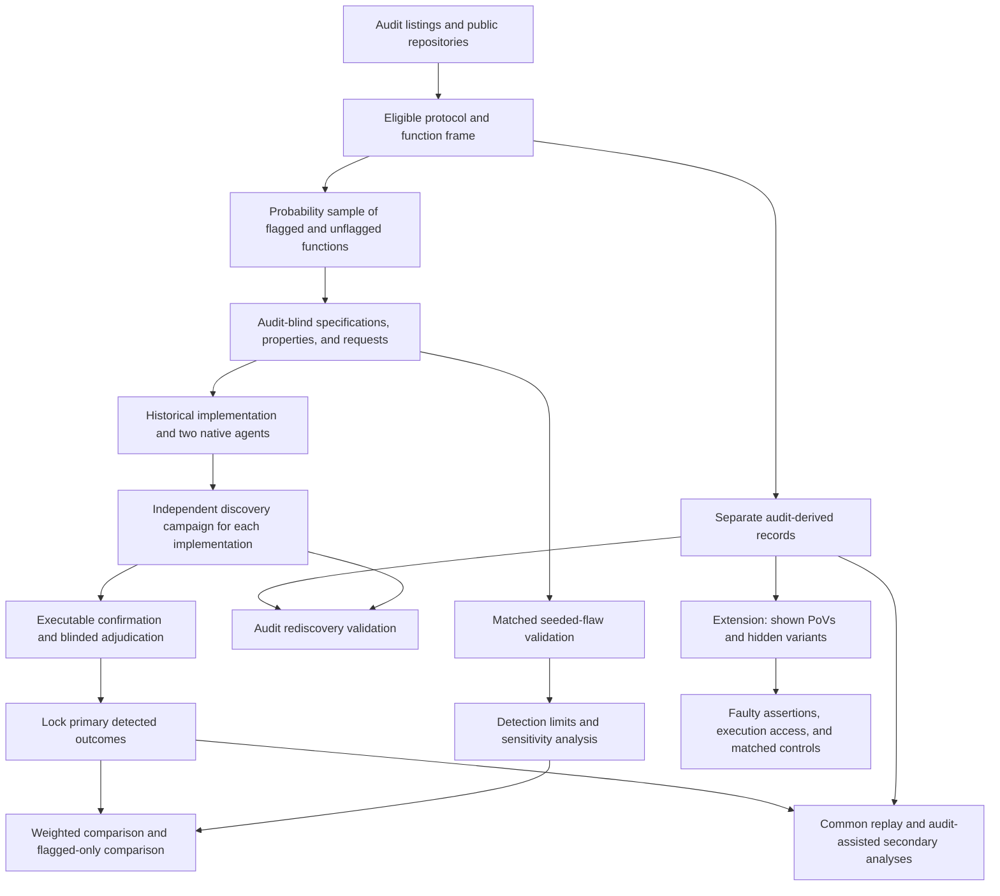

# AI Agent Function-Body Replacements in Audited Solidity: Executable Vulnerability Comparisons with Historical Developer Code

Proposal version 12 (author of this revision: Peer A, Loop 1 round 11, after the iteration-2 meta-review; version 11 was written by Peer B in round 10).

## 1. Abstract

We study AI-generated replacements of individual functions in audited Solidity contracts, compared with the historical developer implementations, which may themselves contain AI-assisted code. A probability sample includes functions linked to audit findings and functions without such labels. Each implementation receives its own discovery campaign that never sees the audit, and its primary candidates are confirmed by a person who has not read the audit. A vulnerability counts only after an executable attack, a correction to the target function body alone, and independent adjudication. The principal estimand is how much an analysis restricted to audit-flagged functions misstates the agent-minus-historical difference, judged against a stated precision target. The study also tests the author difference itself. Protocols are processed in a random order until a fixed date, so the study finishes on time and its precision depends on throughput. Matched seeded flaws, flaws that earlier audits missed, and paid auditors bound detection limits. A complete executable evidence package for one pilot finding is included. A study of faulty test assertions during repair is specified as an extension.

## 2. Problem and motivation

Solidity developers already use AI tools. The Solidity Developer Survey 2025 reports that 58% of respondents use them daily and 49% use them to write code [Solidity Survey]. These are self-reports. They establish relevance, not the security of generated code.

Security failures in contracts can transfer funds or prevent legitimate operations. In a study of 516 exploitable smart-contract bugs, more than 80% were beyond the automated tools examined [Web3Bugs]. A separate study found substantial limitations in Solidity static analyzers [SAST Study]. These results motivate executable evidence of specific attacker effects.

Existing benchmarks answer several useful but different questions. SecureVibeBench reconstructs tasks around historical vulnerabilities and applies executable checks to developer and agent implementations [SecureVibeBench]. SusVibes evaluates functional and security outcomes on reconstructed vulnerable tasks [SusVibes]. Foresight-SWE studies tasks associated with later-fixed general defects [Foresight-SWE].

Selecting functions because a developer previously failed cannot establish the average difference across other functions. Agents might avoid known mistakes while introducing different vulnerabilities elsewhere. Conversely, a benchmark of historical failures may exaggerate the apparent advantage of replacement.

Unconditional comparisons are not new. Sajadi et al. compare human and agent patches for the same issues [Patch Security]. Cotroneo et al. compare human and AI functions paired by documentation [Cotroneo]. SolEval already regenerates function bodies in real Solidity repositories [SolEval]. SolAgent compares generated and historical Solidity using static analysis [SolAgent].

The first paper asks whether including unflagged functions changes the conclusion under executable security evaluation. Its contribution must be demonstrated on the collected data. Probability weighting alone is not a new technique.

A specified extension concerns repair. Existing research already shows that incorrect tests can mislead agents [ImpossibleBench; ExecCritic; Calibration]. We ask a narrower question: does executing assertions that endorse an exploitable behavior preserve that behavior despite contrary PoV evidence, beyond the effect of ordinary incorrect assertions?

Neither paper estimates how much human review developers can safely remove.

## 3. Key insight and contributions

### Paper 1: measure how much flagged-only sampling changes the comparison

Audit labels define sampling strata. They are not security verdicts.

The core study includes functions linked to qualifying findings and functions without those labels. It reports:

- the comparison restricted to flagged functions;
- the weighted comparison over the eligible population;
- the difference between those estimates, for each agent configuration, and any change in agent ranking.

That difference is the principal estimand (RQ1a). V functions are chosen because the historical code failed, so when detection is good the direction of the difference is predictable. What matters is its size. We state the smallest difference that matters to a benchmark builder (0.10 in detected D), set a precision target, and choose the allocation that meets it (section 6.4). A result is called "little difference" only if its calibrated interval lies inside ±0.10, which the planned precision will rarely allow. If no affordable allocation meets the target, the design difference is reported as a secondary estimate, and paper 1 rests on the author comparison (RQ1b) and its validated benchmark.

### Count discoveries made under a common procedure

An audit gives historical code an extra source of known vulnerabilities. Replaying audit-derived attacks does not provide an equally strong search for different agent flaws.

The primary endpoint therefore uses only flaws found by each implementation’s own campaign. Every campaign follows the same procedure and budget. It receives no audit report, finding list, audit-derived PoV, or audit-derived reference correction.

Pooling discovered attacks can also favor flaws shared by many agent attempts. For that reason, common replay is a separate analysis. It does not retroactively change the primary campaign label.

This defines a comparison of **detected vulnerabilities under a stated procedure**. It does not establish equal sensitivity or compare all latent vulnerabilities.

### Keep functionality separate from security

The primary endpoint counts implementations that compile, pass ordinary functional checks, and contain a confirmed vulnerability.

The study also reports compiled vulnerable outputs that fail functional checks. Failed implementations stay in the denominator. A lower vulnerability count caused by failed generation is not evidence of better security.

### Planned extension: distinguish security effects from ordinary test obedience

The pilot motivates a hypothesis but does not establish it.

In the repair study, the two preregistered OpenHands contrasts were:

- adding the shown PoV, with a full terminal in both arms (L-E2 against P-E2): 0 of 12 successes versus 2 of 12, with Holm-adjusted p = 0.96;
- allowing the shown PoV to be rerun: 10 of 12 versus 9 of 12, with Holm-adjusted p = 1.00.

The exploratory comparison between no execution and a full terminal was 10 of 12 versus 2 of 12. OpenHands succeeded in 9 of 12 runs with the shown-test tool. Codex succeeded in 6 of 12 both with that tool and with a full terminal.

These results concern one finding. The repairs have not yet been reviewed by a person. The hypothesis about faulty repository tests was formed after inspecting the pilot. The proposed repository-test tool is also a narrower intervention than a full terminal.

The extension would compare wrong assertions that endorse a vulnerability with matched wrong assertions that endorse an ordinary error, measuring in each case whether the endorsed behaviour is kept (section 6.6). It is specified so that its design can be reviewed, but it is not a claimed contribution of the twelve-month plan.

## 4. Threat model and problem setting

### Historical replacement

Each task replaces one function body in a fixed audited snapshot. The historical developer implementation supplies the baseline.

The agent sees mature surrounding code and repository tests. These may have been written after the original function. The study does not recreate the developer’s original conditions or estimate a causal effect of replacing a human worker.

Historical code may contain AI assistance. Its provenance is recorded rather than assumed.

### Attacker and environment

The attacker is an unprivileged external account. It may deploy contracts, call public interfaces, and use borrowing or transaction ordering permitted by the protocol record.

The attacker cannot steal keys, assume an administrator role, change trusted oracle behavior outside the recorded assumptions, or modify deployed code.

Each protocol record specifies:

- protected assets and legitimate entitlements;
- available capital and permitted borrowing;
- reachable initial states;
- token and oracle behavior;
- transaction ordering and block assumptions;
- legitimate operation and resource limits.

All execution occurs offline. Arbitrary storage changes cannot manufacture an otherwise unreachable vulnerable state.

### Severity

The study uses one rubric across audit platforms. Original audit labels are retained separately.

High severity includes unauthorized loss of principal, protocol insolvency, and irreversible loss of access to protected assets. Medium severity includes theft of earned protocol entitlements and attacker-induced loss of a core operation under the recorded resource and recovery limits.

Ordinary implementation failure is not automatically a security vulnerability. Availability findings require an attacker action, affected legitimate users, and a demonstrated failure under permitted operating conditions.

Financial effects must reflect entitlement or backing. Attacker profit alone is insufficient. Temporary inconvenience, gas optimization, privileged misuse, and effects outside the threat model are excluded.

Before evaluation, the rubric records how recoverability, repetition, affected users, and protocol resource limits determine inclusion. A frozen tie rule decides borderline cases: a borderline case does not count toward the primary endpoint, and a secondary count includes it. Borderline cases are therefore classified, not left unresolved.

### Attribution

A counted flaw requires all of the following:

- a PoV demonstrates a qualifying property violation;
- execution evidence connects the violation to the target function;
- replacing only that function body with a justified correction removes the violation under the same setup and attack;
- the correction preserves required functionality and passes the acceptance checks.

The intervention preserves signatures, surrounding code, dependencies, and initial-state procedures. It cannot disable the feature or hide a loss by changing accounting.

A historical implementation may serve as a correction only after the same checks. Its authorship is not evidence of correctness.

Two adjudicators outside the construction team assess severity and attribution. Packs conceal author, agent, and experimental arm as far as the code permits. The study records disagreements, resolution, and cases where blinding failed.

## 5. Approach

### 5.1 Frame and sampling unit

The existing pipeline downloaded 19,666 findings. It obtained complete source files for 7,826. Earlier filtering left 77 recent candidates and 43 with suitable public history. These are screening counts, not a validated sample.

The refreshed protocol frame starts from audit contest listings where possible. This allows protocols without qualifying findings to enter. If only a finding-derived frame is practical, the population is explicitly restricted to protocols with at least one qualifying finding.

A protocol must have an available audited snapshot, pinned dependencies, an offline build, and sufficient documentation to define its environment.

A function must be in audit scope, contain meaningful computation or state changes, and be replaceable without changing its signature or surrounding code. Reachability must be supported by tests or a documented call path.

The core unit is one function body.

Before sampling, the frame identifies functions implicated in qualifying findings whose corrective changes span several function bodies. Those functions are excluded from the core. The study reports the excluded share of functions and findings. Unrelated edits in a fix commit do not by themselves establish a multi-function correction.

Multi-function replacement is a named extension. It does not enter the core through an undocumented exception.

**What the single-function rule keeps.** We classified the fixes of the 43 pilot findings with public history, using only local clones (`evidence/frame_count/README.md` and `evidence/frame_count/fix_scope_by_finding.csv`):

| Fix scope | Findings | High confidence |
|---|---|---|
| One function body | 17 | 14 |
| Several function bodies | 2 | 2 |
| Signature, storage layout, new function or other declaration | 15 | 14 |
| Undetermined (eight never fixed, one fix not tied to a commit) | 9 | not applicable |

So the core covers about 40% of these findings (17 of 43), or half of those with an identified fix (17 of 34). Three judgment calls move the count between 15 and 18. Fixes that change a signature, storage layout or add a function are as common as single-body fixes, and they are outside the core. The report states this share for the refreshed frame.

The single-function V functions are spread unevenly. Among these findings, one protocol (Panoptic) supplies 9 of the 17, and four of the ten protocols supply none. The design comparison depends on the number of V functions, so section 6.4 uses this spread in its planning.

Audit stratum V contains eligible functions linked to qualifying High or Medium findings. Stratum N contains the other eligible functions. N means no qualifying audit label, not safe code.

### 5.2 Core allocation and processing order

Protocols are drawn from the frame by simple random sampling and put in a random processing order before any construction starts. The study works through the protocols in that order and stops starting new protocols at a fixed date, the time box in section 8. A protocol that has been started is finished, or recorded as a construction failure; it is never dropped for being slow or difficult. The order is random and fixed in advance, and the stopping date does not depend on any outcome, so the processed protocols are themselves a simple random sample of the frame.

Each processed protocol contributes up to four V functions, or all of them if it has fewer. The first protocols in the order, 15 to 20 of them, also contribute up to eight N functions each. Later protocols contribute V functions only, which raises the precision of the design comparison at lower cost (section 6.4). Month two fixes these numbers from the measured frame. Small strata are censused. A protocol with no V functions can still contribute N functions.

The two primary agents receive two fresh attempts per function. `tools/power_sim_v16.py` shows the trade (`tools/power_results_v16.txt`): at 15 protocols, two attempts instead of three cut the discovery campaigns from 1,050 to 750, and the raw half-width of the RQ1b difference grows from 0.049–0.060 to 0.055–0.064. At 20 protocols with two attempts (1,000 campaigns) it is 0.047–0.054, narrower than 15 protocols with three. More protocols buy more precision than more attempts.

Functions within protocols are drawn with recorded inclusion probabilities. Allocation and selection rules are fixed before main outcomes. The point estimator uses inverse joint inclusion probabilities.

Construction failures remain in the sample. They are not replaced by convenient cases.

### 5.3 Provenance and AI assistance

For each sampled function, the study records available history around its introduction. Evidence includes agent instruction files, AI co-author trailers, and pull-request text.

The categories are evidence of assistance, no observed evidence, and unresolved provenance. An instruction file is a marker, not proof that the target lines were generated by AI. Absence of a marker is not proof of human-only authorship.

All categories remain in the primary historical-developer comparison. The unflagged subset is a preregistered secondary analysis with its own denominator and uncertainty.

Publication dates for code, fixes, and audit reports are recorded separately. A report published after a model cutoff does not establish that the code was unseen.

### 5.4 Audit-blind task construction

The request and primary-property builders do not receive audit findings, historical fixes, or the removed function body. They receive permitted documentation, signatures, callers, and surrounding code.

Every request sentence records its source. The request is frozen before agent runs.

Primary security properties must follow from documented entitlements and operations. They cannot be copied from an audit finding. An audit-derived invariant, differential reference, or attack cannot enter primary discovery under another name.

Audit-informed work uses separate records and contexts. People who already know a development case’s findings cannot provide its blind construction evidence.

The feasibility pilot must test whether this separation is practical. Audit blindness is not established merely by omitting a report from an LLM prompt.

**Who does what, and in which order.** Before sampling, the student records the protocols whose findings they have already read. This list includes the five pilot protocols. The second person also records prior exposure. Assignment follows that record.

For a protocol unfamiliar to the student:

1. *Frame step, done by the second person.* A script maps finding line links to function definitions. The second person handles missing links and checks the mapping, the V and N labels, and the multi-function exclusion. The sampling script then draws the functions. It gives the student a shuffled list, with labels sealed in a separate file whose hash is recorded.
2. *Blind step, done by the student.* Before opening the audit or fix commits, the student writes the threat-model record, primary properties, functional checks, and requests from permitted documentation and code. These files are committed with a timestamp.
3. *Generation, discovery and primary confirmation, still without the audit.* The agents run, every implementation gets its own campaign, and the student confirms the primary candidates: completing each attack, writing the function-only correction and checking attribution. The student uses only the originating campaign's materials and the permitted context. The primary records are then locked.
4. *Audit-informed step, done by the student.* Only after the primary records are locked does the student open the audit for tracing, audit-derived PoVs, variants, the request diagnostic and the secondary views.

For a protocol the student already knows:

1. *Frame step, done by the student.* The student prepares the finding-to-function mapping, labels, and exclusions. The sampling script produces a shuffled task list. Audit information and labels are sealed and hashed.
2. *Blind step, done by an unexposed second person.* The second person receives only the permitted task materials. They do not receive findings, labels, fixes, or mapping-review work. They write and commit the blind artifacts with a timestamp.
3. *Primary confirmation, done by the same unexposed second person.* After generation and discovery, the second person confirms the primary candidates from the originating campaign's materials and the permitted context, and the primary records are locked.
4. *Checks after the primary records are locked.* Only then may the second person receive the audit information and check the mapping, labels, and exclusions. The student performs the audit-informed construction. Mapping corrections are logged and handled under the preregistered eligibility rules. They do not silently change the frozen blind artifacts or the locked primary records.

The month-one demonstration follows the second sequence. A person who has already reviewed a protocol’s findings or mapping cannot later provide its blind artifacts. If neither person is unexposed, an unexposed builder must be assigned and budgeted before construction proceeds.

The second person is paid and records their hours. They do not independently adjudicate evidence packages they helped construct.

The blind builder does not receive the V and N labels while writing requests and properties. Audit-informed work can still teach either builder general vulnerability patterns that shape later work on other protocols. This is recorded as a threat, not removed.

Any later change to a blind file is logged. The primary label always uses the committed version.

**Primary confirmation rule.** Whoever confirms a primary candidate has not read that protocol's audit, fix commits or audit-derived PoVs. They use only the originating campaign's materials and the permitted context. A candidate confirmed with any audit-derived help counts only in the secondary audit-assisted view. Independent adjudication of severity and attribution follows as before.

**Request template.** Requests follow a written template frozen before sampling. It fixes the sections, the order in which documented behaviour is stated, and how boundary behaviour is described. For a random subset of 15 sampled functions, both builders write the request independently. The study reports how often the two requests receive the same classification in the request diagnostic, and a secondary analysis adds the builder as a covariate.

A separate diagnostic, completed before evaluated runs, classifies requests as favoring vulnerable behavior, neutral, or favoring corrected behavior. Requests that describe vulnerable behavior are retained when the acceptance specification remains coherent. Results are stratified by this classification.

A task lacking a coherent specification remains unresolved. It is not silently removed.

### 5.5 Functional and security checks

Checks are classified before generation.

Ordinary functional checks establish intended operations, outputs, and useful completion. Explicit security checks establish forbidden attacker outcomes. Assertions that endorse known faulty behavior are not accepted as correctness checks.

An ordinary functional check is not removed merely because it also catches a security flaw. The historical implementation is not assumed to pass the resulting suite.

The classification record explains overlaps. The study reports the original repository-test outcome separately from the frozen functional outcome.

A PoV has three semantic results:

| Result | Meaning |
|---|---|
| Violation observed | Valid execution demonstrates the forbidden outcome. |
| Violation checked and absent | The attack scenario executes and establishes that the outcome did not occur. |
| Unresolved | Setup, execution or instrumentation still fails after the frozen number of reruns, so no valid judgment is possible. |

An exit code is not a security verdict. A defensive revert is acceptable only when the harness establishes its intended meaning and required legitimate operations still work.

### 5.6 Agent configurations

The primary configurations are Claude Code and Codex CLI with vendor-supported models current at the study freeze.

Exact model identifiers, agent versions, reasoning settings, prompts, permissions, and budgets are pinned. Both run on the full core sample. Each session starts from a fresh workspace.

The target body is replaced with a placeholder. Only the submitted body is applied to evaluation. Changes to tests, dependencies, or unrelated code do not alter the evaluated artifact.

Original history, fixes, cached target copies, generated artifacts exposing the target, and hidden evaluation material are removed. Network access is restricted to model APIs.

The pilot configurations, translated integrations, and a documented SolAgent adaptation are extensions. Their results cannot silently enlarge the primary family or its discovery effort.

### 5.7 Primary discovery

Every scheduled implementation receives an independent campaign under the same frozen procedure.

The procedure includes:

- Foundry property-based fuzzing;
- the same two LLM reviewers;
- a fixed candidate ordering rule;
- equal candidate-confirmation limits.

Reviewer identities and versions are pinned before the month-two freeze. Where the month-one demonstration finds a reviewer of comparable recall, the two reviewers come from model families other than those of the two agents. Otherwise the relationship is reported, and a preregistered secondary analysis recomputes D for each configuration, on both the agent and the historical implementations, using fuzzing and only the reviewer from the other family. Confirmation records keep which reviewer produced each candidate, so this needs no new data.

Primary reviewers receive the implementation, relevant context, frozen properties, and request. They receive no author label, audit findings, audit PoVs, or historical correction.

Each campaign operates without reports or attacks from other implementations. Exact duplicate outputs may share deterministic execution work, but they do not acquire extra stochastic search opportunities through deduplication.

A campaign label is positive only when its own search produces a candidate that passes executable confirmation and independent adjudication. Confirmation records preserve the candidate’s origin and chronology.

The primary records are locked before common replay or audit-assisted analysis.

### 5.8 Secondary replay and audit rediscovery

After primary records are locked, every validated common-procedure PoV is replayed across the function’s cohort. Attribution is checked for each affected implementation.

Audit-derived PoVs are then evaluated separately. They do not change primary labels.

The study reports four views:

- discoveries from each implementation’s own audit-blind campaign;
- discoveries after pooling common-procedure PoVs;
- own-campaign discoveries supplemented by audit-derived attacks;
- the union after common and audit-assisted replay.

The latter views are secondary. Their differences reveal the consequences of pooled search and audit knowledge.

For historical V functions, the study reports how often the blind campaign independently rediscovers a qualifying audit flaw. It distinguishes missing rediscovery from an audit finding that cannot satisfy the study’s confirmation standard.

This rediscovery rate also governs how the design comparison is read (section 6.4). If the blind campaign misses audit flaws in historical V code, the V-only estimate moves toward the weighted one for a reason unrelated to sampling.

### 5.9 Detection validation

Matched seeded flaws supplement natural rediscovery.

A separate builder inserts the same vulnerability pattern into historical and agent implementations of a function. Patterns come from other protocols. Each seed must compile, preserve unrelated behavior, and produce an attributable violation under the same threat model.

Invalid seeds are recorded. They are not quietly replaced until the desired result appears.

Primary discovery is run blind on seeded and unseeded controls. Seed locations and known attacks remain hidden until results are locked. Seeded artifacts never enter the natural vulnerability estimate.

**Core allocation.** The core funds 60 matched pairs. Each pair contains a seeded historical implementation and a seeded implementation from one agent configuration. This requires 120 seeded artifacts.

The planned allocation is 15 pairs for each combination of audit stratum and agent configuration. Pairs are spread across protocols and use distinct functions where possible. The catalogue has at least 20 distinct patterns, and no pattern is used in more than three pairs. Selection and allocation are fixed without seeing discovery results.

The pooled diagnostic describes this balanced validation mixture. It is not a population-weighted recall estimate. The report also shows each stratum and configuration separately, without claiming that those smaller groups have the pooled precision.

**Planning precision.** Part C of `tools/power_sim_v10.py` gives an analytic approximation, not a simulation of clustered observations. The results are in `tools/power_results_v10_c.txt`.

Let \(\delta\) be the probability that exactly one implementation in a pair has its seed detected. Let \(d\) be the difference in detection probability. The approximate half-width is

\[
1.96\sqrt{\frac{\operatorname{deff}(\delta-d^2)}{n}}.
\]

The recorded calculation assumes \(d=0.1\) and a design effect of 1.5.

| Matched pairs | Discordance 0.2 | Discordance 0.3 | Discordance 0.4 |
|---|---:|---:|---:|
| 60 | 0.135 | 0.167 | 0.194 |
| 120 | 0.096 | 0.118 | 0.137 |
| 240 | 0.068 | 0.083 | 0.097 |
| 480 | 0.048 | 0.059 | 0.068 |

The core therefore makes no promise of a 0.05 half-width. Even 480 pairs meet that target only in the lowest-discordance row shown.

The funded sample is a coarse diagnostic. It may reveal a large detection imbalance, but it cannot establish equal recall or rule out smaller imbalances. A nonsignificant difference is not evidence that detection is comparable.

The final intervals account for the actual protocol and pattern dependence. The assumed design effect is not treated as measured. The pilot's intraclass correlation across runs of one task was 0.69 (`docs/pilot/pilot_results.md`). If the design effect were 3.1 rather than 1.5, the 60-pair half-width would be 0.194 to 0.278 instead of 0.135 to 0.194. Greater discordance or dependence leads to wider reported intervals, not an unplanned increase in the core sample.

**Natural-implementation investigation.** Two paid auditors investigate a stratified random sample of natural implementations. The plan is fixed before sampling:

- 12 cells: author (historical implementation, configuration A, configuration B) by audit stratum (V, N) by own-campaign result (confirmed flaw, no confirmed flaw);
- 4 implementations drawn at random in each cell, 48 in all, with inclusion probabilities recorded; a cell with fewer than 4 is taken in full; any unresolved campaign results, which the narrowed definition in section 6.2 makes rare, are added up to 4;
- each implementation gets one auditor for a fixed 2 hours with the threat-model record, the frozen properties and the PoV harness, but no campaign output and no author label as far as the code allows;
- 12 of the 48, chosen at random, also get the second auditor, to measure agreement;
- 120 auditor hours in all, 60 for each auditor.

This sample has 8 campaign-negative implementations for each author. A 95% interval for the share of them in which auditors find a flaw is therefore about ±0.3 wide. The sample can show a gross difference between authors, and it checks confirmed positives for false confirmations. It cannot estimate the sensitivity on historical N code. Its reference standard is investigation under a stated budget, not proof of absence.

**Flaws that an earlier audit missed.** Historical N code has passed an audit, so its remaining flaws are the ones the auditors missed. To measure the campaign on such flaws, month one builds a separate set: flaws in a function body that an earlier audit covered and that a later review found (a later contest, a mitigation review or a bounty report), from protocols outside the sampling frame. The blind campaign runs on the code before the fix. Its rediscovery rate, with its interval, sets the range for the sensitivity on historical N code in section 6.5. The target is 10 to 20 cases. How many exist is not yet known; month one counts them in the downloaded findings. With fewer than 10, the range stays at the full feasible range, and the report says so.

**Month-one demonstration.** Before confirmatory collection, the full primary campaign is tested on development functions with independently confirmed vulnerabilities. The pilot protocols are removed from the sampling frame and form the development reserve. Among the 43 pilot findings with history, 17 have a single-function fix (section 5.1). Only findings that meet the applicable confirmation standard enter the denominator; if fewer than 16 qualify, further findings come from other protocols outside the frame.

Properties and campaign inputs are constructed without audit knowledge. People already familiar with a finding cannot provide its blind construction evidence. The student knows all eight pilot findings. They therefore prepare the sealed demonstration materials, and an unexposed second person builds the blind inputs for these five protocols. That person receives no audit information or mapping-review work until the blind inputs are committed, as specified in section 5.4.

The gate is fixed before month one:

- first assessment: 8 qualifying development flaws; the campaign passes if it rediscovers at least 5;
- if it fails, one revision only, assessed on a fresh set of 8 flaws, with a pass mark of 6;
- if the revision also fails, the study stops for redesign.

By the binomial distribution, the chance of passing is:

| True recall on these flaws | First assessment (5 of 8) | Revision (6 of 8) | Overall |
|---|---|---|---|
| 0.3 | 0.058 | 0.011 | 0.069 |
| 0.5 | 0.363 | 0.145 | 0.455 |
| 0.7 | 0.806 | 0.552 | 0.913 |

So a weak campaign (recall 0.3) passes with probability below 0.10, and a good one (0.7) passes with probability above 0.9. A campaign with recall 0.5 more often fails, which we accept: such a campaign would make the primary endpoint hard to read. Results of every assessment are reported.

This is a practical development criterion, not an estimate of population recall or proof of comparable sensitivity.

### 5.10 PoV-guided repair

The extension begins from a validated vulnerable implementation. A shown PoV supplies executable evidence. Hidden attacks use different states, boundaries, or call sequences.

A successful repair must compile, preserve legitimate behavior, block frozen attacks, and have no confirmed new attributable vulnerability under the declared evaluation. Required unresolved checks prevent a success verdict.

Later discoveries are reported separately and replayed consistently. Passing the shown PoV is never sufficient.

### 5.11 Worked example: finding 63008

The pilot concerns the downward tick iterator in Sorella L2 Angstrom. The recorded vulnerable implementation skips a starting boundary.

The pilot includes swap and reward scenarios. In the reward scenario, an honest liquidity provider has 49 ETH of pending rewards and the attacker obtains 48.88 ETH net. Four repository tests expect the faulty boundary behavior.

**The evidence package now exists.** It is in `evidence/63008/` (`README.md`, the tests, the patches, a log for every run, and `reproduce.sh`). Every run was offline, in the study's Docker image with no network.

The entitlement PoV (`evidence/63008/tests/Evidence63008_Entitlement.t.sol`) asserts four facts rather than attacker profit: the honest liquidity provider has a reward entitlement before the attack; the attacker collects more reward than its own swap tax; the hook's ether backing for liquidity-provider rewards is less than what the honest provider is owed; and the honest provider receives less than it is owed. A variant uses a different boundary tick (30 instead of 20).

| Code state | Entitlement PoV and variant | Repository suite (60 tests) | Key measurements |
|---|---|---|---|
| Vulnerable snapshot `386baff` | Violation observed in both | 60 pass | Honest provider owed 49.0 ether before the attack. Attacker collects 48.99999755 ether against its own swap tax of 0.0245 ether. Backing for provider rewards 0.0245 ether against 49.0245 ether owed. The honest provider's claim and its removal of liquidity both revert. |
| Correction to the target function body only | Violation checked and absent in both | 55 pass, 5 fail | Attacker collects 0.024488 ether, below its own swap tax. Honest provider claims 49.000012 ether and removes its full principal. Attacker's net result −0.098 ether. |
| H-02 fix only (commit `cd0ac3c`) | Violation observed in both, with identical numbers | 60 pass | The attack does not depend on H-02. |
| Both fixes | Violation checked and absent in both | 55 pass, 5 fail | Same as the function-body correction alone. |

The correction changes one line in `reset(TickIteratorDown)`: the iterator starts at `startTick + 1` instead of `startTick`. It behaves the same as the historical fix `c01b6c7`, which changes only this file and its test file. Four of the five failing repository tests assert the old boundary behaviour that the audit found faulty. The fifth (`test_iterateDown_emptyRange`) fails because the correction changes how an empty range is handled; the historical fix also has this behaviour and updated the test instead. Under section 5.5, the frozen functional suite must classify this test before the example counts as meeting the functionality condition. That classification is the one open point of the package.

Capital and ordering are recorded in the package. Measured: the attack position is about 2e25 liquidity units in one tick-spacing range, sized from pending rewards divided by the attacker's swap tax; the attacker makes one swap to reach the boundary tick, adds the position, makes one swap with a 5 gwei priority fee, and removes the position, holding it for one block; its costs are the swap tax (0.0245 ether), the hook's just-in-time tax (0.098 ether) and price movement. Assumed: the attacker's funding in the test (100 ether and 1e9 tokens) is a ceiling, and the attacker is first in the block; the test does not simulate a competing priority-fee auction.

The audit report cross-references the reward-growth initialization issue as H-02; in the repository's copy of the report (version 2.1) it sits in the informational section. Its fix is commit `cd0ac3c`, which the report names.

An LLM subagent built the package in about 23 minutes of wall-clock time, starting from the pilot's existing material. That is a measured time for the automated part of one evidence package on a known finding, not a measurement of human time.

The repository also contained a `CLAUDE.md` before the faulty commit. The baseline is therefore described as historical developer code.

The pilot’s two added control-group flaws both failed a repository functional test. They motivate reporting K, but do not establish an added-flaw rate for the primary D endpoint.

## 6. Research questions and evaluation plan

### 6.1 Research questions

**RQ1a, paper 1, principal estimand:** By how much does an analysis restricted to audit-flagged functions misstate the agent-minus-historical difference in detected, functionally passing vulnerabilities, compared with the weighted eligible population? This is estimated for each configuration against a stated precision target (section 6.4).

**RQ1b, paper 1:** How do supported AI agents’ function-body replacements compare with historical developer implementations in detected, functionally passing vulnerabilities? This is the Holm-tested author comparison (section 6.3).

**RQ4, paper 1 validation:** How does the discovery procedure behave across authors, strata, and known flaw patterns, and how sensitive are conclusions to missed flaws?

**RQ2, planned extension (not a claimed contribution of the twelve-month plan):** Is obedience to executed wrong assertions stronger when the assertion endorses an exploitable behaviour than when it endorses a matched ordinary error (section 6.6)?

**RQ3, optional extension:** How does request wording change vulnerability reproduction within the same task?

### 6.2 Outcomes and unresolved attempts

Let:

- \(C\) indicate compilation;
- \(L\) indicate passing the frozen ordinary functional suite;
- \(V_{\mathrm{own}}\) indicate a vulnerability confirmed from the implementation’s own blind campaign.

The primary endpoint is

\[
D=C L V_{\mathrm{own}}.
\]

The main secondary endpoint is

\[
K=C V_{\mathrm{own}}.
\]

All scheduled attempts remain in the denominator. The historical implementation contributes one observation per function, not one per agent attempt.

The report also gives working outputs without a confirmed flaw, compilation failures, functional failures, and unresolved evaluations.

**What counts as unresolved.** D is a detected outcome under a stated procedure, so most cases that looked unresolved in earlier versions are decided by definition:

- a candidate that is not confirmed within the campaign's frozen confirmation budget is "not confirmed", the same as a flaw the campaign never found;
- a borderline severity case is decided by the frozen tie rule (section 4);
- only an evaluation that cannot run, such as a harness or environment failure that persists after the frozen number of reruns, is unresolved.

For the descriptive confirmed-count statistic, an unresolved attempt contributes zero unless its endpoint is already established as one. This means “not confirmed,” not “safe.”

Each unresolved endpoint also receives an admissible interval based on known dimensions. A known compilation failure fixes D and K at zero. A known functional failure fixes D at zero even if security remains unresolved.

The lower difference bound assigns unresolved agent outcomes their lowest admissible values and unresolved developer outcomes their highest. The upper bound reverses those assignments.

A directional claim must survive uncertainty at the adverse bound. Jointly setting both authors’ unknowns to zero, or both to one, is not sufficient. The analysis constructs simultaneous confidence bounds for the endpoint bounds under the final calibrated design.

A lower K or D is not described as better agent security when working completion falls. The phrase “better security” additionally requires evidence that the rate of working outputs with no confirmed flaw does not fall. The test is a one-sided non-inferiority test of that rate for each configuration against the historical implementation, with a margin of 0.05, at level 0.05, with Holm across the two configurations. Under the planning rates the rule cannot be met: agents produce working outputs in 72% of attempts (0.9 × 0.8) and historical code in 100%, so the working-without-flaw rate is lower for agents by about 0.28 minus the difference in D. We expect the result to be described as a difference in detected outcomes and capability, and we say so in advance.

### 6.3 RQ1 estimand, inference, and planning evidence

The target is the finite eligible function frame declared before sampling. For agents, the target averages over fresh runs under the frozen configuration and budget. For historical code, it uses the recorded implementation.

For endpoint \(Y\), configuration \(c\), and audit stratum \(s\), the estimator is

\[
\widehat{\Delta}^{Y}_{c}
=
\sum_s \pi_s
\frac{\sum_{i\in S_s}w_i
(\overline{Y}_{Aci}-Y_{Hi})}
{\sum_{i\in S_s}w_i}.
\]

Here \(w_i\) is the inverse joint inclusion probability and \(\pi_s\) is the stratum’s share of the eligible frame.

The proposed standard error is the delete-one-protocol jackknife. Each replicate removes the protocol and all its paired observations. Population stratum shares remain fixed.

This is an approximation. Its adequacy must be checked under the actual finite sampling design, including sampling fractions, empty V strata, unequal weights, and repeated attempts. The study makes no automatic claim about protocols outside the frame.

The two configurations form the primary Holm family for D. Holm-adjusted tests determine directional significance. Pointwise intervals describe estimation uncertainty and are not substituted for the family decision.

The multiplicity plan has two families. The Holm family for RQ1b is the D difference for the two configurations. RQ1a, the design difference for the two configurations, is the principal estimand and is judged by its calibrated intervals against the precision target in section 6.4, not by a test against zero. K and the stratum analyses are secondary.

Paper 1 makes no equivalence claim. The ±0.05 margin used in earlier versions is large next to the historical D rate under the planning rates (about 0.03 to 0.07), and equivalence power was 0.12 to 0.19. Intervals are reported instead.

#### Current simulation evidence

The current code is `tools/power_sim_v10.py`, using the data generator in `tools/power_sim_v8.py`. RQ1 results are in `tools/power_results_v10_a.txt`. Every cited script and result file is listed with its SHA-256 hash in `tools/MANIFEST.md`. The generator has gained options since these results were made; with the options at their defaults it reproduces `tools/power_results_v10_a.txt` and `tools/power_results_v11.txt` exactly (checked).

Earlier v8 power tables and v9 calibration results are superseded for this procedure. The provenance note in `tools/power_results_v9.txt` distinguishes its earlier Part A output from later versions.

The model includes two configurations, three attempts (the plan now uses two; the calibration is redone for two at month two), unequal frames, compilation, functional success, detection, and a protocol effect that differs between agents and historical code.

Agent compilation probability is 0.9 and functional success probability is 0.8. Historical code always compiles and passes functional checks in this simulation. Protocol, function, and protocol-by-author standard deviations are 0.5, 1.5, and 0.5.

Detection scenarios use equal recall of 0.7, agent recall 0.8 with historical recall 0.5, and the reverse. These are assumptions, not measured rates.

For each protocol count and target difference, the generator uses six scenarios: three recall patterns and two historical N-stratum vulnerability rates.

#### Actual boundary generation

The generator sets the N-stratum difference from each study’s frame share:

\[
d_N=\frac{\Delta-\pi_V d_V}{1-\pi_V}.
\]

It converts that difference into an agent vulnerability probability, checks that the probability is valid, and calibrates the intercept used to generate outcomes. It asserts that the resulting true difference equals the target within \(10^{-12}\).

Thus the boundary datasets have true differences of \(+0.05\) or \(-0.05\). They are not shifted zero-effect estimates.

The negative boundary requires different feasible rates. It uses an agent V-stratum vulnerability rate of 0.2 and historical N rates of 0.12 or 0.15. The zero and positive-boundary conditions use an agent V rate of 0.6 and historical N rates of 0.02 or 0.05.

These conditions exercise both boundaries. They do not imply that the boundaries share one fixed underlying population.

#### Calibration and independent validation

The calibration selects a nominal level for Holm’s difference tests and a multiplier for pointwise 95% intervals. It also selected an equivalence multiplier, which paper 1 no longer uses; that column is kept below only as a record.

Calibration and validation use independent streams. Each contains 600 studies per scenario and condition.

| Protocols | Holm level | Interval multiplier | Equivalence multiplier | Worst validation family-wise error | Minimum validation coverage | Worst validation family false equivalence |
|---|---:|---:|---:|---|---|---|
| 15 | 0.04 | 1.12 | 1.34 | 0.042 ± 0.016 | 0.948 ± 0.018 | 0.058 ± 0.019 |
| 20 | 0.035 | 1.18 | 1.40 | 0.038 ± 0.015 | 0.965 ± 0.015 | 0.038 ± 0.015 |

Coverage is checked at zero and at both boundaries. The reported Monte Carlo uncertainties concern the selected worst rates. They are not simultaneous bounds over the scenario grid.

The 15-protocol results are compatible with the nominal targets within Monte Carlo uncertainty. They do not establish strict error control under every possible population.

At an exact zero difference, equivalence would have been shown in as few as 12% (15 protocols) and 19% (20 protocols) of studies. This is why paper 1 makes no equivalence claim. A null result will often remain inconclusive. Nonsignificance does not establish equivalence or safety.

#### Power and interval widths of the selected procedure

Power and widths were recomputed using the selected Holm levels and interval multipliers. Each alternative scenario uses 400 studies.

The following ranges summarize the recorded rows. Power is the lower configuration-specific power in each scenario. The ranges are not confidence intervals.

| Protocols | Alternative group | Mean true difference across scenarios | Minimum configuration power across scenarios | Mean pointwise 95% half-width across scenarios |
|---|---|---|---|---|
| 15 | Smaller differences | +0.022 to +0.042 | 0.13 to 0.38 | 0.045 to 0.046 |
| 15 | Larger differences | +0.069 to +0.090 | 0.55 to 0.93 | 0.055 to 0.067 |
| 20 | Smaller differences | +0.022 to +0.042 | 0.13 to 0.59 | 0.039 to 0.041 |
| 20 | Larger differences | +0.069 to +0.090 | 0.70 to 0.98 | 0.049 to 0.060 |

The core cannot reliably detect the smaller differences. Even the larger scenarios do not establish a worst-scenario power of 0.80 at either allocation.

The study is justified as an estimation and design-comparison study. It does not promise a significant author difference.

The simulation changes underlying agent vulnerability rates when recall changes to hold an observed N-stratum difference fixed. It is not a sensitivity analysis that holds latent code quality fixed.

#### Power under the adverse-bound rule

A directional claim must survive the adverse bound for unresolved outcomes (section 6.2). `tools/power_sim_v13.py` adds unresolved security results to the generator: each working agent attempt is unresolved with probability u_A and each historical implementation with probability u_H. For a claim that agents are worse, the bound sets unresolved agent results to "not vulnerable" and unresolved historical results to "vulnerable". The selected procedure is applied to that bound (`tools/power_results_v13.txt`; 400 studies per row; larger differences, +0.069 to +0.090):

| Unresolved share (agents, historical) | Minimum configuration power, 15 protocols | 20 protocols |
|---|---|---|
| 0, 0 | 0.55 to 0.92 | 0.68 to 0.98 |
| 0.005, 0.005 | 0.50 to 0.82 | 0.56 to 0.95 |
| 0.01, 0.01 | 0.38 to 0.74 | 0.48 to 0.89 |
| 0.02, 0.02 | 0.24 to 0.57 | 0.35 to 0.65 |
| 0.05, 0.05 | 0.04 to 0.13 | 0.04 to 0.16 |
| 0.02, 0 | 0.48 to 0.91 | 0.60 to 0.98 |
| 0, 0.02 | 0.25 to 0.59 | 0.32 to 0.70 |

Unresolved historical results hurt most, because each one counts fully against a claim that agents are worse. This is why section 6.2 narrows "unresolved" to evaluations that cannot run. **Launch criterion:** in the development cases, the unresolved share after the frozen reruns must be at most 0.005 for each author. If it is higher, the directional test of RQ1b is reported as descriptive, and RQ1a is unaffected, because it is judged by its interval.

#### What remains before confirmatory collection

At month two, the procedure is checked against:

- protocols drawn from a finite frame with the measured frame size and sampling fraction (the current generator draws each protocol independently and has no finite-population correction);
- measured frame sizes, inclusion probabilities, allocation, and sampling fractions;
- development evidence on compilation, functional status, and detection;
- historical functional failures and dependence among outcome components;
- unresolved outcomes and the adverse-bound analysis;
- a range of protocol-by-author variation;
- equal-rate and offsetting nulls, partial nulls, and mixed boundary configurations;
- recall changes while latent code quality remains fixed.

Final calibration uses one stream and validation another. Selection criteria, simulation uncertainty, and the action on failure are fixed before confirmatory outcomes. A grid endpoint is not accepted merely because no candidate passes.

Power and widths are recomputed if the selected procedure changes, including the change from three to two attempts (section 8). If directional inference fails validation, the study reports descriptive estimates and clearly labels their uncertainty.

### 6.4 RQ1a: the design difference as the principal estimand

On the same collected data, the study reports the V-only estimate beside the weighted estimate.

It also reports their difference, with uncertainty computed jointly so that shared observations are preserved. Agent ordering is shown with its uncertainty. An apparent reversal based only on noisy point estimates is not treated as established.

This comparison isolates the consequence of including and weighting unflagged functions under this study’s evaluation. It is not a literal replication of SecureVibeBench or Foresight-SWE, whose tasks and evaluation differ.

**Smallest difference that matters.** A benchmark built only from flagged functions misleads its users if it misstates the agent-minus-historical difference by more than that difference could plausibly be. The planning scenarios put the weighted difference at up to about 0.09 in detected D. We therefore take 0.10 as the smallest design difference that matters to a benchmark builder.

**Precision target.** For each configuration, the calibrated 95% half-width of the design difference should be at most 0.20. And when the true design difference is about 0.33, the size the pilot points to, the calibrated interval should exclude zero in at least 80% of simulated studies. At this precision the study can show that flagged-only sampling misstates the comparison by more than 0.10 when the true difference is about 0.3 or more. It cannot show that the misstatement is small.

**Reading rule.** The design difference is always reported beside the blind rediscovery rate for historical V flaws (section 5.8). It is also computed with audit-supplemented labels, the third view in section 5.8. A small design difference is called informative only if the lower 95% bound of that rediscovery rate is at least 0.5. Otherwise a small difference may only mean that the campaign missed the audit flaws.

**Evidence.** `tools/power_sim_v11.py`, `tools/power_sim_v12.py` and `tools/power_sim_v15.py` use the generator of `tools/power_sim_v8.py`. They return the V-only estimate and the design difference for each simulated study, with their true values. For every allocation, an interval multiplier is chosen on one random stream and checked on an independent one; worst validation coverage was 0.938 to 0.963 across all allocations. Twelve scenarios vary the agents' V rate, recall and the N rates. The table gives the mean calibrated half-width and the lowest configuration-specific rate at which the calibrated interval excludes zero when the true difference is about 0.33. Two frames are used for the number of V functions per protocol: the earlier assumption (2 plus a Poisson count with mean 2), and the spread counted among the 43 pilot findings (section 5.1), which undercounts because those findings are a filtered subset of each audit.

| V functions per protocol | Protocols (of which with N functions) | Cap on V per protocol | Attempts | V functions | N functions | Campaigns | Calibrated half-width | Excludes zero at about 0.33 | Source |
|---|---|---|---|---|---|---|---|---|---|
| Counted | 15 (15) | 4 | 3 | 18 | 120 | 966 | 0.395 | 0.40 | `power_results_v15.txt` |
| Counted | 20 (20) | 6 | 2 | 28 | 160 | 940 | 0.310 | 0.55 | `power_results_v15.txt` |
| Counted | 30 (20) | 6 | 2 | 42 | 160 | 1,010 | 0.227 | 0.82 | `power_results_v15.txt` |
| Counted | 40 (20) | 6 | 2 | 56 | 160 | 1,080 | 0.196 | 0.90 | `power_results_v15.txt` |
| Earlier assumption, 30% of protocols without V | 20 (20) | 4 | 3 | 48 | 160 | 1,456 | 0.199 | 0.91 | `power_results_v12.txt` |
| Earlier assumption | 15 (15) | 4 | 3 | 52 | 120 | 1,203 | 0.189 | 0.93 | `power_results_v15.txt` |
| Earlier assumption | 20 (20) | 6 | 2 | 78 | 160 | 1,192 | 0.155 | 0.99 | `power_results_v15.txt` |

The target needs about 50 V functions. In a frame like the earlier assumption, 15 protocols supply them. In a frame like the counted one, about 40 protocols are needed, with N functions built in only 20 of them. The true frame is probably between the two, and month one measures it. The raw half-width of the RQ1b difference is 0.035 to 0.044 across the `power_results_v15.txt` rows, and 0.039 in every row with N functions in 20 protocols, because it depends mostly on the protocols with N functions.

The intervals are pointwise and configuration-specific, without correction across the two configurations. The rates are not probabilities that both configurations reach the target or that an agent ranking reverses.

**Allocation rule.** Month one counts the single-function V functions per protocol in the refreshed frame; this is desk work, scripted and checked by the second person. Month two reruns `tools/power_sim_v15.py` with that count, the unit costs measured in the development cases, and the time box of section 8. It picks the cheapest allocation that meets the target, including how many protocols contribute N functions and how many contribute V functions only. If no affordable allocation meets the target, RQ1a is reported as a secondary estimate with its interval, and paper 1 is presented as the author comparison (RQ1b) with its validated benchmark, not as a design-comparison paper.

The pilot points to a large design difference, with clear limits. Reading the code found the bug in 16 of the 32 agent runs, while all eight historical implementations contained it (`docs/pilot/pilot_results.md`). Among compiled runs, the bug appeared in 13 of 13 when the request described the vulnerable design and in 3 of 15 when it stated the corrected rule. Code-reading bug presence is not D, the pilot used older configurations and only eight findings, and it says nothing about the N stratum.

The report also separates V functions by request classification and separates functions according to whether repository tests directly call the target.

### 6.5 Detection sensitivity and validation decisions

For each stratum, let \(r_{As}\) and \(r_{Hs}\) be detected D rates. Let \(s_{As}\) and \(s_{Hs}\) denote assumed detection sensitivities among truly vulnerable working implementations.

Under a simplifying model with negligible false confirmations, the corresponding latent difference is

\[
\Delta_{\mathrm{latent}}
=
\sum_s \pi_s
\left(
\frac{r_{As}}{s_{As}}
-
\frac{r_{Hs}}{s_{Hs}}
\right),
\]

restricted to feasible rates.

The preregistered report shows the sensitivity combinations for which this difference is zero and those that reverse its sign. For a single stratum with positive rates, the boundary is \(s_A/s_H=r_A/r_H\).

There is no single numerical reversal threshold before the rates are observed. The plausible ranges are set from the validation sources by a rule fixed before outcomes are unblinded:

- historical V code: the 95% interval of the blind rediscovery rate of qualifying audit flaws (section 5.8);
- historical N code: the 95% interval of the rediscovery rate in the set of flaws an earlier audit missed (section 5.9), or the full feasible range if that set has fewer than 10 cases;
- agent code in each stratum: the historical range multiplied by the 95% interval of the seeded recall ratio (agent over historical) for that stratum;
- the auditor sample checks confirmed positives for false confirmations; where it contradicts a range, the range is widened to include its estimate.

The latent difference is reported at the corners of these ranges.

Seeded recall informs sensitivity to those patterns. It does not identify natural-flaw recall. The report therefore presents seeded evidence, natural audit rediscovery, and expert investigation separately.

The 60-pair core validation cannot certify equal sensitivity within 0.05. Its uncertainty is carried into interpretation. The analysis does not replace that uncertainty with a pooled point estimate.

If plausible sensitivity ranges reverse the direction, the study reports that vulnerability prevalence is not identified. A difference in detected outcomes may still be reported with its narrower meaning.

### 6.6 Planned extension: faulty assertions and PoV-guided repair

This experiment is specified so that its design can be reviewed. It is not a claimed contribution of the twelve-month plan. It runs only after paper 1 is secured and only within its own funding (section 8). It has a separate sample, budget, preregistration, and inference validation.

Within tasks, the experiment varies:

- whether the assertion is correct or incorrect;
- whether repository-test execution is permitted;
- whether the incorrect assertion concerns the security property or matched non-security behavior.

Both execution arms see the same test source. Both receive identical read, search, edit, and fixed-build tools. Only the execution arm receives the repository-test tool.

There is no unrestricted terminal. Build and test tools restore fixed settings outside the writable workspace. The enforcement check includes test renaming, scripts, configuration edits, and instrumentation through allowed paths.

For repair, both arms receive the same shown PoV and the same tool for rerunning it. Hidden evaluation attacks remain inaccessible.

**Matched outcome.** For each assertion type, the primary outcome is whether the final code keeps the behaviour that the type's wrong assertion endorses: the vulnerability for a security assertion, and the wrong output for an ordinary assertion. Both types get matched contrary evidence: the shown PoV for a security assertion, and a shown failing check derived from the specification for an ordinary assertion. Vulnerability retention stays the security endpoint within the security arms.

**Admitting a matched pair.** A pair of assertions enters only after a recorded check that both concern the same target function, need a reference correction of comparable size, and conflict with the shown evidence in the same way. Pairs that fail the check are recorded, not silently replaced.

**Contrast.** An agent that obeys every executed test, whatever the test says, changes the retention of both endorsed behaviours in the same way. We model this on the log-odds scale. Let \(I_k\) be the interaction between a wrong assertion and permission to execute tests, on the log-odds of retention for assertion type \(k\). Plain test obedience means equal interactions. A security-specific effect means

\[
\theta=I_{\mathrm{security}}-I_{\mathrm{ordinary}}>0.
\]

The probability-scale contrast of earlier versions is dropped. The two endorsed behaviours can have different rates without any wrong assertion, and then equal log-odds effects give unequal probability differences, so the probability-scale test rejects too often.

**Simulation.** `tools/power_sim_v14.py` (results in `tools/power_results_v14.txt`) uses the matched outcome, 20 protocols, three attempts per cell, function-specific interactions and 1,000 studies per row. It compares a probability-scale test with a log-odds test (per protocol, the interaction of empirical log-odds for each type, then the difference between types, tested across protocols):

| Situation | Probability-scale test | Log-odds test |
|---|---|---|
| Plain obedience, equal baselines (80 and 160 functions) | 0.038 to 0.059 | 0.040 to 0.058 |
| Plain obedience, unequal baselines (80 and 160 functions) | 0.038 to 0.097 | 0.040 to 0.067 |
| Security-specific effect, 80 functions | 0.522 to 0.684 | 0.383 to 0.523 |
| Security-specific effect, 160 functions | 0.797 to 0.926 | 0.529 to 0.812 |

The log-odds test keeps close to its level; the probability-scale test does not when baselines differ. With the log-odds test, 160 matched functions give power 0.53 to 0.81 for the alternatives shown. A confirmatory version therefore needs at least 160 admitted functions and a further power check at the baselines measured in a pilot of the matched pairs.

**Where the functions come from.** Paper 1's sample supplies only tens of V functions. The extension would draw validated vulnerable functions from the whole refreshed frame, not only from paper 1's sample. Month two counts how many are available. With fewer than 160, the extension is exploratory and reports estimates with intervals.

Both configurations are protected in the extension. Claims beyond one configuration require the same effect direction in both. A random-slope model is secondary.

### 6.7 Natural tests and optional extensions

Natural faulty tests require semantic confirmation that the assertion endorses the flaw. Passing on vulnerable code and failing on a correction is only a screening signal.

A full census of V functions is attempted only if measured screening costs permit. Otherwise the study estimates the weighted share from sampled V functions, with protocol-aware uncertainty and bounds for unresolved cases.

Natural cases provide separate descriptive evidence. They do not enlarge the injected experiment statistically.

Named extensions are:

- request wording within the same function;
- the six pilot agent configurations;
- a SolAgent adaptation under the same replacement restrictions;
- multi-function replacement tasks;
- additional report-only repair conditions;
- the faulty-assertion experiment of section 6.6.

Extensions have separate budgets and cannot change the locked core labels.

### 6.8 Threats to validity

**Historical context.** Mature snapshots differ from original development conditions.

**AI assistance.** Historical code may be partly generated. Provenance markers are incomplete.

**Exposure.** Public code or fixes may have appeared in training. A V function has a public audit report and a public fix; an N function has neither. Recall of a fix could make agents look better in V only and so inflate the design difference. For each V function, the study records whether its audit report and its fix commit were public before each pinned model's stated training cutoff. A report or fix published after a cutoff cannot be in that model's training data, although the code itself may be. RQ1a and the V-stratum D difference are also reported for the V functions whose report and fix appeared after both cutoffs, and month two reports how many such functions the frame holds. A recall flag is raised when an agent's output reproduces the historical fix's changed lines after formatting, or a comment from the fix commit; flagged cases receive a secondary exclusion analysis.

**Detection.** Equal procedure does not establish equal sensitivity. Human N code has already survived an audit. Seeded flaws may be easier than natural ones.

**Properties.** Audit-blind properties may omit important behavior. Their source records and development controls expose some gaps but do not prove completeness.

**Learning across protocols.** The builders may read audits after their blind artifacts are frozen. What they learn about common vulnerability patterns can shape blind work on later protocols. Builder identity, prior exposure, and protocol order are recorded. The primary estimates are also computed separately for the first and second half of the processing order (section 8), and their difference is reported with a jackknife interval.

**Sampling.** Buildability, documentation, and the single-function restriction limit the population. Missing construction outcomes remain visible.

**Inference.** Current simulations are planning evidence. Final tests require independent validation under the actual design.

**Interpretation.** A passing functional suite does not imply deployment readiness. No confirmed vulnerability does not imply safety.

## 7. Related work

The study reuses established techniques. Its contribution is an empirical measurement of how flagged-only sampling changes the comparison under executable evaluation, with a validated benchmark. The specified extension is a controlled experiment with a matched non-security control.

SolEval is the closest function-replacement setup [SolEval]. Its vulnerability metric uses Slither. Our design adds a probability-defined historical comparison, executable attribution, and direct measurement of how V-only selection changes conclusions.

Sajadi et al. and Cotroneo et al. already compare human and generated code without selecting only historical failures [Patch Security; Cotroneo]. Therefore unconditional comparison itself is not claimed as novel.

SecureVibeBench supplies close precedent for reconstructed tasks and common PoVs [SecureVibeBench]. EVMbench supplies close precedent for executable Solidity security evaluation [EVMbench]. PoCo supplies precedent for generating attacks from audit findings [PoCo]. Audit-derived generation remains secondary in paper 1 because it would compromise primary blindness.

Fault-enforcing tests are an existing construct [Fault-Enforcing Tests]. ImpossibleBench already manipulates conflicting tests and execution feedback [ImpossibleBench]. ExecCritic separates test construction from repair because generated tests can encode incorrect targets [ExecCritic].

Calibration, Not Compilation reports harmful unit-test feedback in probabilistic-program repair. Its setting differs, but the general claim that execution feedback can reinforce an incorrect solution is established [Calibration].

The extension's difference from ImpossibleBench and SpecGuard is a matched test of whether obedience to an executed wrong assertion is stronger when the assertion endorses an exploitable behaviour than when it endorses an ordinary error, with matched contrary evidence for both. SpecGuard already shows that satisfying a corrupted test can remove a security defense [SpecGuard], so the extension claims nothing beyond that matched contrast. It is not a claimed contribution of the twelve-month plan.

| Work | Closest overlap | Difference addressed here |
|---|---|---|
| SolEval | Function-body generation in Solidity repositories | Probability-weighted historical comparison with executable attribution |
| Cotroneo et al. | Human and AI functions paired by documentation | Real audited context, executable attacks, and declared sampling weights |
| Sajadi et al. | Human and agent patches on common issues | Direct comparison of flagged-only and population estimates |
| SolAgent | Solidity generation and historical-code comparison | Executable security outcomes rather than static warnings |
| SecureVibeBench | Historical vulnerabilities and common PoVs | Unflagged sampling and independent primary discovery |
| SusVibes | Functional and security outcomes on vulnerable tasks | Comparison over a declared population beyond known failures |
| Foresight-SWE | Tasks associated with historical defects | Security-specific evidence and unflagged functions |
| EVMbench | Executable Solidity detection, patching, and exploitation | Historical replacement comparison with sampling weights |
| PoCo | Audit-derived exploit construction | Used for secondary validation and repair, not blind primary discovery |
| P2Patch and PatchBench | Exploit-guided repair and broader repair evaluation | Separate experiment on faulty assertions and execution |
| Fault-Enforcing Tests | Tests that preserve faulty behavior | Controlled effect on attributable vulnerabilities |
| ImpossibleBench | Conflicting tests and access to execution | Matched security and non-security assertions with matched contrary evidence (extension) |
| SpecGuard | A corrupted test leads an agent to remove a security defense | Matched comparison with ordinary errors on a log-odds contrast (extension) |
| ExecCritic | Incorrect tests and independently frozen validation | Repository assertions and security-specific contrasts |
| Calibration, Not Compilation | Harmful test feedback during repair | Executable attacker outcomes rather than statistical misspecification |
| This project | Historical Solidity replacement and PoV-guided repair | Tests the effect of sampling design and separates security-specific test effects |

The Foresight-SWE source is a submission under review. Claims here are limited to the verified abstract.

## 8. Feasibility, risks and fallback plans

### What is measured and what is not

Measured now, for automated and LLM-assisted steps (`evidence/timings.md`):

- the complete 63008 evidence package, built end to end by an LLM subagent in about 23 minutes, starting from the pilot's material;
- the fix-scope classification of the 43 pilot findings with public history, from local clones, in about 14 minutes; this is the scripted part of the frame step;
- the pilot's 144-run repair study, which had no timeouts, API errors or runs without an edit (`docs/pilot/repair_input_study_results.md`).

Not measured: the time a person needs for blind construction, primary confirmation, adjudication and auditing. The month-one development cases time every step: protocol preparation, blind construction, request checks, running the campaigns, primary confirmation, the function-only correction, adjudication, seeds, replay and disclosure review. Failures stay in the timing record. These steps must be done by the student and by paid people. No LLM run can stand in for them, and we do not present LLM timings as human ones. The month-one development cases measure them.

The plan therefore no longer depends on these unknown hours to finish. It depends on them only for how precise the results are.

### The time box

Protocols are processed in the random order of section 5.2, against fixed dates:

- no new protocol starts after the end of month 9;
- every started protocol finishes construction, generation, discovery, primary confirmation and audit-informed work by the end of month 9, or is recorded as a construction failure;
- analysis starts in month 10.

The dates do not depend on any outcome, so the processed protocols remain a simple random sample. If throughput is low, fewer protocols are processed and the intervals are wider; the study still finishes.

### Planning assumptions per unit

These are assumptions, to be replaced by the development measurements. Two attempts per configuration.

| Work | Unit | Assumed student hours per unit |
|---|---|---|
| Protocol preparation, provenance, threat-model record, properties | Protocol | 6 to 12 |
| V task: specification, request, then (after the primary lock) tracing, audit-derived PoV and variant, function-only correction | V function | 4 to 8 |
| N task: specification, request, property check | N function | 1.5 to 3 |
| Primary confirmation by a person | Candidate | 0.5 to 1.5 |
| Running generation, discovery and replay: setup, monitoring, failure handling | Discovery campaign | 0.1 to 0.2 |
| Seed construction and validation checks | Seeded artifact (120) | 0.5 to 1 |

Candidates per campaign follow the pilot's rates, from 8 of 64 reviewed repairs to 3 of 13 control implementations needing confirmation work; these are sensitivity inputs from different tasks, not estimates. A protocol with two V and eight N functions has 10 functions and 50 discovery campaigns (each function: the historical implementation and four agent attempts).

| Protocol type | Pessimistic hours | Optimistic hours |
|---|---|---|
| With N functions (2 V, 8 N) | about 79: preparation 12, V 16, N 24, confirmation 17, running 10 | about 34: preparation 6, V 8, N 12, confirmation 3, running 5 |
| V functions only (2 V) | about 34: preparation 12, V 16, confirmation 3.5, running 2 | about 16: preparation 6, V 8, confirmation 0.6, running 1 |

### Month-by-month student hours

The year is 1,800 student hours, 150 a month. This assumes no coursework or teaching. If those take a quarter of the year, the processing months hold about 790 hours instead of 1,050, and the protocol counts below fall by about a quarter.

| Month | Student work | Hours |
|---|---|---|
| 1 | Three timed development cases (one with probability-selected N functions), gate assessment, count of single-function V functions in the frame, count of flaws earlier audits missed, engage the second person | 150 |
| 2 | Draw the frame and the processing order, fix the allocation (section 6.4), calibrate and validate inference, build the seed catalogue | 150 |
| 3 to 9 | Process protocols in order; build the 120 seeded artifacts (60 to 120 hours) alongside | 1,050 |
| 10 | Secondary replay, the four views, sensitivity analysis, natural-validation results | 150 |
| 11 | Writing and submission of paper 1 | 150 |
| 12 | Artifact release and disclosure follow-up | 150 |
| | **Total** | **1,800** |

The extension of section 6.6 has zero student hours in this year.

What months 3 to 9 deliver, with 930 to 990 hours left after the seeds:

| Unit costs | Protocols with N functions | V-only protocols | Consequence |
|---|---|---|---|
| All pessimistic | about 11 | none | Below 12 protocols, so RQ1b is reported as descriptive; RQ1a misses its target and is a secondary estimate |
| All optimistic | 20 (the planned maximum) | about 19 | RQ1b at the 20-protocol precision of section 6.3; RQ1a meets its target in the earlier-assumption frame, and is at the edge of it in the counted frame (40 protocols gave 0.196) |

The development cases tell us where in this range we are. The research claims that survive at each throughput are fixed in advance by sections 6.3 and 6.4.

### Work outside the student's hours

| Who | Work | Assumed hours |
|---|---|---|
| Two paid adjudicators | Severity and attribution, about 0.5 hours per confirmation package each | with 20 protocols with N functions and two attempts (1,000 campaigns), 125 to 231 packages, so about 63 to 116 each |
| Two paid auditors | Natural-implementation investigation (section 5.9) | 120 in all |
| Paid second person | Mapping check per processed protocol (2 to 4 hours); blind step and primary confirmation for the five pilot protocols in month one (8 to 20 hours each); the same for any sampled protocol on the student's prior-exposure list | about 100 to 220 at 30 processed protocols, before prior-exposure cases |

Seed validity checks draw on the adjudicators' allocation and are reconciled with the candidate workload before collection. Compute is priced at month two from the selected configurations and measured token use; pilot dollar costs are not extrapolated to different models. The launch decision requires a funded ceiling for compute and paid work.

### Minimum deliverable and decision rules

The deliverable is paper 1 with every protocol the time box processes. Which claims it makes is fixed in advance:

- with 12 or more protocols with N functions and an unresolved share of at most 0.005 per author, RQ1b is Holm-tested; otherwise it is descriptive;
- if the allocation meets the precision target, RQ1a is the principal estimand; otherwise it is a secondary estimate, and paper 1 presents the author comparison and the validated benchmark;
- the detection validation is reported in every case.

These rules are fixed before outcomes and cannot be changed because an early result looks promising. Increasing seeded validation beyond 60 pairs, the extension of section 6.6, and the other extensions of section 6.7 have separate funding and start only after paper 1's processing ends.

### Main risks

| Risk | Response |
|---|---|
| Throughput is at the pessimistic end | The time box processes fewer protocols; the claims that survive follow the decision rules above; sampled failures are retained |
| Blind property construction leaks audit knowledge | Reject the affected primary construction evidence and rebuild through an independent process |
| The blind step is done after audit reading, or the commit order is broken | Stop that protocol’s construction, assign an unexposed builder under section 5.4, budget the work, and report the breach |
| The design comparison is moderate rather than large, or the target is not met | Report it as an estimate with its interval; do not claim a design effect that the interval does not show; paper 1 rests on RQ1b and the benchmark |
| Unresolved evaluations exceed 0.005 per author in development | Fix the harness before launch; otherwise report RQ1b as descriptive |
| The month-one gate fails twice | Stop for redesign before any confirmatory campaign |
| Seeded validation is imprecise | Report the funded diagnostic with its uncertainty; do not claim equal recall |
| Final inference fails calibration | Revise inference and recompute precision before collection |
| Natural faulty tests are rare | Report prevalence and restrict the extension's claim to constructed conditions |
| The 63008 functional suite cannot classify the empty-range test | Report 63008 as meeting the security and attribution conditions but not the functionality condition |
| The extension of section 6.6 lacks 160 admissible functions or funding | Run it as exploratory, or not at all; paper 1 is unaffected |
| New deployed exposure is found | Follow disclosure procedures before artifact release |

## 9. Ethics and responsible disclosure

All attacks run offline with local assets. Generated implementations are never deployed.

Each finding receives a release record covering public status, known fixes, and exposure in deployed or forked copies. A public audit does not establish that exposure has ended.

New findings are reported through the protocol’s security contact or bounty process. Exposure is reviewed again at 90 days. Exploit details remain embargoed while a known deployment remains exposed.

Submission does not override disclosure restrictions. A paper may report methods and aggregate outcomes while withholding affected artifacts.

Seeded vulnerabilities remain confined to local validation copies. They are clearly marked in released research data and never submitted as real findings.

Independent reviewers are paid. Institutional review requirements are checked before recruitment. The study records LLM assistance and distinguishes human adjudication from model-generated review.

Released material excludes credentials, private endpoints, and information covered by active agreements. The artifact supports research reproduction, not an autonomous live-exploitation service.

## 10. Target venues and 12-month timeline

Paper 1 targets ICSE, with FSE as the backup. It contains the design difference (RQ1a), the author comparison (RQ1b), and detection validation. A security venue (USENIX Security or CCS) is considered only if the confirmed vulnerabilities and their evidence packages carry a security contribution on their own.

The extension of section 6.6 would target FSE or ISSTA as a separate paper after the twelve-month plan, with its own freeze, if its admission and power checks pass.

| Months | Paper 1 |
|---|---|
| 1 | Engage the second person; record both builders' prior exposure; three timed development cases; the month-one gate; count single-function V functions in the frame and flaws that earlier audits missed |
| 2 | Draw the frame and the random processing order; fix the allocation from the V count and the measured costs; calibrate and validate inference; freeze the preregistration |
| 3–9 | Process protocols in order until the time box: blind construction, generation, discovery, primary confirmation, primary lock, audit-informed work, adjudication; build the seeded artifacts; draw the natural-validation sample as campaigns finish |
| 10 | Secondary replay, the four views, sensitivity analysis, natural-validation results |
| 11 | Write and submit paper 1 to the selected available cycle |
| 12 | Release eligible artifacts and continue disclosure |

Exact conference deadlines will be checked against official calls before scheduling submission. The protected twelve-month deliverable is paper 1.

## References

- **[Solidity Survey]** Solidity team. *Solidity Developer Survey 2025 Results*. 2026. https://soliditylang.org/blog/2026/04/15/solidity-developer-survey-2025-results/
- **[Web3Bugs]** Zhang et al. *Demystifying Exploitable Bugs in Smart Contracts*. ICSE 2023. https://github.com/ZhangZhuoSJTU/Web3Bugs
- **[SAST Study]** Li et al. *Static Application Security Testing Tools for Smart Contracts: How Far Are We?* FSE 2024. https://arxiv.org/abs/2404.18186
- **[SecureVibeBench]** Chen et al. *SecureVibeBench: Benchmarking Secure Vibe Coding of AI Agents via Reconstructing Vulnerability-Introducing Scenarios*. ACL 2026. https://aclanthology.org/2026.acl-long.1107/
- **[SusVibes]** Zhao et al. *Is Vibe Coding Safe? Benchmarking Vulnerability of Agent-Generated Code in Real-World Tasks*. ICML 2026. https://proceedings.mlr.press/v306/zhao26ax.html
- **[Foresight-SWE]** Anonymous authors. *Do Coding Agents Catch Their Own Bugs? (They Don’t)*. ICLR 2027 submission, under review. https://openreview.net/forum?id=rtJNEHQA79
- **[Patch Security]** Sajadi, Damevski, and Chatterjee. *How Safe Are AI-Generated Patches?* Preprint, 2025. https://arxiv.org/abs/2507.02976
- **[Cotroneo]** Cotroneo et al. *Human-Written vs. AI-Generated Code: A Large-Scale Study of Defects, Vulnerabilities, and Complexity*. ISSRE 2025. https://arxiv.org/pdf/2508.21634
- **[SolEval]** Peng et al. *SolEval: Benchmarking Large Language Models for Repository-level Solidity Smart Contract Generation*. EMNLP 2025. https://aclanthology.org/2025.emnlp-main.218/
- **[SolAgent]** Chen et al. *SolAgent: A Specialized Multi-Agent Framework for Solidity Code Generation*. Preprint, 2026. https://arxiv.org/abs/2601.23009
- **[EVMbench]** Wang et al. *EVMbench: Evaluating AI Agents on Smart Contract Security*. ICML 2026. https://proceedings.mlr.press/v306/wang26k.html
- **[PoCo]** Andersson et al. *PoCo: Agentic Proof-of-Concept Exploit Generation for Smart Contracts*. Preprint. https://arxiv.org/abs/2511.02780
- **[P2Patch]** Iranmanesh et al. *P2Patch: Exploit-Guided Vulnerability Repair*. Preprint, 2026. https://arxiv.org/abs/2610.20245
- **[PatchBench]** Shen et al. *PatchBench: Evaluating AI Agents for Vulnerability Patching*. Preprint, 2026. https://arxiv.org/abs/2609.04075
- **[Fault-Enforcing Tests]** Charoosaei, Richter, and Papadakis. *On the Risks of using LLM-Generated Tests for Regression Testing*. Preprint, 2026. https://arxiv.org/abs/2610.11835
- **[ImpossibleBench]** Zhong, Raghunathan, and Carlini. *ImpossibleBench: Measuring LLMs’ Propensity of Exploiting Test Cases*. ICLR 2026. https://arxiv.org/abs/2510.20270
- **[ExecCritic]** Tao, Peng, et al. *ExecCritic: Learn to Test, Test to Improve for Coding Agents*. Preprint, 2026. https://arxiv.org/abs/2609.09133
- **[SpecGuard]** Biyani et al. *SpecGuard: Proving a Task Is Broken Before the Agent Cheats*. Preprint, 2026. https://arxiv.org/abs/2610.09159
- **[Calibration]** Xu, Zeng, Paisley, and Zhao. *Calibration, Not Compilation: Detecting and Repairing Misspecified Probabilistic Programs Written by Language Models*. Preprint, 2026. https://arxiv.org/abs/2606.31630

