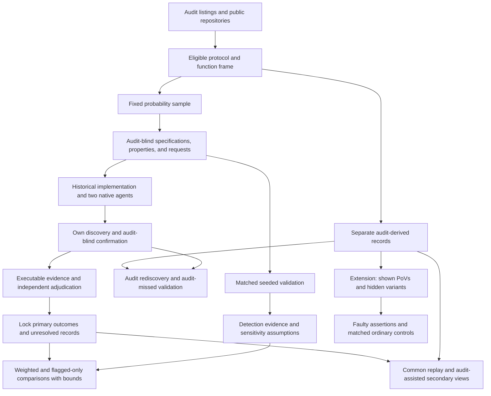

# AI Agent Function-Body Replacements in Audited Solidity: Executable Vulnerability Comparisons with Historical Developer Code

Proposal version 13 (author of this revision: Peer B, Loop 1 round 12; version 12 was written by Peer A in round 11).

## 1. Abstract

We study AI-generated function replacements in audited Solidity contracts, compared with historical developer implementations. A fixed probability sample includes audit-flagged and unflagged functions. Each implementation receives its own audit-blind discovery and confirmation procedure. A counted vulnerability requires an executable attack, a correction confined to the target body, and independent adjudication. The principal estimand is the difference between the flagged-only and population-weighted comparisons. We judge it against a stated precision criterion and account for unresolved outcomes. Detection validation uses seeded flaws, audit rediscovery and independent investigation, with explicit limits on transfer to natural flaws. An executable pilot package demonstrates entitlement loss and a function-only correction. PoV-guided repair is a separately specified extension. The study has fixed resource limits, but human throughput remains unmeasured. Human development cases and final inference validation must establish readiness before confirmatory collection.

## 2. Problem and motivation

Solidity developers already use AI tools. The Solidity Developer Survey 2025 reports that 58% of respondents use them daily and 49% use them to write code [Solidity Survey]. These are self-reports. They establish relevance, not the security of generated code.

Security failures in contracts can transfer funds or prevent legitimate operations. In a study of 516 exploitable smart-contract bugs, more than 80% were beyond the automated tools examined [Web3Bugs]. A separate study found substantial limitations in Solidity static analyzers [SAST Study]. These results motivate executable evidence of specific attacker effects.

Existing benchmarks answer several useful but different questions. SecureVibeBench reconstructs tasks around historical vulnerabilities and applies executable checks to developer and agent implementations [SecureVibeBench]. SusVibes evaluates functional and security outcomes on reconstructed vulnerable tasks [SusVibes]. Foresight-SWE studies tasks associated with later-fixed general defects [Foresight-SWE].

Selecting functions because a developer previously failed cannot establish the average difference across other functions. Agents might avoid known mistakes while introducing different vulnerabilities elsewhere. Conversely, a benchmark of historical failures may exaggerate the apparent advantage of replacement.

Unconditional comparisons are not new. Sajadi et al. compare human and agent patches for the same issues [Patch Security]. Cotroneo et al. compare human and AI functions paired by documentation [Cotroneo]. SolEval already regenerates function bodies in real Solidity repositories [SolEval]. SolAgent compares generated and historical Solidity using static analysis [SolAgent].

The first paper asks whether including unflagged functions changes the conclusion under executable security evaluation. Its contribution must be demonstrated on the collected data. Probability weighting alone is not a new technique.

A specified extension concerns repair. Existing research already shows that incorrect tests can mislead agents [ImpossibleBench; ExecCritic; Calibration]. We ask a narrower question: does executing assertions that endorse an exploitable behavior preserve that behavior despite contrary PoV evidence, beyond the effect of matched ordinary incorrect assertions?

Neither study estimates how much human review developers can safely remove.

## 3. Key insight and contributions

### Paper 1: measure how much flagged-only sampling changes the comparison

Audit labels define sampling strata. They are not security verdicts.

On the same collected data, the study reports:

- the comparison restricted to flagged functions;
- the weighted comparison over the eligible population;
- the difference between those estimates, for each configuration;
- agent ordering and its uncertainty.

The design difference is the principal estimand, RQ1a. Its meaningful-difference threshold is 0.10 in detected D. Section 6.4 defines the precision criterion.

The study does not claim that a predictable sign is itself a contribution. It measures the size of the sampling effect and interprets it alongside detection evidence.

A result is called “little difference” only when the full uncertainty interval lies inside ±0.10 and the rediscovery condition in section 6.4 is met. A wide interval containing zero is inconclusive.

The fixed minimum study is described in section 8. If development cannot support its workload and precision, confirmatory collection does not begin. The proposal does not substitute an unspecified benchmark contribution for a failed principal design.

### Count discoveries made under a common procedure

An audit gives historical code an extra source of known vulnerabilities. Replaying audit-derived attacks does not provide an equally strong search for different agent flaws.

The primary endpoint therefore uses only flaws found and confirmed through each implementation’s own campaign. Every campaign follows the same frozen procedure and budget. It receives no audit report, finding list, audit-derived PoV or audit-derived correction.

Pooling discovered attacks can favor flaws shared by many agent attempts. Common replay is therefore secondary. It does not change locked primary labels.

This compares **detected vulnerabilities under a stated procedure**. It does not establish equal sensitivity or compare all latent vulnerabilities.

### Keep functionality separate from security

The primary endpoint counts implementations that compile, pass ordinary functional checks and contain a confirmed vulnerability.

Compiled vulnerable outputs that fail functional checks are also reported. Failed generation remains in the denominator. A lower vulnerability count caused by failed generation is not evidence of better security.

### Planned extension: faulty assertions during PoV-guided repair

The pilot motivates a hypothesis but does not establish it.

The two preregistered OpenHands contrasts were:

- adding the shown PoV, with a full terminal in both arms: 0 of 12 successes versus 2 of 12, with Holm-adjusted p = 0.96;
- allowing the shown PoV to be rerun: 10 of 12 versus 9 of 12, with Holm-adjusted p = 1.00.

The exploratory comparison between no execution and a full terminal was 10 of 12 versus 2 of 12. OpenHands succeeded in 9 of 12 runs with the shown-test tool. Codex succeeded in 6 of 12 both with that tool and with a full terminal.

These results concern one finding. The repairs have not yet been reviewed by a person. The hypothesis about faulty repository tests was formed after inspecting the pilot. The proposed repository-test tool is narrower than a full terminal.

The extension compares wrong assertions endorsing a vulnerability with matched wrong assertions endorsing an ordinary error. It measures whether each endorsed behavior remains. It is specified for review but is not a claimed contribution of the protected twelve-month study.

## 4. Threat model and problem setting

### Historical replacement

Each task replaces one function body in a fixed audited snapshot. The historical developer implementation supplies the baseline.

The agent sees mature surrounding code and repository tests. These may have been written after the original function. The study does not recreate the developer’s original conditions or estimate a causal effect of replacing a human worker.

Historical code may contain AI assistance. Its provenance is recorded rather than assumed.

### Attacker and environment

The attacker is an unprivileged external account. It may deploy contracts, call public interfaces and use borrowing or transaction ordering permitted by the protocol record.

The attacker cannot steal keys, assume an administrator role, change trusted oracle behavior outside the recorded assumptions or modify deployed code.

Each protocol record specifies:

- protected assets and legitimate entitlements;
- available capital and permitted borrowing;
- reachable initial states;
- token and oracle behavior;
- transaction ordering and block assumptions;
- legitimate operation and resource limits.

All execution occurs offline. Arbitrary storage changes cannot manufacture an otherwise unreachable vulnerable state.

### Severity

The study uses one rubric across audit platforms. Original audit labels remain in the record.

High severity includes unauthorized loss of principal, protocol insolvency and irreversible loss of access to protected assets. Medium severity includes theft of earned protocol entitlements and attacker-induced loss of a core operation under the recorded resource and recovery limits.

Ordinary implementation failure is not automatically a security vulnerability. Availability findings require an attacker action, affected legitimate users and a demonstrated failure under permitted operating conditions.

Financial effects must reflect entitlement or backing. Attacker profit alone is insufficient. Temporary inconvenience, gas optimization, privileged misuse and effects outside the threat model are excluded.

Before evaluation, the rubric records how recoverability, repetition, affected users and resource limits determine inclusion. A frozen tie rule excludes borderline severity cases from the primary count and includes them in a secondary count. This is a classification rule, not evidence that those cases are harmless.

### Attribution

A counted flaw requires:

- an executable qualifying property violation;
- evidence connecting it to the target function;
- removal of the violation by changing only that function body;
- preservation of required functionality under the acceptance checks.

The intervention preserves signatures, surrounding code, dependencies and initial-state procedures. It cannot disable the feature or hide a loss by changing accounting.

Historical code may serve as a correction only after the same checks.

Two adjudicators outside the construction team assess severity and attribution. Packs conceal author, agent and experimental arm as far as the code permits. Disagreements, resolution and blinding failures are recorded.

## 5. Approach

### 5.1 Frame and sampling unit

The pipeline downloaded 19,666 findings and obtained complete source files for 7,826. Earlier filtering left 77 recent candidates and 43 with suitable public history. These are screening counts, not a validated sample.

The refreshed protocol frame starts from audit contest listings where possible. Protocols without qualifying findings can enter. If only a finding-derived frame is practical, the population is restricted to protocols with at least one qualifying finding.

A protocol must have an available audited snapshot, pinned dependencies, an offline build and sufficient documentation to define its environment.

A function must be in audit scope, contain meaningful computation or state changes, and be replaceable without changing its signature or surrounding code. Tests or a documented call path must support reachability.

The unit is one function body.

Before sampling, the frame identifies functions implicated in qualifying findings whose necessary corrections span several function bodies or require changes outside the body. Those functions are excluded. Unrelated edits in a fix commit do not establish that a broader correction is necessary.

The report gives the excluded shares of functions and findings. Multi-function replacement is a named extension.

The fix-scope record for the 43 pilot findings is in `evidence/frame_count/`.

| Fix scope | Findings | High confidence |
|---|---:|---:|
| One function body | 17 | 14 |
| Several function bodies | 2 | 2 |
| Signature, storage layout, new function or other declaration | 15 | 14 |
| Undetermined | 9 | Not applicable |

These classifications describe the identified developer fixes. They do not prove that no narrower correction exists.

The one-function count is 17 of 43, or 17 of 34 findings with identified fixes. Three judgment calls move it between 15 and 18. Panoptic supplies 9 of the 17. Three of the ten protocols have no identified one-function fix among these filtered findings.

The count is not the refreshed eligible frame. The filtering and unresolved classifications limit its use for planning.

Stratum V contains eligible functions linked to qualifying High or Medium findings. Stratum N contains the other eligible functions. N means no qualifying audit label, not safe code.

### 5.2 Fixed allocation and processing limits

The proposed minimum main study selects 20 protocols by simple random sampling without replacement from the frozen frame.

Each selected protocol contributes up to six V functions and eight N functions. Small strata are censused. A protocol without V functions remains eligible and contributes N functions. Functions are sampled with recorded inclusion probabilities.

Both primary agents receive two fresh attempts per function.

This allocation is fixed before main construction and outcomes. Protocol processing order is randomized, but order does not determine inclusion. Every selected protocol and function remains in the denominator.

Section 8 assigns a fixed student work allowance to each protocol. If work exceeds that allowance, remaining outcomes are recorded as unresolved. Slow protocols are not replaced. Unused time does not buy extra sampled protocols or outcome-dependent extra search.

Within a protocol, task order and campaign limits are frozen. Candidate-confirmation limits are the same across authors. Protocol-level exhaustion is distinguished from a completed campaign that found no confirmed vulnerability.

The allocation is a proposed minimum, not a demonstrated feasible study. Main sampling begins only after the readiness requirements in section 8 are met. If the actual frame and measured costs cannot support this allocation and the precision criterion, the design returns for revision before collection.

The attempt choice is informed by `tools/power_results_v16.txt`. Under its scenarios, 20 protocols with two attempts have narrower raw RQ1b intervals than 15 protocols with three attempts. This is a precision and campaign-count comparison, not a comparison of complete human costs.

### 5.3 Provenance and AI assistance

For each function, the study records available history around its introduction. Evidence includes agent instruction files, AI co-author trailers and pull-request text.

The categories are evidence of assistance, no observed evidence and unresolved provenance. An instruction file does not prove that the target lines were generated. Absence of a marker does not prove human-only authorship.

All categories remain in the primary historical-developer comparison. The unflagged subset is a preregistered secondary analysis.

Code, fix and report publication dates are recorded separately. A report published after a model cutoff does not establish that the code was unseen.

### 5.4 Audit-blind task construction and confirmation

Request and primary-property builders do not receive audit findings, historical fixes or the removed function body. They receive permitted documentation, signatures, callers and surrounding code.

Every request sentence records its source. Requests and primary properties are frozen before agent runs.

Security properties must follow from documented entitlements and operations. An audit-derived invariant, reference correction or attack cannot enter primary discovery under another name.

The student and paid second person record prior exposure before assignment.

For a protocol unfamiliar to the student:

1. The second person checks the frame mapping, labels and exclusions. A script draws the functions and gives the student a shuffled list with labels sealed.
2. The student constructs and commits the threat-model record, properties, functional checks and requests without audit access.
3. Generation and independent discovery run. The student confirms primary candidates using only their originating campaign materials and permitted context.
4. Independent adjudication is completed and primary records are locked.
5. The student may then access the audit for audit-derived attacks and secondary analyses.

For a protocol already known to the student:

1. The student prepares the frame mapping and sealed task materials.
2. An unexposed second person constructs and commits the blind artifacts.
3. That person performs primary confirmation without receiving findings, labels, fixes or mapping-review work.
4. Primary adjudication and locking are completed.
5. Only then may that person inspect the audit or review the mapping.

If neither person is unexposed, an unexposed builder and confirmer must be assigned within the paid allocation before work starts. Otherwise the affected construction remains unresolved.

A candidate completed using audit-derived help counts only in the audit-assisted secondary view. Construction staff do not independently adjudicate their own packages.

The rule applies to development and validation as well as main cases. Committing a request alone does not permit audit access while primary confirmation remains open.

**Requests and duplicate construction.** A written request template is frozen before sampling. It fixes sections, ordering and treatment of documented boundary behavior.

For a random subset of 15 sampled functions, two unexposed builders independently prepare requests before either sees the other request. One request is designated for generation in advance. The other is used only to assess construction agreement.

A person who checked that protocol’s audit mapping cannot be the second blind builder. The staffing record must assign an unexposed replacement within the paid allowance. If that cannot be funded, the duplicate-request exercise is not presented as completed.

The audit-informed request diagnostic occurs after primary locking. Its reviewers do not receive agent outcomes when classifying requests. It labels requests as favoring vulnerable behavior, neutral or favoring corrected behavior.

Requests favoring vulnerable behavior remain included when the acceptance specification is coherent. Incoherent specifications remain unresolved. Results are stratified by classification.

Builder identity, prior exposure and processing order are recorded. A secondary analysis includes builder identity where the data permit it; this does not eliminate confounding by protocol.

### 5.5 Functional and security checks

Checks are classified before generation.

Ordinary functional checks establish intended operations, outputs and useful completion. Explicit security checks establish forbidden attacker outcomes. Assertions endorsing known faulty behavior are not accepted as correctness checks.

An ordinary functional check is not removed merely because it also catches a flaw. The historical implementation is not assumed to pass the suite.

The classification record explains overlaps. Original repository-test outcomes are reported separately.

A PoV has three semantic outcomes:

| Outcome | Meaning |
|---|---|
| Violation observed | Valid execution demonstrates the forbidden outcome. |
| Violation checked and absent | The scenario executes and checks that the outcome did not occur. |
| Unresolved | Construction, execution or interpretation prevents a valid judgment. |

An exit code is not a security verdict. Expected failure of a violation-asserting test is distinguished from a setup failure. Fixed-state checks establish that legitimate behavior remains.

### 5.6 Agent configurations

The primary configurations are Claude Code and Codex CLI with vendor-supported models current at the freeze.

Exact model identifiers, versions, reasoning settings, prompts, permissions and budgets are pinned. Both run on the full sample. Every attempt starts from a fresh workspace.

The target body is replaced with a placeholder. Only the submitted body is applied to evaluation. Changes to tests, dependencies or unrelated code cannot alter the evaluated artifact.

History, fixes, cached target copies and generated artifacts exposing the target are removed. Network access is restricted to model APIs.

Pilot configurations, translated integrations and a documented SolAgent adaptation are extensions. They do not enlarge the primary family or its discovery budget.

### 5.7 Primary discovery

Each scheduled implementation receives its own campaign under a frozen procedure:

- Foundry property-based fuzzing;
- the same two LLM reviewers;
- a fixed candidate ordering rule;
- equal confirmation limits.

Reviewer identities and versions are named before the main freeze. Where development supports suitable reviewers from other model families, those are preferred. Otherwise the overlap is reported.

A preregistered secondary analysis uses fuzzing and only the other-family reviewer for each agent configuration, applied to both that agent’s and the historical implementations. Candidate origin is retained. This analysis is labeled as a filtered view of the frozen campaign, not a newly run campaign with reallocated confirmation effort.

Reviewers receive code, permitted context, frozen properties and the request. They receive no author label or audit-derived material.

Campaigns do not receive other implementations’ reports or attacks. Duplicate outputs may share deterministic execution work but do not acquire extra stochastic search opportunities.

A positive primary label requires a candidate from the implementation’s own campaign, executable confirmation and independent adjudication.

A completed campaign with no confirmed candidate contributes “not confirmed.” A campaign that could not complete the frozen procedure because construction or evaluation failed remains unresolved.

Primary records are locked before pooled replay.

### 5.8 Secondary replay and audit rediscovery

After primary locking, validated common-procedure PoVs are replayed across each function’s cohort. Attribution is checked separately for each implementation.

Audit-derived PoVs are then evaluated. Neither step changes primary labels.

The report contains four views:

- own audit-blind campaign discoveries;
- pooled common-procedure discoveries;
- own discoveries supplemented by audit-derived attacks;
- the union after both forms of replay.

For historical V functions, the study reports how often the blind campaign rediscovers a qualifying audit flaw. Audit findings that fail the study’s confirmation standard are distinguished from valid findings that were missed.

RQ1a is reported beside this rediscovery result and under the third view. A small own-campaign design difference can reflect weak rediscovery rather than a small effect of sampling.

### 5.9 Detection validation

#### Matched seeded flaws

A separate builder inserts the same vulnerability pattern into historical and agent implementations of a function. Patterns come from other protocols.

Each seed must compile, preserve unrelated behavior and produce an attributable violation under the recorded threat model. Invalid seeds remain in the record.

The core schedules 60 matched pairs, or 120 seeded artifacts. Each pair contains one historical and one agent implementation. The planned allocation is 15 pairs for each stratum and configuration combination.

The catalogue contains at least 20 patterns, with no pattern used in more than three pairs. Pairs are spread across protocols and use distinct functions where possible.

Seeded and unseeded controls receive blind discovery. Seed locations and known attacks remain hidden until outcomes are locked. Seeded artifacts do not enter natural vulnerability estimates.

The pooled diagnostic describes this validation mixture. It is not a population-weighted recall estimate. Results for each stratum and configuration are also reported.

The analytic planning calculation in `tools/power_results_v10_c.txt` uses

\[
1.96\sqrt{\frac{\operatorname{deff}(\delta-d^2)}{n}},
\]

where \(\delta\) is paired discordance and \(d\) is the recall difference.

With \(d=0.1\), design effect 1.5 and 60 pairs, the half-width is 0.135 to 0.194 across the recorded discordance assumptions. With design effect 3.1, it would be 0.194 to 0.278. These are assumptions, not measured precision.

The core cannot establish equal recall within 0.05. Final uncertainty accounts for the realized protocol and pattern dependence and the number of valid pairs.

#### Natural-implementation investigation

The maximum allocation is 48 first assessments and 12 duplicate assessments. Each assessment has a fixed two-hour budget. Total investigation therefore cannot exceed 120 auditor hours.

The base cells are author—historical, configuration A or configuration B—by stratum—V or N—by campaign category—confirmed or non-confirmed.

Each of the 12 cells receives up to four first assessments:

- confirmed cells are sampled uniformly;
- non-confirmed cells include both completed negative campaigns and unresolved evaluations;
- where both subgroups exist, one is sampled from each, followed by a uniform draw from the remaining cell members to fill its allocation;
- smaller cells are censused;
- unused slots are not transferred after inspecting investigation results.

This includes unresolved cases within the budget rather than adding them.

Up to 12 first-assessment cases are selected at random for a second assessment. If fewer are available, all available cases are duplicated. Assignment is balanced within the two auditors’ hour limits.

Auditors receive permitted context, the threat-model record and the harness, but no campaign reports or author label as far as the code permits.

The report uses the recorded selection probabilities to estimate campaign–auditor disagreement by author and stratum. It also reports agreement between auditors. Sparse cells and unresolved auditor judgments remain visible.

The rough ±0.3 calculation for eight negative cases is not a precision guarantee. Final uncertainty uses the actual allocation, inclusion probabilities and protocol structure. Development checks the analysis by simulation before it is used for claims.

Auditor investigation is a budgeted reference assessment, not proof of vulnerability absence or a direct estimate of recall.

#### Flaws missed by an earlier audit

A separate validation set targets 10 to 20 flaws found after an earlier audit.

Eligibility requires evidence that the same flaw existed in code covered by the earlier audit. A later-introduced flaw does not qualify. The record identifies the earlier scope, vulnerable version, later finding and correction.

These protocols are outside the main sampling frame. The campaign runs blind on the pre-fix implementation.

Availability remains unknown. Development counts eligible cases and records exclusions. Fewer than 10 cases leave the historical N sensitivity analysis at the full feasible range unless another explicitly justified assumption is examined.

Even with more cases, rediscovery estimates performance on this selected set. It does not automatically identify recall on all historical N flaws.

#### Development gate

Development cases are separate from the main frame. The pilot protocols form part of the reserve.

The gate uses eight qualifying flaws and passes at five rediscoveries. At most one revision is permitted, assessed on eight fresh flaws with a pass mark of six. Failure of both assessments stops development for redesign.

Only independently confirmed, in-scope flaws qualify. If the pilot reserve is insufficient, additional cases must come from outside the main frame.

| Assumed recall | First assessment | Revision assessment | Overall pass probability |
|---|---:|---:|---:|
| 0.3 | 0.058 | 0.011 | 0.069 |
| 0.5 | 0.363 | 0.145 | 0.455 |
| 0.7 | 0.806 | 0.552 | 0.913 |

These are binomial planning calculations for independent trials at the stated recall. They are not established error guarantees for clustered findings or an adaptively revised campaign.

Every attempt is reported. The gate is a practical development check, not proof of equal detection or a population recall estimate.

### 5.10 PoV-guided repair

The extension begins from a validated vulnerable implementation. A shown PoV supplies executable evidence. Hidden attacks use different states, boundaries or call sequences.

A successful repair must compile, preserve legitimate behavior, block frozen attacks and have no confirmed new attributable vulnerability under the declared evaluation. Required unresolved checks prevent a success verdict.

Later discoveries are reported separately and replayed consistently. Passing the shown PoV is never sufficient.

### 5.11 Worked example: finding 63008

The pilot concerns the downward tick iterator in Sorella L2 Angstrom. The vulnerable implementation skips a starting boundary.

Version 2 of the executable package is in `evidence/63008/`. It includes the violation test, fixed-state assertions, a function-body patch, an independent H-02 patch and an outcome-checking runner.

The correction adds `self.currentTick = startTick + 1` after the empty-range early return in `reset(TickIteratorDown)`. Empty ranges retain the original behavior. No signature, storage layout or other function changes.

The fixed-state test checks that:

- the honest provider can claim its rewards;
- payment covers its recorded entitlement;
- withdrawal returns its principal;
- backing covers the reward liability;
- attacker rewards do not exceed its share of its own swap tax.

The attacker-share formula is specific to the test’s two-position scenario. It is not a general accounting rule.

| Code state | Violation tests | Fixed-state tests | Original repository suite |
|---|---|---|---|
| Vulnerable `386baff` | Violation observed in both | Both fail | 60 pass |
| Version-2 function-body correction | Violation absent in both | Both pass | 56 pass, 4 fail |
| H-02 correction only | Violation observed in both | Both fail | 60 pass |
| Both corrections | Violation absent in both | Both pass | 56 pass, 4 fail |

The four remaining repository failures assert the old starting-boundary behavior. The empty-range test passes in every state.

The runner excludes all package-added test files from the original-suite count. It handles expected failures explicitly and compares test counts and failing names. The recorded end-to-end run matched all 12 expected outcomes.

On vulnerable code, the honest provider is owed about 49 ether before the attack. The attacker receives 48.99999755 ether, while remaining backing is about 0.0245 ether against about 49.0245 ether owed. Reward claim and withdrawal revert.

With the version-2 correction, the honest provider receives 49.000012243878672857 ether and withdraws its principal. The attacker receives 0.024487756121327142 ether, equal to the scenario’s calculated share of its own swap tax.

H-02’s independent correction leaves this attack unchanged. The report’s H-02 naming differs from its later informational classification, but the cited correction is `cd0ac3c`.

The capital record gives the attacker 100 ether and \(10^9\) tokens as a ceiling, not a minimum. The attack position is about \(2\times10^{25}\) liquidity units. The recorded scenario uses a 5 gwei priority fee and assumes the attacker wins the relevant top-of-block swap. It does not simulate a competitive priority-fee auction.

The original capital run records swap tax of 0.0245 ether, just-in-time tax of 0.098 ether and vulnerable-code net profit of 48.877274256875928055 ether. The version-2 package reruns reward and withdrawal assertions, not the separate net-profit test. No new version-2 net-profit measurement is claimed.

The automated version-2 work took 598 seconds. This is not human construction or adjudication time. The package supports the executable attribution example; it does not demonstrate audit-blind construction, human throughput or independent human approval.

The repository contained a `CLAUDE.md` before the faulty commit. The baseline is historical developer code.

The pilot’s two added control-group flaws failed repository functional tests. They motivate reporting K but do not establish an added-flaw rate for D.

## 6. Research questions and evaluation plan

### 6.1 Research questions

**RQ1a, principal estimand:** How much does restricting analysis to audit-flagged functions change the agent-minus-historical difference in detected, functionally passing vulnerabilities?

**RQ1b:** How do supported agents’ function-body replacements compare with historical developer implementations on that endpoint?

**RQ4, validation:** How does discovery behave across authors, strata and known flaw patterns, and how do missed flaws affect interpretation?

**RQ2, planned extension:** Does executing wrong assertions have a different effect on retention of an endorsed vulnerability than on retention of a matched ordinary error?

**RQ3, optional extension:** How does request wording affect vulnerability reproduction within a task?

### 6.2 Outcomes and unresolved attempts

Let \(C\) indicate compilation, \(L\) passing the frozen ordinary functional suite, and \(V_{\mathrm{own}}\) a vulnerability confirmed through the implementation’s own campaign.

The primary endpoint is

\[
D=C L V_{\mathrm{own}}.
\]

The secondary endpoint is

\[
K=C V_{\mathrm{own}}.
\]

All scheduled attempts remain in the denominator. Historical code contributes one observation per function.

The report also gives working outputs without a confirmed flaw, compilation failures, functional failures and unresolved evaluations.

**Completed negative versus unresolved.** A completed campaign that fails to confirm a candidate within its frozen budget is “not confirmed.” Borderline severity follows the frozen classification rule.

Failure to construct a coherent task, complete the prescribed evaluation or obtain required adjudication is unresolved. Exhausting an overall protocol work allowance before completing a campaign does not turn it into a completed negative.

For descriptive confirmed counts, an unresolved endpoint contributes zero unless already established as one. Zero means “not confirmed,” not “safe.”

Each unresolved endpoint receives admissible bounds based on known components. A known compilation failure fixes D and K at zero. A known functional failure fixes D at zero.

For the author difference, the lower bound assigns unresolved agent endpoints their lowest admissible values and historical endpoints their highest. The upper bound reverses this.

Let \(d_V\) and \(d_N\) be the author differences in the strata. The design difference is

\[
G=(1-\pi_V)(d_V-d_N).
\]

Its lower bound combines the lower V difference with the upper N difference. Its upper bound combines the upper V difference with the lower N difference. Shared observations and weights remain shared throughout estimation.

Both RQ1a and RQ1b receive uncertainty intervals around their identification bounds. Neither is exempt from missing construction or evaluation.

The working-without-confirmed-flaw endpoint is reported separately. Under the earlier planning completion rates, its agent-minus-historical difference is

\[
(0.72-D_A)-(1-D_H)=-0.28-\Delta_D.
\]

The study does not convert a negative D difference into a “better security” verdict. It reports detected vulnerability and capability outcomes separately. The unvalidated non-inferiority decision from the previous version is removed.

### 6.3 RQ1 estimand, inference and current evidence

The target is the finite eligible function frame declared before sampling. Agent outcomes average over fresh runs under the frozen configuration and budget.

For endpoint \(Y\), configuration \(c\) and stratum \(s\),

\[
\widehat{\Delta}^{Y}_{c}
=
\sum_s \pi_s
\frac{\sum_{i\in S_s} w_i(\overline{Y}_{Aci}-Y_{Hi})}
{\sum_{i\in S_s}w_i},
\]

where \(w_i\) is the inverse joint inclusion probability and \(\pi_s\) is the stratum’s population share.

The proposed standard error is the delete-one-protocol jackknife, retaining paired observations and fixed population shares. Its adequacy requires validation under the actual finite sampling design. There is no automatic generalization beyond the frame.

RQ1a consists of two principal estimates with pointwise uncertainty stated explicitly. A claim about both configurations requires separately validated joint uncertainty. RQ1b uses Holm across the two configurations. K and subgroup analyses are secondary.

Paper 1 makes no equivalence claim about author security. The RQ1a rule for a small design difference is distinct from the abandoned ±0.05 author-equivalence test.

#### V17: directional decisions with unresolved outcomes

The code is `tools/power_sim_v17.py`, with results in `tools/power_results_v17.txt`.

It uses two attempts, up to two V and eight N functions per protocol, and 15 or 20 protocols. A positive claim uses the lower adverse bound; a negative claim uses the upper bound. If neither bound lies on the corresponding side of zero, the configuration cannot make that directional claim.

Calibration uses exact nulls without unresolved outcomes. Validation uses a separate stream. The selected Holm level is 0.05 at both allocations.

| Protocols | Unresolved shares | Worst null family-wise error |
|---|---|---|
| 15 | 0, 0 | 0.053 ± 0.018 |
| 15 | 0.05, 0.05 | 0.002 ± 0.003 |
| 15 | 0.10, 0.10 | No errors observed |
| 20 | 0, 0 | 0.053 ± 0.018 |
| 20 | 0.05, 0.05 | No errors observed |
| 20 | 0.10, 0.10 | No errors observed |

The reported Monte Carlo errors are not simultaneous bounds over scenarios. No observed error does not establish zero population error.

For the tested partial null, one configuration has true difference zero and the other +0.08. Worst family-wise error is 0.052 without unresolved outcomes and 0.003 with equal unresolved shares of 0.05, at both allocations.

Selected power results are:

| Protocols | Unresolved shares | Positive differences +0.069 to +0.090 | Negative difference −0.05 |
|---|---|---|---|
| 15 | 0, 0 | 0.49–0.88 | 0.18–0.38 |
| 15 | 0.01, 0.01 | 0.34–0.69 | 0.14–0.25 |
| 15 | 0.05, 0.05 | 0.04–0.13 | 0.01–0.03 |
| 20 | 0, 0 | 0.65–0.97 | 0.19–0.47 |
| 20 | 0.01, 0.01 | 0.47–0.85 | 0.15–0.36 |
| 20 | 0.05, 0.05 | 0.04–0.14 | 0.02–0.05 |

These are ranges of minimum configuration-specific power across the recorded scenarios. They are not probabilities that both configurations succeed.

V17 also reports asymmetric unresolved rates through 0.10. Historical unresolved outcomes especially weaken a positive author-difference claim; agent unresolved outcomes especially weaken a negative claim.

The code does not validate the proposed six-V allocation or the actual finite frame. Null validation does not cover all asymmetric missingness scenarios. Missingness is generated among otherwise working implementations, not as correlated construction failure. The tested partial null does not exhaust directional or heterogeneous partial-null cases.

The previous 0.005 launch threshold is removed. A small development sample cannot establish that population missingness is below that value.

#### Final inference requirements

Before confirmatory collection, validation must use:

- the frozen finite frame and sampling fractions;
- the fixed 20-protocol allocation and six-V cap;
- two attempts and the actual weights;
- historical functional failures;
- construction and evaluation failures, including correlated and author-dependent failure;
- both identification bounds and their joint uncertainty;
- exact nulls, partial nulls and both directions;
- recall variation with latent code quality held fixed.

Calibration and validation use separate streams. Selection rules and actions on failure are frozen first. A grid endpoint is not accepted merely because no candidate passes.

If final validation fails, inferential collection does not launch under this proposal. Development evidence may still be reported as development evidence.

### 6.4 RQ1a: precision and interpretation

The V-only estimate and weighted estimate use the same observations. Their difference preserves the covariance caused by shared observations.

Agent ordering is reported with uncertainty. An apparent reversal in noisy point estimates is not treated as established.

This measures the effect of the sampling restriction under this study’s evaluation. It is not a literal replication of SecureVibeBench or Foresight-SWE.

**Meaningful difference.** The planning threshold is 0.10 in detected D. It is a choice about a material distortion in a benchmark comparison, not a security threshold.

**Operational precision criterion.** For every retained planning scenario and each configuration, compute the mean half-width of the full uncertainty interval enclosing both identification bounds. The largest of those means must be at most 0.20.

This is an expected-width requirement within every scenario and configuration. It is not a promise that every realized interval is that narrow.

For scenarios with a design difference near −0.33, the interval must lie wholly below −0.10 in at least 0.80 of simulated studies for each configuration. Corresponding positive scenarios must be checked if a general claim in both directions is intended.

A mean sampling-error width for one bound does not establish this criterion when outcomes are unresolved.

**V18 evidence.** The code and results are `tools/power_sim_v18.py` and `tools/power_results_v18.txt`. It evaluates the largest mean sampling half-width over configurations and scenarios. With unresolved outcomes it evaluates the bound toward zero for a negative difference.

| Frame and allocation | Unresolved share in both authors | Largest mean sampling half-width | Excludes −0.10 near true −0.33 |
|---|---:|---:|---:|
| Earlier assumption; 15 protocols, V cap 4 | 0 | 0.206 | 0.63 |
| Earlier assumption; 15 protocols, V cap 4 | 0.01 | 0.209 | 0.57 |
| Earlier assumption; 20 protocols, V cap 6 | 0 | 0.159 | 0.89 |
| Earlier assumption; 20 protocols, V cap 6 | 0.01 | 0.161 | 0.81 |
| Earlier assumption; 20 protocols, V cap 6 | 0.05 | 0.164 | 0.38 |
| Counted spread; 40 protocols, N in 20, V cap 6 | 0 | 0.210 | 0.65 |
| Counted spread; 40 protocols, N in 20, V cap 6 | 0.01 | 0.211 | 0.55 |
| Counted spread; 40 protocols, N in 20, V cap 6 | 0.05 | 0.213 | 0.20 |

The selected multipliers are 1.12, 1.10 and 1.18 for the three allocations. Independent validation without unresolved outcomes gives minimum coverage of 0.938, 0.953 and 0.950.

V18 does not validate coverage of the bound interval with unresolved outcomes. It does not report the full interval spanning both identification bounds. Its results therefore support planning, not final attainment of the criterion.

The favorable 20-protocol scenario passes the displayed width and meaningful-difference checks without unresolved outcomes. The counted-spread allocation does not, even with 40 protocols. The claim that about 50 V functions generally suffice is withdrawn.

The counted vector is a filtered pilot distribution, not the final frame or a proven lower bound on it. No assumption is made that the true frame lies between the two simulated cases.

**Reading rule.** RQ1a is always accompanied by historical V rediscovery and the audit-supplemented design estimate. A small difference is informative only if its full interval lies inside ±0.10 and the lower 95% rediscovery bound is at least 0.5. The latter is a reporting threshold, not proof of complete discovery.

**Readiness decision.** The final frame, costs and missingness scenarios are used to assess the fixed minimum allocation. If it fails the precision or budget requirement, it is not launched and silently rebranded as a benchmark paper. A different allocation requires a revised plan before outcomes.

The pilot found the historical bug by code reading in 16 of 32 agent runs. All eight historical implementations contained it. Among compiled runs, the counts were 13 of 13 for requests describing vulnerable behavior and 3 of 15 for requests stating the corrected rule.

These observations motivate scenarios. They do not estimate D or establish the expected design difference. The pilot used older configurations and says nothing about the N contribution.

Secondary analyses separate request classifications and whether repository tests directly call the target.

### 6.5 Detection sensitivity and validation decisions

For stratum \(s\), let \(r_{As}\) and \(r_{Hs}\) be detected D rates. Let \(s_{As}\) and \(s_{Hs}\) be assumed sensitivities among truly vulnerable working implementations.

With negligible false confirmations, a sensitivity analysis considers

\[
\Delta_{\mathrm{latent}}
=
\sum_s \pi_s
\left(
\frac{r_{As}}{s_{As}}-
\frac{r_{Hs}}{s_{Hs}}
\right),
\]

restricted to feasible rates.

For a single stratum with positive detected rates, the sign-reversal boundary is \(s_A/s_H=r_A/r_H\). There is no numerical reversal threshold before observing rates.

Validation results are reported separately:

- historical V audit rediscovery;
- rediscovery on selected audit-missed flaws;
- matched seeded recall;
- natural auditor disagreement and confirmed-positive checks.

Their confidence intervals are intervals for those validation populations. They are not automatically bounds for natural-flaw sensitivity in the main population.

Any transfer is labeled as an assumption. Examples include treating selected later-discovered flaws as representative of historical N flaws or assuming that a seeded author recall ratio transfers to natural code.

The primary sensitivity presentation retains the full feasible natural-recall ranges. Additional restricted scenarios may use justified transport assumptions. The report shows which conclusion depends on each assumption.

Seeded recall-ratio intervals are not mechanically multiplied by historical intervals and presented as identified agent sensitivity. Auditor disagreement is not substituted for sensitivity either.

Where auditors challenge a confirmed positive, the case is re-adjudicated without selectively changing one author’s evaluation. The report also examines the effect of disputed confirmations.

If plausible ranges reverse the latent difference, prevalence is reported as not identified. The detected-outcome comparison may still be reported with its narrower meaning.

### 6.6 Planned extension: faulty assertions and PoV-guided repair

This extension has a separate sample, budget, preregistration and inference validation. It has no student hours in the protected year.

Within tasks, the experiment varies:

- correct versus incorrect assertions;
- permission to execute repository tests;
- security versus matched ordinary assertions.

Within each assertion type, execution arms see the same test source and contrary evidence. Both receive identical read, search, edit and fixed-build tools. Only the execution arm receives the repository-test tool.

There is no unrestricted terminal. Build and test tools restore fixed settings outside the writable workspace. Enforcement checks include scripts, test renaming, configuration edits and instrumentation through allowed paths.

Security repair arms receive the same shown PoV and rerun tool. Ordinary arms receive a matched failing check derived from the specification. Hidden evaluation remains inaccessible.

The primary outcome for each assertion type is retention of the behavior its wrong assertion endorses. Vulnerability retention remains a separate security endpoint within the security arms.

A matched pair requires the same target function, comparable reference-correction size and a recorded comparison of conflict with the supplied evidence. Failed admission attempts remain recorded.

Let \(I_k\) denote the interaction of wrong assertions and execution permission on the declared log-odds outcome for type \(k\). The operational contrast is

\[
\theta=I_{\mathrm{security}}-I_{\mathrm{ordinary}}.
\]

Equal log-odds interactions define a modeling null. They are not a theorem about every agent that obeys tests. Conditional generating interactions and interactions of aggregated probabilities must not be treated as interchangeable.

V14 uses 20 protocols, three attempts per cell and 1,000 studies per row. For its equal-interaction scenarios, the log-odds test rejects in 0.040 to 0.067 of studies. At 160 functions, rejection rates under the displayed alternatives are 0.529 to 0.812.

These results are specific to the generating model. Differences from a probability-scale test do not establish that a probability-scale estimand is invalid.

A confirmatory extension must first define the estimand at the level used by its estimator, calibrate the decision under unequal baselines and heterogeneous effects, and select a sample for a stated meaningful effect. The earlier 160-function figure is a candidate size, not an automatic threshold.

Functions would come from the whole refreshed frame, not only paper 1’s sample. Availability and pair-admission costs remain unknown. Both configurations are protected. A broader claim requires consistent direction and a validated multiplicity plan.

### 6.7 Natural tests and optional extensions

Natural faulty tests require semantic confirmation. Passing on vulnerable code and failing on a correction is only a screen.

A census is attempted only if measured costs permit. Otherwise the study estimates the weighted share among sampled V functions, with uncertainty and unresolved-case bounds.

Natural cases provide descriptive evidence and do not enlarge the injected experiment statistically.

Named extensions include request wording, pilot configurations, SolAgent, multi-function replacement, additional repair conditions and the faulty-assertion experiment.

Each has separate funding and cannot change locked primary labels.

### 6.8 Threats to validity

**Historical context.** Mature snapshots do not recreate original development.

**AI assistance.** Provenance markers are incomplete.

**Exposure.** V functions can have more public discussion of their flaw and correction than N functions. For each pinned model, report and fix publication dates are compared with a documented cutoff where available. Unknown or incomplete cutoffs remain unknown.

The V difference and RQ1a are reported for the subset whose report and fix appeared after both documented cutoffs, if such a subset exists. This limits exposure to those artifacts, not exposure to the code or related examples.

A recall flag records reproduction of distinctive fix lines or comments. Flagged cases receive a secondary exclusion analysis.

**Detection.** Equal procedure does not establish equal sensitivity. Seeded flaws and later-discovered flaws are selected validation populations.

**Properties.** Audit-blind properties can omit important behavior. Development does not prove completeness.

**Learning and builders.** Builders can learn general vulnerability patterns between protocols. Identity, prior exposure and order are recorded. Estimates from the first and second halves of the fixed processing order are compared with uncertainty. This is a sensitivity analysis, not removal of confounding.

**Sampling and work limits.** Eligibility restrictions limit the population. Fixed work limits can produce informative missingness. Every selected unit remains represented through outcomes or bounds.

**Inference.** Current simulations do not validate all aspects of the actual finite frame, construction process and missingness.

**Interpretation.** Passing tests does not establish deployment readiness. No confirmed flaw does not establish safety.

## 7. Related work

The study reuses established techniques. Its intended contribution is the empirical size of the sampling effect under executable, function-attributed evaluation.

SolEval is the closest function-replacement setup [SolEval]. It uses Slither for vulnerability measurement. This study adds a probability-defined historical comparison, executable attribution and direct measurement of flagged-only selection.

Sajadi et al. and Cotroneo et al. already compare human and generated code without selecting only historical failures [Patch Security; Cotroneo]. Unconditional comparison itself is not claimed as novel.

SecureVibeBench supplies close precedent for reconstructed tasks and common PoVs [SecureVibeBench]. EVMbench supplies precedent for executable Solidity security evaluation [EVMbench]. PoCo supplies precedent for audit-derived exploit generation [PoCo]. Such generation remains secondary here.

Fault-enforcing tests are an existing construct [Fault-Enforcing Tests]. ImpossibleBench manipulates conflicting tests and execution feedback [ImpossibleBench]. ExecCritic separates test construction from repair because tests can encode incorrect targets [ExecCritic].

Calibration, Not Compilation reports harmful unit-test feedback in probabilistic-program repair [Calibration]. SpecGuard shows that satisfying a corrupted test can remove a security defense [SpecGuard].

The extension’s proposed distinction is a matched comparison of endorsed security and ordinary errors with contrary evidence in both arms. It must demonstrate that distinction rather than rely on Solidity alone.

| Work | Closest overlap | Difference addressed here |
|---|---|---|
| SolEval | Function-body generation in Solidity | Probability-weighted historical comparison and executable attribution |
| Cotroneo et al. | Human and AI functions paired by documentation | Audited context, executable attacks and declared weights |
| Sajadi et al. | Human and agent patches on common issues | Flagged-only versus population estimates |
| SolAgent | Solidity generation and historical comparison | Executable outcomes rather than static warnings |
| SecureVibeBench | Historical vulnerabilities and common PoVs | Unflagged sampling and own-campaign primary labels |
| SusVibes | Functional and security outcomes on vulnerable tasks | A declared population beyond known failures |
| Foresight-SWE | Tasks associated with historical defects | Security-specific attribution and unflagged functions |
| EVMbench | Solidity detection, patching and exploitation | Historical replacement and sampling comparison |
| PoCo | Audit-derived exploit construction | Secondary audit-assisted evaluation only |
| P2Patch and PatchBench | Exploit-guided repair | Separate faulty-assertion extension |
| Fault-Enforcing Tests | Tests preserving faulty behavior | Matched experimental comparison |
| ImpossibleBench | Conflicting tests and execution | Matched endorsed outcomes and contrary evidence |
| SpecGuard | Corrupted tests removing defenses | A separately calibrated matched contrast |
| ExecCritic | Incorrect tests and frozen validation | Repository assertions during PoV-guided repair |
| Calibration, Not Compilation | Harmful test feedback | Executable attacker outcomes |

Foresight-SWE is a submission under review. Claims are limited to its verified abstract.

## 8. Feasibility, risks and fallback plans

### What is measured

The automated timing record is `evidence/timings.md`.

| Automated work | Wall-clock time |
|---|---:|
| Original 63008 package | 1,373 seconds |
| Version-2 package | 598 seconds |
| Classification of 43 pilot fixes | 864 seconds |

These jobs used existing pilot material and LLM assistance. They do not measure human construction, confirmation, adjudication or auditing.

No development case has yet been timed with a person doing every designated human-review step. The student’s participation has not been confirmed. This proposal does not claim readiness for confirmatory collection.

### Fixed minimum study and resource ceiling

The proposed minimum is the allocation in section 5.2:

- 20 probability-selected protocols;
- up to six V and eight N functions per protocol;
- two native configurations;
- two attempts per configuration;
- the planned 60 seeded pairs;
- natural investigation within the fixed auditor allowance.

The student ceiling is 1,800 hours over twelve months. This assumes no coursework or teaching. If other duties reduce availability, the plan must be revised before launch rather than silently reducing the sample.

The main processing period has 1,050 hours. It reserves 120 hours for seeded-validation operation and 30 hours for duplicate-request coordination. The remaining hours are divided equally among the 20 selected protocols:

\[
H_{\mathrm{protocol\ cap}}
=
\frac{1,050-120-30}{20}.
\]

This is a hard proposed allowance, not an estimate that a protocol can be completed in that time.

Each allowance covers protocol preparation, task construction, generation supervision, discovery, confirmation, audit-informed work and preparation for replay. Every selected unit remains recorded if its allowance is exhausted.

The paid planning ceilings are:

- two adjudicators, up to 121 hours each;
- two natural investigators, 120 hours in total;
- unexposed construction, mapping and validation support, up to 220 hours in total.

These ceilings reuse available planning quantities. They are not evidence that the assigned work fits. Human development must reconcile them before launch.

Compute has a separate funded ceiling set from measured usage and current quotes before launch. It is presently unpriced. No pilot dollar amount is treated as a price for current native agents.

### Quantity-based ledger

Let \(F_V\) and \(F_N\) be the actual sampled function counts and \(F=F_V+F_N\).

| Work | Quantity | Resource account |
|---|---|---|
| Frame, provenance and protocol preparation | 20 protocols and the refreshed frame | Development, freeze work and protocol allowances |
| V construction | \(F_V\) | Protocol allowances |
| N construction | \(F_N\) | Protocol allowances |
| Generation | \(F\times2\times2\) attempts | Protocol allowances and compute |
| Historical and agent discovery | \(F+(F\times2\times2)\) campaigns | Protocol allowances and compute |
| Candidate confirmation | Actual candidates under frozen limits | Protocol allowances and paid support where required |
| Adjudication | Two assessments per package | Adjudicator ceilings |
| Seeded validation | 60 planned pairs, 120 artifacts, controls and campaigns | Seed reserve, paid construction and adjudicator ceilings |
| Duplicate requests | 15 functions | Coordination reserve and unexposed paid construction |
| Natural investigation | Up to 48 first assessments and 12 duplicates | 120 investigator hours |
| Audit-missed validation | Target 10–20 eligible cases, if available | Development, paid support and month-ten work |
| Replay | \(\sum_i m_i p_i\) executions | Protocol preparation, month-ten operation and compute |
| Analysis, release and disclosure | All retained cases and unresolved records | Months 10–12 |

Candidate workload is examined using both pilot sensitivity inputs:

\[
Q_{\mathrm{low}}
=
\bigl[F+(F\times2\times2)\bigr]\frac{8}{64},
\]

\[
Q_{\mathrm{high}}
=
\bigl[F+(F\times2\times2)\bigr]\frac{3}{13}.
\]

These rates come from different pilot tasks. They are workload scenarios, not new-core estimates or limits on discoveries.

Development must account for confirmation, correction, two adjudications, replay and disclosure for each package. Unmeasured operation costs are not assigned zero.

The earlier assumed rates remain comparison inputs: protocol preparation 6–12 hours, V construction 4–8, N construction 1.5–3, confirmation 0.5–1.5 per candidate, and campaign operation 0.1–0.2. They do not establish that the new per-protocol cap is sufficient.

The workload projection must use the actual six-V allocation. The former two-V throughput table is withdrawn.

### Monthly resource schedule

| Month | Student work | Hour limit |
|---|---|---:|
| 1 | Human development cases, exposure records, gate preparation, audit-missed availability and timing | 150 |
| 2 | Frame completion, resource reconciliation, inference validation and preregistration | 150 |
| 3–9 | Fixed protocol allowances, seeded-validation operation and duplicate-request coordination | 1,050 |
| 10 | Secondary replay, natural-validation analysis, audit-missed results, sensitivity and primary analysis | 150 |
| 11 | Writing and submission preparation | 150 |
| 12 | Artifact release and disclosure follow-up | 150 |

The extension receives zero student hours in this year.

No month can borrow hours from later work merely to preserve an earlier sample-size promise. Development must demonstrate that the scheduled activities fit. If not, the design is revised before main collection.

### Required human development evidence

At least three development cases must complete every required step with people performing the designated human work. One case must include a probability-selected set of N functions. Failures remain in the record.

The record must establish:

1. **Blindness is practical.** An unexposed person can construct requests and properties and confirm candidates before audit access.
2. **The endpoint is executable.** Candidate origin, correction, legitimate behavior, severity and attribution can be documented and independently adjudicated.
3. **Costs are complete.** Timings include failed construction, retries, supervision, candidate confirmation, independent reviews, validation, replay and packaging.
4. **The proposed limits are credible.** Applying the fixed allowances to the development cases leaves enough evaluable outcomes to support the required precision scenarios.
5. **Paid work fits.** Mapping, unexposed construction, seed work, duplicate requests, audit-missed cases and adjudication fit their funded ceilings.
6. **Missingness is carried into inference.** Development rates inform scenarios but are not treated as proof that rare failures cannot occur.
7. **Compute is funded.** Usage is measured and priced for the selected configurations.

The cases are not selected or repeated until favorable timings appear. All attempted cases and protocol breaches are reported.

Three cases cannot precisely estimate throughput or a very small missingness rate. The readiness calculation therefore includes conservative cost and failure scenarios rather than relying only on their mean.

### Minimum evaluable output and readiness decision

The main study must deliver the fixed probability sample’s complete accounting record. For every selected function and scheduled implementation, it must contain either the prescribed completed evaluation or an admissible unresolved interval with a reason.

Every counted flaw requires the full evidence package and two independent decisions. All selected protocols remain represented. Validation attempts and invalid seeds remain recorded.

A scientifically adequate main study additionally requires:

- the RQ1a criterion to pass under the actual frame and retained failure scenarios;
- valid uncertainty for both identification bounds;
- independently checked inference for any RQ1b directional claims;
- funded human and compute resources within the ceilings;
- a demonstrated route to the required evaluable output under the fixed work limits.

These requirements are not yet met.

If the fixed minimum cannot meet them, confirmatory collection does not begin. The output of development is then a feasibility and methods record, not a completed substitute for the proposed top-venue contribution.

A larger sample, different work limits or a different principal contribution requires a new reviewed plan before main outcomes. There is no throughput-dependent fallback sample.

### Main risks

| Risk | Response |
|---|---|
| Human work exceeds the proposed allowances | Do not launch until the minimum study and resource limits are reconciled |
| Refreshed V counts are too sparse | Reassess the principal design before collection |
| Audit knowledge enters primary work | Record the breach; use only an eligible unexposed process or retain an unresolved outcome |
| A work limit truncates evaluation | Retain the selected unit and propagate its bounds |
| Final bound intervals fail coverage checks | Revise and validate inference before launch |
| Seed or natural validation is imprecise | Report its actual uncertainty without claiming equal recall |
| Audit-missed cases are scarce | Retain broad sensitivity ranges |
| Duplicate blind construction cannot be staffed | Do not claim that exercise is complete; revise its funded assignment before launch |
| Extension costs are excessive | Defer the extension |
| New deployed exposure is found | Follow disclosure procedures before release |

## 9. Ethics and responsible disclosure

All attacks run offline with local assets. Generated implementations are never deployed.

Each finding receives a release record covering public status, known fixes and exposure in deployed or forked copies. A public audit does not establish that exposure has ended.

New findings are reported through the protocol’s security contact or bounty process. Exposure is reviewed again at 90 days. Exploit details remain embargoed while a known deployment remains exposed.

Submission does not override disclosure restrictions. Aggregate results and methods may be published while affected artifacts are withheld.

Seeded flaws remain confined to local validation copies. Released seeds are clearly marked and never submitted as real findings.

Independent reviewers are paid. Institutional review requirements are checked before recruitment. The study records LLM assistance and distinguishes model-generated work from human adjudication.

Released material excludes credentials, private endpoints and material covered by active agreements. The artifact supports research reproduction, not autonomous live exploitation.

## 10. Target venues and twelve-month timeline

Paper 1 targets ICSE, with FSE as a backup. It contains the design comparison, historical replacement comparison and detection validation.

A security venue is considered only if the confirmed findings and evidence support a distinct security contribution.

The repair extension would target FSE or ISSTA after the protected plan, with separate funding and validation.

| Months | Milestone |
|---|---|
| 1 | Complete human development cases and record all attempts |
| 2 | Decide readiness from the fixed frame, budget, precision and inference checks |
| 3–9 | Execute the fixed sample within frozen allowances, retaining failures |
| 10 | Complete secondary analyses, bounds, validation interpretation and disclosure review |
| 11 | Prepare and submit paper 1 if the required evidence is complete |
| 12 | Release eligible artifacts and continue disclosure |

Conference deadlines will be checked against official calls. The schedule allocates research time; it does not guarantee acceptance or make an incomplete study complete.

The study is not yet ready for confirmatory collection. That status changes only when the evidence required in section 8 is recorded and independently checked.

## References

- **[Solidity Survey]** Solidity team. *Solidity Developer Survey 2025 Results*. 2026. https://soliditylang.org/blog/2026/04/15/solidity-developer-survey-2025-results/
- **[Web3Bugs]** Zhang et al. *Demystifying Exploitable Bugs in Smart Contracts*. ICSE 2023. https://github.com/ZhangZhuoSJTU/Web3Bugs
- **[SAST Study]** Li et al. *Static Application Security Testing Tools for Smart Contracts: How Far Are We?* FSE 2024. https://arxiv.org/abs/2404.18186
- **[SecureVibeBench]** Chen et al. *SecureVibeBench: Benchmarking Secure Vibe Coding of AI Agents via Reconstructing Vulnerability-Introducing Scenarios*. ACL 2026. https://aclanthology.org/2026.acl-long.1107/
- **[SusVibes]** Zhao et al. *Is Vibe Coding Safe? Benchmarking Vulnerability of Agent-Generated Code in Real-World Tasks*. ICML 2026. https://proceedings.mlr.press/v306/zhao26ax.html
- **[Foresight-SWE]** Anonymous authors. *Do Coding Agents Catch Their Own Bugs? (They Don’t)*. ICLR 2027 submission, under review. https://openreview.net/forum?id=rtJNEHQA79
- **[Patch Security]** Sajadi, Damevski and Chatterjee. *How Safe Are AI-Generated Patches?* Preprint, 2025. https://arxiv.org/abs/2507.02976
- **[Cotroneo]** Cotroneo et al. *Human-Written vs. AI-Generated Code: A Large-Scale Study of Defects, Vulnerabilities, and Complexity*. ISSRE 2025. https://arxiv.org/pdf/2508.21634
- **[SolEval]** Peng et al. *SolEval: Benchmarking Large Language Models for Repository-level Solidity Smart Contract Generation*. EMNLP 2025. https://aclanthology.org/2025.emnlp-main.218/
- **[SolAgent]** Chen et al. *SolAgent: A Specialized Multi-Agent Framework for Solidity Code Generation*. Preprint, 2026. https://arxiv.org/abs/2601.23009
- **[EVMbench]** Wang et al. *EVMbench: Evaluating AI Agents on Smart Contract Security*. ICML 2026. https://proceedings.mlr.press/v306/wang26k.html
- **[PoCo]** Andersson et al. *PoCo: Agentic Proof-of-Concept Exploit Generation for Smart Contracts*. Preprint. https://arxiv.org/abs/2511.02780
- **[P2Patch]** Iranmanesh et al. *P2Patch: Exploit-Guided Vulnerability Repair*. Preprint, 2026. https://arxiv.org/abs/2610.20245
- **[PatchBench]** Shen et al. *PatchBench: Evaluating AI Agents for Vulnerability Patching*. Preprint, 2026. https://arxiv.org/abs/2609.04075
- **[Fault-Enforcing Tests]** Charoosaei, Richter and Papadakis. *On the Risks of using LLM-Generated Tests for Regression Testing*. Preprint, 2026. https://arxiv.org/abs/2610.11835
- **[ImpossibleBench]** Zhong, Raghunathan and Carlini. *ImpossibleBench: Measuring LLMs’ Propensity of Exploiting Test Cases*. ICLR 2026. https://arxiv.org/abs/2510.20270
- **[ExecCritic]** Tao, Peng et al. *ExecCritic: Learn to Test, Test to Improve for Coding Agents*. Preprint, 2026. https://arxiv.org/abs/2609.09133
- **[SpecGuard]** Biyani et al. *SpecGuard: Proving a Task Is Broken Before the Agent Cheats*. Preprint, 2026. https://arxiv.org/abs/2610.09159
- **[Calibration]** Xu, Zeng, Paisley and Zhao. *Calibration, Not Compilation: Detecting and Repairing Misspecified Probabilistic Programs Written by Language Models*. Preprint, 2026. https://arxiv.org/abs/2606.31630

