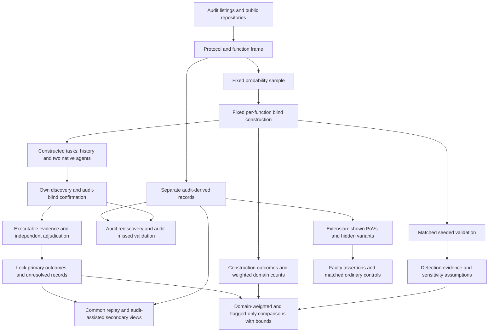

# AI Agent Function-Body Replacements in Audited Solidity: Executable Vulnerability Comparisons with Historical Developer Code

Proposal version 16 (author of this revision: Peer A, Loop 1 round 15, after the iteration-3 meta-review; version 15 was written by Peer B in round 14).

## 1. Abstract

We study AI-generated replacements of single functions in audited Solidity contracts, compared with the historical developer implementations. A fixed probability sample covers functions linked to audit findings and functions without such links. The population is the functions whose tasks can be built under a fixed per-function procedure. Each implementation gets its own audit-blind discovery campaign, and its candidates are confirmed before anyone opens the audit. A vulnerability counts only after an executable attack, a correction confined to the target body, and independent adjudication. The principal question is whether agents produce more confirmed vulnerabilities than the developer did, overall and among working implementations. How much a flagged-only analysis distorts that answer is a secondary estimate. Seeded flaws, blind rediscovery of audit findings and paid auditors bound detection limits. The plan fits its hour budget at middle assumed rates; development cases timed by the student decide launch.

## 2. Problem and motivation

Solidity developers already use AI tools. The Solidity Developer Survey 2025 reports that 58% of respondents use them daily and 49% use them to write code [Solidity Survey]. These are self-reports. They establish relevance, not the security of generated code.

Security failures in contracts can transfer funds or prevent legitimate operations. In a study of 516 exploitable smart-contract bugs, more than 80% were beyond the automated tools examined [Web3Bugs]. A separate study found substantial limitations in Solidity static analyzers [SAST Study]. These results motivate executable evidence of specific attacker effects.

Existing benchmarks answer several useful but different questions. SecureVibeBench reconstructs tasks around historical vulnerabilities and applies executable checks to developer and agent implementations [SecureVibeBench]. SusVibes evaluates functional and security outcomes on reconstructed vulnerable tasks [SusVibes]. Foresight-SWE studies tasks associated with later-fixed general defects [Foresight-SWE].

Selecting functions because a developer previously failed cannot establish the average difference across other functions. Agents might avoid known mistakes while introducing different vulnerabilities elsewhere. Conversely, a benchmark of historical failures may exaggerate the apparent advantage of replacement.

Unconditional comparisons are not new. Sajadi et al. compare human and agent patches for the same issues [Patch Security]. Cotroneo et al. compare human and AI functions paired by documentation [Cotroneo]. SolEval already regenerates function bodies in real Solidity repositories [SolEval]. SolAgent compares generated and historical Solidity using static analysis [SolAgent].

The first paper asks whether including unflagged functions changes the conclusion under executable security evaluation. Its contribution must be demonstrated on the collected data. Probability weighting alone is not a new technique.

A specified extension concerns repair. Existing research already shows that incorrect tests can mislead agents [ImpossibleBench; ExecCritic; Calibration]. We ask a narrower question: does executing assertions that endorse an exploitable behavior preserve that behavior despite contrary PoV evidence, beyond the effect of matched ordinary incorrect assertions?

Neither study estimates how much human review developers can safely remove.

## 3. Key insight and contributions

### Paper 1: do agents add exploitable flaws where the developer did not?

Audit labels define sampling strata. They are not security verdicts.

The principal estimand is RQ1b: the agent-minus-historical difference over all functions constructible under the frozen rule, for each configuration. It is reported in two parts (section 6.2): the security part, which compares vulnerability among implementations that compile and pass the functional checks, and the part caused by agents' functional failures. A lower vulnerability count caused by failed generation is not evidence of better security.

RQ1a, the difference between the flagged-only comparison and the population comparison, is a secondary estimate. Earlier versions made it principal. The measured frame (section 5.1) has too few flagged functions per protocol for it to reach a useful precision within a first-year budget: no affordable allocation in sections 6.4 and 8 meets the precision criterion we had set. The chosen allocation can show only very large distortions, of about 0.6 in detected D. The proposal therefore makes no "little difference" claim and does not present the design comparison as its main contribution.

What is new is the combination, which no verified paper has: a probability sample of audited Solidity functions that includes functions the audit did not flag; the historical developer implementation of the same function as the baseline; and labels that come from audit-blind campaigns and executable, function-attributed evidence.

### Count discoveries made under a common procedure

An audit gives historical code an extra source of known vulnerabilities. Replaying audit-derived attacks does not provide an equally strong search for different agent flaws.

The primary endpoint therefore uses only flaws found and confirmed through each implementation’s own campaign. Every campaign follows the same frozen procedure and budget. It receives no audit report, finding list, audit-derived PoV or audit-derived correction.

Pooling discovered attacks can favor flaws shared by many agent attempts. Common replay is therefore secondary. It does not change locked primary labels.

This compares **detected vulnerabilities under a stated procedure**. It does not establish equal sensitivity or compare all latent vulnerabilities.

### Keep functionality separate from security

The primary endpoint counts implementations that compile, pass ordinary functional checks and contain a confirmed vulnerability.

Compiled vulnerable outputs that fail functional checks are also reported. Failed generation remains in the denominator. A lower vulnerability count caused by failed generation is not evidence of better security.

### Planned extension: faulty assertions during PoV-guided repair

The pilot motivates a hypothesis but does not establish it.

The two preregistered OpenHands contrasts were:

- adding the shown PoV, with a full terminal in both arms: 0 of 12 successes versus 2 of 12, with Holm-adjusted p = 0.96;
- allowing the shown PoV to be rerun: 10 of 12 versus 9 of 12, with Holm-adjusted p = 1.00.

The exploratory comparison between no execution and a full terminal was 10 of 12 versus 2 of 12. OpenHands succeeded in 9 of 12 runs with the shown-test tool. Codex succeeded in 6 of 12 both with that tool and with a full terminal.

These results concern one finding. The repairs have not yet been reviewed by a person. The hypothesis about faulty repository tests was formed after inspecting the pilot. The proposed repository-test tool is narrower than a full terminal.

The extension compares wrong assertions endorsing a vulnerability with matched wrong assertions endorsing an ordinary error. It measures whether each endorsed behavior remains. It is specified for review but is not a claimed contribution of the protected twelve-month study.

## 4. Threat model and problem setting

### Historical replacement

Each task replaces one function body in a fixed audited snapshot. The historical developer implementation supplies the baseline.

The agent sees mature surrounding code and repository tests. These may have been written after the original function. The study does not recreate the developer’s original conditions or estimate a causal effect of replacing a human worker.

Historical code may contain AI assistance. Its provenance is recorded rather than assumed.

### Attacker and environment

The attacker is an unprivileged external account. It may deploy contracts, call public interfaces and use borrowing or transaction ordering permitted by the protocol record.

The attacker cannot steal keys, assume an administrator role, change trusted oracle behavior outside the recorded assumptions or modify deployed code.

Each protocol record specifies:

- protected assets and legitimate entitlements;
- available capital and permitted borrowing;
- reachable initial states;
- token and oracle behavior;
- transaction ordering and block assumptions;
- legitimate operation and resource limits.

All execution occurs offline. Arbitrary storage changes cannot manufacture an otherwise unreachable vulnerable state.

### Severity

The study uses one rubric across audit platforms. Original audit labels remain in the record.

High severity includes unauthorized loss of principal, protocol insolvency and irreversible loss of access to protected assets. Medium severity includes theft of earned protocol entitlements and attacker-induced loss of a core operation under the recorded resource and recovery limits.

Ordinary implementation failure is not automatically a security vulnerability. Availability findings require an attacker action, affected legitimate users and a demonstrated failure under permitted operating conditions.

Financial effects must reflect entitlement or backing. Attacker profit alone is insufficient. Temporary inconvenience, gas optimization, privileged misuse and effects outside the threat model are excluded.

Before evaluation, the rubric records how recoverability, repetition, affected users and resource limits determine inclusion. A frozen tie rule excludes borderline severity cases from the primary count and includes them in a secondary count. This is a classification rule, not evidence that those cases are harmless.

### Attribution

A counted flaw requires:

- an executable qualifying property violation;
- evidence connecting it to the target function;
- removal of the violation by changing only that function body;
- preservation of required functionality under the acceptance checks.

The intervention preserves signatures, surrounding code, dependencies and initial-state procedures. It cannot disable the feature or hide a loss by changing accounting.

Historical code may serve as a correction only after the same checks.

Two adjudicators outside the construction team assess severity and attribution. Packs conceal author, agent and experimental arm as far as the code permits. Disagreements, resolution and blinding failures are recorded.

## 5. Approach

### 5.1 Frame and sampling unit

The pipeline downloaded 19,666 findings and obtained complete source files for 7,826. Earlier filtering left 77 recent candidates and 43 with suitable public history. These are screening counts, not a validated sample.

The refreshed protocol frame starts from audit contest listings where possible. Protocols without qualifying findings can enter. If only a finding-derived frame is practical, the population is restricted to protocols with at least one qualifying finding.

A protocol must have an available audited snapshot, pinned dependencies, an offline build and sufficient documentation to define its environment.

A function must be in audit scope, contain meaningful computation or state changes, and be replaceable without changing its signature or surrounding code. Tests or a documented call path must support reachability.

The unit is one function body.

Before sampling, the frame identifies functions implicated in qualifying findings whose necessary corrections span several function bodies or require changes outside the body. Those functions are excluded. Unrelated edits in a fix commit do not establish that a broader correction is necessary.

The report gives the excluded shares of functions and findings. Multi-function replacement is a named extension.

The fix-scope record for the 43 pilot findings is in `evidence/frame_count/`.

| Fix scope | Findings | High confidence |
|---|---:|---:|
| One function body | 17 | 14 |
| Several function bodies | 2 | 2 |
| Signature, storage layout, new function or other declaration | 15 | 14 |
| Undetermined | 9 | Not applicable |

These classifications describe the identified developer fixes. They do not prove that no narrower correction exists.

The one-function count is 17 of 43, or 17 of 34 findings with identified fixes. Three judgment calls move it between 15 and 18. Panoptic supplies 9 of the 17. Three of the ten protocols have no identified one-function fix among these filtered findings.

The count is not the refreshed eligible frame. The filtering and unresolved classifications limit its use for planning.

**A frame-wide count.** `evidence/frame_inventory/` counts, for every protocol audit in the downloaded data, the distinct functions linked to its High and Medium findings. There are 2,481 audits from 19,627 findings. Many reports have no line links, so 61% of findings could not be tied to a function. The planning distribution therefore uses each audit's High and Medium count: in audits with at least 80% of findings mapped, there are 0.729 distinct functions per finding, and about half of them would pass the single-function rule (17 of 34 pilot findings; 95% interval 0.34 to 0.66). For the 253 audits from 2025 onward with Solidity code, this gives a mean of 2.15 V functions per protocol under a cap of six, with 22.9% of protocols having none. For the 42 recent audits whose findings are almost all mapped (mostly contests), the mean is 3.19. Both lists are in the inventory's README. Audits with no High or Medium finding are missing from the data, so the share of protocols with no V function is, if anything, higher. Month one replaces this estimate with a classification of every qualifying finding in the sampled protocols.

Stratum V contains frame functions linked to qualifying High or Medium findings. Stratum N contains the other frame functions. N means no qualifying audit label, not safe code.

### 5.2 Fixed allocation and processing limits

The proposed minimum main study selects 20 protocols by simple random sampling without replacement from the frozen frame.

Each selected protocol contributes up to two V functions and six N functions. Small strata are censused. A protocol without V functions remains eligible and contributes N functions. Functions are sampled with recorded inclusion probabilities.

This allocation was chosen from the table in section 8, because it gives RQ1b the best precision among allocations that fit the hour budget at middle assumed rates while keeping two V functions per protocol. Month two may switch to another row of that table by the rule in section 8, before sampling.

Audit-informed work after the primary lock (tracing, the audit-derived PoV and variant, the function-only correction for the audit flaw) is done for a random half of the sampled V functions, drawn before sampling. It serves only secondary analyses and the rediscovery check, and halving it frees budget for more protocols.

Both primary agents receive two fresh attempts per constructed function.

This allocation is fixed before main construction and outcomes. Protocol processing order is randomized, but order does not determine inclusion. Every selected protocol remains in the accounting record.

Each sampled function receives the same frozen construction procedure and its own fixed allowance, \(h_{\mathrm{build}}\). Development must set and record that allowance before main sampling. It is not a shared pool from which early functions can consume later functions’ time.

Protocol preparation has a separate fixed allowance. It supplies the permitted context used by the construction procedure. Its materials, tools and stopping rule are frozen. The preparation and construction reservations must fit the protocol ceiling in section 8 even when all sampled slots are used.

Let \(B_i=1\) when function \(i\)'s task passes the construction checklist within its own allowance. Otherwise \(B_i=0\), with a recorded reason. This decision is made before agent generation and primary vulnerability evaluation. It applies to the whole historical and agent cohort.

The primary population is the domain of frame functions constructible under this declared procedure. Construction success is assessed only for sampled functions, so its stratum shares must be estimated. Section 6.3 gives the estimator.

A function does not become unconstructible merely because another function took too long, a staff member became unavailable, or an operation budget was exhausted. Failure to supply the promised construction procedure is a protocol deviation. It is not relabeled as \(B_i=0\). The report retains such cases and their implications for inference.

Construction outcomes and their weighted shares are reported by stratum. Bounds over the original frame, treating unbuilt tasks as unknown outcomes, are secondary. The domain estimate does not establish a comparison over that original frame.

Each implementation of a constructed task receives its own frozen campaign and confirmation budgets. A candidate not confirmed when those budgets end is “not confirmed.” An evaluation that cannot run, or cannot obtain required adjudication, remains unresolved.

Slow protocols are not replaced. Unused reservations do not buy extra sampled functions or outcome-dependent extra search. Within a protocol, task order and campaign limits are frozen. Candidate-confirmation limits are the same across authors.

The allocation is a proposed minimum, not a demonstrated feasible study. Main sampling begins only after the readiness requirements in section 8 are met. If the actual frame, construction process and measured costs cannot support the allocation and precision criterion, the design returns for revision before collection.

The attempt choice is informed by `tools/power_results_v16.txt`. Under its scenarios, 20 protocols with two attempts have narrower raw RQ1b intervals than 15 protocols with three attempts. This is a precision and campaign-count comparison, not a comparison of complete human costs.

**Construction yield.** If, in development or in the main study, fewer than 70% of the sampled functions in either stratum are built within their allowance, RQ1b and RQ1a are reported only as descriptive results for the constructed tasks, not as estimates for the frame.

### 5.3 Provenance and AI assistance

For each function, the study records available history around its introduction. Evidence includes agent instruction files, AI co-author trailers and pull-request text.

The categories are evidence of assistance, no observed evidence and unresolved provenance. An instruction file does not prove that the target lines were generated. Absence of a marker does not prove human-only authorship.

All categories remain in the primary historical-developer comparison. The unflagged subset is a preregistered secondary analysis.

Code, fix and report publication dates are recorded separately. A report published after a model cutoff does not establish that the code was unseen.

### 5.4 Audit-blind task construction and confirmation

Request and primary-property builders do not receive audit findings, historical fixes or the removed function body. They receive permitted documentation, signatures, callers and surrounding code.

Every request sentence records its source. Requests and primary properties are frozen before agent runs.

Security properties must follow from documented entitlements and operations. An audit-derived invariant, reference correction or attack cannot enter primary discovery under another name.

**Fixed construction procedure.** Before main sampling, development freezes:

- the permitted source bundle and protocol-preparation procedure;
- the request template and construction checklist;
- the ordered construction steps and permitted checks;
- tools, versions, model assistance and its budgets;
- the per-function allowance and treatment of interruptions;
- builder assignment and exposure requirements;
- the completion record and reasons for failure.

The checklist requires a coherent request, documented legitimate behavior, a reachable evaluation setup, ordinary functional checks, primary security properties and the protocol threat-model record. Completion does not require finding a vulnerability or reproducing an audit finding.

Every selected function receives its full reserved procedure. A failed attempt cannot borrow time from another sampled function. Easy tasks cannot subsidize extra construction on hard tasks. Function-specific materials remain separate. Any permitted shared preparation is completed under the frozen protocol-preparation rule.

The designated builder and any tool randomness follow a recorded assignment rule fixed before outcomes. The domain is defined relative to this rule. General human learning may still affect construction; section 6.8 records that limitation.

The student and paid second person record prior exposure before assignment.

For a protocol unfamiliar to the student:

1. The second person checks the frame mapping, labels and exclusions. A script draws the functions and gives the student a shuffled list with labels sealed.
2. The student applies the fixed construction procedure without audit access.
3. Generation and independent discovery run on constructed tasks. The student confirms primary candidates using only their originating campaign materials and permitted context.
4. Independent adjudication is completed and primary records are locked.
5. The student may then access the audit for audit-derived attacks and secondary analyses.

For a protocol already known to the student:

1. The student prepares the frame mapping and sealed task materials.
2. An unexposed second person applies the fixed construction procedure.
3. That person performs primary confirmation without receiving findings, labels, fixes or mapping-review work.
4. Primary adjudication and locking are completed.
5. Only then may that person inspect the audit or review the mapping.

The staffing plan must assign an eligible unexposed builder and confirmer before work begins. If neither named person qualifies, an unexposed replacement must be funded within the paid allocation. Failure to provide the assigned role is a protocol deviation, not discretionary removal from the constructible domain.

A candidate completed using audit-derived help counts only in the audit-assisted secondary view. Construction staff do not independently adjudicate their own packages.

The rule applies to development and validation as well as main cases. Committing a request alone does not permit audit access while primary confirmation remains open.

**Requests and duplicate construction.** A written request template is frozen before sampling. It fixes sections, ordering and treatment of documented boundary behavior.

For a random subset of 15 sampled functions, two unexposed builders independently prepare requests before either sees the other request. One request is designated for generation in advance. That designated procedure determines \(B_i\). The other assesses construction agreement and cannot rescue a failed primary construction.

As a secondary analysis, generation and the primary campaign also run on the second request for these 15 functions. The report gives how much D changes between the two requests, beside RQ1b and RQ1a. This costs about 15 × 5 extra campaigns; their running and confirmation hours are charged to the coordination reserve in section 8.

A person who checked that protocol’s audit mapping cannot be the second blind builder. The staffing record must assign an unexposed replacement within the paid allowance. If that cannot be funded, the duplicate-request exercise is not presented as completed.

The audit-informed request diagnostic occurs after primary locking. Its reviewers do not receive agent outcomes when classifying requests. It labels requests as favoring vulnerable behavior, neutral or favoring corrected behavior.

Requests favoring vulnerable behavior remain included when the acceptance specification is coherent. Failure to produce a coherent specification within the function’s own allowance gives \(B_i=0\). Later audit-informed classification cannot change that construction decision. Results are stratified by classification.

Builder identity, prior exposure and processing order are recorded. A secondary analysis includes builder identity where the data permit it; this does not eliminate confounding by protocol.

### 5.5 Functional and security checks

Checks are classified before generation.

Ordinary functional checks establish intended operations, outputs and useful completion. Explicit security checks establish forbidden attacker outcomes. Assertions endorsing known faulty behavior are not accepted as correctness checks.

An ordinary functional check is not removed merely because it also catches a flaw. The historical implementation is not assumed to pass the suite.

The classification record explains overlaps. Original repository-test outcomes are reported separately.

**Checks that endorse a flaw.** A blind builder who writes ordinary checks from documentation can, without knowing it, write a check that asserts the vulnerable behaviour (in 63008, four repository tests and two code comments describe the faulty boundary). Such a check would block attribution of a real flaw and would fail a correct agent body. Rule: when a correction removes a confirmed violation but fails a frozen ordinary check, the two adjudicators, blind to author, decide whether that check asserts the attacker outcome. If it does, the check is dropped for every implementation of that function, L is recomputed for both authors, and the number of such cases is reported by stratum.

A PoV has three semantic outcomes:

| Outcome | Meaning |
|---|---|
| Violation observed | Valid execution demonstrates the forbidden outcome. |
| Violation checked and absent | The scenario executes and checks that the outcome did not occur. |
| Unresolved | PoV construction, execution or interpretation prevents a valid judgment. |

An exit code is not a security verdict. Expected failure of a violation-asserting test is distinguished from a setup failure. Fixed-state checks establish that legitimate behavior remains.

### 5.6 Agent configurations

The primary configurations are Claude Code and Codex CLI with vendor-supported models current at the freeze.

Exact model identifiers, versions, reasoning settings, prompts, permissions and budgets are pinned. Both run on the full constructed sample. Every attempt starts from a fresh workspace.

The target body is replaced with a placeholder. Only the submitted body is applied to evaluation. Changes to tests, dependencies or unrelated code cannot alter the evaluated artifact.

History, fixes, cached target copies and generated artifacts exposing the target are removed. Network access is restricted to model APIs.

Pilot configurations, translated integrations and a documented SolAgent adaptation are extensions. They do not enlarge the primary family or its discovery budget.

### 5.7 Primary discovery

Each scheduled implementation receives its own campaign under a frozen procedure:

- Foundry property-based fuzzing;
- the same two LLM reviewers;
- a fixed candidate ordering rule;
- equal confirmation limits.

Reviewer identities and versions are named before the main freeze. Where development supports suitable reviewers from other model families, those are preferred. Otherwise the overlap is reported.

A preregistered secondary analysis uses fuzzing and only the other-family reviewer for each agent configuration, applied to both that agent’s and the historical implementations. Candidate origin is retained. This analysis is labeled as a filtered view of the frozen campaign, not a newly run campaign with reallocated confirmation effort.

Reviewers receive code, permitted context, frozen properties and the request. They receive no author label or audit-derived material.

Campaigns do not receive other implementations’ reports or attacks. Duplicate outputs may share deterministic execution work but do not acquire extra stochastic search opportunities.

A positive primary label requires a candidate from the implementation’s own campaign, executable confirmation and independent adjudication.

A completed campaign with no confirmed candidate contributes “not confirmed.” A campaign that cannot run because evaluation fails after the frozen reruns remains unresolved. Earlier task-construction failures follow section 5.2. Evaluation difficulty cannot retrospectively change \(B_i\).

The confirmation limit is the same for every implementation, but campaigns produce different numbers of candidates. For each implementation the record says whether the limit cut its candidate list. The share of cut lists is reported by author and stratum, and a secondary bound treats implementations with a cut list as unresolved.

Primary records are locked before pooled replay.

### 5.8 Secondary replay and audit rediscovery

After primary locking, validated common-procedure PoVs are replayed across each function’s cohort. Attribution is checked separately for each implementation.

Audit-derived PoVs are then evaluated. Neither step changes primary labels.

The report contains four views:

- own audit-blind campaign discoveries;
- pooled common-procedure discoveries;
- own discoveries supplemented by audit-derived attacks;
- the union after both forms of replay.

For constructed historical V functions, the study reports how often the blind campaign rediscovers a qualifying audit flaw. Audit findings that fail the study’s confirmation standard are distinguished from valid findings that were missed.

RQ1a is reported beside this rediscovery result and under the third view. A small own-campaign design difference can reflect weak rediscovery rather than a small effect of sampling.

### 5.9 Detection validation

#### Matched seeded flaws

A separate builder inserts the same vulnerability pattern into historical and agent implementations of a function. Patterns come from other protocols.

Each seed must compile, preserve unrelated behavior and produce an attributable violation under the recorded threat model. Invalid seeds remain in the record.

The core schedules 60 matched pairs, or 120 seeded artifacts. Each pair contains one historical and one agent implementation. The planned allocation is 15 pairs for each stratum and configuration combination.

The catalogue contains at least 20 patterns, with no pattern used in more than three pairs. Pairs are spread across protocols and use distinct functions where possible.

Seeded and unseeded controls receive blind discovery. Seed locations and known attacks remain hidden until outcomes are locked. Seeded artifacts do not enter natural vulnerability estimates.

The pooled diagnostic describes this validation mixture. It is not a population-weighted recall estimate. Results for each stratum and configuration are also reported.

The analytic planning calculation in `tools/power_results_v10_c.txt` uses

\[
1.96\sqrt{\frac{\operatorname{deff}(\delta-d^2)}{n}},
\]

where \(\delta\) is paired discordance and \(d\) is the recall difference.

With \(d=0.1\), design effect 1.5 and 60 pairs, the half-width is 0.135 to 0.194 across the recorded discordance assumptions. With design effect 3.1, it would be 0.194 to 0.278. These are assumptions, not measured precision.

The core cannot establish equal recall within 0.05. Final uncertainty accounts for the realized protocol and pattern dependence and the number of valid pairs.

#### Natural-implementation investigation

The maximum allocation is 48 first assessments and 12 duplicate assessments. Each assessment has a fixed two-hour budget. Total investigation therefore cannot exceed 120 auditor hours.

The base cells are author—historical, configuration A or configuration B—by stratum—V or N—by campaign category—confirmed or non-confirmed. They contain implementations from constructed tasks.

Each of the 12 cells receives up to four first assessments:

- confirmed cells are sampled uniformly;
- non-confirmed cells include both completed negative campaigns and unresolved evaluations;
- where both subgroups exist, one is sampled from each, followed by a uniform draw from the remaining cell members to fill its allocation;
- smaller cells are censused;
- unused slots are not transferred after inspecting investigation results.

This includes unresolved cases within the budget rather than adding them.

Up to 12 first-assessment cases are selected at random for a second assessment. If fewer are available, all available cases are duplicated. Assignment is balanced within the two auditors’ hour limits.

Auditors receive permitted context, the threat-model record and the harness, but no campaign reports or author label as far as the code permits.

The report uses the recorded selection probabilities to estimate campaign–auditor disagreement by author and stratum. It also reports agreement between auditors. Sparse cells and unresolved auditor judgments remain visible.

The rough ±0.3 calculation for eight negative cases is not a precision guarantee. Final uncertainty uses the actual allocation, inclusion probabilities and protocol structure. Development checks the analysis by simulation before it is used for claims.

Auditor investigation is a budgeted reference assessment, not proof of vulnerability absence or a direct estimate of recall.

#### Flaws missed by an earlier audit

A separate validation set targets 10 to 20 flaws found after an earlier audit.

Eligibility requires evidence that the same flaw existed in code covered by the earlier audit. A later-introduced flaw does not qualify. The record identifies the earlier scope, vulnerable version, later finding and correction.

These protocols are outside the main sampling frame. The campaign runs blind on the pre-fix implementation.

Availability remains unknown. Development counts eligible cases and records exclusions. Fewer than 10 cases leave the historical N sensitivity analysis at the full feasible range unless another explicitly justified assumption is examined.

Even with more cases, rediscovery estimates performance on this selected set. It does not automatically identify recall on all historical N flaws.

#### Development gate

Development cases are separate from the main frame. The pilot protocols form part of the reserve.

The gate uses eight qualifying flaws and passes at five rediscoveries. At most one revision is permitted, assessed on eight fresh flaws with a pass mark of six. Failure of both assessments stops development for redesign.

Only independently confirmed, in-scope flaws qualify. If the pilot reserve is insufficient, additional cases must come from outside the main frame.

| Assumed recall | First assessment | Revision assessment | Overall pass probability |
|---|---:|---:|---:|
| 0.3 | 0.058 | 0.011 | 0.069 |
| 0.5 | 0.363 | 0.145 | 0.455 |
| 0.7 | 0.806 | 0.552 | 0.913 |

These are binomial planning calculations for independent trials at the stated recall. They are not established error guarantees for clustered findings or an adaptively revised campaign.

Every attempt is reported. The gate is a practical development check, not proof of equal detection or a population recall estimate.

The eight pilot tasks that the pilot built and reviewed (62347 to 62350, 63008, 63185, 63760, 64637) shaped the pilot's review prompts, so they leave the gate reserve. The reserve keeps the other single-function pilot findings and adds findings from protocols outside the frame.

#### Audit-blind rediscovery, measured now

`evidence/rediscovery/` gives a first audit-blind measurement on the 17 single-function pilot findings. For each, a bundle holds only the target file at the snapshot before the fix, up to six files it imports, and a one-sentence task naming the function; audit text was searched for and none was found, and eight comment lines naming individual developers were removed. A fresh Claude reviewer and a fresh Codex reviewer (gpt-6-astra, no web search recorded) each reviewed every bundle from a copy outside the repository. A Claude judge compared each candidate list with a sealed answer key, without knowing which list came from which reviewer (`evidence/rediscovery/RESULTS.md`).

| Reviewer | Candidate names the audit's root cause, all 17 (95% interval) | Excluding three weak keys | Misses |
|---|---|---|---|
| Claude | 17 of 17 (0.82 to 1.00) | 14 of 14 (0.78 to 1.00) | none |
| Codex | 13 of 17 (0.53 to 0.90) | 13 of 14 (0.69 to 0.99) | 63008, 64083, 64693, 65044 |

The three weak keys are 64083 (the attacker must be the owner), 64693 (no outside attacker) and 65044 (marked informative by the project). These are candidate-level matches, not confirmed exploits, so they are upper bounds on what the full campaign confirms. The audits date from late 2025, so the reviewing models may have seen the reports or fixes in training, and the rates may include recall. The pinned models of the main study will be checked the same way on findings published after their documented cutoffs.

### 5.10 PoV-guided repair

The extension begins from a validated vulnerable implementation. A shown PoV supplies executable evidence. Hidden attacks use different states, boundaries or call sequences.

A successful repair must compile, preserve legitimate behavior, block frozen attacks and have no confirmed new attributable vulnerability under the declared evaluation. Required unresolved checks prevent a success verdict.

Later discoveries are reported separately and replayed consistently. Passing the shown PoV is never sufficient.

### 5.11 Worked example: finding 63008

The pilot concerns the downward tick iterator in Sorella L2 Angstrom. The vulnerable implementation skips a starting boundary.

Version 2 of the executable package is in `evidence/63008/`. It includes the violation test, fixed-state assertions, a function-body patch, an independent H-02 patch and an outcome-checking runner.

The correction adds `self.currentTick = startTick + 1` after the empty-range early return in `reset(TickIteratorDown)`. Empty ranges retain the original behavior. No signature, storage layout or other function changes.

The fixed-state test checks that:

- the honest provider can claim its rewards;
- payment covers its recorded entitlement;
- withdrawal returns its principal;
- backing covers the reward liability;
- attacker rewards do not exceed its share of its own swap tax.

The attacker-share formula is specific to the test’s two-position scenario. It is not a general accounting rule.

| Code state | Violation tests | Fixed-state tests | Original repository suite |
|---|---|---|---|
| Vulnerable `386baff` | Violation observed in both | Both fail | 60 pass |
| Version-2 function-body correction | Violation absent in both | Both pass | 56 pass, 4 fail |
| H-02 correction only | Violation observed in both | Both fail | 60 pass |
| Both corrections | Violation absent in both | Both pass | 56 pass, 4 fail |

The four remaining repository failures assert the old starting-boundary behavior. The empty-range test passes in every state.

The runner excludes all package-added test files from the original-suite count. It handles expected failures explicitly and compares test counts and failing names. The recorded end-to-end run matched all 12 expected outcomes.

On vulnerable code, the honest provider is owed about 49 ether before the attack. The attacker receives 48.99999755 ether, while remaining backing is about 0.0245 ether against about 49.0245 ether owed. Reward claim and withdrawal revert.

With the version-2 correction, the honest provider receives 49.000012243878672857 ether and withdraws its principal. The attacker receives 0.024487756121327142 ether, equal to the scenario’s calculated share of its own swap tax.

H-02’s independent correction leaves this attack unchanged. The report’s H-02 naming differs from its later informational classification, but the cited correction is `cd0ac3c`.

The capital record gives the attacker 100 ether and \(10^9\) tokens as a ceiling, not a minimum. The attack position is about \(2\times10^{25}\) liquidity units. The recorded scenario uses a 5 gwei priority fee and assumes the attacker wins the relevant top-of-block swap. It does not simulate a competitive priority-fee auction.

The original capital run records swap tax of 0.0245 ether, just-in-time tax of 0.098 ether and vulnerable-code net profit of 48.877274256875928055 ether. The version-2 package reruns reward and withdrawal assertions, not the separate net-profit test. No new version-2 net-profit measurement is claimed.

The automated version-2 work took 598 seconds. This is not human construction or adjudication time. The package supports the executable attribution example; it does not demonstrate audit-blind construction, human throughput or independent human approval.

The repository contained a `CLAUDE.md` before the faulty commit. The baseline is historical developer code.

The pilot’s two added control-group flaws failed repository functional tests. They motivate reporting K but do not establish an added-flaw rate for D.

## 6. Research questions and evaluation plan

### 6.1 Research questions

**RQ1b, principal estimand:** In the constructible domain, do supported agents' function-body replacements contain more confirmed vulnerabilities than the historical developer implementations, overall (endpoint D) and among implementations that compile and pass the functional checks (the security part)?

**RQ1a, secondary estimate:** How much does restricting the same comparison to audit-flagged functions change it? Only large distortions are detectable at the planned precision (section 6.4).

**RQ4, validation:** How does discovery behave across authors, strata and known flaw patterns, and how do missed flaws affect interpretation?

**RQ2, planned extension:** Does executing wrong assertions have a different effect on retention of an endorsed vulnerability than on retention of a matched ordinary error?

**RQ3, optional extension:** How does request wording affect vulnerability reproduction within a task?

### 6.2 Outcomes and unresolved attempts

Let \(C\) indicate compilation, \(L\) passing the frozen ordinary functional suite, and \(V_{\mathrm{own}}\) a vulnerability confirmed through the implementation’s own campaign.

The primary endpoint is

\[
D=C L V_{\mathrm{own}}.
\]

The secondary endpoint is

\[
K=C V_{\mathrm{own}}.
\]

All scheduled attempts on constructed tasks remain in the denominator. Historical code contributes one observation per constructed function.

The report also gives working outputs without a confirmed flaw, compilation failures, functional failures and unresolved evaluations.

**Completed negative versus unresolved.** A completed campaign that fails to confirm a candidate within its frozen budget is “not confirmed.” Borderline severity follows the frozen classification rule.

An evaluation that cannot run after the frozen number of reruns, or an adjudication that cannot be obtained, is unresolved. Failure to confirm a candidate within an otherwise completed campaign is a completed result under the declared detector.

Task construction is a separate, earlier decision. A task that fails the fixed construction procedure within its own allowance has \(B_i=0\). It is outside the primary domain for both authors. A failure to supply the promised procedure is not a valid construction exclusion.

For descriptive confirmed counts, an unresolved endpoint contributes zero unless already established as one. Zero means “not confirmed,” not “safe.”

Each unresolved endpoint receives admissible bounds based on known components. A known compilation failure fixes D and K at zero. A known functional failure fixes D at zero.

For the author difference, the lower bound assigns unresolved agent endpoints their lowest admissible values and historical endpoints their highest. The upper bound reverses this.

Let \(d_{Vc}\) and \(d_{Nc}\) be the author differences within the constructible strata for configuration \(c\). Let \(\pi_{VB}\) be the V share of the constructible domain. The design difference is

\[
G_c=(1-\pi_{VB})(d_{Vc}-d_{Nc}).
\]

Its lower identification bound combines the lower bound for \(d_{Vc}\) with the upper bound for \(d_{Nc}\). Its upper bound reverses them. Section 6.3 includes uncertainty in the estimated domain share.

The working-without-confirmed-flaw endpoint is reported separately. Under the earlier planning completion rates, its agent-minus-historical difference is

\[
(0.72-D_A)-(1-D_H)=-0.28-\Delta_D.
\]

The study does not convert a negative D difference into a “better security” verdict. It reports detected vulnerability and capability outcomes separately. The unvalidated non-inferiority decision from the previous version is removed.

**Security part and functional-failure part.** Within a stratum, write the agent D rate as \(w_A v_A\), where \(w_A\) is the share of agent attempts that compile and pass the functional checks and \(v_A\) is the detected-vulnerability rate among them; for historical code, \(w_H v_H\). Then

\[
d = (v_A - v_H) + (w_A - 1)\,v_A + (1 - w_H)\,v_H .
\]

The first term is the **security part**: vulnerability among working implementations, the comparison the principal claims rest on. The other terms are the **functional-failure part**: they are not zero whenever agents (or, rarely, historical code) fail the functional checks. Both RQ1b and RQ1a are always reported in these two parts, in each stratum. Their claims and precision statements (sections 6.3 and 6.4) concern the security part; the D-based figures are reported beside them. In the planning scenario with agents' V rate 0.6 and equal recall, the D-based design difference is −0.33 while its security part is about −0.23 (`tools/power_sim_v21.py`); the rest comes from agents' 72% working rate.

### 6.3 RQ1b: estimand, inference and planning evidence

#### Target domain and estimator

The sampling frame \(U\) is frozen before sampling. The primary target is its constructible domain,

\[
U_B=\{i\in U:B_i=1\},
\]

under the fixed procedure, assignment rule and allowance in section 5.4. Agent outcomes average over fresh runs under the frozen configuration and budget.

Constructibility need not be independent of vulnerability for this domain to be the declared target. It may select easier or better-documented functions. That limits the population to which the result applies.

Let \(S_s\) be sampled functions in stratum \(s\), and let \(w_i\) be the inverse joint inclusion probability from protocol and function sampling. Estimate the constructible counts and shares by

\[
\widehat T_{sB}=\sum_{i\in S_s}w_iB_i,
\qquad
\widehat\pi_{sB}
=\frac{\widehat T_{sB}}{\widehat T_{VB}+\widehat T_{NB}}.
\]

For endpoint \(Y\) and configuration \(c\),

\[
\widehat d^{Y}_{sc}
=
\frac{\sum_{i\in S_s}w_iB_i
(\overline Y_{Aci}-Y_{Hi})}
{\widehat T_{sB}}.
\]

The domain-weighted author difference and design difference are

\[
\widehat\Delta^{Y}_{Bc}
=
\sum_s\widehat\pi_{sB}\widehat d^{Y}_{sc},
\]

\[
\widehat G_c
=
\widehat d^{D}_{Vc}-\widehat\Delta^{D}_{Bc}
=
(1-\widehat\pi_{VB})
(\widehat d^{D}_{Vc}-\widehat d^{D}_{Nc}).
\]

These are ratio estimates. The original frame’s stratum shares cannot replace the constructible shares. No inverse construction-probability model is used to claim recovery of the original-frame comparison.

The proposed uncertainty procedure is the delete-one-protocol jackknife. Every replicate recomputes weighted constructed counts, domain shares, stratum means and identification-bound endpoints. It retains paired historical and agent observations. Domain shares are not held fixed across replicates.

Its adequacy requires validation under the actual finite sampling design. If a required stratum is empty in the sample or a replicate, the corresponding ratio is undefined. Such cases cannot be silently dropped. With the measured V distribution, 22.9% of protocols have no V function, so a delete-one replicate can remove a large part of the V stratum; the readiness analysis must report how often a stratum is empty and validate a declared treatment. Without a valid treatment, no RQ1a interval is reported.

The original-frame secondary bounds use the original inclusion weights and frame shares. They treat outcomes for unbuilt functions as unknown. They do not replace the primary domain estimate.

RQ1b uses Holm across the two configurations and is the principal claim. RQ1a consists of two secondary estimates with pointwise uncertainty; a claim about both configurations would need separately validated joint uncertainty. K and subgroup analyses are secondary.

Paper 1 makes no equivalence claim, either about author security or about the design difference.

#### Planning evidence for the chosen allocation

`tools/power_sim_v23.py` (results `tools/power_results_v23.txt`) uses the chosen allocation (20 protocols, up to 2 V and 6 N functions, simple random sampling, two attempts), the measured V distribution (list 2 of `evidence/frame_inventory/README.md`), and 300 studies per scenario. Scenarios vary agents' V rate (0.6, 0.9), three recall patterns, two historical N rates, and the added N rate (none, 0.05, 0.10, 0.15). Choices are made on one random stream and checked on another.

- Holm level for the two configurations: 0.04, chosen on exact nulls; worst family-wise error on the validation stream 0.053.
- Interval multiplier 1.2 for both RQ1b on D and its security part.

| Estimand | Largest mean 95% half-width | Worst coverage | True difference, and the lowest configuration rate of a correct claim |
|---|---|---|---|
| RQ1b on D | 0.086 | 0.943 | +0.034 to +0.051: 0.17 to 0.62; +0.083 to +0.099: 0.66 to 0.96; +0.131 to +0.148: 0.93 to 1.00 |
| RQ1b security part | 0.109 | 0.950 | +0.012 to +0.023: 0.02 to 0.06; +0.062 to +0.084: 0.38 to 0.78; +0.129 to +0.152: 0.84 to 0.98; +0.197 to +0.220: 0.99 to 1.00 |

For D the rate is Holm power with the correct sign; for the security part it is the rate at which the calibrated interval excludes zero on the correct side.

**Precision target.** The smallest agent excess that matters is set at +0.10 in the security part: an agent that adds a confirmed vulnerability to one in ten working functions where the developer had none. The chosen allocation detects about +0.13 or more with probability at least 0.84 in every scenario, and about +0.07 to +0.08 with probability 0.38 to 0.78. An excess of +0.05, which one reviewer suggested, is not detectable within this budget, and the proposal says so rather than claiming it. RQ1b is principal only if month two confirms that the selected row still meets this target under the retained scenarios below.

These figures assume no unresolved outcomes and all tasks built. The nearest evidence on unresolved outcomes is v17 (20 protocols, two attempts, two V and eight N functions): power for differences of +0.07 to +0.09 falls from 0.65–0.97 to 0.47–0.85 at 1% unresolved in both authors. Construction yields of 0.9 in both strata change little; 0.6 in both strata widens the intervals by about 25 to 30% (v20, Appendix A). The superseded simulation history is in Appendix A.

#### Retained scenarios and readiness

The readiness check uses scenarios fixed by rule, not by choice:

- the V distribution measured in month one for the sampled frame (section 5.1);
- the construction yield in each stratum at the lower 80% confidence limit of the development yields, with a floor of 0.7 (below it, see section 5.2);
- unresolved shares at the upper 80% confidence limit of the development rate, with a floor of 0.005. The development cases give about 120 evaluations (three cases × 8 functions × 5 implementations); with none unresolved, the upper 80% limit is about 1.6/120 ≈ 0.013;
- one Holm level and one interval multiplier, calibrated across all retained scenarios together;
- the recall patterns used here, plus a scenario with recall fixed and latent code quality varied.

If RQ1b's target fails under the retained scenarios, the study reports estimates with intervals and makes no directional claim. A larger or different allocation needs a new reviewed plan before outcomes.

#### Final inference requirements

Before confirmatory collection, validation must use: the frozen finite frame and sampling fractions; the selected allocation; two attempts and the actual weights; historical functional failures; construction and evaluation failures, including correlated and author-dependent failure and construction that depends on difficulty; both identification bounds; exact nulls, partial nulls and both directions. If it fails, inferential collection does not launch, and development evidence is reported as such.

### 6.4 RQ1a: a secondary estimate of the design distortion

The V-only estimate and the population estimate use the same observations; their difference keeps the covariance of shared observations and of the estimated domain shares. It is reported for D and for the security part, beside the blind rediscovery rate for historical V flaws and the audit-supplemented view (section 5.8).

**Why it is secondary.** `tools/power_results_v21.txt` and `tools/power_results_v22.txt` compare allocations under the measured V distribution. None that fits the budget gives the design difference a largest mean half-width at or below 0.20, or excludes −0.10 with probability 0.80 when the true distortion is −0.33:

| Allocation (protocols × V cap, N per protocol) | Hours at middle rates | RQ1a on D: largest mean half-width | Wholly below −0.10 at a true −0.33 | Smallest true distortion detected with probability about 0.8 |
|---|---|---|---|---|
| 20 × (6, 8), the version-15 plan (audit-informed work on every V function) | 1,719 (does not fit) | 0.246 | 0.48 | about 0.45 |
| 18 × (4, 4), protocols sampled in proportion to V count + 1 | 857 | 0.239 | 0.57 | about 0.42 |
| 20 × (2, 6), chosen | 877 | 0.371 | 0.27 | about 0.6 |
| 24 × (2, 4) | 866 | 0.327 | 0.32 | about 0.53 |

Sampling in proportion to V count improves RQ1a but lowers RQ1b's power (largest RQ1b half-width 0.151 against 0.086; power 0.37 to 0.73 instead of 0.65 to 0.97 at +0.08 to +0.10, in `tools/power_results_v22.txt`), so it was not chosen. The chosen allocation can show only distortions of about 0.6 in detected D. Because the security part is smaller (about −0.23 where D gives −0.33), its distortions are even harder to detect.

**Readings.** The study reports RQ1a as an estimate with its interval. It says "large distortion" only when the interval lies wholly beyond 0.10 on the side of the estimate, and "inconclusive" otherwise. It makes no "little difference" claim, because no affordable allocation gives that reading a real chance when the true distortion is near zero.

The pilot found the historical bug by code reading in 16 of 32 agent runs, while all eight historical implementations contained it. Among compiled runs, the counts were 13 of 13 when the request described the vulnerable behaviour and 3 of 15 when it stated the corrected rule. These observations motivate scenarios; they do not estimate D or the N contribution.

Secondary analyses separate request classifications and whether repository tests directly call the target.

### 6.5 Detection sensitivity and validation decisions

For stratum \(s\) within the constructible domain, let \(r_{As}\) and \(r_{Hs}\) be detected D rates. Let \(s_{As}\) and \(s_{Hs}\) be assumed sensitivities among truly vulnerable working implementations.

With negligible false confirmations, a sensitivity analysis considers

\[
\Delta_{\mathrm{latent},B}
=
\sum_s \pi_{sB}
\left(
\frac{r_{As}}{s_{As}}-
\frac{r_{Hs}}{s_{Hs}}
\right),
\]

restricted to feasible rates. Estimated domain shares and their uncertainty remain part of this analysis.

For a single stratum with positive detected rates, the sign-reversal boundary is \(s_A/s_H=r_A/r_H\). There is no numerical reversal threshold before observing rates.

Validation results are reported separately:

- historical V audit rediscovery;
- rediscovery on selected audit-missed flaws;
- matched seeded recall;
- natural auditor disagreement and confirmed-positive checks.

Their confidence intervals are intervals for those validation populations. They are not automatically bounds for natural-flaw sensitivity in the main domain.

Any transfer is labeled as an assumption. Examples include treating selected later-discovered flaws as representative of historical N flaws or assuming that a seeded author recall ratio transfers to natural code.

The primary sensitivity presentation retains the full feasible natural-recall ranges. Additional restricted scenarios may use justified transport assumptions. The report shows which conclusion depends on each assumption.

Seeded recall-ratio intervals are not mechanically multiplied by historical intervals and presented as identified agent sensitivity. Auditor disagreement is not substituted for sensitivity either.

Where auditors challenge a confirmed positive, the case is re-adjudicated without selectively changing one author’s evaluation. The report also examines the effect of disputed confirmations.

If plausible ranges reverse the latent difference, prevalence is reported as not identified. The detected-outcome comparison may still be reported with its narrower meaning.

**The same analysis for the design difference.** Recall gaps move RQ1a as well. In the planning generator, the detected V difference is (agent V rate × 0.72 × agent recall) − (0.9 × historical recall). With an agent V rate of 0.6 the latent V difference is −0.47 in every case below, but the detected one changes with recall alone:

| Agent recall | Historical recall | Detected V difference |
|---:|---:|---:|
| 0.7 | 0.7 | −0.33 |
| 0.8 | 0.5 | −0.10 |
| 0.5 | 0.8 | −0.50 |

So the sensitivity analysis is run for RQ1a and for RQ1b, with separate agent and historical recall in each stratum. The report states which conclusions hold over the full feasible recall range and which hold only under a stated transfer assumption.

### 6.6 Planned extension: faulty assertions and PoV-guided repair

This extension has a separate sample, budget, preregistration and inference validation. It has no student hours in the protected year.

Within tasks, the experiment varies:

- correct versus incorrect assertions;
- permission to execute repository tests;
- security versus matched ordinary assertions.

Within each assertion type, execution arms see the same test source and contrary evidence. Both receive identical read, search, edit and fixed-build tools. Only the execution arm receives the repository-test tool.

There is no unrestricted terminal. Build and test tools restore fixed settings outside the writable workspace. Enforcement checks include scripts, test renaming, configuration edits and instrumentation through allowed paths.

Security repair arms receive the same shown PoV and rerun tool. Ordinary arms receive a matched failing check derived from the specification. Hidden evaluation remains inaccessible.

The primary outcome for each assertion type is retention of the behavior its wrong assertion endorses. Vulnerability retention remains a separate security endpoint within the security arms.

A matched pair requires the same target function, comparable reference-correction size and a recorded comparison of conflict with the supplied evidence. Failed admission attempts remain recorded.

Let \(I_k\) denote the interaction of wrong assertions and execution permission on the declared log-odds outcome for type \(k\). The operational contrast is

\[
\theta=I_{\mathrm{security}}-I_{\mathrm{ordinary}}.
\]

Equal log-odds interactions define a modeling null. They are not a theorem about every agent that obeys tests. Conditional generating interactions and interactions of aggregated probabilities must not be treated as interchangeable.

V14 uses 20 protocols, three attempts per cell and 1,000 studies per row. For its equal-interaction scenarios, the log-odds test rejects in 0.040 to 0.067 of studies. At 160 functions, rejection rates under the displayed alternatives are 0.529 to 0.812.

These results are specific to the generating model. Differences from a probability-scale test do not establish that a probability-scale estimand is invalid.

A confirmatory extension must first define the estimand at the level used by its estimator, calibrate the decision under unequal baselines and heterogeneous effects, and select a sample for a stated meaningful effect. The earlier 160-function figure is a candidate size, not an automatic threshold.

Functions would come from the whole refreshed frame, not only paper 1’s sample. Availability and pair-admission costs remain unknown. Both configurations are protected. A broader claim requires consistent direction and a validated multiplicity plan.

### 6.7 Natural tests and optional extensions

Natural faulty tests require semantic confirmation. Passing on vulnerable code and failing on a correction is only a screen.

A census is attempted only if measured costs permit. Otherwise the study estimates the weighted share among sampled constructible V functions, with uncertainty and unresolved-case bounds.

Natural cases provide descriptive evidence and do not enlarge the injected experiment statistically.

Named extensions include request wording, pilot configurations, SolAgent, multi-function replacement, additional repair conditions and the faulty-assertion experiment.

Each has separate funding and cannot change locked primary labels.

### 6.8 Threats to validity

**Historical context.** Mature snapshots do not recreate original development.

**AI assistance.** Provenance markers are incomplete.

**Exposure.** V functions can have more public discussion of their flaw and correction than N functions. For each pinned model, report and fix publication dates are compared with a documented cutoff where available. Unknown or incomplete cutoffs remain unknown.

The V difference and RQ1a are reported for the constructible subset whose report and fix appeared after both documented cutoffs, if such a subset exists. This limits exposure to those artifacts, not exposure to the code or related examples.

A recall flag records reproduction of distinctive fix lines or comments, and also reproduction of the historical body itself, in both strata: a flag is raised when an agent body's normalized token similarity to the historical body is at or above a threshold fixed before generation (planned at 0.9, set from development cases). RQ1b and RQ1a are also reported with flagged cases removed.

**Detection.** Equal procedure does not establish equal sensitivity. Seeded flaws and later-discovered flaws are selected validation populations.

**Properties.** Audit-blind properties can omit important behavior. Development does not prove completeness.

**Learning and builders.** Builders can learn general vulnerability patterns between protocols. Identity, prior exposure and order are recorded. Estimates from the first and second halves of the fixed processing order are compared with uncertainty. This is a sensitivity analysis, not removal of confounding.

**Sampling and construction.** The primary population is restricted by the fixed construction rule. Its composition may differ from the original frame. Estimating its shares addresses domain estimation, not generalization to unbuilt tasks. Changing the allowance changes the target population.

Per-function reservations prevent other sampled functions from consuming construction time. They do not prove that human construction is invariant to learning or context. Readiness checks must examine this assumption and retain procedure deviations.

**Unresolved evaluations.** Fixed operation limits can leave informative unresolved outcomes. These remain in the identification bounds. Construction exclusions cannot be used to remove difficult evaluations retrospectively.

**Inference.** Current simulations do not validate all aspects of the actual finite frame, difficulty-dependent construction and unresolved outcomes. The construction simulation's independence assumptions are planning assumptions.

**Interpretation.** Passing tests does not establish deployment readiness. No confirmed flaw does not establish safety.

## 7. Related work

The study reuses established techniques. Its intended contribution is the empirical size of the sampling effect under executable, function-attributed evaluation.

SolEval is the closest function-replacement setup [SolEval]. It uses Slither for vulnerability measurement. This study adds a probability-defined historical comparison, executable attribution and direct measurement of flagged-only selection.

Sajadi et al. and Cotroneo et al. already compare human and generated code without selecting only historical failures [Patch Security; Cotroneo]. Unconditional comparison itself is not claimed as novel.

SecureVibeBench supplies close precedent for reconstructed tasks and common PoVs [SecureVibeBench]. EVMbench supplies precedent for executable Solidity security evaluation [EVMbench]. PoCo supplies precedent for audit-derived exploit generation [PoCo]. Such generation remains secondary here.

Fault-enforcing tests are an existing construct [Fault-Enforcing Tests]. ImpossibleBench manipulates conflicting tests and execution feedback [ImpossibleBench]. ExecCritic separates test construction from repair because tests can encode incorrect targets [ExecCritic].

Calibration, Not Compilation reports harmful unit-test feedback in probabilistic-program repair [Calibration]. SpecGuard shows that satisfying a corrupted test can remove a security defense [SpecGuard].

The extension’s proposed distinction is a matched comparison of endorsed security and ordinary errors with contrary evidence in both arms. It must demonstrate that distinction rather than rely on Solidity alone.

| Work | Closest overlap | Difference addressed here |
|---|---|---|
| SolEval | Function-body generation in Solidity | Probability-weighted historical comparison and executable attribution |
| Cotroneo et al. | Human and AI functions paired by documentation | Audited context, executable attacks and declared weights |
| Sajadi et al. | Human and agent patches on common issues | Flagged-only versus domain-weighted estimates |
| SolAgent | Solidity generation and historical comparison | Executable outcomes rather than static warnings |
| SecureVibeBench | Historical vulnerabilities and common PoVs | Unflagged sampling and own-campaign primary labels |
| SusVibes | Functional and security outcomes on vulnerable tasks | A declared population beyond known failures |
| Foresight-SWE | Tasks associated with historical defects | Security-specific attribution and unflagged functions |
| EVMbench | Solidity detection, patching and exploitation | Historical replacement and sampling comparison |
| PoCo | Audit-derived exploit construction | Secondary audit-assisted evaluation only |
| P2Patch and PatchBench | Exploit-guided repair | Separate faulty-assertion extension |
| Fault-Enforcing Tests | Tests preserving faulty behavior | Matched experimental comparison |
| ImpossibleBench | Conflicting tests and execution | Matched endorsed outcomes and contrary evidence |
| SpecGuard | Corrupted tests removing defenses | A separately calibrated matched contrast |
| ExecCritic | Incorrect tests and frozen validation | Repository assertions during PoV-guided repair |
| Calibration, Not Compilation | Harmful test feedback | Executable attacker outcomes |

Foresight-SWE is a submission under review. Claims are limited to its verified abstract.

## 8. Feasibility, risks and fallback plans

### What is measured

The automated timing record is `evidence/timings.md`.

| Automated work | Wall-clock time |
|---|---:|
| Original 63008 package | 1,373 seconds |
| Version-2 package | 598 seconds |
| Classification of 43 pilot fixes | 864 seconds |

These jobs used existing pilot material and LLM assistance. They do not measure human construction, confirmation, adjudication or auditing.

No development case has yet been timed with a person doing every designated human-review step. This proposal does not claim readiness for confirmatory collection.

### Student commitment and the timed development case

On 22 October 2026 the student committed to carry out the development cases and to time at least one case personally, doing every step the proposal assigns to the student. The dates, weekly hours, other duties and the named people for the unexposed and adjudicator roles are recorded in `dev_case/commitment.md`, which the student completes. `dev_case/README.md` gives the step-by-step protocol (steps S1 to S10, with who does each step and which inputs are allowed), `dev_case/timesheet.csv` the timing record, `dev_case/exposure_record.md` the prior-exposure record, and `dev_case/sample_and_seal.py` the sampling and label-sealing script (with a passing self-check). The case is done on a protocol whose findings the student has not read, outside the frame, with a probability-selected set of N functions, and failures stay in the record.

The full three-case record remains the launch gate. The first timed case is required before the proposal is resubmitted to the committee.

### Allocation table and selection rule

**Cost model.** The student hours reserved for one protocol at its maximum allocation are

\[
h_{\mathrm{setup}} + (V_{\max}+N)\,h_{\mathrm{build}} + 5\,(V_{\max}+N)\,(h_{\mathrm{op}} + c\,h_{\mathrm{conf}}) + \tfrac{1}{2}V_{\max}\,h_{\mathrm{audit}},
\]

with one construction allowance \(h_{\mathrm{build}}\) for V and N functions alike, because the labels are sealed during construction; five discovery campaigns per function (the historical implementation and four agent attempts); \(c\) candidates per campaign; and audit-informed work for half of the V functions. The assumed rates, low / middle / high, are: setup 6 / 9 / 12 hours; construction 1.5 / 2.25 / 3 hours per function; campaign operation 0.1 / 0.15 / 0.2 hours; candidates per campaign 8/64 / 0.178 / 3/13 (the pilot's two rates and their midpoint); confirmation 0.5 / 1.0 / 1.5 hours per candidate; audit-informed work 2.5 / 3.75 / 5 hours per V function. Months 3 to 9 hold 1,050 hours; 120 go to seeded validation and 30 to request coordination, leaving 900 for protocols. These are assumptions until the development cases measure them.

| Allocation (protocols × V cap, N) | Hours per protocol, low / middle / high | Protocols that fit 900 hours | RQ1b on D: largest half-width; power at +0.08 to +0.10 | RQ1a on D: smallest distortion detected with probability about 0.8 |
|---|---|---|---|---|
| **20 × (2, 6), chosen** | 27.0 / 43.9 / 62.8 | 33 / 20 / 14 | 0.086; 0.66 to 0.96 (recalibrated, section 6.3) | about 0.6 |
| 17 × (2, 8) | 31.6 / 51.6 / 74.3 | 28 / 17 / 12 | 0.083; 0.68 to 0.97 | about 0.65 |
| 23 × (1, 6) | 23.4 / 38.1 / 54.6 | 38 / 23 / 16 | 0.078; 0.73 to 0.99 | none below 0.64 |
| 24 × (2, 4) | 22.4 / 36.1 / 51.4 | 40 / 24 / 17 | 0.094; 0.62 to 0.91 | about 0.53 |
| 18 × (4, 4), protocols in proportion to V count + 1 | 29.5 / 47.6 / 67.8 | 30 / 18 / 13 | 0.151; 0.37 to 0.73 | about 0.42 |

Sources: `tools/power_results_v22.txt` (costs; precision with Holm at 0.05 before recalibration) and `tools/power_results_v23.txt` (the chosen row, recalibrated). All rows use the measured V distribution, two attempts, no unresolved outcomes and all tasks built.

**Selection rule, fixed now.** In month two, each unit cost is set at the upper 80% confidence limit of its development measurement, or at the high planning value if the unit was not measured. For each row, the number of protocols that fits 900 hours is computed. The chosen row is kept if it fits; otherwise the row with the highest RQ1b power at +0.10 among those that fit is taken. A row may run with fewer protocols than listed, down to 12, only if a rerun of `tools/power_sim_v23.py` at that size, with the measured V distribution, still meets the RQ1b target of section 6.3. If no row qualifies, confirmatory collection does not start. The choice is made before sampling and before any outcome.

At the high rates no row fits its listed size; at the middle rates the chosen row fits exactly. This is why the timed development case matters: it tells us which of these three situations we are in.

Unused reservations cannot be reassigned. An unbuilt task leaves its later operation reservation unused; those hours cannot extend another task's construction or search.

The paid planning ceilings are:

- two adjudicators, about 0.5 hours per confirmation package each: 800 campaigns at the pilot's candidate rates give 100 to 185 packages, so about 50 to 92 hours each;
- two natural investigators, 120 hours in total;
- unexposed construction, mapping and validation support, up to 220 hours in total.

These ceilings reuse available planning quantities. They are not evidence that the assigned work fits. Human development must reconcile them before launch.

Compute has a separate funded ceiling set from measured usage and current quotes before launch. It is presently unpriced. No pilot dollar amount is treated as a price for current native agents.

### Quantity-based ledger

Let \(F_V\) and \(F_N\) be the actual sampled function counts, with \(F=F_V+F_N\). Let \(F_B\) be the number whose designated construction procedure succeeds.

| Work | Quantity | Resource account |
|---|---|---|
| Frame, provenance and protocol preparation | 20 protocols and the refreshed frame | Development, freeze work and protocol preparation reservations |
| V construction attempts | \(F_V\), including failed attempts | Fixed per-function reservations |
| N construction attempts | \(F_N\), including failed attempts | Fixed per-function reservations |
| Generation | \(F_B\times2\times2\) attempts | Reserved operation and compute |
| Historical and agent discovery | \(F_B+(F_B\times2\times2)\) campaigns | Reserved operation and compute |
| Candidate confirmation | Actual candidates under frozen limits | Campaign reservations and paid support where required |
| Adjudication | Two assessments per package | Adjudicator ceilings |
| Seeded validation | 60 planned pairs, 120 artifacts, controls and campaigns | Seed reserve, paid construction and adjudicator ceilings |
| Duplicate requests | 15 functions | Coordination reserve and unexposed paid construction |
| Natural investigation | Up to 48 first assessments and 12 duplicates | 120 investigator hours |
| Audit-missed validation | Target 10–20 eligible cases, if available | Development, paid support and month-ten work |
| Replay | \(\sum_i m_i p_i\) executions | Protocol preparation, month-ten operation and compute |
| Analysis, release and disclosure | All retained cases, construction records and unresolved outcomes | Months 10–12 |

Here \(m_i\) is the number of implementations receiving replay and \(p_i\) the number of applicable PoVs for function \(i\).

Candidate workload is examined using both pilot sensitivity inputs:

\[
Q_{\mathrm{low}}
=
\bigl[F_B+(F_B\times2\times2)\bigr]\frac{8}{64},
\]

\[
Q_{\mathrm{high}}
=
\bigl[F_B+(F_B\times2\times2)\bigr]\frac{3}{13}.
\]

These rates come from different pilot tasks. They are workload scenarios, not new-core estimates or limits on discoveries. Budget reservations must also cover the declared candidate limits; an expected candidate count alone is insufficient.

Development must account for confirmation, correction, two adjudications, replay and disclosure for each package. Unmeasured operation costs are not assigned zero.

The assumed rates are those of the cost model above. They do not establish that the reservations are sufficient; the development cases measure them. The workload projection uses the selected row and includes every attempted construction.

### Monthly resource schedule

| Month | Student work | Hour limit |
|---|---|---:|
| 1 | Human development cases, exposure records, gate preparation, audit-missed availability and timing | 150 |
| 2 | Frame completion, resource reconciliation, inference validation and preregistration | 150 |
| 3–9 | Fixed protocol reservations, seeded-validation operation and duplicate-request coordination | 1,050 |
| 10 | Secondary replay, natural-validation analysis, audit-missed results, sensitivity and primary analysis | 150 |
| 11 | Writing and submission preparation | 150 |
| 12 | Artifact release and disclosure follow-up | 150 |

The extension receives zero student hours in this year.

No month can borrow hours from later work merely to preserve an earlier sample-size promise. Development must demonstrate that the scheduled activities fit. If not, the design is revised before main collection.

### Required human development evidence

At least three development cases must complete every required step with people performing the designated human work. One case must include a probability-selected set of N functions. Failures remain in the record.

The record must establish:

1. **Blindness is practical.** An unexposed person can construct requests and properties and confirm candidates before audit access.
2. **The endpoint is executable.** Candidate origin, correction, legitimate behavior, severity and attribution can be documented and independently adjudicated.
3. **Costs are complete.** Timings include failed construction, retries, supervision, candidate confirmation, independent reviews, validation, replay and packaging.
4. **The proposed limits are credible.** Every sampled function can receive its reserved construction procedure. Its observed success and failure patterns support conservative scenarios for domain size and precision.
5. **Paid work fits.** Mapping, unexposed construction, seed work, duplicate requests, audit-missed cases and adjudication fit their funded ceilings.
6. **Selection and missingness enter inference.** Construction and evaluation failures inform separate scenarios. Their observed rates are not treated as proof that rare failures cannot occur.
7. **Compute is funded.** Usage is measured and priced for the selected configurations.

The cases are not selected or repeated until favorable timings appear. All attempted cases and protocol breaches are reported.

Three cases cannot precisely estimate throughput, domain composition or a very small unresolved rate. The readiness calculation therefore includes conservative cost, construction and failure scenarios rather than relying only on their means.

### Minimum evaluable output and readiness decision

The main study must deliver the fixed probability sample’s complete accounting record.

For every selected function, it records completion of the designated construction procedure and \(B_i\), or a protocol deviation that prevented that procedure. For every scheduled implementation of a constructed task, it records the prescribed completed evaluation or an admissible unresolved interval with a reason.

Every counted flaw requires the full evidence package and two independent decisions. All selected protocols remain represented. Validation attempts and invalid seeds remain recorded.

A scientifically adequate main study additionally requires:

- the RQ1b precision target (section 6.3) to hold under the actual frame and the retained construction and unresolved-outcome scenarios;
- estimated domain shares and their uncertainty in the final analysis;
- valid uncertainty for both identification bounds;
- independently checked inference for any RQ1b directional claims;
- explicit treatment of sparse domains and undefined estimates;
- funded human and compute resources within the ceilings;
- a demonstrated route to the required evaluable output under the fixed work limits.

Readiness is not defined by a universal unresolved-share threshold or by resemblance to one simulated V distribution. It is assessed using the complete procedure, including construction selection and Monte Carlo uncertainty.

These requirements are not yet met.

If the fixed minimum cannot meet them, confirmatory collection does not begin. The output of development is then a feasibility and methods record, not a completed substitute for the proposed top-venue contribution.

A larger sample, different work limits or a different principal contribution requires a new reviewed plan before main outcomes. There is no throughput-dependent fallback sample.

### Main risks

| Risk | Response |
|---|---|
| Human work exceeds the proposed allowances | Do not launch until the minimum study and resource limits are reconciled |
| Refreshed V counts or constructed V counts are too sparse | RQ1a is already secondary; RQ1b is unaffected except through the V share; report RQ1a as inconclusive |
| Audit knowledge enters primary work | Record the breach; do not relabel it as construction failure or use audit-assisted work in the primary endpoint |
| A function exhausts its construction allowance | Record \(B_i=0\), estimate domain composition and retain original-frame bounds as secondary |
| A promised construction allowance cannot be supplied | Record a protocol deviation rather than a valid domain exclusion |
| Construction depends on difficulty | Include that dependence in readiness scenarios and limit generalization to the declared domain |
| Final bound intervals fail coverage checks | Revise and validate inference before launch |
| Seed or natural validation is imprecise | Report its actual uncertainty without claiming equal recall |
| Audit-missed cases are scarce | Retain broad sensitivity ranges |
| Duplicate blind construction cannot be staffed | Do not claim that exercise is complete; revise its funded assignment before launch |
| Extension costs are excessive | Defer the extension |
| New deployed exposure is found | Follow disclosure procedures before release |

## 9. Ethics and responsible disclosure

All attacks run offline with local assets. Generated implementations are never deployed.

Each finding receives a release record covering public status, known fixes and exposure in deployed or forked copies. A public audit does not establish that exposure has ended.

New findings are reported through the protocol’s security contact or bounty process. Exposure is reviewed again at 90 days. Exploit details remain embargoed while a known deployment remains exposed.

Submission does not override disclosure restrictions. Aggregate results and methods may be published while affected artifacts are withheld.

Seeded flaws remain confined to local validation copies. Released seeds are clearly marked and never submitted as real findings.

Independent reviewers are paid. Institutional review requirements are checked before recruitment. The study records LLM assistance and distinguishes model-generated work from human adjudication.

Released material excludes credentials, private endpoints and material covered by active agreements. The artifact supports research reproduction, not autonomous live exploitation.

## 10. Target venues and twelve-month timeline

Paper 1 targets ICSE, with FSE as a backup. It contains the design comparison, historical replacement comparison and detection validation.

A security venue is considered only if the confirmed findings and evidence support a distinct security contribution.

The repair extension would target FSE or ISSTA after the protected plan, with separate funding and validation.

| Months | Milestone |
|---|---|
| 1 | Complete human development cases and record all attempts |
| 2 | Freeze construction allowances and decide readiness from the frame, budget, domain precision and inference checks |
| 3–9 | Execute the fixed sample within reserved allowances, retaining construction records and evaluation failures |
| 10 | Complete secondary analyses, bounds, validation interpretation and disclosure review |
| 11 | Prepare and submit paper 1 if the required evidence is complete |
| 12 | Release eligible artifacts and continue disclosure |

Conference deadlines will be checked against official calls. The schedule allocates research time; it does not guarantee acceptance or make an incomplete study complete.

The study is not yet ready for confirmatory collection. That status changes only when the evidence required in section 8 is recorded and independently checked, starting with the first case timed by the student.

## Appendix A. Simulation history

All scripts and results are in `tools/`, with SHA-256 hashes in `tools/MANIFEST.md`. The shared data generator is `power_sim_v8.py`; options added later draw no random numbers at their defaults, and earlier results reproduce exactly (checked for v10, v11 and v13). Only the evidence in sections 6.3, 6.4 and 8 supports the current plan; the rows below are kept as a record.

| Version | What it tested | Status |
|---|---|---|
| v10 | Calibrated Holm level, interval and equivalence multipliers at 15 and 20 protocols; paper-2 power; seeded-pair precision | Superseded for the allocation; seeded-pair precision still used (section 5.9) |
| v11, v12 | Precision of the design comparison; protocols without V functions | Superseded by v21 and v22 |
| v13, v17 | The adverse-bound rule for unresolved outcomes (three, then two attempts, both directions) | v17 is the nearest evidence on unresolved outcomes (section 6.3) |
| v14 | The extension's matched-outcome contrast | Current for the extension (section 6.6) |
| v15, v16 | Two-phase allocations; two against three attempts | Two attempts kept |
| v18, v19 | RQ1a per configuration; the full interval enclosing both bounds | Superseded by v21 and v22 under the measured frame |
| v20 | Construction yield and domain-share estimation | Current for construction yield (section 6.3) |
| v21, v22 | Allocation table under the measured frame: cost, RQ1a, RQ1b, security part | Current (sections 6.4 and 8) |
| v23 | The chosen allocation with RQ1b recalibrated, on D and on the security part | Current (section 6.3) |

## Appendix B. Answers to the committee's factual questions (iteration 3)

- **Eligibility of N functions by script.** Yes. A script on the compiler's AST marks a function eligible if it writes state, or if it is a view or pure function with more than one statement or any branch; getters, single-call forwarding wrappers and interface declarations are excluded. The rule is frozen with the frame.
- **V functions with report and fix after the model cutoffs.** Unknown until the models are pinned. The frame inventory has 258 audits from 2025 onward of 2,481; month two counts how many sampled V functions have both report and fix after both documented cutoffs.
- **Unit values for generation and secondary work.** Generation supervision is inside the campaign-operation rate (0.1 / 0.15 / 0.2 hours per campaign); secondary audit-informed work is 2.5 / 3.75 / 5 hours per V function, done for half of them.
- **Audit platforms in the frame, and the recall-flag threshold.** The listing frame uses public contest listings (Code4rena, Sherlock, Cantina); private reviews (for example Pashov, Zokyo, OpenZeppelin, MixBytes, which appear in the downloaded data) enter only through their findings, so protocols with no qualifying finding from private reviews are missing, and this is reported. The recall flag uses normalized token similarity of at least 0.9, set from development cases.
- **Named people for the unexposed roles.** Not yet named; recorded in `dev_case/commitment.md`.
- **Candidate limit.** At most three candidates confirmed per implementation, in the frozen order. The planning rates give 0.125 to 0.231 candidates per campaign, so the limit should bind rarely; the cut share is reported (section 5.7).
- **Earlier audits as a first count of audit-missed flaws.** The fix-scope record lists earlier audits for Panoptic (five), Sorella (two), YuzuUSD (one) and Megapot (two). Whether later findings concern code those audits covered has not been checked; month one does it.
- **What four assessments per cell can estimate.** Little on their own: a cell share with four observations has a 95% interval about ±0.4 wide. Pooled by author, eight campaign-negative implementations give about ±0.3. The sample checks confirmed positives and shows gross differences; it does not estimate sensitivity.
- **Empty strata in jackknife replicates.** With 22.9% of protocols having no V function, a sample of 20 protocols has no V function at all with probability about 0.229 to the power 20, which is negligible, and a delete-one replicate empties the V stratum only if a single protocol holds all V functions. The readiness analysis still reports the frequency.
- **N functions per protocol and the V share.** The planning frame has 30 to 120 N functions per protocol (mean 75) against a mean of 2.15 V functions, so the V share of the frame is about 0.03. RQ1b is therefore mostly a comparison on ordinary functions, which is the question practitioners ask.
- **Compute per protocol.** Order of magnitude only: the pilot's 144 repair runs cost $24.45 with older models; one Codex repair run with Sonnet 4.5, through a proxy without prompt caching, cost $6.83. A protocol here has about 8 functions, 32 agent attempts and 80 reviewer runs, so tens to a few hundred dollars at pilot-era prices. Current native agents are priced at month two.
- **Agent ordering with two configurations.** It is the difference between the two configurations' estimates, with its interval; nothing more.
- **Why the repair extension stays.** It records a reviewed design for a later study that reuses this infrastructure. It has no hours in this year and could become a separate proposal.

## References

- **[Solidity Survey]** Solidity team. *Solidity Developer Survey 2025 Results*. 2026. https://soliditylang.org/blog/2026/04/15/solidity-developer-survey-2025-results/
- **[Web3Bugs]** Zhang et al. *Demystifying Exploitable Bugs in Smart Contracts*. ICSE 2023. https://github.com/ZhangZhuoSJTU/Web3Bugs
- **[SAST Study]** Li et al. *Static Application Security Testing Tools for Smart Contracts: How Far Are We?* FSE 2024. https://arxiv.org/abs/2404.18186
- **[SecureVibeBench]** Chen et al. *SecureVibeBench: Benchmarking Secure Vibe Coding of AI Agents via Reconstructing Vulnerability-Introducing Scenarios*. ACL 2026. https://aclanthology.org/2026.acl-long.1107/
- **[SusVibes]** Zhao et al. *Is Vibe Coding Safe? Benchmarking Vulnerability of Agent-Generated Code in Real-World Tasks*. ICML 2026. https://proceedings.mlr.press/v306/zhao26ax.html
- **[Foresight-SWE]** Anonymous authors. *Do Coding Agents Catch Their Own Bugs? (They Don’t)*. ICLR 2027 submission, under review. https://openreview.net/forum?id=rtJNEHQA79
- **[Patch Security]** Sajadi, Damevski and Chatterjee. *How Safe Are AI-Generated Patches?* Preprint, 2025. https://arxiv.org/abs/2507.02976
- **[Cotroneo]** Cotroneo et al. *Human-Written vs. AI-Generated Code: A Large-Scale Study of Defects, Vulnerabilities, and Complexity*. ISSRE 2025. https://arxiv.org/pdf/2508.21634
- **[SolEval]** Peng et al. *SolEval: Benchmarking Large Language Models for Repository-level Solidity Smart Contract Generation*. EMNLP 2025. https://aclanthology.org/2025.emnlp-main.218/
- **[SolAgent]** Chen et al. *SolAgent: A Specialized Multi-Agent Framework for Solidity Code Generation*. Preprint, 2026. https://arxiv.org/abs/2601.23009
- **[EVMbench]** Wang et al. *EVMbench: Evaluating AI Agents on Smart Contract Security*. ICML 2026. https://proceedings.mlr.press/v306/wang26k.html
- **[PoCo]** Andersson et al. *PoCo: Agentic Proof-of-Concept Exploit Generation for Smart Contracts*. Preprint. https://arxiv.org/abs/2511.02780
- **[P2Patch]** Iranmanesh et al. *P2Patch: Exploit-Guided Vulnerability Repair*. Preprint, 2026. https://arxiv.org/abs/2610.20245
- **[PatchBench]** Shen et al. *PatchBench: Evaluating AI Agents for Vulnerability Patching*. Preprint, 2026. https://arxiv.org/abs/2609.04075
- **[Fault-Enforcing Tests]** Charoosaei, Richter and Papadakis. *On the Risks of using LLM-Generated Tests for Regression Testing*. Preprint, 2026. https://arxiv.org/abs/2610.11835
- **[ImpossibleBench]** Zhong, Raghunathan and Carlini. *ImpossibleBench: Measuring LLMs’ Propensity of Exploiting Test Cases*. ICLR 2026. https://arxiv.org/abs/2510.20270
- **[ExecCritic]** Tao, Peng et al. *ExecCritic: Learn to Test, Test to Improve for Coding Agents*. Preprint, 2026. https://arxiv.org/abs/2609.09133
- **[SpecGuard]** Biyani et al. *SpecGuard: Proving a Task Is Broken Before the Agent Cheats*. Preprint, 2026. https://arxiv.org/abs/2610.09159
- **[Calibration]** Xu, Zeng, Paisley and Zhao. *Calibration, Not Compilation: Detecting and Repairing Misspecified Probabilistic Programs Written by Language Models*. Preprint, 2026. https://arxiv.org/abs/2606.31630

