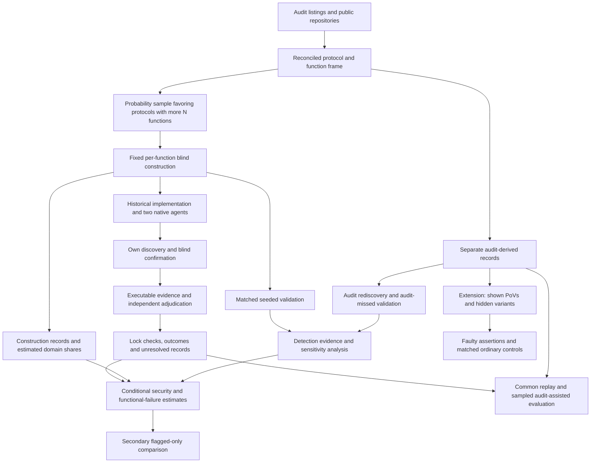

# AI Agent Function-Body Replacements in Audited Solidity: Executable Vulnerability Comparisons with Historical Developer Code

Proposal version 19 (author of this revision: Peer B, Loop 1 round 18; version 18 was written by Peer A in round 17).

## 1. Abstract

We compare AI-generated function replacements with historical developer implementations in audited Solidity contracts. A probability sample includes functions linked to audit findings and functions without such links. Tasks must be constructible under a fixed procedure and allowance. Each implementation receives its own audit-blind discovery campaign. A counted vulnerability requires an executable attack, a correction confined to the target body, and independent adjudication. The proposed principal comparison measures detected vulnerability among working implementations, standardized across the constructible population. Functional failure is reported separately. The flagged-only comparison is secondary. Strict audit counts and combined simulations inform the allocation. The latest simulation matches the planned sampling design, but error control and coverage have not passed validation. We request approval for a lower power requirement. PoV-guided repair remains a separate extension. Student timing and final readiness checks remain required.

## 2. Problem and motivation

Solidity developers already use AI tools. The Solidity Developer Survey 2025 reports that 58% of respondents use them daily and 49% use them to write code [Solidity Survey]. These are self-reports. They establish relevance, not the security of generated code.

Security failures in contracts can transfer funds or prevent legitimate operations. In a study of 516 exploitable smart-contract bugs, more than 80% were beyond the automated tools examined [Web3Bugs]. A separate study found substantial limitations in Solidity static analyzers [SAST Study]. These results motivate executable evidence of specific attacker effects.

Existing benchmarks answer useful but different questions. SecureVibeBench reconstructs tasks around historical vulnerabilities and applies executable checks to developer and agent implementations [SecureVibeBench]. SusVibes evaluates functional and security outcomes on reconstructed vulnerable tasks [SusVibes]. Foresight-SWE studies tasks associated with later-fixed general defects [Foresight-SWE].

Selecting functions because a developer previously failed cannot establish the average difference across other functions. Agents might avoid known mistakes while introducing different vulnerabilities elsewhere. Conversely, a benchmark of historical failures may exaggerate the apparent advantage of replacement.

Unconditional comparisons are not new. Sajadi et al. compare human and agent patches for the same issues [Patch Security]. Cotroneo et al. compare human and AI functions paired by documentation [Cotroneo]. SolEval already regenerates function bodies in real Solidity repositories [SolEval]. SolAgent compares generated and historical Solidity using static analysis [SolAgent].

The first paper proposes a population comparison using executable, function-attributed security evidence. It includes functions without qualifying audit findings. Its principal question concerns detected vulnerability among working implementations. It also reports whether a flagged-only analysis gives a different answer.

This is an empirical contribution, not a claim that probability weighting or conditional-rate estimation is new. Its value depends on the precision, coverage and detection evidence achieved by the study.

A specified extension concerns repair. Existing research already shows that incorrect tests can mislead agents [ImpossibleBench; ExecCritic; Calibration]. We ask a narrower question: does executing assertions that endorse an exploitable behavior preserve that behavior despite contrary PoV evidence, beyond the effect of matched ordinary incorrect assertions?

Neither study estimates how much human review developers can safely remove.

## 3. Key insight and contributions

### Paper 1: compare detected security and functional failure separately

Audit labels define sampling strata. They are not security verdicts.

We propose RQ1b as the principal estimand. For each agent configuration, it compares detected vulnerability among working agent and historical implementations. It standardizes the stratum-specific differences using the function shares of the constructible domain.

This is not the probability that an agent introduces a flaw into a particular function that the developer implemented safely. Nor does conditioning on working outputs create a causal comparison between equivalent sets of implementations. Section 6.3 defines the narrower descriptive estimand.

The study reports the difference in the joint functional-and-vulnerable endpoint alongside this conditional comparison. An exact decomposition shows the contribution of functional failure. Failed generation remains visible.

RQ1a is the difference between the flagged-only and domain-standardized comparisons. It is secondary.

### Proposed departure from the committee’s principal-estimand decision

The iteration-3 committee asked us to retain RQ1a as principal and add an RQ1b target. We propose a departure from that instruction.

The examined allocations give broad RQ1a intervals. V27 reports a largest mean half-width of 0.338 for its security component under the proposed allocation. The observed-fix-only count scenario gives 0.422. These runs precede the strict recount and assume complete construction and resolved outcomes. They do not support the earlier 0.20 criterion.

This does not prove that no affordable allocation could support RQ1a. It shows that the examined allocations do not provide the promised evidence under the tested scenarios.

RQ1b answers the project’s underlying comparison more directly. Its distinct contribution would be a weighted comparison of historical and agent implementations on ordinary as well as audit-flagged Solidity functions, using blind discovery and executable attribution. This differs from static-warning comparisons and benchmarks restricted to historical failures.

We therefore request committee approval to make RQ1b principal. We also request approval to reduce the power requirement.

The earlier requirement was at least 0.80 correct directional power for each configuration at an exact +0.15 difference in every retained scenario. V29 does not meet it. We propose a minimum of 0.60 at that same effect, assessed conservatively as specified in section 6.3.

This reduction is substantive. The study may miss a large difference, even when it exists. It is proposed because the protected resource plan cannot claim the stronger guarantee from the supplied evidence. It is not a new scientific threshold or a declaration that lower power is generally sufficient.

A null result with a broad interval will be inconclusive. The paper will not claim equal security or little difference. If the committee considers the revised requirement insufficient for the proposed contribution, the design must be reconsidered before collection.

### Count discoveries made under a common procedure

An audit gives historical code an extra source of known vulnerabilities. Replaying audit-derived attacks does not provide an equally strong search for different agent flaws.

The primary endpoint therefore uses only flaws found and confirmed through each implementation’s own campaign. Every campaign follows the same frozen procedure and budget. It receives no audit report, finding list, audit-derived PoV or audit-derived correction.

Pooling discovered attacks can favor flaws shared by many agent attempts. Common replay is secondary. It does not change locked primary labels.

This compares detected vulnerabilities under a stated procedure. It does not establish equal sensitivity or compare all latent vulnerabilities.

### Planned extension: faulty assertions during PoV-guided repair

The pilot motivates a hypothesis but does not establish it.

The two preregistered OpenHands contrasts were:

- adding the shown PoV, with a full terminal in both arms: 0 of 12 successes versus 2 of 12, with Holm-adjusted p = 0.96;
- allowing the shown PoV to be rerun: 10 of 12 versus 9 of 12, with Holm-adjusted p = 1.00.

The exploratory comparison between no execution and a full terminal was 10 of 12 versus 2 of 12. OpenHands succeeded in 9 of 12 runs with the shown-test tool. Codex succeeded in 6 of 12 both with that tool and with a full terminal.

These results concern one finding. The repairs have not yet been reviewed by a person. The hypothesis about faulty repository tests was formed after inspecting the pilot. The proposed repository-test tool is narrower than a full terminal.

The extension compares wrong assertions endorsing a vulnerability with matched wrong assertions endorsing an ordinary error. It measures whether each endorsed behavior remains. It is specified for review but is not a claimed contribution of the protected twelve-month study.

## 4. Threat model and problem setting

### Historical replacement

Each task replaces one function body in a fixed audited snapshot. The historical developer implementation supplies the baseline.

The agent sees mature surrounding code and repository tests. These may have been written after the original function. The study does not recreate the developer’s original conditions or estimate a causal effect of replacing a human worker.

Historical code may contain AI assistance. Its provenance is recorded rather than assumed.

### Attacker and environment

The attacker is an unprivileged external account. It may deploy contracts, call public interfaces and use borrowing or transaction ordering permitted by the protocol record.

The attacker cannot steal keys, assume an administrator role, change trusted oracle behavior outside the recorded assumptions or modify deployed code.

Each protocol record specifies:

- protected assets and legitimate entitlements;
- available capital and permitted borrowing;
- reachable initial states;
- token and oracle behavior;
- transaction ordering and block assumptions;
- legitimate operation and resource limits.

All execution occurs offline. Arbitrary storage changes cannot manufacture an otherwise unreachable vulnerable state.

### Severity

The study uses one rubric across audit platforms. Original audit labels remain in the record.

High severity includes unauthorized loss of principal, protocol insolvency and irreversible loss of access to protected assets. Medium severity includes theft of earned protocol entitlements and attacker-induced loss of a core operation under the recorded resource and recovery limits.

Ordinary implementation failure is not automatically a security vulnerability. Availability findings require an attacker action, affected legitimate users and a demonstrated failure under permitted operating conditions.

Financial effects must reflect entitlement or backing. Attacker profit alone is insufficient. Temporary inconvenience, gas optimization, privileged misuse and effects outside the threat model are excluded.

Before evaluation, the rubric records how recoverability, repetition, affected users and resource limits determine inclusion. A frozen tie rule excludes borderline severity cases from the primary count and includes them in a secondary count. This is a classification rule, not evidence that those cases are harmless.

### Attribution

A counted flaw requires:

- an executable qualifying property violation;
- evidence connecting it to the target function;
- removal of the violation by changing only that function body;
- preservation of required functionality under the acceptance checks.

The intervention preserves signatures, surrounding code, dependencies and initial-state procedures. It cannot disable the feature or hide a loss by changing accounting.

A new declaration outside the body is not permitted, even if it is an error or event used only by the correction.

Historical code may serve as a correction only after the same checks.

Two adjudicators outside the construction team assess severity and attribution. Packs conceal author, agent and experimental arm as far as the code permits. Disagreements, resolution and blinding failures are recorded.

## 5. Approach

### 5.1 Frame and sampling unit

The downloaded data contain 19,627 distinct High and Medium findings. The earlier overview’s total of 19,666 was inconsistent with its batch totals. Complete source files were obtained for 7,826 findings. Earlier filtering left 77 recent candidates and 43 with suitable public history. These are screening counts, not a validated sample.

The refreshed frame starts from public contest listings where possible. Protocols without qualifying findings can enter. If only a finding-derived frame is practical, the population is explicitly restricted to audits with at least one qualifying finding.

The sampling unit at the first stage is a protocol audit and its fixed snapshot. Multiple audits of the same project are identified before sampling. The final frame must avoid treating overlapping snapshots as independent protocols without accounting for that dependence.

A protocol must have an available audited snapshot, pinned dependencies, an offline build and sufficient documentation to define its environment.

A function must be in audit scope, contain meaningful computation or state changes, and be replaceable without changing its signature or surrounding code. Tests or a documented call path must support reachability.

The unit at the second stage is one function body. Its identifier includes repository, snapshot, full file path, enclosing contract and signature. Overloads are distinct.

Before sampling, functions implicated in qualifying findings whose necessary corrections extend outside the target body are excluded. Unrelated edits in a fix commit do not establish that a broader correction is necessary.

Stratum V contains eligible functions linked to qualifying High or Medium findings. Stratum N contains eligible functions without such links. Functions with unresolved finding-to-function mapping or unresolved correction scope are not silently assigned to N.

The report gives exclusions and unresolved classifications separately. Multi-function replacement is a named extension.

#### Earlier pilot fix-scope evidence

The fix-scope record for the 43 pilot findings is in `evidence/frame_count/`.

| Fix scope | Findings | High confidence |
|---|---:|---:|
| One function body | 17 | 14 |
| Several function bodies | 2 | 2 |
| Signature, storage layout, new function or other declaration | 15 | 14 |
| Undetermined | 9 | Not applicable |

These classifications describe identified developer fixes. They do not prove that no narrower correction exists.

Three judgment calls move the one-function count between 15 and 18. Panoptic supplies 9 of the 17. Three of the ten protocols have no identified one-function fix among the filtered findings.

#### Inventory of downloaded findings

The inventory in `evidence/frame_inventory/` groups the findings into 2,481 audits. It maps functions from source links where possible. It could not map 61.0% of findings.

Its earlier planning distribution estimated eligible V counts using mapping rates and the pilot proportion 17/34. That distribution is a model, not a measured eligible frame. It is retained only to explain older simulations.

#### Random audit sample

The evidence in `evidence/frame_audit/` starts from 70 recent audits after the stated pilot exclusions. A fixed random order was drawn. Processing the first 33 audits yielded 25 processed audits and eight replacements.

The replacements reflect unavailable repositories, unavailable scope or non-Solidity code. They are recorded, not treated as random missingness. Five of the eight replacements were Cantina private reviews. The processed sample therefore represents accessible audited code more closely than all reviews.

The processed audits contain 352 High and Medium findings. The reading was done by Claude agent sessions, followed by merge checks and a spot check. It was not human adjudication. No code from the repositories was executed.

| Quantity in the initial audit record | Recorded count |
|---|---:|
| Processed audits | 25 |
| Findings | 352 |
| Findings with an observed fix | 156 |
| Findings classified from a recommendation | 98 |
| Findings with undetermined fix scope | 98 |
| Functions with a body | 5,364 |
| Functions accepted by the counting rule | 3,965 |
| Initially recorded N functions | 3,621 |

The initial V totals were 62 from observed fixes and 118 when clear recommendations were included. They are superseded for current planning by the strict recount below.

#### Strict reconciliation completed

The strict recount in `evidence/frame_audit/strict/` applies unique identities and the body-only correction rule to the same audits. It rereads every observed fix previously classified as a one-body correction.

Full paths, enclosing contracts and parameter types distinguish functions. The recount separates 94 colliding names involving 198 functions.

A strict observed-fix V function needs a correction confined to that function body. New errors, events, imports, modifiers or other declarations are not allowed. The same function-eligibility rule applies to V and N. N excludes functions linked to High or Medium findings under the recount’s classification.

| Strict count | Total | Mean per audit | Median | Audits with zero |
|---|---:|---:|---:|---:|
| V, observed fixes only | 54 | 2.16 | 1 | 10 of 25 |
| V, observed fixes and admissible recommendations | 109 | 4.36 | 4 | 1 of 25 |
| N, eligible and unflagged | 3,620 | 144.8 | 92 | 0 of 25 |

The rereading records four fixes with a new error and one with an added import. Three fixes changed a function that was not the root cause. Two counted an ineligible overload. One finding falls under two reasons. Two recommendations also failed the rule.

The ten audits with no observed strict V function have private or unpublished fixes. Their zeros do not establish an absence of eligible V functions.

Recommendation-based counts are not proven upper bounds. Unresolved findings may contain additional eligible functions. A recommendation may also understate the correction actually required. The simulation label “upper” means recommendation-inclusive counts only.

Strict N counts range from 24 to 672. This spread motivates sampling in proportion to N counts.

#### Remaining frame-freezing checks

The strict recount resolves the earlier identity and body-only classification problems. It is not the final eligible census.

The study’s severity rubric has not yet replaced the original High and Medium labels. The record identifies 18 findings with root causes outside functions, eight close observed-fix calls and 134 reread rows without a second reader. One audit uses a later public snapshot for fixes and another uses an upstream fork.

The counting parser also treats non-view functions as potentially state-changing rather than proving actual writes.

Before inclusion probabilities are frozen, the frame record must settle these eligibility and provenance questions under the study’s rules. It must preserve excluded and unresolved cases. Development establishes the procedure; reconciliation of the sampling frame precedes main sampling.

### 5.2 Allocation and processing limits

The proposed allocation is 20 distinct protocol audits, with up to two V and six N functions per selected audit. Small strata are censused.

The first-stage size measure is the eligible N count, or one when that count is zero. Fixed-size inclusion probabilities are proportional to that measure, with certainty inclusion capped at one. They sum to the chosen protocol count.

Protocols are selected by randomized systematic sampling. The implementation randomly permutes the frame, draws a uniform start and selects from cumulative inclusion probabilities. It records the frame order, probabilities and random seed.

Functions are sampled uniformly without replacement within each stratum. The inverse joint inclusion probability supplies the analysis weight.

V29 implements this first-stage design and asserts that selected protocols are distinct. Its frame is simulated from audited count pairs. It is planning evidence for the procedure, not a substitute for checking the final frame and inference.

Section 8 gives alternative allocations and a selection rule. The row and sampling procedure are frozen before main sampling.

Both primary agents receive two fresh attempts per constructed function.

Each sampled function receives the same construction procedure and its own fixed allowance. It is not a shared pool from which early functions can consume later functions’ time.

Protocol preparation has a separate allowance. It supplies permitted context under a frozen rule. The preparation and construction reservations must fit the selected budget at the maximum allocation.

Let \(B_i=1\) when function \(i\)’s task passes the construction checklist within its own allowance. Otherwise \(B_i=0\), with a recorded reason. This decision precedes agent generation and primary vulnerability evaluation. It applies to the whole historical and agent cohort.

The primary population is the domain constructible under this procedure. Its stratum shares are estimated from weighted constructed counts.

A function does not become unconstructible because another function took too long or because the promised staff were unavailable. Failure to supply the procedure is a protocol deviation, not \(B_i=0\).

Each constructed implementation receives fixed discovery and confirmation allowances. Unused time cannot extend another implementation’s search. A campaign that completes its prescribed procedure without confirmation is “not confirmed.” A campaign that cannot perform required evaluation or obtain required adjudication remains unresolved.

Slow protocols are not replaced after sampling.

For audit-assisted secondary work, each sampled protocol with constructed V functions contributes one such function, selected uniformly. The conditional selection probability is the inverse of its number of constructed V functions. This gives every constructed V function a positive chance of audit-assisted evaluation while reserving at most one such task per protocol.

Section 5.8 defines the corresponding weighted secondary analysis.

Construction yield is reported by stratum. A lower confidence limit below 0.7 prevents confirmatory launch under the proposed plan. The limit is not raised to 0.7. Low construction yield in the main study does not authorize a new target population or deletion of failures.

### 5.3 Provenance and AI assistance

For each function, the study records available history around its introduction. Evidence includes agent instruction files, AI co-author trailers and pull-request text.

The categories are evidence of assistance, no observed evidence and unresolved provenance. An instruction file does not prove that the target lines were generated. Absence of a marker does not prove human-only authorship.

All categories remain in the primary historical-developer comparison. The subset without observed evidence of assistance is a preregistered secondary analysis.

Code, fix and report publication dates are recorded separately. A report published after a model cutoff does not establish that the code was unseen.

### 5.4 Audit-blind task construction and confirmation

Request and primary-property builders do not receive audit findings, historical fixes or the removed function body. They receive permitted documentation, signatures, callers and surrounding code.

Every request sentence records its source. Requests and primary properties are frozen before agent runs.

Security properties must follow from documented entitlements and operations. An audit-derived invariant, reference correction or attack cannot enter primary discovery under another name.

Before main sampling, development freezes:

- the permitted source bundle and protocol-preparation procedure;
- the request template and construction checklist;
- the ordered construction steps and permitted checks;
- tools, versions, model assistance and budgets;
- the per-function allowance and treatment of interruptions;
- builder assignment and exposure requirements;
- the completion record and reasons for failure.

The checklist requires a coherent request, documented legitimate behavior, a reachable evaluation setup, ordinary functional checks, primary security properties and the threat-model record. Completion does not require finding a vulnerability.

Every function receives its reserved procedure. A failed attempt cannot borrow time from another function. Function-specific materials remain separate.

The student and paid second person record prior exposure before assignment.

For a protocol unfamiliar to the student:

1. The second person checks mapping, labels and exclusions. A script draws functions and gives the student a shuffled list with labels sealed.
2. The student applies the construction procedure without audit access.
3. Generation and discovery run on constructed tasks. The student confirms candidates using their originating campaign materials and permitted context.
4. Independent adjudication and any admissible primary check revisions are completed. Primary records are locked.
5. Only then may the student access audit material.

For a protocol known to the student:

1. The student prepares the mapping and sealed task materials.
2. An unexposed second person constructs the tasks.
3. That person performs primary confirmation without findings, labels or fixes.
4. Adjudication and primary locking are completed.
5. Only then may that person inspect the audit.

An eligible unexposed replacement must be funded if neither person qualifies. Failure to provide the role is a protocol deviation.

Audit-assisted confirmation counts only in the secondary view. Construction staff do not independently adjudicate their own packages.

The same rule applies to development and validation. Committing a request does not permit audit access while primary confirmation remains open.

#### Duplicate requests

A request template is frozen before sampling.

For a random subset of 15 sampled functions, two unexposed builders independently prepare requests. One procedure is designated in advance as primary. It determines \(B_i\) and the request used for the main cohort. The duplicate cannot rescue failed primary construction.

When both requests produce evaluable tasks, generation and the same discovery procedure run on both. This is secondary. The report gives changes in D, working status and the conditional security estimates where defined. Failed duplicate constructions remain recorded.

The added evaluation uses at most \(15\times5\) campaigns. Section 8 separately reserves their operation and coordination. Their confirmation packages enter the paid-review ledger.

A person who checked audit mapping cannot provide blind duplicate construction for that protocol.

Audit-informed request classification occurs after primary locking and without agent outcomes. It labels requests as favoring vulnerable behavior, neutral or favoring corrected behavior. It cannot change \(B_i\).

Builder identity, exposure and order are recorded. Analyses using builder identity do not eliminate confounding by protocol.

### 5.5 Functional and security checks

Checks are classified before generation.

Ordinary functional checks establish intended operations, outputs and useful completion. Explicit security checks establish forbidden attacker outcomes.

An ordinary functional check is not removed merely because it catches a flaw. Historical code is not assumed to pass the suite. Original repository-test outcomes are reported separately.

A blind builder can unknowingly write a check that endorses faulty documented behavior. The following rule handles that problem.

When a correction from the blind primary process removes a confirmed violation but fails a frozen ordinary check, the two author-blind adjudicators decide whether the check asserts the forbidden attacker outcome. If it does, the check is removed from the primary acceptance suite for every implementation of that function. L is recomputed consistently.

This occurs before primary locking and before audit access. The record preserves the original and revised outcomes and reports such cases by stratum.

A correction first obtained through audit-assisted work cannot reopen the primary endpoint. Any resulting check revision defines a secondary suite, applied to the whole function cohort. Its outcomes are labeled secondary.

A PoV has three semantic outcomes:

| Outcome | Meaning |
|---|---|
| Violation observed | Valid execution demonstrates the forbidden outcome. |
| Violation checked and absent | The scenario executes and checks that the outcome did not occur. |
| Unresolved | Construction, execution or interpretation prevents a valid judgment. |

An exit code is not a security verdict. Expected failure of a violation-asserting test is distinguished from setup failure. Fixed-state checks establish that legitimate behavior remains.

### 5.6 Agent configurations

The primary configurations are Claude Code and Codex CLI with vendor-supported models current at the freeze.

Exact model identifiers, versions, reasoning settings, prompts, permissions and budgets are pinned. Both run on the full constructed sample. Every attempt starts from a fresh workspace.

The target body is replaced with a placeholder. Only the submitted body is applied to evaluation. Changes to tests, dependencies or unrelated code cannot alter the artifact.

History, fixes, cached target copies and generated artifacts exposing the target are removed. Network access is restricted to model APIs.

Pilot configurations, translated integrations and a documented SolAgent adaptation are extensions. They do not enlarge the primary family or its discovery budget.

### 5.7 Primary discovery

Each implementation receives its own campaign:

- Foundry property-based fuzzing;
- the same two LLM reviewers;
- a fixed candidate ordering rule;
- fixed discovery and confirmation allowances.

Reviewer identities and versions are frozen before main collection. Suitable reviewers from other model families are preferred where development supports them. Otherwise the overlap is reported.

A secondary analysis filters each comparison to fuzzing and the other-family reviewer, applied to both the agent and historical implementations. It does not rerun the campaign or reallocate effort.

Reviewers receive code, permitted context, properties and the request. They receive no author label or audit material.

Campaigns do not receive other implementations’ reports or attacks. Duplicate outputs may share deterministic execution work but do not acquire extra stochastic search.

At most three candidates are processed in frozen order within the implementation’s confirmation allowance. The count limit does not promise a separate full unit of time for every candidate.

A positive primary label requires an own-campaign candidate, executable confirmation and independent adjudication.

The record distinguishes:

- a completed campaign without a confirmed candidate;
- a candidate list cut by the count or time limit;
- an evaluation that cannot run;
- a package without completed required adjudication.

The first is a completed negative under the declared detector. Evaluation and adjudication failures remain unresolved. A secondary bound treats cut candidate lists as unresolved as well.

Cut shares are reported by author and stratum. Construction status cannot be changed retrospectively to remove difficult evaluation cases.

Primary records are locked before pooled replay.

### 5.8 Secondary replay and audit rediscovery

After locking, validated common-procedure PoVs are replayed across each function’s cohort. Attribution is checked separately for each implementation.

Audit-assisted work is performed on the probability sample specified in section 5.2. Neither replay nor audit access changes primary labels.

The report separates:

- own audit-blind discoveries;
- pooled common-procedure discoveries;
- audit-assisted outcomes on selected V functions;
- an estimated audit-assisted increment over the primary result.

Let \(q_i\) be the conditional probability that constructed V function \(i\) receives audit-assisted work. The estimated total increment for an endpoint is

\[
\widehat T_{\mathrm{increment}}
=
\sum_{i\in S_V}
w_iB_i\frac{A_i}{q_i}
\left(Y_i^{\mathrm{audit}}-Y_i^{\mathrm{primary}}\right),
\]

where \(A_i\) indicates selection for audit-assisted work.

The full primary total plus this estimated increment defines the audit-supplemented total. For conditional rates, numerator and working-output denominator totals are estimated separately before taking ratios. The same rule applies if a secondary functional suite changes working status.

Unassessed audit outcomes are not coded as misses or negatives. Unresolved assessed outcomes retain bounds.

Rediscovery is estimated as a weighted ratio among audit flaws that satisfy the study’s confirmation standard. The numerator counts those also found by the blind campaign. The denominator contains qualifying confirmed audit flaws, using both sampling stages’ weights.

Uncertainty must include both the main sample and the audit-assisted subsample. Validation of this two-stage estimator is required before numerical claims.

### 5.9 Detection validation

#### Matched seeded flaws

A separate builder inserts the same vulnerability pattern into historical and agent implementations of a function. Patterns come from other protocols.

Each seed must compile, preserve unrelated behavior and produce an attributable violation. Invalid seeds remain recorded.

The core schedules 60 matched pairs, or 120 seeded artifacts. Each pair contains one historical and one agent implementation. The planned allocation is 15 pairs for each stratum and configuration combination.

The catalogue contains at least 20 patterns, with no pattern used in more than three pairs. Pairs are spread across protocols and use distinct functions where possible.

Seeded and unseeded controls receive blind discovery. Seed locations and known attacks remain hidden until locking. Seeded artifacts do not enter natural vulnerability estimates.

The pooled diagnostic describes this validation mixture, not population-weighted natural recall. Stratum and configuration results are also reported.

The planning calculation in `tools/power_results_v10_c.txt` uses

\[
1.96\sqrt{\frac{\operatorname{deff}(\delta-d^2)}{n}},
\]

where \(\delta\) is paired discordance and \(d\) is the recall difference.

With \(d=0.1\), design effect 1.5 and 60 pairs, the assumed half-width is 0.135 to 0.194. With design effect 3.1, it is 0.194 to 0.278.

These are planning assumptions. The core cannot establish equal recall within 0.05. Final uncertainty accounts for realized protocol and pattern dependence and the valid-pair count.

#### Natural-implementation investigation

The maximum allocation is 48 first assessments and 12 duplicates. Each assessment has a two-hour budget. Total investigation cannot exceed 120 auditor hours.

Cells are defined by author, stratum and campaign category. They contain implementations from constructed tasks.

Each of the 12 cells receives up to four first assessments:

- confirmed cells are sampled uniformly;
- non-confirmed cells include completed negative and unresolved evaluations;
- where both subgroups exist, one is sampled from each, followed by a uniform draw from remaining members;
- smaller cells are censused;
- unused slots are not transferred after investigation outcomes.

Up to 12 first-assessment cases receive a second assessment, selected at random. Assignment respects the two auditors’ hour limits.

Auditors receive permitted context, the threat-model record and the harness, but no campaign reports or author label as far as the code permits.

Selection probabilities support weighted campaign–auditor disagreement estimates. Auditor agreement is also reported. Sparse cells and unresolved judgments remain visible.

The rough ±0.3 calculation for eight negative cases is not a precision guarantee. Final uncertainty uses the actual allocation, weights and protocol structure.

Auditor investigation is a budgeted reference assessment, not proof of vulnerability absence or a direct recall estimate.

#### Flaws missed by an earlier audit

A separate validation set targets 10 to 20 flaws found after an earlier audit.

Eligibility requires evidence that the same flaw existed in code covered by the earlier audit. Later-introduced flaws do not qualify. The record identifies scope, vulnerable version, later finding and correction.

These protocols are outside the main frame. The campaign runs blind on the pre-fix implementation.

Availability remains unknown. Fewer than 10 cases leave historical N sensitivity at the full feasible range unless another justified assumption is examined.

Even a larger set measures these selected cases. It does not identify recall on all historical N flaws.

#### Development gate

Development cases are separate from the main frame.

The gate uses eight qualifying flaws and passes at five rediscoveries. At most one revision is permitted, assessed on eight fresh flaws with a pass mark of six. Failure of both assessments stops development for redesign.

Only independently confirmed, in-scope flaws qualify.

| Assumed recall | First assessment | Revision assessment | Overall pass probability |
|---|---:|---:|---:|
| 0.3 | 0.058 | 0.011 | 0.069 |
| 0.5 | 0.363 | 0.145 | 0.455 |
| 0.7 | 0.806 | 0.552 | 0.913 |

These are binomial planning calculations for independent trials. They are not established error guarantees for clustered findings or an adaptively revised campaign.

Every attempt is reported. The gate does not prove equal detection or population recall.

The eight built pilot tasks that shaped the review prompts leave the gate reserve. Other eligible cases must come from outside the main frame. Cases used to change the final reviewer procedure cannot later serve as fresh gate cases.

#### Audit-blind candidate rediscovery

The evidence in `evidence/rediscovery/` covers the 17 single-function pilot findings. Each bundle contains a pre-fix target file, limited imported context and a task naming the function. The reviewers did not receive audit findings.

A fresh Claude reviewer and a fresh Codex reviewer each assessed every bundle. A Claude judge compared candidate lists with sealed keys while blinded to reviewer family.

| Reviewer | Candidate matches, all 17 | Excluding three weak keys |
|---|---|---|
| Claude | 17 of 17 | 14 of 14 |
| Codex | 13 of 17 | 13 of 14 |

The reported Wilson intervals are 0.82 to 1.00 and 0.53 to 0.90 for the full sets, and 0.78 to 1.00 and 0.69 to 0.99 after exclusions. These calculations assume independent trials. Several findings share a protocol and related snapshots, so these are not cluster-adjusted population recall intervals.

The weak keys are 64083, 64693 and 65044. They involve an owner attacker, no demonstrated outside attacker, or an informational classification.

A candidate match is not an executable confirmation. It limits what can be confirmed from that same candidate list, but is not an upper bound on a future campaign using fuzzing, different context or different reviewers.

Training exposure remains possible. Findings published after documented model cutoffs will be used where available; that does not establish that the underlying code was unseen.

The batch-1 judge note says the full 63008 theft depends on H-02. The executable package shows otherwise: the attack remains with H-02 corrected alone. The package governs this causal claim. The candidate root-cause match does not depend on that erroneous note.

### 5.10 PoV-guided repair

The extension begins from a validated vulnerable implementation. A shown PoV supplies executable evidence. Hidden attacks use different states, boundaries or call sequences.

A successful repair must compile, preserve legitimate behavior, block frozen attacks and have no confirmed new attributable vulnerability under the declared evaluation. Required unresolved checks prevent a success verdict.

Later discoveries are reported separately and replayed consistently. Passing the shown PoV is never sufficient.

### 5.11 Worked example: finding 63008

The pilot concerns the downward tick iterator in Sorella L2 Angstrom. The vulnerable implementation skips a starting boundary.

Version 2 of the executable package in `evidence/63008/` contains violation tests, fixed-state assertions, a function-body patch, an independent H-02 patch and an outcome-checking runner.

The correction adds `self.currentTick = startTick + 1` after the empty-range early return in `reset(TickIteratorDown)`. Empty ranges retain their original behavior. No signature, storage layout or other function changes.

The fixed-state test checks that:

- the honest provider can claim its rewards;
- payment covers its entitlement;
- withdrawal returns its principal;
- backing covers the reward liability;
- attacker rewards do not exceed its share of its own swap tax.

The attacker-share formula is specific to the two-position scenario.

| Code state | Violation tests | Fixed-state tests | Original suite |
|---|---|---|---|
| Vulnerable `386baff` | Violation observed in both | Both fail | 60 pass |
| Version-2 body correction | Violation absent in both | Both pass | 56 pass, 4 fail |
| H-02 correction only | Violation observed in both | Both fail | 60 pass |
| Both corrections | Violation absent in both | Both pass | 56 pass, 4 fail |

The four remaining repository failures assert the old starting-boundary behavior. The empty-range test passes in every state.

The runner excludes package-added tests from the original-suite count. It handles expected failures explicitly and compares counts and failing names. The recorded run matched all 12 expected outcomes.

On vulnerable code, the honest provider is owed about 49 ether before the attack. The attacker receives 48.99999755 ether. Remaining backing is about 0.0245 ether against about 49.0245 ether owed. Reward claim and withdrawal revert.

With the correction, the honest provider receives 49.000012243878672857 ether and withdraws its principal. The attacker receives 0.024487756121327142 ether, equal to its calculated share of its own swap tax.

H-02’s correction alone leaves this attack unchanged. The cited H-02 correction is `cd0ac3c`. This executable comparison supersedes the contrary causal statement in the candidate-rediscovery judge note.

The capital record gives the attacker 100 ether and \(10^9\) tokens as a ceiling, not a minimum. The attack position is about \(2\times10^{25}\) liquidity units. The scenario uses a 5 gwei priority fee and assumes the attacker wins the relevant top-of-block swap. It does not simulate a competitive auction.

The original capital run records swap tax of 0.0245 ether, just-in-time tax of 0.098 ether and vulnerable-code net profit of 48.877274256875928055 ether. Version 2 reruns reward and withdrawal assertions, not the separate net-profit test.

The automated version-2 work took 598 seconds. This is not human construction or adjudication time. It does not establish blind construction or human throughput.

The repository contained a `CLAUDE.md` before the faulty commit. The baseline is historical developer code.

The pilot’s two added control-group flaws failed repository functional tests. They motivate reporting K but do not establish an added-flaw rate for D.

## 6. Research questions and evaluation plan

### 6.1 Research questions

**RQ1b, proposed principal estimand:** Within the constructible domain, how do agents and historical developers differ in detected vulnerability among working implementations, standardized by stratum?

**RQ1a, secondary:** How much does restricting analysis to audit-flagged functions change that comparison?

**RQ4, validation:** How does discovery behave across authors, strata and known flaw patterns, and how do missed flaws affect interpretation?

**RQ2, planned extension:** Does executing wrong assertions affect retention of an endorsed vulnerability differently from retention of a matched ordinary error?

**RQ3, optional extension:** How does request wording affect vulnerability reproduction within a task?

### 6.2 Outcomes, decomposition and unresolved results

Let \(C\) indicate compilation, \(L\) passing the final primary ordinary suite, and \(V_{\mathrm{own}}\) a vulnerability confirmed through the implementation’s own campaign.

Define working status and the joint endpoint as

\[
W=CL,\qquad D=WV_{\mathrm{own}}.
\]

Also report

\[
K=CV_{\mathrm{own}}.
\]

All scheduled attempts on constructed tasks remain in the accounting record. Historical code contributes one implementation per function.

Within stratum \(s\), let \(w_{as}\) be the working rate for author \(a\), and \(v_{as}\) the detected-vulnerability rate conditional on working. Then

\[
d^D_s
=
w_{As}v_{As}-w_{Hs}v_{Hs}
=
(v_{As}-v_{Hs})
+(w_{As}-1)v_{As}
+(1-w_{Hs})v_{Hs}.
\]

The first term is the conditional security component. The remaining terms are the functional-failure component.

This is a descriptive identity. The conditional rates may concern different mixes of functions for each author. The study reports working rates and D alongside the conditional comparison so that this selection remains visible.

A negative D difference alone is not a “better security” verdict.

#### Admissible outcomes

Each scheduled implementation has a set of admissible \((W,D)\) pairs.

- A known compilation or functional failure fixes \((W,D)=(0,0)\).
- A working implementation with confirmed vulnerability fixes \((1,1)\).
- A completed working campaign without confirmation fixes \((1,0)\) under the declared detector.
- Known working status with unresolved security allows \((1,0)\) and \((1,1)\).
- Unknown working status retains every pair consistent with observed checks.

The general feasible pairs are \((0,0)\), \((1,0)\) and \((1,1)\). A security confirmation does not erase uncertainty about functionality.

Task-construction failure is an earlier decision under section 5.2. It cannot remove a difficult evaluation retrospectively.

For descriptive confirmed counts, unresolved security contributes no confirmed positive. Inference instead uses the admissible sets.

#### Bounds for conditional rates

For each author and stratum, minimize and maximize the weighted conditional rate over admissible completions of all \((W,D)\) pairs.

Unknown working status affects both numerator and denominator. It cannot be handled by changing D alone while holding the working denominator fixed.

If every admissible completion has zero working denominator, the conditional rate is undefined. If some completions have zero denominator, the study reports that the conditional target may be undefined and makes no directional conditional-security claim for that comparison. It still reports D, W and their bounds.

For defined rates, the author-difference bounds are

\[
d^{S,L}_s=v^L_{As}-v^U_{Hs},
\qquad
d^{S,U}_s=v^U_{As}-v^L_{Hs}.
\]

The same historical outcomes are retained across configurations. Family inference preserves this dependence.

The functional-failure component and D are calculated from the same admissible completions. Separate endpoint bounds are not combined as though they were independent observations.

### 6.3 RQ1b: estimand, inference and evidence

#### Domain and weighted estimator

Let \(U\) be the frozen eligible frame and

\[
U_B=\{i\in U:B_i=1\}
\]

the domain constructible under the declared procedure.

The conditional agent rate averages over fresh runs, with each function contributing equal total weight before conditioning on working status. The historical rate concerns its fixed implementation and the declared evaluation procedure.

Let \(a_i\) be the inverse joint sampling probability. For author \(a\), average its observations within function \(i\), giving \(\overline W_{ai}\) and \(\overline D_{ai}\). Historical averages contain one observation.

For stratum \(s\), estimate

\[
\widehat T_{sB}=\sum_{i\in S_s}a_iB_i,
\qquad
\widehat\pi_{sB}
=
\frac{\widehat T_{sB}}
{\widehat T_{VB}+\widehat T_{NB}},
\]

\[
\widehat w_{as}
=
\frac{\sum_{i\in S_s}a_iB_i\overline W_{ai}}
{\widehat T_{sB}},
\qquad
\widehat v_{as}
=
\frac{\sum_{i\in S_s}a_iB_i\overline D_{ai}}
{\sum_{i\in S_s}a_iB_i\overline W_{ai}}.
\]

The principal estimate for configuration \(c\) is

\[
\widehat\Delta^S_{Bc}
=
\sum_s\widehat\pi_{sB}
\left(\widehat v_{A_cs}-\widehat v_{Hs}\right).
\]

It is a stratum-standardized difference between conditional rates. It is not the unstratified rate difference among all working outputs and not a paired count of newly introduced flaws.

The companion D difference is

\[
\widehat\Delta^D_{Bc}
=
\sum_s\widehat\pi_{sB}
\left(
\widehat w_{A_cs}\widehat v_{A_cs}
-
\widehat w_{Hs}\widehat v_{Hs}
\right).
\]

All domain counts, shares and ratios are recomputed in uncertainty replicates.

#### Decision and uncertainty

The proposed directional decision uses the lower identification bound for a positive claim and the upper bound for a negative claim. It applies Holm across the two configurations.

A positive conditional difference means a higher detected rate under the declared procedure. It does not establish a higher latent vulnerability rate without detection assumptions.

V29 evaluates a delete-one-protocol jackknife using inverse-inclusion weights. This is a candidate uncertainty procedure for the specified sampling design. The jackknife factor alone does not establish design-valid inference for unequal-probability sampling. Calibration and independent validation are required.

For a configuration, the candidate interval is

\[
\left[
\widehat L-c\,t_{0.975,P-1}\widehat{\mathrm{se}}(\widehat L),
\quad
\widehat U+c\,t_{0.975,P-1}\widehat{\mathrm{se}}(\widehat U)
\right].
\]

It extends both estimated identification bounds. It includes uncertainty in constructible shares and working denominators through recomputation.

The marginal coverage target is 0.95 for the true conditional contrast of each configuration. Family-wise directional error must be at most 0.05 across configurations.

These are different guarantees. A marginal interval is not a simultaneous confidence statement across configurations. Coverage of the true contrast also does not establish simultaneous coverage of both population identification-bound endpoints. Any such stronger claim requires a separate validation.

Undefined strata and replicates are reported. An undefined estimate produces no directional claim. Validation must retain those studies in its accounting and report both conditional and unconditional performance. It cannot improve coverage by silently removing them.

Original-frame bounds remain secondary. They treat unbuilt tasks as unknown and do not extend the domain estimate to those functions.

#### Revised power requirement proposed for committee approval

We withdraw the requirement of at least 0.80 correct directional power at exactly +0.15 in every retained scenario.

The proposed replacement is at least 0.60 correct directional power for each configuration at that same effect in every retained scenario. A lower Monte Carlo confidence bound must meet this requirement in final validation. A point estimate above 0.60 is insufficient.

The target remains a 15-percentage-point standardized conditional rate contrast. It is not an estimate that a particular fraction of paired functions acquired new flaws.

This requirement is chosen after the planning results and is submitted explicitly for committee approval. It permits a substantial chance of failing to detect a large difference. The rationale is a bounded empirical study with honest uncertainty, not a claim that the revised requirement is equivalent to the earlier one.

Differences of +0.05 and +0.10 remain important. The evidence does not support high-power promises for them. No equivalence or “little difference” claim is planned.

There is no supplied result showing that a different resource-bounded allocation meets the old requirement under the combined assumptions. We therefore request a changed requirement rather than assert an unsupported redesign.

The revised requirement has not yet passed. A more conservative family level may reduce the recorded power. Its final value must be assessed after error control is established.

#### V29: combined evidence for the planned sampling design

The code is `tools/power_sim_v29.py`. The results are in `tools/power_results_v29.txt`.

V29 combines:

- strict observed-fix and recommendation-inclusive count pairs from the 25-audit record;
- a fully enumerated simulated frame of 200 protocols, held fixed across studies within a scenario;
- fixed historical vulnerability and agent vulnerability probabilities;
- construction decided once per function, with difficulty links 0 and 0.6 and target yields 0.9 and 0.7;
- exact constructible-domain security targets for both configurations;
- 20 distinct protocols selected by randomized systematic sampling with inclusion probabilities proportional to N;
- inverse-inclusion weights, up to two V and six N functions, and two agent attempts;
- estimated constructible shares and admissible bounds for unresolved working and security outcomes;
- one family-decision level and one interval multiplier across both count lists.

The program caps certainty-unit inclusion probabilities at one and asserts distinct selected protocols. It recomputes weighted totals, domain shares and bound ratios after deleting each protocol.

There are 24 frames. They cross the two count lists, three recall patterns, two historical N rates and two construction settings. Each condition uses 400 studies per frame.

Calibration uses exact nulls and exact +0.15 effects without unresolved outcomes. Later draws supply validation. The selected Holm level is 0.045. The selected interval multiplier is 1.1.

These are provisional settings. They have not passed the validation requirements.

| Validation condition | Unresolved share: agents, historical | Worst family-wise error | Lowest marginal coverage |
|---|---|---|---|
| Exact null | 0, 0 | 0.062 ± 0.024 | 0.940 ± 0.023 |
| Exact null | 0.005, 0.005 | 0.030 ± 0.017 | 0.963 ± 0.019 |
| Exact null | 0.013, 0.013 | 0.022 ± 0.015 | 0.978 ± 0.015 |
| Exact null | 0.013, 0 | 0.037 ± 0.019 | 0.963 ± 0.019 |
| Exact null | 0, 0.013 | 0.040 ± 0.019 | 0.963 ± 0.019 |
| Partial null: 0 and +0.10 | 0, 0 | 0.048 ± 0.021 | 0.945 ± 0.022 |

The coverage calculation uses the interval extending both estimated bounds, but checks whether it contains the true contrast. It takes the lower marginal coverage across configurations. It does not measure simultaneous coverage of both configurations.

The reported undefined-estimate share is 0.000 in every condition. The code calculates coverage after excluding nonfinite studies and reports their share separately. Final validation must also report unconditional coverage, counting an undefined interval as a failure to provide coverage.

| Exact difference | Unresolved share: agents, historical | Lowest correct directional power | Lowest marginal coverage |
|---|---|---|---|
| +0.10 | 0, 0 | 0.41 ± 0.05 | 0.948 ± 0.022 |
| +0.10 | 0.013, 0.013 | 0.27 ± 0.04 | 0.975 ± 0.015 |
| +0.15 | 0, 0 | 0.74 ± 0.04 | 0.940 ± 0.023 |
| +0.15 | 0.013, 0.013 | 0.63 ± 0.05 | 0.973 ± 0.016 |
| +0.15 | 0.013, 0 | 0.75 ± 0.04 | 0.968 ± 0.017 |
| +0.15 | 0, 0.013 | 0.63 ± 0.05 | 0.958 ± 0.020 |
| −0.05, feasible frames only | 0, 0 | 0.18 ± 0.04 | 0.940 ± 0.023 |

Power is the minimum configuration power across frames. It is not the probability that both configurations succeed.

The exact −0.05 target was infeasible in 16 of 24 frames under the generating constraints. Its result applies only to the remaining frames. It does not validate negative alternatives throughout the readiness set.

The displayed ± values are the script’s approximate Monte Carlo half-widths. They are not simultaneous uncertainty bounds for selecting the worst result among frames. The script’s zero-error half-width also cannot establish zero error probability.

The worst exact-null validation error, 0.062, exceeds 0.05. Some coverage estimates fall below 0.95. Their Monte Carlo uncertainty includes the targets, but that is not evidence of a pass.

The lowest +0.15 powers are 0.74 without unresolved outcomes and 0.63 with both authors unresolved at 0.013. No median is treated as performance in a typical population.

#### Required calibration correction

The final calibration must be larger and separate from final validation. It must select one family level and one interval procedure across all retained scenarios.

Selection must use Monte Carlo uncertainty, not just point estimates. The family-error upper confidence bound must be at most 0.05. The marginal-coverage lower confidence bound must be at least 0.95 for each configuration. The lower bound for correct directional power must be at least the proposed 0.60 at +0.15.

The Monte Carlo bounds must account for the set of scenario checks. Use binomial bounds with an explicit adjustment across those checks. Zero observed errors must receive a nonzero upper bound.

Calibration should seek a margin below the error limit and above the coverage limit. The procedure may lower the Holm level, enlarge the interval multiplier or replace the variance method. No new numerical setting is asserted here.

If no candidate passes, calibration fails. The implementation must not silently return the most conservative grid endpoint, as V29’s fallback defaults permit.

After selection, freeze the procedure and evaluate it on fresh validation draws. A failed validation cannot be reused as an independent pass after tuning. Any further tuning requires another fresh validation run.

All frame-specific results must be saved, including infeasible targets, undefined estimates and replicate failures. Negative alternatives must use feasible generating settings and state their domain. The retained scenario set cannot quietly discard a difficult case because the current intercept adjustment cannot generate its target.

Power must be recomputed for the final accepted family procedure. V29’s power cannot be carried over unchanged to a lower level. The preferred allocation cannot launch unless the revised power requirement also passes.

#### Readiness scenarios and remaining simplifications

The final scenario set is fixed by rule before calibration:

- reconciled observed-fix and recommendation-based count scenarios, retaining uncertainty about unresolved classifications;
- the actual finite frame, sampling design and inclusion probabilities;
- construction yield by stratum at its lower 80% confidence limit, without upward truncation;
- unresolved outcomes at their upper 80% confidence limits, with a floor of 0.005;
- asymmetric author failures and uncertainty about working status;
- difficulty-independent and difficulty-dependent construction;
- the three recorded recall patterns, plus sensitivity with latent quality fixed;
- exact security nulls, partial nulls, positive targets and feasible negative alternatives.

Confidence limits use actual denominators. The expression \(3\times8\times5\) is only the maximum development count for the proposed allocation. Small strata and construction failures reduce it. Protocol and function dependence must enter the uncertainty assessment.

If dependence cannot be estimated credibly from development, the scenario set retains conservative dependence assumptions. It does not substitute an independent binomial limit without qualification.

V29 resamples a finite frame from 25 audited pairs. It is not a simulation on the final census. Historical implementations always work in its generator, even though their observed status can be unresolved. Agent working status is generated independently of vulnerability. Missingness is independent within each stated author rate. These assumptions do not establish robustness to outcome-dependent failure or adjudication loss.

The final scenario set must cover the relevant development-supported departures. V29’s sample-wide construction targets do not replace stratum-specific development limits.

The combined sampling mismatch is now fixed. Calibration, coverage and the revised power requirement remain open. If the final procedure fails any required check, no inferential collection begins.

### 6.4 RQ1a: secondary design comparison

For the conditional security component,

\[
G^S_c
=
d^S_{Vc}-\Delta^S_{Bc}
=
(1-\pi_{VB})(d^S_{Vc}-d^S_{Nc}).
\]

The analogous D difference and functional-failure component are reported beside it.

The lower bound uses the lower V difference and upper N difference. The upper bound reverses them. Replicates recompute domain shares and all ratios.

The V-only and domain estimates share observations. Their covariance is retained.

V27 reports the following largest mean half-widths:

| Allocation | RQ1a on D | RQ1a security component |
|---|---:|---:|
| 20 protocols, V cap 2, N take 6 | 0.296 | 0.338 |
| Same allocation, observed-fix V counts | 0.395 | 0.422 |
| 24 protocols, V cap 2, N take 4 | 0.301 | 0.294 |
| 17 protocols, V cap 2, N take 8 | 0.326 | 0.357 |

These are planning results from the earlier audited counts, with all tasks built and all outcomes resolved.

For the proposed allocation, the security-component interval excludes −0.10 in 0.81 and 0.86 of studies at displayed true differences −0.56 and −0.57. At −0.46 the rate is 0.61. Under observed-fix counts, displayed rates at −0.56 and −0.58 are 0.73 and 0.70.

These results do not establish a general detectable-distortion threshold of 0.5. They show sensitivity to effect size and frame assumptions.

RQ1a is reported as an estimate with uncertainty. A material negative distortion is claimed only if a validated full interval lies below −0.10. A positive claim requires corresponding positive-scenario validation. Otherwise the result is inconclusive.

V29 does not validate RQ1a intervals. Its multiplier cannot be transferred to this contrast without checking coverage.

There is no “little difference” reading.

### 6.5 Detection sensitivity

Let \(r_{as}\) denote the detected rate among working implementations. Let \(\rho_{as}\) be an assumed sensitivity among truly vulnerable working implementations.

With negligible false confirmations,

\[
v^{\mathrm{latent}}_{as}
=
\frac{r_{as}}{\rho_{as}},
\]

restricted to feasible rates.

The latent conditional comparison is

\[
\Delta^{S,\mathrm{latent}}_{Bc}
=
\sum_s\pi_{sB}
\left(
\frac{r_{A_cs}}{\rho_{A_cs}}
-
\frac{r_{Hs}}{\rho_{Hs}}
\right).
\]

The latent design difference uses the same stratum-specific differences in

\[
G^{S,\mathrm{latent}}_c
=
(1-\pi_{VB})
\left(
d^{S,\mathrm{latent}}_{Vc}
-
d^{S,\mathrm{latent}}_{Nc}
\right).
\]

D sensitivity additionally multiplies each latent conditional rate by its author-specific working rate. These are distinct analyses.

For a single stratum with positive detected rates, the sign-reversal boundary is \(\rho_A/\rho_H=r_A/r_H\). No numerical reversal threshold is claimed before observing rates.

The older example with latent difference about −0.47 concerns D, which includes functional failure. It is not the latent conditional security difference and is not used to interpret the principal endpoint.

Validation results remain separate:

- historical V audit rediscovery;
- selected audit-missed flaws;
- matched seeded recall;
- natural auditor disagreement and positive checks.

Their intervals describe their own populations. Transfer to natural-flaw sensitivity in the main domain is an assumption.

The primary sensitivity presentation retains the full feasible ranges. Restricted scenarios state the transport assumption they require. Seeded ratios are not mechanically converted into identified natural sensitivity.

If plausible ranges reverse the latent comparison, its sign is reported as not identified. The detected comparison may still be reported with its narrower meaning.

Challenges to confirmed positives trigger consistent re-adjudication. They do not selectively change one author’s evaluation.

### 6.6 Planned extension: faulty assertions and PoV-guided repair

This extension has a separate sample, budget, preregistration and validation. It has no student hours in the protected year.

Within tasks, the experiment varies:

- correct versus incorrect assertions;
- permission to execute repository tests;
- security versus matched ordinary assertions.

Within each assertion type, execution arms see the same source and contrary evidence. Both receive identical read, search, edit and fixed-build tools. Only the execution arm receives the repository-test tool.

There is no unrestricted terminal. Tools restore fixed settings outside the writable workspace. Enforcement checks include scripts, test renaming, configuration edits and instrumentation through allowed paths.

Security arms receive the same shown PoV and rerun tool. Ordinary arms receive a matched failing check derived from the specification. Hidden evaluation remains inaccessible.

The primary outcome for each type is retention of the behavior its wrong assertion endorses. Vulnerability retention remains a separate endpoint within security arms.

A matched pair requires the same target function, comparable correction size and a recorded comparison of conflict with supplied evidence. Failed admissions remain recorded.

Let \(I_k\) be the interaction of wrong assertions and execution permission on the declared log-odds outcome for type \(k\). The contrast is

\[
\theta=I_{\mathrm{security}}-I_{\mathrm{ordinary}}.
\]

Equal log-odds interactions define a modeling null, not a theorem about every agent that obeys tests. Conditional generating interactions and interactions of aggregated probabilities are not interchangeable.

V14 uses 20 protocols, three attempts per cell and 1,000 studies per row. Equal-interaction scenarios reject in 0.040–0.067 of studies. At 160 functions, displayed alternative rejection rates are 0.529–0.812.

These results depend on the generating model. They do not establish that a probability-scale estimand is invalid.

A confirmatory extension must define the estimand at the estimator’s level, calibrate under unequal baselines and heterogeneous effects, and choose a sample for a meaningful effect. The 160-function figure is a candidate size.

Functions would come from the whole refreshed frame. Availability and admission costs remain unknown. Both configurations are protected. Broader claims require consistent direction and a validated multiplicity plan.

### 6.7 Natural tests and optional extensions

Natural faulty tests require semantic confirmation. Passing on vulnerable code and failing on a correction is only a screen.

A census is attempted only if measured costs permit. Otherwise the study estimates the weighted share in the assessed V sample, with both sampling stages and unresolved cases included.

Natural cases are descriptive and do not enlarge the injected experiment statistically.

Named extensions include request wording beyond the protected duplicate exercise, pilot configurations, SolAgent, multi-function replacement, additional repair conditions and the faulty-assertion experiment.

Each has separate funding and cannot change locked primary labels.

### 6.8 Threats to validity

**Historical context.** Mature snapshots do not recreate original development.

**AI assistance.** Provenance markers are incomplete.

**Exposure.** V functions may have more public discussion than N functions. Report and fix dates are compared with documented model cutoffs. Unknown cutoffs remain unknown.

RQ1b and RQ1a are also reported for an eligible post-cutoff subset if one exists. This limits exposure to those artifacts, not to the underlying code.

The recall flag covers distinctive fix lines and reproduction of the historical body in both strata. Its normalized-token threshold is frozen before generation. The planned threshold is 0.9, subject to development checking before the freeze. Flagged cases receive a secondary exclusion analysis.

**Detection.** Equal procedure does not imply equal sensitivity. Candidate matches and selected validation flaws do not establish population recall.

**Conditional outcomes.** Working outputs differ between authors. The principal comparison is descriptive, not a causal effect among a common set of successful implementations.

**Properties.** Blind properties can omit behavior. Check revisions before locking are distinguished from audit-assisted revisions afterward.

**Builders.** General learning can affect construction. Identity, exposure and order are recorded. First-half and second-half estimates are compared with uncertainty, without claiming to remove confounding.

**Frame.** Accessible audits, public fixes and recommendation quality affect eligibility. Strict identities and correction scope have been reconciled in the planning audit. Severity and provenance checks remain before freezing the main frame. The audit count is not a census of all Solidity development.

**Construction.** Fixed allowances define the domain. They prevent shared-budget selection but do not make construction independent of difficulty.

**Inference.** V29 combines the main features using the planned sampling design. Its selected settings have not passed error and coverage validation. Its finite frames and missingness assumptions do not exhaust the final readiness scenarios.

**Power.** The proposed minimum has been reduced after planning results. It needs committee approval and independent validation. A large effect may still be missed.

**Interpretation.** Passing tests does not establish deployment readiness. No confirmed flaw does not establish safety.

## 7. Related work

The study reuses established methods. Its proposed contribution is a probability-defined historical comparison of detected security in real Solidity function replacements, supported by executable attribution and explicit detection limits.

SolEval is the closest function-replacement setup [SolEval]. It uses Slither for vulnerability measurement. This study adds historical comparison over flagged and unflagged functions and executable evidence tied to the replaced body.

Sajadi et al. and Cotroneo et al. already compare human and generated code without selecting only historical failures [Patch Security; Cotroneo]. Unconditional comparison is not claimed as novel.

SecureVibeBench provides close precedent for reconstructed tasks and common PoVs [SecureVibeBench]. EVMbench provides executable Solidity evaluation [EVMbench]. PoCo provides audit-derived exploit generation [PoCo]. Audit-derived generation remains secondary here.

The contribution is not simply that sampling bias exists. RQ1a is secondary because the examined designs do not support the earlier precision promise. The principal empirical question is the conditional author comparison, with functionality and detection limits reported separately.

The reduced power requirement limits the strength of the proposed empirical contribution. Its adequacy is a committee decision, not a consequence of using a new sampling domain.

Fault-enforcing tests are an existing construct [Fault-Enforcing Tests]. ImpossibleBench manipulates conflicting tests and execution feedback [ImpossibleBench]. ExecCritic separates test construction from repair because tests can encode incorrect targets [ExecCritic].

Calibration, Not Compilation reports harmful test feedback in probabilistic-program repair [Calibration]. SpecGuard shows that satisfying a corrupted test can remove a defense [SpecGuard].

The extension’s distinction is a matched comparison of endorsed security and ordinary errors with contrary evidence in both arms. It must demonstrate that distinction rather than rely on Solidity alone.

| Work | Closest overlap | Difference addressed here |
|---|---|---|
| SolEval | Solidity function-body generation | Historical comparison with executable attribution |
| Cotroneo et al. | Human and AI functions paired by documentation | Audited contexts, probability weights and executable attacks |
| Sajadi et al. | Human and agent patches on common issues | Function replacement across flagged and unflagged Solidity code |
| SolAgent | Solidity generation and historical comparison | Executable outcomes rather than static warnings |
| SecureVibeBench | Historical vulnerabilities and common PoVs | Unflagged sampling and own-campaign labels |
| SusVibes | Functional and security outcomes on vulnerable tasks | A declared domain beyond known failures |
| Foresight-SWE | Tasks associated with historical defects | Security attribution and unflagged functions |
| EVMbench | Solidity detection, patching and exploitation | Historical replacement and population comparison |
| PoCo | Audit-derived exploit construction | Secondary audit-assisted evaluation |
| P2Patch and PatchBench | Exploit-guided repair | Separate matched faulty-assertion experiment |
| Fault-Enforcing Tests | Tests preserving faulty behavior | Matched experimental comparison |
| ImpossibleBench | Conflicting tests and execution | Matched endorsed outcomes and contrary evidence |
| SpecGuard | Corrupted tests removing defenses | Separately calibrated matched contrast |
| ExecCritic | Incorrect tests and frozen validation | Repository assertions during PoV-guided repair |
| Calibration, Not Compilation | Harmful test feedback | Executable attacker outcomes |

Foresight-SWE is under review. Claims are limited to its verified abstract.

## 8. Feasibility, risks and fallback plans

### What is measured

The automated timing record is `evidence/timings.md`.

| Automated work | Wall-clock time |
|---|---:|
| Original 63008 package | 1,373 seconds |
| Version-2 package | 598 seconds |
| Classification of 43 pilot fixes | 864 seconds |

These jobs used existing pilot material and LLM assistance. They do not measure human construction, confirmation, adjudication or auditing.

The frame audit and strict recount also used agent readers. They do not supply human throughput.

### Student commitment and preconditions

The student has committed to undertake the development cases and personally time at least one case. The dated commitment and completed timed case are not yet available.

The development kit in `dev_case/` contains the procedure, commitment form, exposure record, timesheet and sampling script. Empty fields are not completed commitments.

Before resubmission, the committee requires the dated written commitment and one complete timed case. The case includes probability-selected N functions and retains failures.

The full three-case record remains a launch requirement. Item 10 is pending from the student; it is not replaced by the simulations.

### Candidate allocations

The preferred row remains 20 protocols with two V and six N functions, sampled in proportion to N counts. It is a planning choice, not a demonstrated optimum.

The other considered rows are those tested with the same sampling direction in V27.

| Allocation | Earlier cost per protocol: low, middle, high | Middle total in the cost file |
|---|---|---:|
| 20 protocols, V cap 2, N take 6 | 27.0, 43.9, 62.8 hours | 877 hours |
| 24 protocols, V cap 2, N take 4 | 22.4, 36.1, 51.4 hours | 866 hours |
| 17 protocols, V cap 2, N take 8 | 31.6, 51.6, 74.3 hours | 878 hours |

These figures come from V22. They use assumed candidate workload and are not sufficient reservations by themselves.

Only the preferred allocation has the V29 combined check. Its recorded minimum +0.15 power is 0.74 without unresolved outcomes and 0.63 with unresolved share 0.013 in both authors. These use a procedure that has not passed error and coverage validation.

The alternatives do not inherit V29’s results. Their older favorable V27 power figures assume complete construction and resolved outcomes.

The earlier rows involving one V function or sampling in proportion to V counts are not selectable without a new analysis.

### Fixed reservations

The student ceiling remains 1,800 hours over twelve months. The plan assumes no coursework or teaching. Reduced availability requires a revised plan before collection.

Months 3–9 contain 1,050 hours. They reserve 120 for seeded-validation operation and 30 for duplicate-request evaluation and coordination, leaving 900 for main protocols.

For the selected row, the main reservation is

\[
P\left[
h_{\mathrm{setup}}
+(V_{\max}+N)h_{\mathrm{build}}
+5(V_{\max}+N)h_{\mathrm{campaign}}
+h_{\mathrm{audit}}
\right]\leq900.
\]

There is at most one audit-assisted V task per protocol. The term \(h_{\mathrm{audit}}\) reserves its full student work. Small or empty V strata do not release time for extra search elsewhere.

The campaign allowance covers generation supervision, discovery operation, candidate confirmation, correction and package preparation assigned to the student. Its internal stage limits are fixed before collection.

At the middle planning values, a candidate fixed campaign allowance is

\[
h_{\mathrm{campaign}}=0.15+0.178\times1.0
\]

hours. This is a proposed total time cap. It is not a promise of one hour for every candidate or evidence that a campaign can finish to standard within it.

The earlier low and high expressions use the recorded operation and candidate assumptions. Development must determine which fixed allowance supports the required procedure. An allowance is not selected merely because it makes the arithmetic fit.

Construction uses one common allowance for V and N. The earlier 1.5–3 hour assumptions are proposed limits, not measured V construction times. Their effects on yield must enter readiness analysis.

Candidate processing stops at the implementation’s time or count limit. It does not consume another implementation’s reservation. Cuts are recorded and enter the secondary bounds.

### Duplicate-request reservation

The added campaigns for the 15 duplicate requests and coordination must satisfy

\[
15\times5\times h_{\mathrm{campaign}}
+
H_{\mathrm{duplicate\ coordination}}
\leq30.
\]

Independent duplicate construction is charged to the paid construction allocation. Compute is charged separately.

The old interpretation of all 30 hours as coordination is withdrawn. Development must show that the residual coordination allowance is sufficient after reserving the campaigns. Otherwise the selected plan fails its resource check.

Duplicate-request confirmation packages enter the paid adjudication reservation. They are not omitted because the exercise is secondary.

### Paid work and adjudication

The planning ceilings are:

- two adjudicators, up to 121 hours each;
- two natural investigators, 120 hours in total;
- unexposed construction, mapping and validation support, up to 220 hours in total.

The earlier 0.5-hour adjudication assumption is a workload assumption, not a guaranteed time for every possible package.

Before launch, the complete schedule enumerates all campaigns that may produce packages: main implementations, duplicate requests, seeded artifacts and controls, development and audit-assisted validation. For each adjudicator, fixed reservations across these sources must sum to no more than that person’s ceiling.

Within a source, each scheduled implementation receives the same reserved review time. Multiple candidate packages share that implementation’s reservation. Unused time is not reassigned according to observed findings.

A package that lacks the required independent decisions is unresolved. It cannot count as a confirmed vulnerability. The readiness simulation must include the resulting adjudication failure scenarios.

This gives an enforceable ceiling. It does not show that the time is sufficient for valid review. Human development must establish that.

The paid construction schedule similarly includes mapping, unfamiliar-protocol construction, duplicate requests, seed work and validation. It cannot charge all 220 hours to several activities independently.

### Quantity-based ledger

Let \(F_V\) and \(F_N\) be sampled function counts and \(F_B\) the number constructed.

| Work | Quantity | Resource account |
|---|---|---|
| Frame and protocol preparation | Selected protocols and reconciled frame | Development and preparation reservations |
| Construction attempts | \(F_V+F_N\), including failures | Per-function reservations |
| Main generation | \(F_B\times2\times2\) | Campaign reservations and compute |
| Main discovery | \(F_B+(F_B\times2\times2)\) | Campaign reservations and compute |
| Confirmation and packaging | Candidates under each implementation’s limits | Campaign reservations |
| Independent adjudication | Required decisions for every confirmation package | Explicit paid reservations |
| Seeded validation | 60 planned pairs, controls and campaigns | 120-hour reserve, paid support and compute |
| Duplicate requests | 15 functions and up to \(15\times5\) added campaigns | 30-hour reserve, paid construction and review |
| Natural investigation | Up to 48 first assessments and 12 duplicates | 120 investigator hours |
| Audit-assisted main work | At most one constructed V function per selected protocol | Main audit reservations and paid review |
| Audit-missed validation | Target 10–20 cases if available | Development, paid support and month-ten work |
| Replay | Applicable PoVs across required cohorts | Reserved operation and compute |
| Analysis, disclosure and release | All retained records | Months 10–12 |

The pilot candidate rates 8/64 and 3/13 remain workload sensitivity inputs. They are not substitutes for fixed reservations.

Compute has a separate funded ceiling based on measured usage and current prices. It is not yet priced for the selected native agents.

### Monthly schedule

| Month | Student work | Hour limit |
|---|---|---:|
| 1 | Human development cases, exposure records, gate work, availability checks and timing | 150 |
| 2 | Frame freezing, reservation check, final inference validation and preregistration | 150 |
| 3–9 | Main protocol work, seeded operation and duplicate requests | 1,050 |
| 10 | Secondary replay, validation analysis, sensitivity and primary analysis | 150 |
| 11 | Writing and submission preparation | 150 |
| 12 | Artifact release and disclosure follow-up | 150 |

The repair extension receives zero student hours in this year.

No activity silently borrows from later months to preserve a sample-size promise.

### Allocation-selection and launch rule

Before main sampling:

1. Obtain committee approval for the changed principal estimand and power requirement.
2. Freeze the reconciled frame and sampling probabilities.
3. Complete the human development record, including failed cases.
4. Set fixed stage allowances from measured work and documented conservative assumptions.
5. Evaluate the full reservation inequalities, including paid work and duplicate requests.
6. Construct readiness scenarios using actual denominators and uncertainty.
7. Calibrate and independently validate the complete inferential procedure.
8. Retain the preferred allocation only if all requirements pass.

The final validation must establish the error, coverage and power criteria in section 6.3 using Monte Carlo bounds. It must recompute power after selecting a valid family procedure.

If the preferred row fails, an alternative listed row may be selected only after the same full checks. Selection uses measured costs and preregistered simulations, not main outcomes. Ties follow a frozen rule favoring the larger number of sampled protocols.

The protocol count is not reduced below a listed row merely because fewer protocols fit. A different size requires a new reviewed analysis.

No row launches if it fails the resource or inference requirements. A failed power target does not trigger confirmatory collection with a quiet change to descriptive claims.

The requested reduction from 0.80 to 0.60 is made before collection and requires committee approval. It is not an automatic fallback in the launch rule.

### Required human evidence

At least three cases must complete the designated human work. One includes probability-selected N functions. The record must establish:

- practical blindness through confirmation;
- executable attribution and independent adjudication;
- complete costs, including failures and retries;
- construction yields under the fixed allowance;
- feasible student and paid reservations;
- actual unresolved-outcome and review-completion counts;
- measured and funded compute usage.

The cases are not repeated until favorable timings appear. All attempts remain recorded.

Three cases cannot precisely estimate rare failures. Conservative scenarios remain necessary.

### Minimum evaluable output and remaining readiness gaps

Every selected function receives a construction record or a documented protocol deviation. Every scheduled implementation receives a completed outcome or admissible bounds.

Every counted flaw requires executable evidence and two independent decisions. All selected protocols, invalid seeds and failed validation attempts remain accounted for.

Strict identity and body-only correction reconciliation is complete for the planning audit. Severity, provenance and other stated eligibility checks remain before the main frame is frozen.

V29 now combines the main design features using the planned sampling procedure. Its selected inference settings have not passed validation. A larger calibration and fresh validation must establish error control, coverage and the revised power requirement. This remains a peer-addressable Major concern.

The student’s dated commitment and timed case are separate pending preconditions.

If these requirements fail, the result is a development record, not a completed substitute for the proposed main paper.

### Main risks

| Risk | Response |
|---|---|
| Fixed allowances do not support valid work | Do not launch; revise the reviewed design |
| Construction yields are uncertain or low | Retain adverse limits; do not truncate them upward |
| Adjudication cannot finish within reservations | Record unresolved outcomes and test their effect on readiness |
| Frame classifications change | Reconcile before freezing probabilities |
| Sparse working denominators | Report undefined conditional estimates and retain D and W |
| Audit information enters primary work | Record the breach; keep audit-assisted outcomes secondary |
| Error or coverage validation fails | Recalibrate and validate on fresh draws; do not launch |
| Valid calibration reduces power below the approved requirement | Reconsider the allocation within the resource ceiling |
| Committee rejects the lower power requirement | Obtain review of a different design before collection |
| Detection validation is imprecise | Report its limits without claiming equal recall |
| Audit-missed cases are scarce | Retain broad sensitivity ranges |
| New deployed exposure is found | Follow disclosure procedures before release |
| Extension costs exceed separate resources | Defer the extension |

## 9. Ethics and responsible disclosure

All attacks run offline with local assets. Generated implementations are never deployed.

Each finding receives a release record covering public status, known fixes and exposure in deployed or forked copies. A public audit does not establish that exposure has ended.

New findings are reported through the protocol’s security contact or bounty process. Exposure is reviewed again at 90 days. Exploit details remain embargoed while a known deployment remains exposed.

Submission does not override disclosure restrictions. Aggregate results and methods may be published while affected artifacts are withheld.

Seeded flaws remain confined to local copies. Released seeds are clearly marked and never submitted as real findings.

Independent reviewers are paid. Institutional review requirements are checked before recruitment. LLM assistance is recorded and distinguished from human adjudication.

Released material excludes credentials, private endpoints and material covered by active agreements. The artifact supports research reproduction, not autonomous live exploitation.

## 10. Target venues and twelve-month timeline

Paper 1 targets ICSE, with FSE as a backup. Its proposed principal result is the conditional historical comparison, accompanied by functional outcomes, detection validation and the secondary design comparison.

A security venue is considered only if the confirmed findings and evidence support a distinct security contribution.

The repair extension would target FSE or ISSTA after the protected plan, with separate funding and validation.

| Months | Milestone |
|---|---|
| 1 | Complete and time human development cases |
| 2 | Freeze frame and reservations, validate inference and decide launch |
| 3–9 | Execute the selected probability sample within fixed allowances |
| 10 | Complete secondary analyses, validation interpretation and disclosure review |
| 11 | Prepare paper 1 if the required evidence is complete |
| 12 | Release eligible artifacts and continue disclosure |

Conference deadlines will be checked against official calls. The schedule does not guarantee acceptance.

The study is not ready for confirmatory collection. The first timed case is also a committee precondition for resubmission. Approval of the proposed principal estimand or reduced power requirement would not waive the validation and human-evidence requirements.

## Appendix A. Simulation history

Scripts and results are in `tools/`. The manifest records versioned hashes. New source versions and results must be frozen together before release.

| Version | Purpose | Status |
|---|---|---|
| V10 | Earlier inference, extension power and seeded precision | Seeded precision remains relevant; main allocation superseded |
| V11–V13 | Design comparison and unresolved outcomes | Historical planning evidence |
| V14 | Matched repair outcome | Current extension planning evidence |
| V15–V20 | Allocation, attempts, full intervals and independent construction | Superseded for the main count distribution |
| V21–V23 | Modeled-count allocation comparisons | Superseded for the principal decision; V23 rounded-key aggregation defect acknowledged |
| V24 | Exact conditional-security targets and family decision | Older counts; does not combine unknown working status and audited finite sampling |
| V25 | Fixed finite frame with difficulty-dependent construction | Older counts and simple random sampling |
| V26 | Audited paired counts with uniform protocol sampling | Demonstrates loss from unequal weights |
| V27 | Earlier audited count pairs sampled in proportion to N | Allocation and RQ1a planning evidence with complete construction and resolved outcomes |
| V28 | Strict counts, finite frame, dependent construction and unresolved status | Combined planning check with replacement; superseded by V29 for sampling alignment |
| V29 | Planned sampling design and joint calibration across strict count scenarios | Current main planning evidence; error, coverage and revised power validation remain open |

V24 selected Holm level 0.035. Its exact +0.15 power without unresolved outcomes was 0.84–0.95. It used the older count model.

V27 reported +0.15 power of 0.86–0.98 for the preferred allocation. It assumed complete construction, resolved outcomes and known frame shares. These figures do not describe the combined main design.

V28 selected separate levels of 0.045 and 0.04 for its two count scenarios. Its minimum +0.15 powers were 0.75 and 0.73 without unresolved outcomes, and 0.60 and 0.62 with unresolved share 0.013. It sampled with replacement.

V29 replaces those separate checks as the main planning evidence. It selects one level of 0.045 and one interval multiplier of 1.1 across both strict count lists. Validation does not establish compliance with the error and coverage requirements.

Default-result reproduction reported by Peer A is provenance evidence, not validation of newly added options.

The code’s normal-approximation Monte Carlo half-widths and fallback calibration endpoints are not the final acceptance rule. Section 6.3 specifies the required correction.

## Appendix B. Answers to the committee’s factual questions

- **N eligibility:** The audit used a parser-based rule. Strict identities and body-only correction scope have been reconciled. The final frame still requires consistent semantic eligibility and the stated severity and provenance checks. It does not claim that every non-view function writes state.
- **Post-cutoff V functions:** Unknown until models, dates and the reconciled frame are pinned.
- **Generation and secondary costs:** Generation supervision is inside the fixed campaign allowance. Audit-assisted work receives a separate reservation for at most one V task per protocol.
- **Platforms:** The audit sample covers recent Code4rena, Sherlock and Cantina records with downloaded High and Medium findings. It includes accessible private reviews. It does not include every audit with no qualifying finding.
- **Recall flag:** The planned normalized-token threshold is 0.9, frozen before generation after development checking.
- **Named people:** Still to be recorded in the dated commitment and staffing plan. Empty forms do not establish funded roles.
- **Candidate limit:** At most three candidates per implementation, sharing its fixed confirmation allowance.
- **Audit-missed cases:** Earlier audits listed in the pilot identify leads, not verified same-version missed flaws.
- **Natural-investigation precision:** Small cells support descriptive checks and gross disagreement estimates, not precise sensitivity.
- **Empty strata:** V29 reports an undefined-estimate share of 0.000 in its tested conditions. This is not a guarantee for the final frame. Final validation reports sparse strata, undefined estimates and unconditional performance.
- **N counts and V share:** Strict N totals 3,620 and ranges from 24 to 672 per audit. Final shares use reconciled counts and estimated constructible totals, not the former assumed mean of 75 N functions.
- **Compute:** Current native-agent costs remain unpriced. Pilot-era prices are not a funded main-study estimate.
- **Agent ordering:** It is the contrast between the two configurations, with uncertainty. It is secondary.
- **Repair extension:** It preserves a reviewed design for a later study using the infrastructure. It has no hours in the protected year.
- **Power requirement:** The proposed reduction to 0.60 at +0.15 requires committee approval. V29 does not establish that it passes after valid calibration.

## References

- **[Solidity Survey]** Solidity team. *Solidity Developer Survey 2025 Results*. 2026. https://soliditylang.org/blog/2026/04/15/solidity-developer-survey-2025-results/
- **[Web3Bugs]** Zhang et al. *Demystifying Exploitable Bugs in Smart Contracts*. ICSE 2023. https://github.com/ZhangZhuoSJTU/Web3Bugs
- **[SAST Study]** Li et al. *Static Application Security Testing Tools for Smart Contracts: How Far Are We?* FSE 2024. https://arxiv.org/abs/2404.18186
- **[SecureVibeBench]** Chen et al. *SecureVibeBench: Benchmarking Secure Vibe Coding of AI Agents via Reconstructing Vulnerability-Introducing Scenarios*. ACL 2026. https://aclanthology.org/2026.acl-long.1107/
- **[SusVibes]** Zhao et al. *Is Vibe Coding Safe? Benchmarking Vulnerability of Agent-Generated Code in Real-World Tasks*. ICML 2026. https://proceedings.mlr.press/v306/zhao26ax.html
- **[Foresight-SWE]** Anonymous authors. *Do Coding Agents Catch Their Own Bugs? (They Don’t)*. ICLR 2027 submission, under review. https://openreview.net/forum?id=rtJNEHQA79
- **[Patch Security]** Sajadi, Damevski and Chatterjee. *How Safe Are AI-Generated Patches?* Preprint, 2025. https://arxiv.org/abs/2507.02976
- **[Cotroneo]** Cotroneo et al. *Human-Written vs. AI-Generated Code: A Large-Scale Study of Defects, Vulnerabilities, and Complexity*. ISSRE 2025. https://arxiv.org/pdf/2508.21634
- **[SolEval]** Peng et al. *SolEval: Benchmarking Large Language Models for Repository-level Solidity Smart Contract Generation*. EMNLP 2025. https://aclanthology.org/2025.emnlp-main.218/
- **[SolAgent]** Chen et al. *SolAgent: A Specialized Multi-Agent Framework for Solidity Code Generation*. Preprint, 2026. https://arxiv.org/abs/2601.23009
- **[EVMbench]** Wang et al. *EVMbench: Evaluating AI Agents on Smart Contract Security*. ICML 2026. https://proceedings.mlr.press/v306/wang26k.html
- **[PoCo]** Andersson et al. *PoCo: Agentic Proof-of-Concept Exploit Generation for Smart Contracts*. Preprint. https://arxiv.org/abs/2511.02780
- **[P2Patch]** Iranmanesh et al. *P2Patch: Exploit-Guided Vulnerability Repair*. Preprint, 2026. https://arxiv.org/abs/2610.20245
- **[PatchBench]** Shen et al. *PatchBench: Evaluating AI Agents for Vulnerability Patching*. Preprint, 2026. https://arxiv.org/abs/2609.04075
- **[Fault-Enforcing Tests]** Charoosaei, Richter and Papadakis. *On the Risks of using LLM-Generated Tests for Regression Testing*. Preprint, 2026. https://arxiv.org/abs/2610.11835
- **[ImpossibleBench]** Zhong, Raghunathan and Carlini. *ImpossibleBench: Measuring LLMs’ Propensity of Exploiting Test Cases*. ICLR 2026. https://arxiv.org/abs/2510.20270
- **[ExecCritic]** Tao, Peng et al. *ExecCritic: Learn to Test, Test to Improve for Coding Agents*. Preprint, 2026. https://arxiv.org/abs/2609.09133
- **[SpecGuard]** Biyani et al. *SpecGuard: Proving a Task Is Broken Before the Agent Cheats*. Preprint, 2026. https://arxiv.org/abs/2610.09159
- **[Calibration]** Xu, Zeng, Paisley and Zhao. *Calibration, Not Compilation: Detecting and Repairing Misspecified Probabilistic Programs Written by Language Models*. Preprint, 2026. https://arxiv.org/abs/2606.31630
