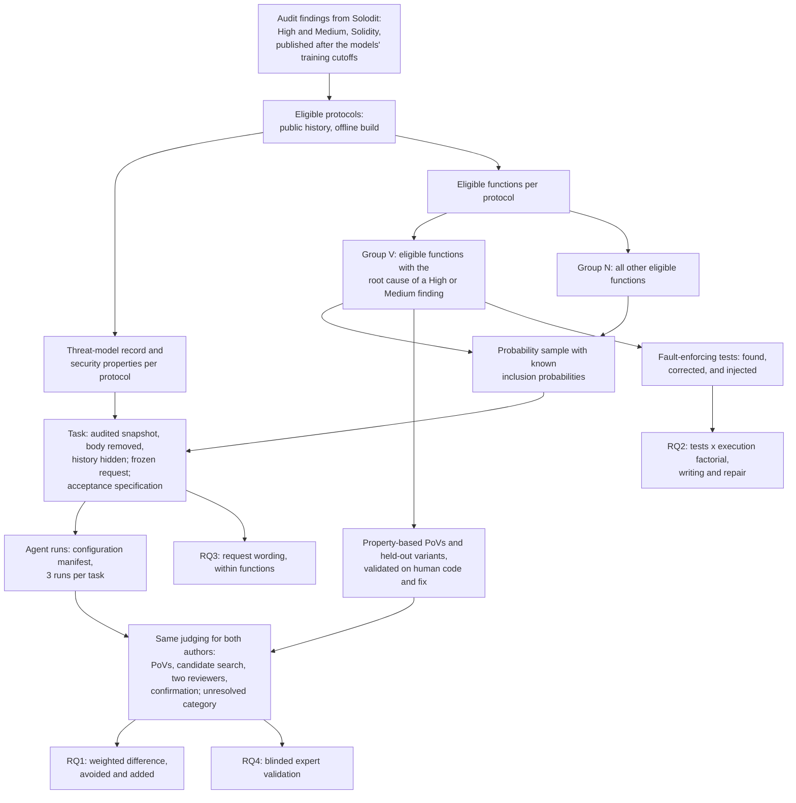

# Agents Versus Developers on Audited Smart Contracts: Measuring the Vulnerabilities Agents Avoid and Add, and How Fault-Enforcing Tests Steer Them

Proposal version 2, 21 October 2026. Author of this version: Peer A (Claude Code), revising version 1 after Peer B's round-1 critique (`codex_raw/L1_r1_peerB_critique.md`). Literature: `proposal_workspace/lit_review.md`.

## 1. Abstract

AI coding agents now write production code, and in a smart contract one bug can drain user funds. Benchmarks show that agent code is often insecure, but they build tasks only from code where a human wrote a bug. So they measure how often agents repeat human bugs, not whether agents are more or less secure than the developers they replace. We propose a retrospective replacement study on audited Solidity protocols. In a fixed audited snapshot, we remove one function and let an agent rewrite it. We sample functions with known probabilities from two groups: those with an audit-confirmed High or Medium bug, and the rest. Both authors' code is judged against the same security properties, with executable exploits. This splits the difference between agent and human into vulnerabilities avoided and vulnerabilities added. A factorial experiment then tests whether the repository's own fault-enforcing tests carry the human's bug to the agent, and whether running them helps or hurts a repair.

## 2. Problem and motivation

**Developers hand code to agents, including smart-contract code.** In the Solidity Developer Survey 2025 (1,095 responses), 58% of respondents use AI tools daily and 49% use them to write code; 61% name Claude Code as their preferred assistant, and 45% distrust the output [Solidity 2026]. On GitHub, the AIDev dataset already holds 932,791 pull requests written by coding agents [Li et al. 2026, AIDev].

**In a smart contract, a bug is a direct loss.** Contracts hold user funds, anyone can call them, and they are hard to change after deployment. DeFi protocols lost $680 million in 2025, and infrastructure failures such as key compromise fell from 30.7% of DeFi losses in 2022 to 10.3% in 2025 [Immunefi 2026]. From DeFiLlama's public incident data (downloaded 21 October 2026), Solidity DeFi protocols lost $411.5 million in 2025, and 45.1% of it came from logic and accounting bugs [DeFiLlama, our computation]. These bugs are hard for tools: over 80% of 516 exploitable bugs from audit contests were beyond existing tools [Zhang et al., ICSE 2023], static analysers miss about half of labelled Solidity vulnerabilities at no more than 10% precision [Li et al., FSE 2024], and tools would have stopped attacks worth only 8% of the losses in 127 incidents [Chaliasos et al., ICSE 2024].

**Agent-assisted Solidity has already been involved in a reported loss.** In February 2026, a Moonwell governance proposal priced cbETH with the raw cbETH/ETH rate and left the protocol with $1.78 million of bad debt. Several commits in the pull request behind it carry a "Co-Authored-By: Claude Opus 4.6" line, and news reports and the OECD AI Incidents Monitor linked the incident to AI-assisted code. Who chose the faulty line is not established, and Moonwell itself did not blame AI [Moonwell 2026].

**What we know about agent code, and what we do not.** Benchmarks built from real vulnerabilities show that agent code is often insecure. In SusVibes, the best setup passes the functional tests on 57.0% of 186 Python tasks, but only 11.8% of its solutions are also secure [Zhao et al., ICML 2026]. In SecureVibeBench, the best setup is correct and secure on 23.8% of 105 C/C++ tasks [Chen et al., ACL 2026]. The Last Secure Code Benchmark reports 16.4% to 25.1% across seven languages [Wu et al. 2026]. These benchmarks, and earlier studies that let a model complete code where a human erred [Asare et al., EMSE 2023; Storhaug et al., ISSRE 2023], build every task from a human failure. On such a sample the human's failure rate is 100% by design, so the agent's rate shows how often it repeats human bugs, not how its overall rate compares with the human's. Studies that mine agent and human pull requests reach opposite conclusions: 1.14 times the human rate of Semgrep findings [Xia and Miller 2026], an odds ratio of 0.63 for security smells [Kraishan 2026], and 11.5% against 12.8% of pull requests with Semgrep findings [Le et al., FPS 2026]. They judge with static analysers, on different tasks for the two sides.

**The question a team needs answered is comparative.** A team that lets an agent write a function wants to know whether the code will carry more or fewer exploitable bugs than the code its own developers wrote. That decides how much review the team must keep. We found no study, in any language, that estimates this difference over a defined population of functions that includes functions the human wrote correctly (literature review, section 6, gap G1).

## 3. Key insight and contributions

**Insight 1. The comparison needs both kinds of functions, sampled with known probabilities.** Compare an agent with the human developer over the same set of functions. Two things can differ. The agent can avoid a bug the human wrote, or it can add a bug where the human's code was correct. Benchmarks built from vulnerability-introducing commits see only the first. The second needs functions the human got right, and the overall answer depends on how many functions of each kind there are. In an audited codebase most functions have no High or Medium finding, so a small rate of added bugs can outweigh a large rate of avoided ones. An audited codebase lets us define an eligible population of functions, split it by the audit's verdict, and sample each part with known probabilities. This is stratified sampling, a standard design that we did not find in any study of AI-written code. It does not remove every selection effect: functions that cannot become tasks stay outside the population, and we say so (section 5.2).

**Insight 2. The repository can carry the human's mistake to the agent.** A test that passes on faulty code and fails on correct code is called a fault-enforcing test [Charoosaei et al. 2026]. Real repositories can contain fault-enforcing tests written by the developer who wrote the bug. An agent reads them, and an agent that can run them tries to keep them passing. In our pilot on finding 63008, the audited test file has four fault-enforcing tests, and the function's parameter comment calls the start tick "exclusive", which is the bug. In a 144-run repair study, OpenHands with GPT-5.4-mini repaired the bug in 10 of 12 runs when it could run nothing and in 2 of 12 runs with a terminal; with the terminal, 7 of 12 repairs still passed all four fault-enforcing tests. Other studies find no effect of execution access on SWE-bench [Lin et al., ISSTA 2026], or find that a general agent with full tools repairs best [Xu et al. 2026]. Fault-enforcing tests are one possible reason for the difference: running tests should help when the tests are right and hurt when they assert the bug. This is a hypothesis from one finding. Section 6.4 tests it with a factorial experiment.

**Insight 3. Request wording may decide the outcome.** In our 8-finding pilot, every request had been written from the vulnerable function, and each ended up describing either the human's design or the rule the fix restores. All 13 compiled runs on the four "design" tasks wrote the bug; 3 of 15 compiled runs on the four "rule" tasks did. Wording and task are confounded here, because no task received both wordings, so this is an association, not an effect. A change of one character in a prompt can turn secure generated code into vulnerable code [Sternfeld et al. 2026], so wording deserves a controlled test. Section 6.5 runs it within functions.

**Contributions.**

1. **An estimand and a design for comparing agents with developers.** The difference in High or Medium vulnerability rates over a defined eligible population, split into vulnerabilities avoided and vulnerabilities added, estimated from a stratified probability sample with inclusion weights. Security is judged against properties written down before any run, so the same exploit can show a flaw in either author's code, including flaws both share.
2. **A benchmark of audited Solidity functions.** For each protocol, a threat-model record and a list of security properties. For each task, an acceptance specification (legitimate behaviour that must keep working, attacker outcomes that must not happen), property-based proofs of vulnerability (PoVs), held-out variants, corrected versions of any fault-enforcing tests, and a frozen feature request.
3. **A validated judging procedure that treats both authors the same way:** the same reviewers, prompts and budgets for every version, confirmation of every reported flaw by a PoV, an explicit unresolved category, and a blinded expert validation with executable adjudication and sampling weights.
4. **A factorial test of Insight 2, in writing and in repair.** It crosses the presence of fault-enforcing tests (natural, or injected from the vulnerable version) with permission to execute tests, inside the same agent configuration, and measures the interaction.

Prior work already runs one exploit on human and agent code [Chen et al., ACL 2026] and judges repairs with held-out exploits [Iranmanesh et al. 2026; Shen et al. 2026; Wang et al., S&P 2026]. We use both as methods and do not claim them as contributions.

## 4. Threat model and problem setting

**Setting: a retrospective replacement.** We take a protocol's code as it was audited and remove one function. A coding agent writes it again from a feature request, inside that fixed snapshot. We compare the agent's version with the historical human version of the same function in the same snapshot. The agent does not work under the human's original conditions: it sees code and tests written after the human's commit. The study answers "if an agent had written this function in the codebase as audited, would it be more or less vulnerable than what the developer wrote?" It does not reproduce the human's development history.

**Assets.** User funds held or accounted for by the protocol, the protocol's solvency, and the availability of its core functions.

**Attacker.** An unprivileged external account. It can deploy contracts, call any public or external function, use flash loans and other capital up to a bound stated in the protocol's threat-model record, order its own transactions within a block, and act across blocks. It cannot break cryptography, steal keys, act as any privileged role (owner, admin, keeper, oracle operator), compromise the developer's machine or the agent, or change the deployed code. Findings whose attack needs a privileged role are not eligible.

**The agent and the developer are honest.** We study accidental vulnerabilities. Prompt injection, malicious dependencies and poisoned training data are out of scope.

**Threat-model record (one per protocol, written before any agent run).** It fixes:
- the attacker's roles and resources (capital bound, flash-loan sources);
- the reachable initial states: only states produced by the protocol's own deployment scripts and public calls, plus listed environmental actions (passing time, moving a mock oracle price within stated bounds);
- the mock assumptions (standard ERC-20 tokens unless the protocol documents otherwise);
- the security properties, taken from the documentation, the audit's scope description and the protocol's invariants. Examples: "no unprivileged account ends with more value than it put in, except fees and rewards the specification grants it"; "a position earns rewards only while it is active"; "a swap that the specification allows does not revert".

**What counts as a vulnerability.** A version of a function is vulnerable if a PoV, obeying the threat-model record, drives the protocol into a state that violates one of the recorded security properties, with an impact of High or Medium severity under the audit platform's rules (theft or loss of funds, permanently frozen funds, insolvency, or denial of a core function). The PoV is a Foundry test run offline on a local copy with mock tokens. Nothing in this definition refers to the other author's code, so the human's version can fail the same PoV as the agent's. The human's fix is used only to validate PoVs (section 5.7).

**Out of scope.** Low and informational findings, gas use, centralization risk, and bugs in code the agent did not write. The PoV runs against the whole protocol, so the effect of the agent's function on other code counts.

## 5. Approach

### 5.1 Selecting findings

We reuse the project's selection pipeline (IDEA.md, "How findings are selected"). It downloads High and Medium Solidity findings from Solodit, keeps findings that link a whole Solidity file, checks that the file is complete and matches the report, and keeps findings published after the models' training data. Of 19,666 findings downloaded, 7,826 link a whole file, and 77 are dated September 2025 to January 2026; 43 of them have a public history. These 77 come from 20 protocols, 59 of them from Code4rena. We will refresh the download to cover findings up to the start of the study and add findings whose report links the contest repository. The refresh's yield is measured in month 1, and the population and targets are fixed in month 2 (section 8).

### 5.2 Eligible population and sampling

All criteria below are fixed and preregistered before any PoV is built or any agent runs.

**Eligible protocol.** Its repository history covers the audited snapshot; the snapshot builds offline with Foundry (or converts to it); its test suite runs; and its threat-model record can be written from public documentation.

**Eligible function.** A function in the audit's scope that (a) changes state or computes a value other code uses, (b) has at least five statements, (c) still compiles when its body is replaced with a revert, and (d) is reached by the repository's tests or by an external call path. Plain getters and one-line wrappers are left out.

**Group V.** Eligible functions that contain the root cause of a High or Medium finding, as shown by a fix commit that changes the function, where the finding's impact matches a recorded security property and needs no privileged attacker. Whether a function belongs to group V is decided from the report and the fix, before any PoV work.

**Group N.** All other eligible functions.

**Sampling.** Within each protocol, we sample group V functions with probability p_V (all of them when there are few) and group N functions with probability p_N, by a seeded random draw. Each sampled function has a known inclusion probability. The analysis weights each function by the inverse of that probability (section 6.2).

**When a sampled group V function yields no valid PoV.** This is a missing outcome, not a reason to drop the function silently. We report the rate. We estimate under the assumption that PoV failure is unrelated to agent outcomes within a protocol and bug class, and we also report the bounds obtained by assuming the missing functions were all repeated, or all avoided, by the agent.

**What the estimate covers.** Conclusions hold for eligible functions in eligible protocols. Functions without traceable history or an offline build are outside the population, and we report how many there are.

### 5.3 Tracing a finding

The pilot traced findings with `git blame` on the lines the report names and took the commit that last changed most of them. For vulnerabilities, the last change is often a refactoring. V-SZZ instead takes the earliest commit that touched the vulnerable lines [Bao et al., ICSE 2022]. Even so, on 1,128 C/C++ vulnerabilities no tracing tool exceeded 45.0% accuracy in finding the affected versions [Chen et al. 2025]. We use the V-SZZ rule, check every result by reading the diffs, and record where the two rules disagree. In the pilot, `git blame` pointed at a later rewrite for finding 63008, and reading the history found the real introducing commit. Squash merges hide many fix commits, so a person confirms each fix by searching the merged diffs for the change the report describes. Tracing matters here only for group membership and for the request's sources; the agent always works in the audited snapshot.

### 5.4 Task framing

Each task starts from the audited snapshot, with the target function's body replaced by `revert("not implemented")`. The signature stays, so the code compiles. The git history is replaced by a single commit, so the agent cannot read the human's code from history. In the pilot one agent did read the human's function from `git log` before we hid it, and a 2026 study found agents reading fixes from git history in another benchmark [Luo et al. 2026].

### 5.5 Feature requests

A request is built from three kinds of source:
- the function's signature, its existing comments, and the code around it in the snapshot, without the target body;
- the issue, the pull-request description and the commit message of the introducing commit, when they exist;
- the protocol's documentation and specification.

The writer is an LLM that is not under study. It never sees the target body, the finding or the fix. Each sentence of the request is tagged with its source, and a person audits the tags against the sources. The request is then frozen. We do not rewrite it after comparing it with the vulnerable or fixed version, because that would bring withheld information back in.

Two diagnostics are recorded for each frozen request but never used to change it: an LLM's list of request points that only one of the two human versions satisfies, and a panel's preference between the two versions with and without the request. How wording changes agent behaviour is measured directly by the experiment in section 6.5.

### 5.6 Acceptance specification for each task

Each task has a written acceptance specification, fixed before any agent run:
- **Legitimate behaviour that must keep working:** the repository's tests for the function, with every fault-enforcing test replaced by its corrected version (section 5.8), plus tests derived from the request where the repository has none. For finding 63008 these are the fix commit's downward iterator tests, adapted to the request (the pilot's repair study built a 61-test suite this way).
- **Attacker outcomes that must not happen:** the impact assertions of the task's PoVs, each tied to a recorded security property.

**An attack is blocked** when its impact assertion is not reached and the legitimate-behaviour suite passes. So a version that stops the attack with an early defensive revert is accepted, and a version that stops the attack by breaking the feature is not. Whether the PoV fails at the same place as on the human's fix is recorded as a diagnostic only. A run whose PoV cannot execute (setup failure, compile error in the test) is unresolved and goes to a person.

### 5.7 PoVs and held-out variants

For each group V function, we adapt the audit report's proof of concept into a Foundry test that asserts the violated property. It must obey the threat-model record. It is kept only if it passes on the human's vulnerable code and fails on the human's fix. For each finding we also write at least one variant from the security property rather than from the report: another boundary, state or call path. Variants are validated the same way, written before any agent run, and kept outside every workspace. PoCo shows that an agent can write such Foundry tests from audit findings and check them against the developer's patch [Andersson et al., TOSEM 2026]. We use an LLM agent with the same check, and a person reads every PoV against the threat-model record.

### 5.8 Fault-enforcing tests: found, corrected and injected

For each group V function, we run the snapshot's test suite on the human's fix. Tests that pass on the vulnerable code and fail on the fix are fault-enforcing. For each one we write a corrected version that asserts the fixed behaviour; where the fix commit changed the test, we start from its version. We also list comments that describe the vulnerable behaviour as intended, and a person confirms each. Finding 63008 has four fault-enforcing tests and the comment `@param startTick The starting tick (exclusive)`.

Natural fault-enforcing tests may be rare. So, for the experiment in section 6.4, we also make **injected** ones for group V functions that have none: we record the vulnerable version's observable results on inputs where it differs from the fix, and write them as ordinary-looking tests in the repository's style. A person checks that each injected test passes on the vulnerable code, fails on the fix, and looks like the repository's other tests.

### 5.9 Agents, models and the configuration manifest

| Configuration | Kind | Notes |
|---|---|---|
| Aider 0.86.2 + GPT-5.4-mini | experimental (pilot) | edits only the target file; no execution in the first round |
| Aider 0.86.2 + Claude Sonnet 4.5 | experimental (pilot) | thinking budget 32,000 tokens |
| OpenHands SDK 1.53.0 + GPT-5.4-mini | experimental (pilot) | high reasoning effort; terminal can be turned off |
| OpenHands SDK 1.53.0 + Claude Sonnet 4.5 | experimental (pilot) | SDK default thinking; terminal can be turned off |
| Codex CLI + GPT-5.4-mini | experimental (pilot) | Codex has no settings for this model and uses its fallback prompt |
| Codex CLI + Claude Sonnet 4.5 | experimental (pilot) | reached through a LiteLLM proxy; fallback prompt |
| Claude Code + a current Claude model | supported, frontier | the vendor's own agent and model, default settings [model fixed at month 2] |
| Codex CLI + a current GPT model it supports | supported, frontier | the vendor's own agent and model, default settings [model fixed at month 2] |

GPT-5.4-mini and Claude Sonnet 4.5 have training data that ends before September 2025, the date of the oldest finding. The six pilot configurations keep the study comparable with the pilot, but three of them run models through integrations their developers do not support, and the agents give the models different reasoning budgets. We report them as experimental integrations. The two supported frontier configurations show what current, vendor-supported agents do. They run only on tasks published after their models' training cutoffs. Direct comparisons between configurations use the common set of tasks that all of them can run.

Each configuration runs three times per task, in Docker, with 6 GB of memory, a 20-minute limit, and network access only to the model APIs. Codex's hosted web search is off, and Codex is asked to work offline.

### 5.10 One judging procedure for both authors

Every compiled version, human or agent, goes through the same steps. The judge is not told who wrote it.

1. **Build and legitimate-behaviour suite** (section 5.6).
2. **Task PoVs and variants** (group V). On the human's version they pass, by construction.
3. **Candidate search by differential fuzzing.** A harness deploys two copies of the protocol that differ only in the target function and sends both the same transaction sequences, generated by Foundry's stateful fuzzer and seeded with the project's tests. It compares token balances, return values, reverts and the storage the function writes. It follows Diffusc, an open-source tool that builds such harnesses for two versions of a contract [Trail of Bits 2023]. For the agent's version the other copy is the human's code, and for the human's version it is the agent's code from each run. Differences are only candidates; they never count as vulnerabilities by themselves.
4. **LLM review.** The same two reviewers read every version, with the same prompt, the same context (function, callers, request, threat-model record) and the same output limit, and report each High or Medium flaw with a concrete attack sequence. The reviewers are fixed for the whole study and come from the strongest available models; whether a reviewer is less sensitive to code from its own vendor's models is measured on confirmed flaws (section 6.6).
5. **Confirmation.** Each candidate and each report gets the same budget: one LLM agent attempt of fixed length to write a PoV that obeys the threat-model record and asserts a recorded property. A person reads every confirmed PoV.
6. **Result.** Each version ends in one of the categories of section 6.2. LLM judgments of vulnerabilities are unreliable on their own [Ding et al., ICSE 2025], and an agentic review repeated five times reported half of its extra findings only once [Tal et al. 2026]. So only confirmed flaws count, and on a random 10% of versions each reviewer runs twice to measure stability.

We do not correct the rates with a capture-recapture model. The audit and our procedure are not independent detectors, because the procedure uses audit-derived material. Instead, section 6.3 reports how far undetected flaws would have to differ between human and agent code to change the conclusion.

### 5.11 Repair study

Every repair starts from the human's vulnerable code, so all agents start equal. Section 6.4 gives the design. A repair succeeds only if it compiles, blocks every frozen attack (the shown PoV, the held-out PoVs and the variants) by the rule of section 5.6, passes the legitimate-behaviour suite, and has no confirmed new High or Medium flaw. For every repair that blocks the shown PoV but not another one, we report the funds the remaining attack takes in its scenario.

### 5.12 Worked example: finding 63008

**The finding.** Sorella L2 Angstrom, a Uniswap v4 hook audited by Cyfrin; report published October 2025. High severity: "All rewards can be stolen due to incorrect active liquidity calculations when the current tick is an exact multiple of the tick spacing at the upper end of a liquidity range."

**Tracing.** The audited snapshot is commit `386baff`. `git blame` pointed at a later rewrite; reading the history showed that the faulty line was written in commit `661468b`. The fix is commit `c01b6c7`, which changes `TickIterator.sol`.

**Security properties (from the protocol's design).** Rewards from swap taxes go only to positions that are active when the tax is paid; a swap within the price range does not revert; no unprivileged account takes more than its share of rewards.

**Groups.** The bug is in `reset(TickIteratorDown)`: the downward walk sets `currentTick = startTick` and then advances, so it skips its start tick. That function is in group V. The same commit also wrote `reset(TickIteratorUp)` and `calldataToId`; in the full study, group N functions are drawn at random, not from the same commit.

**PoVs.** The report's three proofs of concept: P1 swaps to a boundary, adds liquidity and swaps back; P2 swaps down from a boundary tick and the swap reverts; P3 steals all rewards. All three pass on `386baff` and fail with the fix's `TickIterator.sol`. In P3's scenario an honest liquidity provider has 49 ETH of pending rewards; the attacker takes 48.88 ETH net, and with the fix the attacker ends 0.098 ETH down. Held-out variants P4 (tick spacing 60, start and end in the same bitmap word) and P5 (a start at a bitmap word boundary) were written later.

**Fault-enforcing tests and comments.** Four downward tests in `test/libraries/TickIterator.t.sol` expect the start tick to be skipped, and the parameter comment says "exclusive".

**First-round runs (pilot).** Six configurations, one run each. Four of six wrote the human's bug; two wrote the fix's line, `self.currentTick = startTick + 1`. Codex with Sonnet 4.5 ran the human's iterator tests twice and saw all 28 pass, because the downward tests expect the bug.

**Control functions (pilot).** Two of 11 compiled agent versions of `reset(TickIteratorUp)` and `calldataToId` broke the property "a position earns only while active" and the property "an allowed swap does not revert". PoVs confirmed both on the two agent versions and failed on the human's code. Both versions also fail one functional test (`test_iterateUp_emptyRange`). Under the outcome table of section 6.2 they count as compiled versions with a confirmed vulnerability. One further report was rejected because the human's code behaves the same way; under property-based judging such a shared behaviour would count for both authors if a PoV showed a property violation.

**Weighted comparison (illustration only).** If 10% of eligible functions were in group V, the agents' rate on this finding would be about 0.1 × 4/6 + 0.9 × 2/11 ≈ 23%, against the human's 10% plus whatever the checks find in the human's group N code. One finding supports no conclusion; the example only shows why the second term carries most of the weight.

**Repair (pilot).** In the masked-PoV repair round, one repair blocked the shown P2 while held-out P3 still took 48.88 ETH. In the 144-run repair study, OpenHands with GPT-5.4-mini succeeded in 10 of 12 runs with nothing to run and 2 of 12 with a terminal.

## 6. Research questions and evaluation plan

### 6.1 Research questions

- **RQ1 (comparison).** Over eligible functions of audited Solidity protocols, do AI coding agents write High or Medium vulnerabilities more or less often than the human developers did, and how much of the difference is avoided bugs and how much added ones?
- **RQ2 (fault-enforcing tests).** Do fault-enforcing tests make agents keep or write the human's bug, and does permission to execute tests strengthen this effect, in first-round writing and in repair?
- **RQ3 (request wording).** Within the same function, how much does the wording of the request change whether agents write the human's bug?
- **RQ4 (judges).** How well does the judging procedure agree with blinded expert auditors, and is its sensitivity the same for human and agent code?

These map to IDEA.md as follows: RQ1 is IDEA's question 1; RQ2 covers IDEA's questions 2, 3 and 5; RQ3 is part of question 5; RQ4 is question 4.

### 6.2 Outcomes and denominators

| Category | Meaning | Counted in the primary rate as |
|---|---|---|
| X: no compile | the version does not build | excluded from the primary rate; reported per configuration |
| V: confirmed vulnerability | builds, and a PoV confirms a High or Medium property violation | vulnerable |
| S: no confirmed vulnerability, legitimate suite passes | builds, no confirmed flaw | not vulnerable |
| F: no confirmed vulnerability, legitimate suite fails | builds, no confirmed flaw, but breaks legitimate behaviour | not vulnerable in the primary rate; reported separately |
| U: unresolved | a check could not run, or a person could not decide | sensitivity analysis: counted as vulnerable, then as not vulnerable |

**Primary rate:** V divided by all compiled versions (V + S + F + U, with U handled as stated). Every compiled version is judged for security, whether or not it passes the legitimate-behaviour suite, because a version can be both broken and exploitable, as the two pilot control versions were. **Secondary rates:** correct and secure, S divided by all runs; and the compile rate.

### 6.3 RQ1: estimate, power and robustness

Let π be the weighted share of eligible functions in group V. Let a_V and a_N be the agent's weighted vulnerability rates in the two groups, and h_V and h_N the human's (h_V is 1 when every group V PoV validates on the human code). The difference between agent and human is

Δ = π (a_V − h_V) + (1 − π) (a_N − h_N).

The first term is what the agent gains by avoiding the human's bugs. The second is what it loses by adding new ones. Each rate is a weighted mean over sampled functions, with weights equal to the inverse inclusion probabilities. A bootstrap that resamples protocols, then functions within them, then runs, gives the 95% interval. The primary test is Δ = 0 for each of the six experimental configurations, with Holm's correction across the six; the frontier configurations are reported on their own task set.

**Power, by simulation.** The script `tools/power_sim.py` simulates the sampling plan: protocols, functions within them, three runs per function, random effects for protocol and function on the logit scale, one human version per function, and a protocol-level jackknife standard error. For one configuration at the strictest Holm level (α = 0.05/6), with two group V and four group N functions per protocol, π = 0.10 and a_V = 0.6:

| Protocols | a_N | h_N | True Δ | Power |
|---|---|---|---|---|
| 25 | 0.10 | 0.02 | +0.032 | 0.76 to 0.83 |
| 25 | 0.15 | 0.02 | +0.077 | 0.96 to 0.97 |
| 25 | 0.15 | 0.05 | +0.050 | 0.73 to 0.77 |
| 30 | 0.10 | 0.02 | +0.032 | 0.84 to 0.91 |
| 30 | 0.15 | 0.05 | +0.050 | 0.82 to 0.84 |

Each range spans protocol and function standard deviations of 0.5 and 1.5 up to 1.0 and 2.0 on the logit scale. The design needs about 25 to 30 eligible protocols. We rerun the simulation in month 2 with the measured frame sizes and pilot rates, and fix the targets then.

**Robustness to undetected flaws.** We report the observed, confirmed rates. Then we ask how much more often the procedure would have to miss flaws in agent code than in human code (or the reverse) for Δ to change sign, and compare that with the sensitivities measured in RQ4.

### 6.4 RQ2: fault-enforcing tests and execution, a factorial experiment

**First-round writing.** For each group V function in the experiment we run a 2 × 2 design inside the same agent configuration: fault-enforcing tests present or replaced by their corrected versions, and execution of tests allowed or not. Comments are held as they are. We use the configurations whose terminal can be turned off without changing anything else: OpenHands and Codex (the pilot's repair study built and checked these levels). The functions are those with natural fault-enforcing tests, plus a random half of the others with injected ones (section 5.8). Natural and injected tests are analysed separately and together.

**Repair.** The same 2 × 2 runs on repair from the human's vulnerable code, crossed with what the agent is told: the audit report without its proof of concept and fix (R), or the shown PoV as a failing test (P). Arm L (location only) runs once per function as a reference.

**Primary test.** The interaction between tests present and execution allowed, on "the version has the human's bug" (writing) and "the repair succeeds" (repair), estimated with a mixed-effects logistic regression with random effects for function, and checked with the function-level difference in differences.

**Power.** With three runs per cell, a function-level random effect of standard deviation 1.5 and α = 0.05, the simulation gives power 0.82 for an interaction of 1.5 on the logit scale with 30 functions, 0.87 for an interaction of 2.0 with 20 functions, and 0.49 for an interaction of 1.0 with 30 functions. The pilot's contrast on 63008 (10 of 12 against 2 of 12) corresponds to more than 3 on the logit scale. With injected tests, every group V function can enter, so we expect 30 or more functions.

### 6.5 RQ3: request wording, within functions

On a random subset of 20 group V functions, each experimental configuration gets four requests for the same function: the frozen request, a minimal request (signature and existing comments), a request written from the vulnerable code, and a request written from the fix. The last two are made only for this experiment and are labelled as such. Three runs each. The outcome is "the version has the human's bug". A mixed-effects logistic regression with the function as a random effect estimates the wording effect, which the pilot could only observe across different tasks.

### 6.6 RQ4: validation of the judging procedure

- **Sample.** A stratified random sample of about 150 compiled versions: human and agent, both groups, all result categories. Sampling weights are kept, so accuracy estimates refer to the whole set of versions.
- **Experts.** Two auditors with contest experience, paid, blinded to author and to the automatic result. Each has the same time budget per version.
- **Executable adjudication.** Every flaw an expert reports is sent to the confirmation step (section 5.10, step 5). A version is vulnerable in the reference standard only if some PoV confirms a flaw; versions where the experts suspect a flaw but no PoV can be written are unresolved.
- **Measures.** Weighted sensitivity and specificity of the procedure against the reference standard, with 95% intervals; Cohen's κ between the experts and between each check and the experts; and sensitivity separately for human and agent code, and for each reviewer on code from its own vendor's models against others.

### 6.7 Baselines

- For RQ1, the human developer is the baseline.
- For the judge, we compare the procedure with the judges prior Solidity benchmarks use: Slither, as in SolAgent [Chen et al. 2026], and a single LLM judge. We report how RQ1's answer changes with each.
- For RQ2, the cell "tests corrected, execution allowed" is the reference; for repair, the written-report arm (R) is the setting of prior LLM repair studies [Pearce et al., S&P 2023], and arm L is the location-only floor.
- Agents: the two supported frontier configurations are the strongest available baselines on the tasks their training cutoffs allow.

### 6.8 Threats to validity

- **Retrospective replacement.** The agent works in a snapshot that contains later code and tests. The result describes replacement in that snapshot, not the human's original situation. RQ2 measures the most direct channel, the tests.
- **Contamination.** Code that became public before a model's cutoff can be memorized, and code models repeat a human's bug more often when they saw it in training [Al-Kaswan et al., MSR 2026]. We record when each introducing commit and each fix became public, analyse tasks whose vulnerable code postdates the model's cutoff separately, and run a memorization probe that checks whether the model completes the human's body, or the fix, word for word.
- **Missed flaws.** Some group N functions are vulnerable without an audit finding; labels that ignore later-found vulnerabilities can reverse results [Jimenez et al., FSE 2019]. The same procedure judges the human's group N code, and section 6.3 reports how robust Δ is to unequal misses.
- **Population.** Findings with traceable history are a biased sample of all findings [Bird et al., FSE 2009]. We report the eligible population's size and how it differs from all audited functions.
- **One ecosystem.** The results hold for audited Solidity protocols.
- **Fast-moving agents.** We pin versions, keep every log, and release the harness.

## 7. Related work

The literature review (`proposal_workspace/lit_review.md`) gives the full search. The closest work falls into five groups.

**Benchmarks built from real vulnerabilities.** SusVibes [Zhao et al., ICML 2026], SecureVibeBench [Chen et al., ACL 2026], the Last Secure Code Benchmark [Wu et al. 2026] and SecRepoBench [Shen et al. 2026] remove code where a human wrote or fixed a vulnerability and ask agents to write it again. SecureVibeBench starts at the introducing commit and runs the same PoV on human and agent code, which we reuse as a method. Every task in these benchmarks is a human failure, so none estimates a human rate on a population that includes correct human code, and none has a control group. SecureVibeBench compares added risk only through Semgrep, and half of its flags were false alarms on manual check.

**Rewriting code where a human erred.** Asare et al. [EMSE 2023], Jesse et al. [MSR 2023], Guo et al. [2025] and Storhaug et al. [ISSRE 2023] let a model complete code at the place a human introduced a bug and judge by matching text; Guo et al. add ordinary code as a contrast. Al-Kaswan et al. show the result depends on training exposure [MSR 2026].

**Agent versus human at scale.** Sajadi et al. [2025] compare agent and developer patches for the same SWE-bench issues; Xia and Miller [2026], Kraishan [2026] and Le et al. [FPS 2026] mine agent and human pull requests. All judge with static analysers, and their conclusions disagree. In Solidity, SolAgent compares Slither warnings in agent files with the human files [Chen et al. 2026], and Khalid and Brown compare function only [BSCI 2025].

**Agents and smart-contract security.** EVMbench has agents detect, patch and exploit 117 Code4rena vulnerabilities and grades patches with exploit tests the agent never sees [Wang et al., ICML 2026]. It notes that some existing tests "rely on vulnerable logic" and excuses them at grading, but does not study them. CyberChainBench [Huang et al. 2026] replays real attacks, and SCONE-bench [Xiao et al. 2025] and A1 [Gervais and Zhou 2025] exploit deployed contracts. PoCo [Andersson et al., TOSEM 2026], SmartPoC [Chen et al., ASE 2026] and V2E [Zhang et al., FSE 2026] generate executable PoCs for findings. Bobadilla et al. judge smart-contract repair tools with exploits [TSE 2025]. None has agents write a function that a human wrote, and none compares with the human.

**Repair judged by held-out exploits or tests, and what the agent is told or can run.** P2Patch [Iranmanesh et al. 2026], PatchBench [Shen et al. 2026], PVBench [Yu et al. 2026], SlicePatch [Wang et al., S&P 2026], AutoPatchBench [Meta 2025, industry report], SecTDD [Liang et al. 2026] and Ahmed et al. [FSE Companion 2026] show that patches which pass the shown PoC or test are often still wrong, following Smith et al. [FSE 2015]. Le et al. change PoC access and build-and-test instructions and judge with hidden developer tests [2026]; showing the PoC raised PoC passing far more than hidden-test passing. The F.L.A.W.E.D. report varies shell access and prompt content [Mierczuk et al. 2026, industry report]. Lin et al. find no effect of execution access on SWE-bench [ISSTA 2026], and Xu et al. find a general agent with full tools the best Java patcher [2026]. ImpossibleBench shows agents exploiting tests that conflict with the task [Zhong et al., ICLR 2026], and SWE-Residual shows agents keeping flawed work they inherit [Li et al. 2026]. Fault-enforcing tests are defined for LLM-written regression tests [Charoosaei et al. 2026]. No work we found tests whether human-written fault-enforcing tests, together with execution access, make agents keep a vulnerability.

| Work | Population includes correct human code | Human rate estimated | Judge | Agents write a function | Repair with held-out exploits | Fault-enforcing tests studied | Smart contracts |
|---|---|---|---|---|---|---|---|
| SusVibes (ICML 2026) | no | no | tests from the fix | yes | no | no | no |
| SecureVibeBench (ACL 2026) | no | no (Semgrep comparison only) | PoV + Semgrep | yes | no | no | no |
| Last Secure Code Benchmark (2026) | no | no | attack tests | yes | no | no | no |
| Asare et al. (EMSE 2023) | no | no | text match | completion | no | no | no |
| Storhaug et al. (ISSRE 2023) | no | no | manual | completion | no | no | yes |
| Sajadi et al. (2025); Le et al. (FPS 2026) | different tasks | yes, static analysis | static analysers | patches | no | no | no |
| SolAgent (2026) | yes, all functions | Slither counts | Slither | yes | no | no | yes |
| EVMbench (ICML 2026) | no | no | hidden exploits | no | held-out only | noted, not studied | yes |
| P2Patch, PatchBench, SlicePatch (2026) | no | no | held-out PoVs or variants | no | yes | no | no |
| Le et al. (2026), patching benchmarks | no | no | hidden developer tests | no | PoC access varied | no | no |
| Lin et al. (ISSTA 2026) | no | no | SWE-bench tests | no | execution varied | no | no |
| **This proposal** | yes, stratified sample | yes, same PoVs and properties | property-based PoVs, confirmed reviews | yes | yes | yes, factorial | yes |

## 8. Feasibility, risks and fallback plans

**Measured construction speed.** The pilot built 8 traced tasks with validated PoVs in one working day (8 October 2026), using Claude Code subagents, and 17 executable attack tests in total by 20 October. For finding 63008 it built the control tasks, the LLM review, a repair round and a 144-run repair study in eight days (13 to 20 October). Most of those PoVs were adapted from proofs of concept in the reports; findings without one will take longer.

**Staged plan with a decision gate.**
- **Month 1.** Refresh findings; write threat-model records for the first protocols; measure the time to build one complete task (tracing, acceptance specification, PoVs, variants, corrected tests) on 10 findings.
- **Month 2 gate.** From the measured times and the refreshed pool, fix the eligible population, the sampling probabilities and the targets, and rerun the power simulation. If fewer than 25 eligible protocols exist, RQ1 is reported with the interval it supports and RQ2 becomes the primary result. If task construction takes more than two working days per group V function, we lower p_V and keep the sample probabilistic, rather than keeping only the easy findings.

**Budget estimate.**
- **Agent runs.** First round: about 2 × 25 protocols × 6 functions × 6 configurations × 3 runs ≈ 2,700 runs; RQ2 and RQ3: about 2,500 runs. The pilot's priced runs cost about $0.26 each, so about $1,400 in total.
- **LLM review.** In the pilot one review used about 15,000 input and 16,000 output tokens (GPT-5.4) and about 25,000 input and 1,000 to 3,000 output tokens (Claude Opus 5.5). For about 3,000 deduplicated compiled versions with two reviewers, that is about 50 million input and 55 million output tokens [price to be confirmed at month 2].
- **Experts.** About 150 versions at about 20 minutes each for two auditors: about 100 paid hours.

**Risks.**

| Risk | Sign | Fallback |
|---|---|---|
| Too few eligible protocols | fewer than 25 at month 2 | add contest-repository findings; report RQ1 with a wider interval; RQ2 as primary |
| Task construction too slow | more than 2 days per group V function | lower p_V, keep probability sampling |
| Too few natural fault-enforcing tests | fewer than 10 functions | rely on injected tests for RQ2, and report natural ones as a case series |
| Candidate search too noisy | most differences harmless | it only feeds confirmation, so noise costs time but not validity; cap confirmation attempts per version |
| Experts unavailable | fewer than two auditors | PhD students trained on contest reports, with lower confidence stated |
| New flaws in deployed human code | a confirmed PoV on a human group N function | responsible disclosure first (section 9) |

## 9. Ethics and responsible disclosure

- Every PoV runs offline on a local copy with mock tokens. No test touches a live chain or a deployed address.
- **Release decisions per finding.** For each finding we record the evidence that it was remediated (the fix commit, and whether deployed contracts or known forks use the fixed code) and its public disclosure status. A PoV is released only when this record shows no remaining exposure we know of.
- **New vulnerabilities in deployed human code.** We report them to the protocol through its security contact or bug bounty before any publication. At the 90-day deadline we review the exposure again; we publish exploit details only if the bug is fixed or no deployment remains exposed, and otherwise extend the embargo.
- Agent code is not deployed anywhere. We publish its flaws in aggregate.
- We release the tasks, requests, threat-model records, acceptance specifications and harnesses. We do not release an automatic exploit generator.
- The expert reviewers are paid. We ask the university's ethics board whether the expert study needs review.
- All LLM use in building the benchmark is disclosed.

## 10. Target venues and 12-month timeline

**Primary venue:** ICSE 2028 (research track). **Backup:** USENIX Security 2028 or ACM CCS 2027, with the threat model of section 4 at the front. Deadlines will be checked against each call [uncertain].

| Months (from November 2026) | Work |
|---|---|
| 1 | Refresh findings; threat-model records; time 10 complete tasks; build the outcome categories and acceptance rules into the judge |
| 2 | Decision gate: population, sampling probabilities, targets, power rerun; preregistration on OSF |
| 2-5 | Build sampled tasks, PoVs, variants, corrected and injected tests; validate the candidate-search harness on the pilot findings |
| 5-7 | First-round runs and judging; RQ3 wording runs |
| 6-8 | RQ2 factorial in writing and repair |
| 7-8 | Expert validation (RQ4) |
| 9-10 | Analysis |
| 10-11 | Writing and submission |
| 12 | Artifact release; disclosure follow-up |

## References

Each entry gives the page opened in the literature search.

- Al-Kaswan et al. Model See, Model Do? Exposure-Aware Evaluation of Bug-vs-Fix Preference in Code LLMs. MSR 2026. https://arxiv.org/abs/2601.10496
- Ahmed, Ganhotra, Shinnar, Hirzel. Investigating Test Overfitting on SWE-bench. FSE Companion 2026, DOI 10.1145/3803437.3805574. https://arxiv.org/abs/2511.16858
- Andersson, Bobadilla, Hobbelhagen, Monperrus. PoCo: Agentic Proof-of-Concept Exploit Generation for Smart Contracts. TOSEM 2026, DOI 10.1145/3816704. https://arxiv.org/abs/2511.02780
- Asare, Nagappan, Asokan. Is GitHub's Copilot as Bad as Humans at Introducing Vulnerabilities in Code? Empirical Software Engineering 28, 2023. https://arxiv.org/abs/2204.04741
- Bao et al. V-SZZ: Automatic Identification of Version Ranges Affected by CVE Vulnerabilities. ICSE 2022. https://baolingfeng.github.io/papers/ICSE2022VSZZ.pdf
- Bird et al. Fair and Balanced? Bias in Bug-Fix Datasets. ESEC/FSE 2009. https://www.cs.ucdavis.edu/~filkov/papers/biasbusters.pdf
- Bobadilla, Jin, Monperrus. Do Automated Fixes Truly Mitigate Smart Contract Exploits? IEEE TSE 2025. https://arxiv.org/abs/2501.04600
- Chaliasos et al. Smart Contract and DeFi Security Tools: Do They Meet the Needs of Practitioners? ICSE 2024. https://arxiv.org/abs/2304.02981
- Charoosaei, Richter, Papadakis. On the Risks of using LLM-Generated Tests for Regression Testing. arXiv 2610.11835, 2026. https://arxiv.org/abs/2610.11835
- Chen, X. et al. Vulnerability-Affected Versions Identification: How Far Are We? arXiv 2509.03876, 2025. https://arxiv.org/abs/2509.03876
- Chen, J. et al. SecureVibeBench. ACL 2026. https://aclanthology.org/2026.acl-long.1107/
- Chen, L. et al. SmartPoC. ASE 2026, DOI 10.1145/3832783.3834380. https://arxiv.org/abs/2511.12993
- Chen, W. et al. SolAgent: A Specialized Multi-Agent Framework for Solidity Code Generation. arXiv 2601.23009, 2026. https://arxiv.org/abs/2601.23009
- DeFiLlama. Hacks dataset, downloaded 21 October 2026 (our computation). https://api.llama.fi/hacks
- Ding et al. Vulnerability Detection with Code Language Models: How Far Are We? ICSE 2025. https://arxiv.org/abs/2403.18624
- Gervais, Zhou. AI Agent Smart Contract Exploit Generation. arXiv 2507.05558, 2025. https://arxiv.org/abs/2507.05558
- Guo et al. LLMs are Bug Replicators. arXiv 2503.11082, 2025. https://arxiv.org/abs/2503.11082
- Huang, Jiang, Poovendran, Lin. CyberChainBench. arXiv 2606.26216, 2026. https://arxiv.org/abs/2606.26216
- Immunefi. The Ecosystem Vulnerability Scoreboard: 6 Years of DeFi Loss Data, 2026 (industry report). https://immunefi.com/blog/research/the-ecosystem-vulnerability-scoreboard-6-years-of-defi-loss-data/
- Iranmanesh et al. P2Patch: Exploit-Guided Vulnerability Repair. arXiv 2610.20245, 2026. https://arxiv.org/abs/2610.20245
- Jesse, Ahmed, Devanbu, Morgan. Large Language Models and Simple, Stupid Bugs. MSR 2023. https://arxiv.org/abs/2303.11455
- Jimenez et al. The importance of accounting for real-world labelling when predicting software vulnerabilities. ESEC/FSE 2019. https://api.openalex.org/works/doi:10.1145/3338906.3338941
- Khalid, Brown. Evaluating Capabilities and Perspectives of Generative AI Tools in Smart Contract Development. BSCI 2025. https://vtechworks.lib.vt.edu/handle/10919/137729
- Kraishan. Not All Agents Are Equal. arXiv 2609.17598, 2026. https://arxiv.org/abs/2609.17598
- Le, D. K., Shi, Xing. On the Reliability of LLM-Based Vulnerability Patching Benchmarks. arXiv 2610.10150, 2026. https://arxiv.org/abs/2610.10150
- Le et al. On the Security of Agentic Pull Requests in GitHub: An Empirical Study. FPS 2026 (author-hosted PDF). https://ldklab.github.io/assets/papers/fps26-prs.pdf
- Li, H., Zhang, Hassan. AIDev: Studying AI Coding Agents on GitHub. arXiv 2602.09185, 2026. https://arxiv.org/abs/2602.09185
- Li, K. et al. Static Application Security Testing (SAST) Tools for Smart Contracts: How Far Are We? FSE 2024. https://arxiv.org/abs/2404.18186
- Li et al. SWE-Residual: Evaluating Starting-State Robustness of Coding Agents. arXiv 2610.25899, 2026. https://arxiv.org/html/2610.25899
- Liang et al. Security Tests as Executable Specifications for LLM Code Generation. arXiv 2608.09740, 2026. https://arxiv.org/abs/2608.09740
- Lin, Zhu et al. To Run or Not to Run. ISSTA 2026. https://arxiv.org/abs/2606.26978
- Luo et al. Maintaining Benchmarks Against Increasingly Capable Agents: Detection and Remediation of Unearned Passes. arXiv 2609.34262, 2026. https://arxiv.org/abs/2609.34262
- Meta. Introducing AutoPatchBench. Engineering at Meta blog, 2025 (industry report). https://engineering.fb.com/2025/04/29/ai-research/autopatchbench-benchmark-ai-powered-security-fixes/
- Mierczuk, Michaels, Hoodlet. Frontier Models' Vulnerability Patches are Often F.L.A.W.E.D. 1Password industry report, 2026. https://1password.com/files/resources/frontier-models-vulnerability-patches-flawed.pdf
- Moonwell / Anthias Labs. MIP-X43 cbETH Oracle Incident Summary, 2026; OECD AI Incidents Monitor entry. https://forum.moonwell.fi/t/mip-x43-cbeth-oracle-incident-summary/2068 ; https://oecd.ai/en/incidents/2026-02-18-a018
- Pearce et al. Examining Zero-Shot Vulnerability Repair with Large Language Models. IEEE S&P 2023. https://arxiv.org/abs/2112.02125
- Sajadi, Damevski, Chatterjee. How Safe Are AI-Generated Patches? arXiv 2507.02976, 2025. https://arxiv.org/abs/2507.02976
- Shen, C. et al. PatchBench. arXiv 2609.04075, 2026. https://arxiv.org/abs/2609.04075
- Shen, C. et al. SecRepoBench. LLM4Code 2026. https://arxiv.org/abs/2504.21205
- Smith, Barr, Le Goues, Brun. Is the Cure Worse Than the Disease? ESEC/FSE 2015. https://people.cs.umass.edu/~brun/pubs/pubs/Smith15fse.pdf
- Solidity team. Solidity Developer Survey 2025 Results, 2026. https://soliditylang.org/blog/2026/04/15/solidity-developer-survey-2025-results/
- Sternfeld et al. Minimal Prompt Perturbations Lead to Code Vulnerabilities. arXiv 2605.29737, 2026. https://arxiv.org/abs/2605.29737
- Storhaug, Li, Hu. Efficient Avoidance of Vulnerabilities in Auto-completed Smart Contract Code Using Vulnerability-constrained Decoding. ISSRE 2023. https://arxiv.org/abs/2309.09826
- Tal et al. Snyk VulnBench JS 1.0: Can LLMs Find the Same Bugs Twice? arXiv 2606.15762, 2026. https://arxiv.org/abs/2606.15762
- Trail of Bits (Bodell). Differential fuzz testing upgradeable smart contracts with Diffusc. Blog post, 2023. https://blog.trailofbits.com/2023/07/07/differential-fuzz-testing-upgradeable-smart-contracts-with-diffusc/
- Wang, J. et al. EVMbench: Evaluating AI Agents on Smart Contract Security. ICML 2026. https://proceedings.mlr.press/v306/wang26k.html
- Wang et al. Web Application Vulnerability Repair via Context-Aware Fault Localization and Directed Differential Fuzzing (SlicePatch). IEEE S&P 2026. https://seclab.cse.cuhk.edu.hk/papers/sp26-SlicePatch.pdf
- Wu, T. et al. Last Secure Code Benchmark: Is the Code You Vibe Secure? arXiv 2610.14766, 2026. https://arxiv.org/abs/2610.14766
- Xia, Miller. Do These Violent Delights Have Violent Ends? arXiv 2607.09902, 2026. https://arxiv.org/abs/2607.09902
- Xiao et al. AI agents find $4.6M in blockchain smart contract exploits (SCONE-bench). Anthropic, 2025 (industry report). https://www.anthropic.com/research/smart-contracts
- Xu et al. A Systematic Study of LLM-Based Architectures for Automated Patching. arXiv 2603.01257, 2026. https://arxiv.org/html/2603.01257
- Yu et al. Patch Validation in Automated Vulnerability Repair (PVBench). arXiv 2603.06858, 2026. https://arxiv.org/abs/2603.06858
- Zhang, Z., Zhang, Xu, Lin. Demystifying Exploitable Bugs in Smart Contracts. ICSE 2023. https://github.com/ZhangZhuoSJTU/Web3Bugs
- Zhang et al. V2E. FSE 2026, DOI 10.1145/3808108. https://arxiv.org/abs/2604.13611
- Zhao et al. Is Vibe Coding Safe? (SusVibes). ICML 2026. https://proceedings.mlr.press/v306/zhao26ax.html
- Zhong, Raghunathan, Carlini. ImpossibleBench. ICLR 2026. https://arxiv.org/abs/2510.20270
