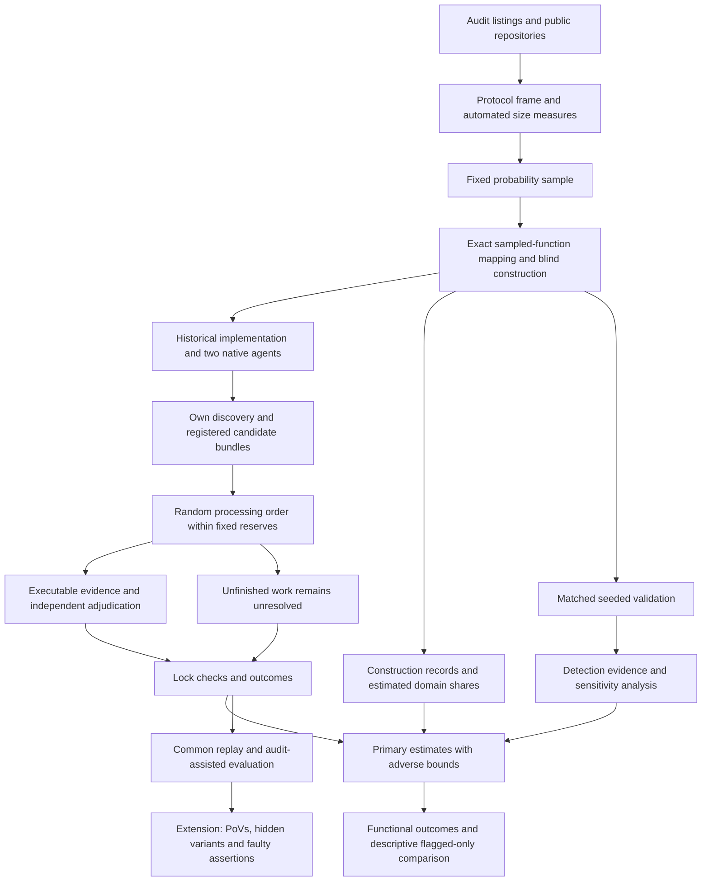

# AI Agent Function-Body Replacements in Audited Solidity: Executable Vulnerability Comparisons with Historical Developer Code

Proposal version 27 (author of this revision: Peer B, Loop 1 round 26; version 26 was written by Peer A in round 25).

## 1. Abstract

We compare AI-generated function replacements with historical developer implementations in audited Solidity contracts. A probability sample includes audit-flagged and unflagged functions. Each implementation receives its own audit-blind discovery campaign. A counted vulnerability requires an executable attack, a correction confined to the target body, and independent adjudication. The principal comparison measures detected vulnerability among working implementations, standardized across the constructible population. Functional failure is reported separately. Adverse bounds retain unresolved outcomes, including work unfinished when a fixed reserve ends. Simulations validate one estimator under five missing-outcome mechanisms. Validation of the reserve stopping rule remains pending. A pre-specified margin states what a null result can rule out. The flagged-only comparison is descriptive. PoV-guided repair remains a separate extension. The student’s dated commitment and timed case are still missing. Committee approval, funded staff and final readiness checks are required.

## 2. Problem and motivation

Solidity developers already use AI tools. The Solidity Developer Survey 2025 reports that 58% of respondents use them daily and 49% use them to write code [Solidity Survey]. These are self-reports. They establish relevance, not the security of generated code.

Security failures in contracts can transfer funds or prevent legitimate operations. In a study of 516 exploitable smart-contract bugs, more than 80% were beyond the automated tools examined [Web3Bugs]. A separate study found substantial limitations in Solidity static analyzers [SAST Study]. These results motivate executable evidence of specific attacker effects.

Existing benchmarks answer useful but different questions. SecureVibeBench reconstructs tasks around historical vulnerabilities and applies executable checks to developer and agent implementations [SecureVibeBench]. SusVibes evaluates functional and security outcomes on reconstructed vulnerable tasks [SusVibes]. Foresight-SWE studies tasks associated with later-fixed general defects [Foresight-SWE].

Selecting functions because a developer previously failed cannot establish the average difference across other functions. Agents might avoid known mistakes while introducing different vulnerabilities elsewhere. A benchmark of historical failures may exaggerate the apparent advantage of replacement.

Unconditional comparisons are not new. Sajadi et al. compare human and agent patches for the same issues [Patch Security]. Cotroneo et al. compare human and AI functions paired by documentation [Cotroneo]. SolEval regenerates function bodies in real Solidity repositories [SolEval]. SolAgent compares generated and historical Solidity using static analysis [SolAgent].

The first paper proposes a population comparison using executable, function-attributed security evidence. It includes functions without qualifying audit findings. Its principal question concerns detected vulnerability among working implementations. It also describes how a flagged-only analysis changes the estimate.

This is an empirical contribution. Probability weighting and conditional-rate estimation are not claimed as new techniques. The contribution depends on achieved precision, detection evidence and a reproducible account of failures.

A separate extension concerns repair. Existing research shows that incorrect tests can mislead agents [ImpossibleBench; ExecCritic; Calibration]. We ask whether executing assertions that endorse an exploitable behavior preserves that behavior despite contrary PoV evidence, beyond the effect of matched ordinary incorrect assertions.

Neither study estimates how much human review developers can safely remove.

## 3. Key insight and contributions

### Paper 1: compare detected security and functional failure separately

Audit labels define sampling strata. They are not security verdicts.

RQ1b is the principal estimand. For each agent configuration, it compares detected vulnerability among working agent and historical implementations. It standardizes stratum-specific differences using the function shares of the constructible domain.

This is not the probability that an agent introduces a flaw into a particular function that the developer implemented safely. Conditioning on working outputs does not create a causal comparison between equivalent sets of implementations.

The study reports the joint functional-and-vulnerable endpoint alongside this conditional comparison. An exact decomposition shows the contribution of functional failure. Failed generation remains visible.

In the strict counts, V functions are 54 of 3,674 eligible functions with observed fixes, or 1.5%. When recommendations are included, they are 109 of 3,729, or 2.9%. RQ1b is therefore mostly a comparison on functions the audit did not flag.

The flagged-only comparison, formerly RQ1a, is a descriptive table rather than a research question.

The examined design cannot support a general conclusion that agents are safer. Its simulated negative differences are small because historical detected rates are low, and worst-frame power is low.

A study without a directional result still has a stated reading. Section 6.3 pre-specifies a test against a margin of +0.05. The study will usually be unable to rule out that margin at a true null. Broad uncertainty remains inconclusive.

### Committee decisions and remaining conditions

The iteration-4 committee approved RQ1b as principal, RQ1a as descriptive, and a minimum correct-direction power of 0.60 at an exact +0.15 conditional difference, subject to its stated conditions.

This is a substantial reduction from the former 0.80 requirement. In V42, an exact +0.15 difference corresponds to an agent detected N rate about 2.9 to 7.8 times the historical rate. A large excess may still be missed.

The earlier RQ1a allocations did not support the promised precision. For example, V27’s earlier allocation of 20 protocols with two V and six N functions had a largest mean security-component half-width of 0.338. The observed-fix-only scenario gave 0.422. These runs used earlier counts and favorable completion assumptions. They do not prove that every affordable design has been ruled out.

Adverse bounds remain principal. The committee approved conditional readiness in place of development-based certification of rare unresolved rates. A few development protocols cannot certify such rates. More agent attempts do not provide more independent historical implementations.

Construction yields also remain planning assumptions. Development reports them descriptively and applies a warning for gross failure. It cannot certify a population construction yield of at least 0.7 in either stratum.

The study accepts a risk of leaving the simulated operating conditions. It does not claim that a non-firing diagnostic proves those conditions hold.

The new reserve-exhaustion procedure requires further validation before its practical power claim is accepted. This is separate from the student’s missing commitment and timed case.

### Count discoveries made under a common procedure

An audit gives historical code an extra source of known vulnerabilities. Replaying audit-derived attacks does not provide an equally strong search for different agent flaws.

The primary endpoint uses only flaws found and confirmed through each implementation’s own campaign. Every campaign follows the same frozen procedure and per-candidate allowance. It receives no audit report, finding list, audit-derived PoV or audit-derived correction.

Pooling discovered attacks can favor flaws shared by many agent attempts. Common replay is secondary and cannot change locked primary labels.

This compares detected vulnerabilities under a stated procedure. It does not establish equal sensitivity or compare all latent vulnerabilities.

### Planned extension: faulty assertions during PoV-guided repair

The pilot motivates a hypothesis but does not establish it.

The two preregistered OpenHands contrasts were:

- adding the shown PoV, with a full terminal in both arms: 0 of 12 successes versus 2 of 12, with Holm-adjusted p = 0.96;
- allowing the shown PoV to be rerun: 10 of 12 versus 9 of 12, with Holm-adjusted p = 1.00.

The exploratory comparison between no execution and a full terminal was 10 of 12 versus 2 of 12. OpenHands succeeded in 9 of 12 runs with the shown-test tool. Codex succeeded in 6 of 12 with that tool and with a full terminal.

These results concern one finding. A person has not reviewed the repairs. The faulty-test hypothesis was formed after inspecting the pilot. The proposed repository-test tool is narrower than a full terminal.

The extension compares wrong assertions endorsing a vulnerability with matched wrong assertions endorsing an ordinary error. It measures whether each endorsed behavior remains. It is not a claimed contribution of the protected twelve-month study.

## 4. Threat model and problem setting

### Historical replacement

Each task replaces one function body in a fixed audited snapshot. The historical developer implementation supplies the baseline.

The agent sees mature surrounding code and repository tests. These may have been written after the original function. The study does not recreate the developer’s original conditions or estimate a causal effect of replacing a human worker.

Historical code may contain AI assistance. Its provenance is recorded rather than assumed.

### Attacker and environment

The attacker is an unprivileged external account. It may deploy contracts, call public interfaces and use borrowing or transaction ordering permitted by the protocol record.

The attacker cannot steal keys, assume an administrator role, change trusted oracle behavior outside the recorded assumptions or modify deployed code.

Each protocol record specifies protected assets, legitimate entitlements, capital, borrowing, reachable initial states, token behavior, oracle behavior, transaction ordering, block assumptions and legitimate operating limits.

All execution occurs offline. Arbitrary storage changes cannot manufacture an otherwise unreachable vulnerable state.

### Severity

The study uses one rubric across audit platforms. Original audit labels remain recorded.

High severity includes unauthorized loss of principal, protocol insolvency and irreversible loss of access to protected assets. Medium severity includes theft of earned protocol entitlements and attacker-induced loss of a core operation under the recorded resource and recovery limits.

Ordinary implementation failure is not automatically a security vulnerability. Availability findings require an attacker action, affected legitimate users and demonstrated failure under permitted conditions.

Financial effects must reflect entitlement or backing. Attacker profit alone is insufficient. Temporary inconvenience, gas optimization, privileged misuse and effects outside the threat model are excluded.

Before evaluation, the rubric records how recoverability, repetition, affected users and resource limits determine inclusion. A frozen tie rule excludes borderline severity cases from the primary count and includes them in a secondary count. This does not establish that excluded cases are harmless.

### Attribution

A counted flaw requires:

- an executable qualifying property violation;
- evidence connecting it to the target function;
- removal of the violation by changing only that function body;
- preservation of required functionality under the acceptance checks.

The intervention preserves signatures, surrounding code, dependencies and initial-state procedures. It cannot disable the feature or hide a loss by changing accounting.

A new declaration outside the body is not permitted, including an error or event used only by the correction.

Historical code may serve as a correction only after the same checks.

Two adjudicators outside the construction team assess severity and attribution. Packages conceal author, agent and experimental arm as far as the code permits. Disagreements, resolution and blinding failures are recorded.

## 5. Approach

### 5.1 Frame and sampling unit

The downloaded data contain 19,627 distinct High and Medium findings. The earlier total of 19,666 was inconsistent with its batch totals. Complete source files were obtained for 7,826 findings. Earlier filtering left 77 recent candidates and 43 with suitable public history. These are screening counts, not a validated sample.

The frame covers accessible Code4rena, Sherlock and Cantina audits from 2024 and 2025 with Solidity code. It includes contests and qualifying Cantina private reviews. It is not a frame of contests alone.

The local inventory lists 313 audits meeting its firm, year and Solidity-signal filters: 235 from 2024 and 78 from 2025. Those signals do not themselves establish final eligibility.

In the frame audit, 25 of the first 33 drawn audits could be processed. Applying that rate gives about 237 usable audits. A frame of about 230 protocols before removing development protocols is a planning assumption, not an observed eligible count.

The earlier 70-audit list is the recent subset used to measure V and N counts. Its 25 processed audits supply the pairs resampled in the planning simulations. Accessible 2024 audits may differ.

Where public listings permit, audits without qualifying findings can enter. If the practical frame remains finding-derived, the population is restricted to audits represented in that frame. The report states the restriction.

The first-stage unit is a protocol audit and its fixed snapshot. Multiple audits of the same project are identified before drawing the frame. Overlapping snapshots cannot be treated as independent protocols without accounting for their dependence.

A protocol needs an available audited snapshot, recoverable scope and dependencies, and enough documentation to attempt the offline environment. Failure during the prescribed preparation remains recorded.

The second-stage unit is one function body. Its identity includes repository, snapshot, full path, enclosing contract and signature. Overloads are distinct.

Eligible functions contain meaningful computation or state changes and permit replacement without changing signatures or surrounding code. Tests or a documented call path must support reachability.

Functions implicated in findings whose necessary corrections extend outside the body are excluded. Unrelated changes in a fix commit do not prove that a broader correction is necessary.

V contains eligible functions linked to qualifying High or Medium findings. N contains eligible functions without those links. Unresolved finding mappings or correction scope are not silently assigned to N.

#### Size measures before exact mapping

The first-stage draw needs a positive size measure for every listed protocol. It does not require human classification of every function before that draw.

Scripts enumerate candidate eligible functions from available scope and source files. Their count supplies a recorded proxy for N size. Every retained protocol has a positive size measure; a zero count uses one. A parse failure is recorded and handled by a frozen fallback rule rather than silently excluding the protocol.

A random 10% of frame protocols receives a human spot check. This checks enumeration, scope and obvious parsing failures. It is not a substitute for semantic eligibility review.

Exact V and N lists are built for the three sampled development protocols and the 22 sampled main protocols before drawing their functions. The actual first-stage probabilities remain fixed. The conditional function probabilities use the exact sampled-protocol lists.

A size-measure error changes efficiency, not the design weights, provided the frame remains complete, every eligible unit has positive selection probability, and the probabilities actually used are retained. These conditions do not excuse frame omissions.

#### Existing frame evidence

The pilot fix-scope record contains:

| Fix scope | Findings | High confidence |
|---|---:|---:|
| One function body | 17 | 14 |
| Several function bodies | 2 | 2 |
| Signature, storage, new function or other declaration | 15 | 14 |
| Undetermined | 9 | Not applicable |

Three judgment calls move the one-function count between 15 and 18. Panoptic supplies 9 of the 17. These classifications describe identified fixes, not proof that no narrower fix exists.

The inventory groups findings into 2,481 audits. It could not map 61.0% of findings. Its earlier modeled V distribution remains historical planning evidence.

The random audit sample processed 25 of the first 33 audits in a fixed random order. Eight replacements reflected unavailable repositories, unavailable scope or non-Solidity code. Five were Cantina private reviews.

The processed audits contain 352 High and Medium findings. Agent sessions performed the reading, followed by merge checks and a spot check. This was not human adjudication. No repository code was executed.

The strict recount separates full function identities and rereads body-only fixes. It supersedes the earlier counts.

| Strict count | Total | Mean per audit | Median | Audits with zero |
|---|---:|---:|---:|---:|
| V, observed fixes | 54 | 2.16 | 1 | 10 of 25 |
| V, including admissible recommendations | 109 | 4.36 | 4 | 1 of 25 |
| N, eligible and unflagged | 3,620 | 144.8 | 92 | 0 of 25 |

Strict N counts range from 24 to 672.

The recommendation-inclusive list is not a proven upper bound. Recommendations can understate necessary changes, and unresolved findings may contain additional eligible functions. The simulation label “upper” means recommendation-inclusive only.

Remaining semantic and provenance checks include the common severity rubric, close body-only calls, incomplete second reading, later public snapshots and an upstream fork. Exact sampled-protocol mapping resolves these before function sampling. Exclusions remain recorded.

### 5.2 Allocation and processing limits

The main allocation is 22 distinct protocol audits, with up to one V and six N functions per audit. Small strata are censused.

First-stage inclusion probabilities are proportional to the recorded positive size measure and capped at one. Randomized systematic sampling uses a random frame permutation and uniform start. The probabilities, order and seed are saved.

Functions are sampled uniformly without replacement within exact strata. Their inverse joint inclusion probabilities supply the analysis weights.

Both primary agents receive two fresh attempts per constructed function.

Every function receives the same construction procedure and its own allowance. Protocol preparation has a separate allowance. Early functions cannot consume later functions’ construction time.

Let \(B_i=1\) when function \(i\)’s task passes the construction checklist within its allowance. Otherwise \(B_i=0\), with a reason. This precedes generation and applies to the whole function cohort.

The principal population is the constructible domain. Its stratum shares are estimated from weighted constructed counts.

Missing staff or another function’s delay cannot make a function unconstructible. Failure to supply the procedure is a deviation.

Slow sampled protocols are not replaced. Each constructed sampled V function enters the scheduled audit-assisted work.

Development uses the same one-V, six-N allocation and two attempts per configuration. It evaluates the procedure and resources, not a certified population construction yield.

### 5.3 Provenance and AI assistance

The study records available history around each function’s introduction. Evidence includes agent instruction files, AI co-author trailers and pull-request text.

Categories are evidence of assistance, no observed evidence and unresolved provenance. An instruction file does not prove that the target lines were generated. Absence of a marker does not prove human-only authorship.

All categories remain in the principal historical-developer comparison. A subset without observed assistance is secondary.

Code, fix and report publication dates are recorded separately. A report after a model cutoff does not establish that the code was unseen.

### 5.4 Audit-blind construction and confirmation

Request and primary-property builders do not receive audit findings, historical fixes or the removed body. They receive permitted documentation, signatures, callers and surrounding code.

Every request sentence records its source. Requests and primary properties are frozen before agent runs.

Security properties must follow from documented entitlements and operations. Audit-derived invariants and attacks cannot enter primary discovery under another name.

Development freezes the source bundle, preparation procedure, template, checklist, ordered steps, tools, versions, assistance, allowances, interruption rules and assignments.

The checklist requires a coherent request, documented legitimate behavior, reachable setup, ordinary checks, primary security properties and a threat-model record. Completion does not require finding a flaw.

For an unfamiliar protocol:

1. A second person maps the sampled protocol and seals labels.
2. The student constructs tasks without audit access.
3. Generation and discovery run.
4. The student confirms candidates using only originating campaign materials and permitted context.
5. Independent adjudication finishes and primary records are locked.
6. Only then may the student inspect audit material.

For a protocol already known to the student, the student prepares mappings and sealed materials. A funded unexposed person performs blind construction and confirmation. Construction staff cannot adjudicate their own packages.

If neither person is eligible, an unexposed replacement must be funded. Missing staff is a deviation. The same rules apply to development and validation.

For 15 randomly selected sampled functions, two unexposed builders independently prepare requests. The designated primary builder determines \(B_i\). Duplicate construction cannot rescue a failed primary task.

Both evaluable requests receive generation and discovery. The added work uses at most \(15\times5\) campaigns. Effects on working status, D and defined conditional estimates are secondary.

After primary locking, an audit-informed classification labels requests as favoring vulnerable behavior, neutral or favoring corrected behavior. It cannot change \(B_i\).

Builder identity, exposure and order are recorded.

### 5.5 Functional and security checks

Checks are classified before generation. Ordinary checks establish intended operations and useful completion. Explicit security checks establish forbidden attacker outcomes.

An ordinary check is not removed merely because it catches a flaw. Historical code is not assumed to pass. Original repository-test outcomes remain visible.

If a blind-process correction removes a confirmed violation but fails an ordinary check, two author-blind adjudicators determine whether the check asserts the forbidden outcome. If so, it is removed for every implementation of that function. Original and revised results remain recorded.

This happens before primary locking and audit access. Audit-assisted corrections cannot reopen the primary endpoint. Later check revisions define a secondary suite applied to the whole cohort.

A PoV result is one of:

- violation observed through valid execution;
- violation checked and absent;
- unresolved because construction, execution or interpretation failed.

An exit code is not a security verdict. Setup failure differs from an executed violation assertion failing as expected. Fixed-state checks establish preserved legitimate behavior.

### 5.6 Agent configurations

The primary configurations are Claude Code and Codex CLI with vendor-supported models current at the freeze.

Model identifiers, versions, reasoning settings, prompts, permissions and budgets are pinned. Both configurations run on the full constructed sample. Every attempt starts from a fresh workspace.

The target body is replaced with a placeholder. Only the submitted body enters evaluation. Changes to tests, dependencies or unrelated code cannot alter the artifact.

History, fixes, cached target copies and revealing generated artifacts are removed. Network access is restricted to model APIs.

Pilot configurations, translated integrations and a documented SolAgent adaptation are separately funded extensions.

### 5.7 Primary discovery and reserve exhaustion

Every implementation receives Foundry property-based fuzzing, the same two LLM reviewers and a frozen candidate-ordering rule.

Reviewer identities and versions are frozen. Other model families are preferred where development supports them. Otherwise overlap is reported.

A secondary analysis filters both authors’ results to fuzzing and the other-family reviewer. It does not rerun campaigns or redistribute effort.

Reviewers receive permitted code, context, properties and the request. They receive neither author labels nor audit material. Campaigns cannot inspect other implementations’ reports or attacks.

At most three candidates per implementation enter confirmation, in frozen order. Later candidates are recorded as outside the prescribed candidate limit.

Campaign operation has a cap of 0.15 student hours per scheduled implementation. Confirmation has a cap of 1.0 student hour per candidate, including the PoV, body-only correction, packaging and lock administration. Each adjudicator has 0.5 hours per submitted package.

These are planning caps. The timed case must establish that they permit valid work.

#### Fixed reserves and random order

Each source has a fixed confirmation reserve and fixed review reservations. Sources include development, main work, duplicate requests, seeds, controls, gate work and audit-assisted work.

All candidate lists for a source are registered before that source’s confirmation order is drawn. The first three candidates form an implementation’s bundle.

A seeded random permutation orders the bundles. Author and stratum cannot change the order. Candidate order within a bundle is already frozen.

Before starting a bundle, the source must be able to reserve the full candidate allowances for that bundle. If it cannot, processing stops. The remaining bundles are not skipped in favor of smaller or apparently promising bundles.

Unused time does not enlarge another candidate’s allowance. The ledger records both reserved and used time.

Review packages follow a separately recorded random order within each source. Both required reviews must receive their reservations. If the next package cannot be reserved, it and the remaining packages stay unfinished.

This is not subsampling for a weighted complete-case estimate. No inverse probability for confirmation or review is added to the function weights.

#### Outcomes after a reserve ends

Every scheduled implementation remains in the data.

If an implementation has a confirmed qualifying flaw, its positive label remains established even if another candidate is unfinished.

If it has no confirmed flaw and required confirmation or review remains unfinished, its security outcome is unresolved. Known functional status remains known. Adverse bounds include every admissible completion.

A campaign that produces no candidate and completes validly is not unresolved merely because another campaign exhausted a reserve.

A completed substantive negative assessment remains “not confirmed.” Inability to judge or unfinished work does not become a negative.

Candidates beyond the fixed three-candidate limit remain recorded as cut. A secondary analysis treats those cuts as unresolved too.

Random ordering prevents deliberate preference for an author. It does not make reserve exhaustion equivalent to independent missingness. Bundle size, candidate validity and shared resource limits can create dependence. Validation of this exact procedure remains pending.

Primary records are locked before pooled replay or audit access.

### 5.8 Secondary replay and audit rediscovery

Validated common-procedure PoVs are replayed after locking. Attribution is checked separately for each implementation.

Audit-assisted work covers the constructed V function in each selected protocol. It cannot change primary labels.

The report separates own discoveries, pooled discoveries, audit-assisted outcomes and their estimated increment.

For a secondary selection probability \(q_i\),

\[
\widehat T_{\mathrm{increment}}
=
\sum_{i\in S_V}a_iB_i\frac{A_i}{q_i}
\left(Y_i^{\mathrm{audit}}-Y_i^{\mathrm{primary}}\right).
\]

Here \(q_i=1\) for constructed sampled V functions.

Conditional-rate analyses estimate numerator and working-output denominator totals separately. Unresolved secondary outcomes retain bounds.

Rediscovery is a weighted ratio among audit flaws that satisfy the confirmation standard. Its numerator counts those also found by the blind campaign.

Secondary uncertainty must include the main sampling design and any additional selection. Numerical inferential claims require validation of the secondary estimator.

### 5.9 Detection validation

#### Matched seeded flaws

A separate builder inserts the same vulnerability pattern into historical and agent implementations of a function. Patterns come from other protocols.

Seeds must compile, preserve unrelated behavior and produce an attributable violation. Invalid seeds remain recorded.

The core schedules 60 matched pairs, or 120 seeded artifacts, with 15 pairs per stratum and configuration combination. The catalogue contains at least 20 patterns, with no pattern used in more than three pairs.

Seeded and unseeded controls receive blind discovery. Locations and known attacks remain hidden until locking. Seeds do not enter natural vulnerability estimates.

The pooled diagnostic concerns the validation mixture, not population-weighted natural recall.

The planning expression in `power_results_v10_c.txt` is

\[
1.96\sqrt{\frac{\operatorname{deff}(\delta-d^2)}{n}}.
\]

With \(d=0.1\), design effect 1.5 and 60 pairs, the half-width is 0.135 to 0.194. With design effect 3.1, it is 0.194 to 0.278.

These are assumptions. The core cannot establish equal recall within 0.05. Final uncertainty uses realized protocol and pattern dependence and valid-pair counts.

#### Natural-implementation investigation

The maximum is 48 first assessments and 12 duplicates. Each assessment has a two-hour allowance. The total is capped at 120 auditor hours.

The original 12 cells are defined by author, stratum and campaign category. Each receives up to three first assessments.

Six further cells, one per author and stratum, contain campaigns with candidates cut by the three-candidate limit or left unfinished by a reserve. Each receives up to two extended independent assessments.

Selection probabilities support weighted estimates of how processing omitted work would change the principal contrast. Smaller cells are censused. Unused slots are not transferred after outcomes.

Confirmed cases are sampled uniformly. Non-confirmed cells include completed negatives and unresolved evaluations. Where both exist, one is sampled from each before filling remaining slots uniformly.

Up to 12 cases receive a second assessment, selected randomly. Auditors receive permitted context and the harness, without campaign reports or author labels where concealment is possible.

Sparse cells and unresolved judgments remain visible. This is a budgeted reference assessment, not proof of absence.

#### Flaws missed by an earlier audit

A separate set targets 10 to 20 later-discovered flaws demonstrably present in code covered by an earlier audit. Later-introduced flaws do not qualify.

Records identify scope, vulnerable version, later finding and correction. These protocols remain outside the main sample.

Availability is unknown. Fewer than 10 cases leave historical N sensitivity at the full feasible range unless another explicit assumption is examined. A larger set still describes selected cases.

#### Discovery gate

The gate uses eight qualifying flaws and passes at five confirmed rediscoveries. One procedure revision is permitted, followed by eight fresh flaws with a pass mark of six.

A matching candidate alone does not count. The target flaw must be confirmed by execution and both adjudications within the main per-candidate and per-package caps.

The gate registers the blind campaign’s first three candidates before matching them against the sealed target. At most one candidate package for the target flaw enters gate confirmation. Other candidates remain recorded but cannot consume the gate’s target-flaw reservation.

Matching is performed by a person who does not subsequently provide audit information to the blind confirmer. This selection is used only to assess rediscovery of a known gate flaw. It is not used for principal outcome labeling.

The first and permitted revision assessments therefore reserve at most 16 target packages. Their operation and confirmation require 18.4 student hours under the stated caps. Both adjudicators receive reservations for all 16 packages.

| Assumed recall | First assessment | Revision assessment | Overall pass probability |
|---|---:|---:|---:|
| 0.3 | 0.058 | 0.011 | 0.069 |
| 0.5 | 0.363 | 0.145 | 0.455 |
| 0.7 | 0.806 | 0.552 | 0.913 |

These are independent-binomial planning calculations. They are not guarantees for clustered findings or adaptive revision.

The eight built pilot tasks that shaped prompts are excluded. Fresh gate cases cannot have been used to revise the tested procedure.

#### Audit-blind candidate rediscovery evidence

The existing evidence covers 17 single-function pilot findings. Fresh Claude and Codex reviewers received pre-fix files and limited context without audit findings. A Claude judge matched candidates to sealed keys while blinded to reviewer family.

| Reviewer | All cases | Excluding three weak keys |
|---|---|---|
| Claude | 17 of 17 | 14 of 14 |
| Codex | 13 of 17 | 13 of 14 |

The reported Wilson intervals are 0.82 to 1.00 and 0.53 to 0.90 for all cases, and 0.78 to 1.00 and 0.69 to 0.99 after exclusions. They assume independent trials.

Weak keys 64083, 64693 and 65044 involve an owner attacker, no demonstrated outside attacker, or an informational classification.

Candidate matching is not executable confirmation. Training exposure remains possible. These findings are upper bounds on confirmed rediscovery for those lists.

The judge’s claim that the full 63008 theft depends on H-02 is superseded by executable evidence.

### 5.10 PoV-guided repair

The extension starts from a validated vulnerable implementation. A shown PoV supplies executable evidence. Hidden attacks use different states, boundaries or call sequences.

Success requires compilation, preserved legitimate behavior, blocked frozen attacks and no confirmed new attributable vulnerability under the declared evaluation. Required unresolved checks prevent success.

Later discoveries are reported separately and replayed consistently. Passing the shown attack is insufficient.

### 5.11 Worked example: finding 63008

The pilot concerns Sorella L2 Angstrom’s downward tick iterator. The vulnerable implementation skips a starting boundary.

Version 2 of the evidence package contains violation tests, fixed-state assertions, a body-only patch, an independent H-02 patch and an outcome-checking runner.

The correction adds `self.currentTick = startTick + 1` after the empty-range early return in `reset(TickIteratorDown)`. It changes no signature, storage layout or other function.

Fixed-state checks establish that the honest provider can claim its entitlement and withdraw principal, backing covers liabilities, and attacker rewards do not exceed the attacker’s share of its own swap tax.

| Code state | Violation tests | Fixed-state tests | Original suite |
|---|---|---|---|
| Vulnerable `386baff` | Violation observed in both | Both fail | 60 pass |
| Version-2 correction | Violation absent in both | Both pass | 56 pass, 4 fail |
| H-02 correction only | Violation observed in both | Both fail | 60 pass |
| Both corrections | Violation absent in both | Both pass | 56 pass, 4 fail |

The four remaining failures assert the old boundary behavior. Empty-range tests pass in every state. The runner matched all 12 expected outcomes.

On vulnerable code, the honest provider is owed about 49 ether. The attacker receives 48.99999755 ether. Remaining backing is about 0.0245 ether against about 49.0245 ether owed. Claims and withdrawal revert.

With the correction, the honest provider receives 49.000012243878672857 ether and withdraws principal. The attacker receives 0.024487756121327142 ether, its calculated share of its own swap tax.

H-02 correction `cd0ac3c` alone leaves the attack unchanged.

The attacker’s recorded capital ceilings are 100 ether and \(10^9\) tokens. The attack position is about \(2\times10^{25}\) liquidity units. The scenario uses a 5 gwei priority fee and assumes the relevant top-of-block swap is won. It does not simulate a competitive auction.

The original capital run records swap tax 0.0245 ether, just-in-time tax 0.098 ether and net profit 48.877274256875928055 ether. Version 2 reruns reward and withdrawal assertions, not that separate profit test.

Automated version-2 work took 598 seconds. This is not human construction or adjudication time.

The repository contained a `CLAUDE.md` before the faulty commit. The baseline is historical developer code.

The two added control-group flaws failed repository functional tests. They motivate reporting K but do not establish an added-flaw rate for D.

## 6. Research questions and evaluation plan

### 6.1 Research questions

**RQ1b, principal:** How do agents and historical developers differ in detected vulnerability among working implementations, standardized across the constructible strata?

A pre-specified secondary estimate compares the authors on the same functions: the historical body must work and at least one attempt of the configuration must work. Retained counts are reported by stratum and configuration.

The flagged-only comparison is a descriptive table with sample sizes and identification bounds. It is not a research question.

**RQ4, validation:** How does discovery behave across authors, strata and known flaw patterns, and how do missed flaws affect interpretation?

**RQ2, extension:** Does executing wrong assertions affect retention of an endorsed vulnerability differently from retention of a matched ordinary error?

**RQ3, optional extension:** How does request wording affect vulnerability reproduction within a task?

### 6.2 Outcomes and unresolved results

Let C indicate compilation, L passing the final primary ordinary suite, and \(V_{\mathrm{own}}\) a vulnerability confirmed through the implementation’s own campaign.

\[
W=CL,\qquad D=WV_{\mathrm{own}},\qquad K=CV_{\mathrm{own}}.
\]

All scheduled attempts on constructed tasks remain recorded. Historical code contributes one implementation per function.

Within stratum s,

\[
d^D_s
=w_{As}v_{As}-w_{Hs}v_{Hs}
=(v_{As}-v_{Hs})+(w_{As}-1)v_{As}+(1-w_{Hs})v_{Hs}.
\]

Here w is the working rate and v is detected vulnerability conditional on working. The first term is the security component. The remaining terms describe functional failure.

This is a descriptive identity. Working outputs can differ in composition across authors. A negative D difference alone is not a better-security verdict.

Admissible outcome pairs include:

- known functional failure: \((W,D)=(0,0)\);
- working and confirmed vulnerable: \((1,1)\);
- completed working campaign without confirmation: \((1,0)\);
- working with unresolved security: \((1,0)\) or \((1,1)\);
- unknown working status: all pairs consistent with observed checks.

For each author and stratum, minimize and maximize the weighted conditional rate over admissible completions. Unknown working status affects numerator and denominator. Known working status must not be discarded merely because confirmation is unfinished.

If an author has no working or unresolved implementation in a stratum, its conditional rate is bounded by 0 and 1. A stratum with no built function contributes zero because its estimated domain share is zero.

For defined rates,

\[
d^{S,L}_s=v^L_{As}-v^U_{Hs},
\qquad
d^{S,U}_s=v^U_{As}-v^L_{Hs}.
\]

Historical observations are shared across configurations. Inference preserves that dependence.

| Source | Closing rule | Primary treatment |
|---|---|---|
| Two completed substantive adjudications disagree | Compare reasons once within the allowance. | Not confirmed if joint confirmation remains absent; secondary bound treats disagreement as unresolved. |
| An adjudicator lacks evidence or cannot decide | Record the missing criterion. | Unresolved. |
| Review allowance or source reserve ends | Stop without borrowing or skipping the order. | Unresolved unless a positive outcome is already established. |
| Confirmation allowance or source reserve ends before a valid decision | Record unfinished work. | Unresolved unless a positive outcome is already established. |
| Candidate lies beyond the fixed three-candidate limit | Record the cut. | Outside the prescribed campaign; secondary bound treats the cut as unresolved. |
| Frozen environment fails outside the implementation | One rerun within the operation allowance. | Unresolved if evaluation remains invalid. |
| Audit information reaches primary work before locking | Record the breach. | Unresolved in the primary analysis. |
| Compilation or ordinary checks fail normally | Record the observed failure. | Known \(W=0\). |

A completed negative decision identifies the unmet confirmation criterion. It does not assert absence of vulnerability.

### 6.3 RQ1b: estimator, operating assumptions and inference

#### Domain and estimator

Let \(U_B=\{i\in U:B_i=1\}\) be the constructible domain in the frame after removing the development protocols.

With inverse joint sampling weight \(a_i\),

\[
\widehat T_{sB}=\sum_{i\in S_s}a_iB_i,\qquad
\widehat\pi_{sB}
=\frac{\widehat T_{sB}}{\widehat T_{VB}+\widehat T_{NB}},
\]

\[
\widehat w_{as}
=\frac{\sum_i a_iB_i\overline W_{ai}}{\widehat T_{sB}},
\qquad
\widehat v_{as}
=\frac{\sum_i a_iB_i\overline D_{ai}}
{\sum_i a_iB_i\overline W_{ai}},
\]

\[
\widehat\Delta^S_{Bc}
=\sum_s\widehat\pi_{sB}
(\widehat v_{A_cs}-\widehat v_{Hs}).
\]

Agent observations are averaged within function. Historical code contributes one observation. No candidate-selection weight is added.

The companion D difference is

\[
\widehat\Delta^D_{Bc}
=\sum_s\widehat\pi_{sB}
(\widehat w_{A_cs}\widehat v_{A_cs}
-\widehat w_{Hs}\widehat v_{Hs}).
\]

Totals, shares, ratios and adverse bounds are recomputed in every uncertainty replicate.

For the same-function secondary estimate, each retained function contributes the agent detected rate among its working attempts and the historical detected indicator. Inverse inclusion weights give equal function weight in the population. Unknown membership or outcomes retain admissible bounds. This estimate has no power requirement or validated confidence interval.

#### Directional decisions and intervals

A positive claim uses the lower identification bound. A negative claim uses the upper bound. Holm adjusts across the two configurations at level 0.03.

The uncertainty procedure deletes one sampled protocol at a time, including certainty protocols. This is the procedure checked by the current simulations. It is not claimed to be universally conservative.

The V39 notes report that a preliminary alternative excluding certainty protocols from deletion had error of 0.25 to 0.28 in two of three small-frame tests. That result does not prove general validity of the retained jackknife.

The interval is

\[
[
\widehat L-c\,t_{0.975,P-1}\widehat{\mathrm{se}}(\widehat L)-z_H,\quad
\widehat U+c\,t_{0.975,P-1}\widehat{\mathrm{se}}(\widehat U)+z_{A_c}
],
\]

with \(c=1.175\).

For an author-stratum with no detected flaw and n resolved working implementations, the widening term adds its estimated constructible share times

\[
1-0.025^{1/n}.
\]

A rate already bounded by 0 and 1 needs no further widening. An empty stratum contributes zero.

This is a binomial-based adjustment, not an exact clustered-data bound. Its justification is empirical validation of the combined procedure.

An interval with a required nonfinite quantity is undefined. It receives no directional claim and counts as a coverage failure in validation.

The targets are marginal coverage of at least 0.95 for each configuration and directional family-wise error at most 0.05. Marginal coverage is not simultaneous coverage of both configurations or all population identification bounds.

#### Reading of the upper limit

The margin is +0.05. It represents five more detected exploitable outcomes per 100 working implementations on the conditional scale. It is a stated judgment of a material excess, not a safety threshold or permission to reduce review.

For each configuration,

\[
p_c=F_{t,P-1}
\left(
\frac{\widehat U_c+z_{A_c}-0.05}
{\widehat{\mathrm{se}}(\widehat U_c)}
\right).
\]

Holm at level 0.01 adjusts the two claims that a configuration’s difference is below +0.05.

V39 selected this level. V42 checks reading error at every retained condition where either configuration’s true difference is at least +0.05, including both ordered partial-margin conditions. Its largest reported upper error bound is 0.0320.

At the exact null, V42’s lowest configuration-specific claim frequency within each frame group ranges from 0.086 to 0.103. The corresponding medians over frames range from 0.218 to 0.234. These are minima of marginal configuration frequencies, not the probability that both claims occur together.

At an exact +0.025 difference, the lowest frequencies range from 0.018 to 0.024.

A null study will usually report only a broad upper limit. It must not be read as equivalence.

#### Current combined evidence: V42

V42 uses one frozen estimator across all three frame groups:

- base;
- working status linked to difficulty, with historical failures;
- low V construction yield.

It uses frames of 230 protocols resampled from the strict audit counts, removes three development protocols, and samples 22 distinct main protocols. Both strict V lists remain represented.

The linked-working setting has agent working probability averaging 0.72 and historical working probability averaging 0.95. Working probability falls with a score linked to vulnerability. Exact targets are conditional on working.

The low-V setting uses V construction probability averaging 0.3, with N construction as specified in its frame. It is a separate group; V42 does not establish validity for every joint combination of adverse assumptions.

Four mechanisms use all 76 ordered implementation-rate vectors:

- independent unresolved outcomes;
- a shared function draw;
- a shared protocol draw;
- unresolved probability increasing with difficulty.

The fifth mechanism uses 64 ordered package-rate vectors. Only an implementation with a detected flaw can become unresolved in that simplified model.

Every condition uses 4,000 fresh studies. Common random draws support comparisons between rate vectors and mechanisms. Configuration order is not collapsed.

| Frame group | Worst error upper bound | Worst coverage lower bound | Worst reading-error upper bound | Lowest +0.15 power without unresolved outcomes |
|---|---:|---:|---:|---:|
| Base | 0.0426 | 0.9551 | 0.0320 | 0.766 |
| Linked working | 0.0414 | 0.9503 | 0.0283 | 0.757 |
| Low V yield | 0.0421 | 0.9586 | 0.0294 | 0.745 |

The reported worst undefined share is zero in all three groups.

The code uses one-sided Clopper–Pearson bounds with Bonferroni adjustment within each frame-group and mechanism family. Error checks cover three null conditions. Coverage checks cover every condition and both configurations. Reading-error checks cover every retained condition at or above the margin.

Across the groups, lowest power at +0.10 ranges from 0.406 to 0.415. At +0.05 it ranges from 0.104 to 0.115.

Mean interval half-width ranges from 0.046 to 0.091 at the exact null and from 0.088 to 0.115 at +0.15.

At +0.15, historical detected N rates range from 0.022 to 0.084 and agent rates from 0.173 to 0.250. Their ratios range from about 2.9 to 7.8.

Negative targets are chosen as the feasible value defined in the simulation, rather than forcing an impossible −0.05. Worst-frame power is 0.003 to 0.004 in V42’s group summaries. The study is not powered to establish a general agent advantage.

#### Retained operating regions

The implementation-rate region is the downward-closed tested set with maximal vectors

\[
(0.0075,0.0075,0.0075),\qquad
(0.013,0.013,0.005),
\]

in the order configuration 1, configuration 2, historical.

This symmetric region passes V42 and lies within the passing results of V40’s base and linked-working groups and V41’s low-V group. The older runs are corroborating planning evidence, not independent validation of the same complete estimator in every group.

The package-model region has maximal vector

\[
(0.05,0.05,0.2).
\]

These are separate mechanism-specific assumptions. They are not interchangeable units or a validated joint region for simultaneous causes.

Continuous extension below these corners is a planning assumption. Validation applies to tested vectors. No monotonicity theorem is claimed.

V42’s package mechanism is not the actual reserve stopping rule. It has no rejected candidates, multiple candidates per implementation, shared reserve or processing-time dependence. The practical region under reserve exhaustion remains **[pending]**.

#### Package-based warning

For each author, register every candidate record within the first three candidates of each campaign before confirmation. Let n be the number of these records and x the number whose required confirmation or review remains unfinished.

For n greater than zero, define

\[
d=
\begin{cases}
0,&x=0,\\
\operatorname{Beta}^{-1}(0.05;x,n-x+1),&x>0.
\end{cases}
\]

The warning fires if either configuration’s value exceeds 0.05 or the historical value exceeds 0.2.

An author with no registered candidate has an unassessable package diagnostic. This is not evidence of a low unfinished-package rate.

The calculation borrows a binomial lower limit. Clustering, shared reserves and unequal selection prevent an exact population-confidence interpretation.

V42 evaluates the same threshold calculation on a simplified denominator: detected-positive implementations before unresolved masking. It does not validate the observable denominator above.

Under that proxy and package rates of (0.1, 0.1, 0.1), main warning frequencies are 0.334, 0.330 and 0.253 across the three groups. Development frequencies are 0.047, 0.044 and 0.019.

At rates of (0.2, 0.2, 0.2), main frequencies are 0.859, 0.855 and 0.731. Development frequencies are 0.155, 0.150 and 0.069.

Development is unassessable in 0.331, 0.347 and 0.634 of samples. The corresponding main proportions are 0.000, 0.000 and 0.004.

These summaries pool frames. Main summaries also pool conditions. They are not worst-frame guarantees. The output’s label “outside” includes the boundary example (0, 0, 0.2); that example is inside the package region.

The practical warning’s operating characteristics remain **[pending]**. A non-firing warning cannot certify the region.

Development does not launch if this diagnostic fires or is unassessable. No extra development case is added to obtain a better result.

#### Reserve-exhaustion validation

Before the revised reserve procedure supports a power claim, a simulation must implement its actual candidate bundles, fixed order, confirmation reservations and review reservations.

It must include rejected candidates and multiple candidates. It must retain known working status and established positives. It must combine exhaustion with the five existing mechanisms and report each retained scenario.

Error and coverage remain required outside the power region. Power is required only in the explicitly retained operating scenarios.

The result, practical region and warning frequencies are **[pending]**. Random ordering alone does not supply them.

#### Final check on the frozen frame

Before main collection, all checks are repeated on the actual frame after removing development protocols.

The simulation uses the recorded first-stage size measures and resulting probabilities. Exact function counts define second-stage probabilities and domain truth. It includes observed discrepancies between size proxies and exact counts where those are available.

The final check includes both strict-count planning lists where relevant, all retained recall and construction settings, linked working status, low V yield, the actual reserve procedure, and a protocol-effect standard deviation of 0.9 beside the earlier setting.

The check matrix is:

| Criterion | Required scope | Acceptance rule |
|---|---|---|
| Directional family-wise error | Global null and both ordered partial nulls; all 76 implementation vectors under all four implementation mechanisms; all 64 package vectors; retained reserve-exhaustion scenarios | Every upper bound at most 0.05 |
| Marginal coverage | Both configurations; all ten V42 conditions; all vectors and mechanisms above | Every lower bound at least 0.95 |
| Correct-direction power | Exact +0.15 for both configurations; tested scenarios inside the retained mechanism-specific region | Every lower bound at least 0.60 |
| Margin-reading error | Every retained condition with either true contrast at or above +0.05, including both ordered partial-margin conditions; all vectors and mechanisms | Every upper bound at most 0.05 |
| Undefined estimates | Every condition and scenario | Report every failure; undefined intervals count as coverage failures |
| Package warning | Main and three-protocol development samples, using registered candidate records | Report firing and unassessability separately; no certification claim |

The ten conditions are the global null, two partial nulls at +0.10, equal +0.025, equal +0.05, both ordered partial-margin conditions, equal +0.10, equal +0.15 and the feasible negative target.

Initial validation uses Holm 0.03, interval multiplier 1.175, reading Holm 0.01 and 4,000 fresh studies per setting and condition.

Bonferroni counts are recomputed from actual checks. They include every frame setting within each mechanism and criterion family. Coverage counts include configurations. Reading-error counts include all applicable conditions. Power counts include only retained inside-region scenarios.

If required checks fail, replacement calibration uses a separate stream of 2,000 studies per setting and condition. It chooses the largest candidate directional Holm level passing all error checks and the smallest interval multiplier passing all coverage checks. Any change to the reading level is calibrated over its full error domain.

The selected procedure is frozen and validated on another 4,000 fresh studies. Calibration and fresh validation use the same full matrix. Failed outside-region validity checks cannot be discarded because power was not required there.

If no procedure passes, the study does not launch under this allocation. The region is not enlarged after failure. Results and hashes are saved before main sampling.

Final-frame results remain **[pending]**.

#### Monitoring and reporting

The main sample, attempts, allowances and endpoint remain fixed after sampling.

Monitoring cannot authorize replacement, selective resolution, transfer of another implementation’s allowance, early success stopping or removal of adverse bounds.

If a reserve ends, remaining work stays recorded under section 6.2. Final estimates and uncertainty are reported regardless of diagnostic flags.

The report gives the upper-limit reading and observed departures. A non-flagging result does not restore an unconditional power claim. A documented departure outside the validated error-control domain prevents presenting a directional result as validated.

### 6.4 Descriptive flagged-only comparison

For the security component, let \(d^S_{Vc}\) and \(d^S_{Nc}\) be the stratum contrasts. The flagged-only difference from the population estimate is

\[
G^S_c
=d^S_{Vc}-\Delta^S_{Bc}
=(1-\pi_{VB})(d^S_{Vc}-d^S_{Nc}).
\]

The report gives this estimate, its identification bounds, constructed counts and working counts. It does not make an inferential directional claim.

Earlier V35 and V37 calculations for the one-V allocation used multiplier 1.175 without calibrating it for this estimand.

| Run | Lowest coverage across conditions | Largest mean half-width | Largest mean half-width without unresolved outcomes |
|---|---|---:|---:|
| V35 | 0.933 to 0.947 | 0.710 | 0.635 |
| V37 | 0.940 to 0.945 | 0.711 | 0.634 |

These are historical planning results for defined intervals, not current validated precision. No general detectable-distortion threshold is claimed.

Any later inferential claim would require separate calibration and validation before collection.

### 6.5 Detection sensitivity

Let \(r_{as}\) be detected vulnerability among working implementations and \(\rho_{as}\) an assumed sensitivity among truly vulnerable working implementations.

With negligible false confirmations,

\[
v^{\mathrm{latent}}_{as}=r_{as}/\rho_{as},
\]

restricted to feasible rates.

\[
\Delta^{S,\mathrm{latent}}_{Bc}
=\sum_s\pi_{sB}
\left(
\frac{r_{A_cs}}{\rho_{A_cs}}
-\frac{r_{Hs}}{\rho_{Hs}}
\right).
\]

The latent design difference is

\[
G^{S,\mathrm{latent}}_c
=(1-\pi_{VB})
(d^{S,\mathrm{latent}}_{Vc}-d^{S,\mathrm{latent}}_{Nc}).
\]

D sensitivity additionally includes working rates.

For positive detected rates, the sign-reversal boundary is \(\rho_A/\rho_H=r_A/r_H\). No numerical reversal threshold is claimed before observing the data.

Audit rediscovery, audit-missed cases, seeded recall and natural investigation concern different populations. Transfer to natural main-study sensitivity is an assumption.

The primary display retains the full feasible range. Restricted ranges state their assumptions. If plausible ranges reverse the latent comparison, its sign is not identified.

Challenges to positives trigger consistent re-adjudication rather than selective changes for one author.

### 6.6 Planned extension: faulty assertions and PoV-guided repair

The extension has a separate sample, budget, preregistration and validation. It receives no student hours in the protected year.

Within tasks, it varies correct versus incorrect assertions, permission to execute repository tests, and security versus matched ordinary assertions.

Within assertion type, execution arms see the same source and contrary evidence. Both receive identical read, search, edit and fixed-build tools. Only one receives the repository-test tool. There is no unrestricted terminal.

Tools restore fixed settings outside the writable workspace. Enforcement checks cover scripts, renamed tests, configuration edits and instrumentation.

Security arms receive the same shown PoV and rerun tool. Ordinary arms receive a matched failing specification check. Hidden evaluation remains inaccessible.

The common primary outcome is retention of the behavior endorsed by the wrong assertion. Vulnerability retention is also reported separately.

Pairs require the same target function, comparable correction size and a documented comparison of conflict with the supplied evidence. Failed admissions remain recorded.

With \(I_k\) the interaction of wrong assertions and execution for type k,

\[
\theta=I_{\mathrm{security}}-I_{\mathrm{ordinary}}.
\]

Equal interactions define a modeling null, not a theorem about agents. Conditional generating interactions and aggregated-probability interactions differ.

V14 uses 20 protocols, three attempts per cell and 1,000 studies per row. Equal-interaction rejection rates are 0.040 to 0.067. At 160 functions, displayed alternative rates are 0.529 to 0.812.

A confirmatory extension must align its estimator and estimand, calibrate unequal baselines and heterogeneous effects, and select a meaningful target. The 160-function size remains a candidate.

### 6.7 Natural tests and optional extensions

Natural faulty tests require semantic confirmation. Passing on vulnerable code and failing on a correction is only a screen.

A census is attempted only if separately measured costs permit. Otherwise the study describes the weighted share in assessed V tasks, retaining unresolved cases.

Natural cases do not enlarge the injected experiment statistically.

Broader request wording, pilot configurations, SolAgent and multi-function replacement remain separately funded extensions.

### 6.8 Threats to validity

Historical snapshots do not recreate original development. AI provenance and exposure markers are incomplete.

Post-cutoff subsets are reported where available. The recall flag covers distinctive fixes and reproduction of historical bodies in both strata. Its planned normalized-token threshold is 0.9, frozen after development checking. Reviewer candidate lists receive the same flag. Exclusion analyses are secondary.

Equal discovery does not establish equal sensitivity. Working outputs differ in composition. Blind properties may omit behavior.

Accessible audits and public fixes restrict the population. Fixed construction allowances define a domain that may depend on difficulty.

V42 validates its tested scenarios, not every combination of construction, working failure and missingness. Its frames are resampled from 25 recent audits. The expanded time window may differ.

A count proxy can support a valid sampling design only if frame membership and actual inclusion probabilities are preserved. Omitted eligible protocols are not repaired by weighting.

The package model uses detected positives as a proxy for packages. The actual reserve and observable warning require additional validation.

The diagnostics are weak in development. Their reported operating characteristics are pooled, not worst-frame guarantees. Zero packages can make the package warning unassessable.

No warning certifies operating assumptions. Passing tests and absence of confirmed flaws do not establish deployment safety.

## 7. Related work

The contribution is a probability-defined historical comparison of detected security in Solidity replacements, supported by executable attribution and explicit detection limits.

SolEval supplies a close function-body generation setup but uses Slither for vulnerability measurement [SolEval]. Sajadi et al. and Cotroneo et al. already compare human and generated code without selecting only historical failures [Patch Security; Cotroneo].

Mahmud et al. compare human and AI code on common competitive-programming tasks and confirm runtime violations using sanitizers and bounded model checking [Illusion of Safety]. Their generators are plain open-weight LLMs. This study uses coding agents, audited repositories, attacker violations, probability sampling and one-body attribution.

SolBehave compares generated Solidity with original code through differential fuzzing and transaction replay [SolBehave]. Its outcome is behavioral equivalence rather than attacker violations.

SecureVibeBench provides reconstructed tasks and common PoVs [SecureVibeBench]. EVMbench supplies executable Solidity evaluation [EVMbench]. PoCo supplies audit-derived exploit construction, which remains secondary here [PoCo].

Sampling bias itself is not the novelty. The principal empirical comparison must be judged with its reduced power and conditional assumptions.

Fault-enforcing tests are an existing construct [Fault-Enforcing Tests]. ImpossibleBench manipulates conflicting tests and execution feedback [ImpossibleBench]. ExecCritic addresses tests encoding incorrect targets [ExecCritic]. Calibration, Not Compilation reports harmful test feedback [Calibration]. SpecGuard shows that corrupted tests can reward removal of a defense [SpecGuard].

The repair extension must establish its matched security-versus-ordinary contrast. Solidity alone is not its contribution.

| Work | Closest overlap | Difference addressed here |
|---|---|---|
| SolEval | Solidity function-body generation | Historical comparison with executable attribution |
| Illusion of Safety | Human and AI code with runtime confirmation | Agents, audited repositories, attacker outcomes and probability sampling |
| SolBehave | Generated Solidity compared with original behavior | Security outcomes rather than equivalence |
| Cotroneo et al. | Human and AI functions paired by documentation | Probability sampling and executable attacks |
| Sajadi et al. | Human and agent patches for common issues | Flagged and unflagged function replacement |
| SolAgent | Solidity generation and historical comparison | Executable outcomes rather than static warnings |
| SecureVibeBench | Historical vulnerabilities and common PoVs | Unflagged sampling and own-campaign labels |
| SusVibes | Functional and security outcomes | A domain beyond historical failures |
| Foresight-SWE | Tasks associated with historical defects | Security attribution and unflagged functions |
| EVMbench | Solidity detection, patching and exploitation | Historical replacement and population comparison |
| PoCo | Audit-derived exploit generation | Secondary audit-assisted evaluation |
| P2Patch and PatchBench | Exploit-guided repair | Matched faulty-assertion extension |
| Fault-Enforcing Tests | Tests preserving faults | Matched experimental comparison |
| ImpossibleBench | Conflicting tests and execution | Matched endorsed outcomes and contrary evidence |
| SpecGuard | Corrupted tests removing defenses | Separately calibrated matched contrast |
| ExecCritic | Incorrect tests and frozen validation | Repository assertions during repair |
| Calibration, Not Compilation | Harmful test feedback | Executable attacker outcomes |

Foresight-SWE is under review. Claims are limited to its verified abstract.

## 8. Feasibility, risks and fallback plans

### Measured evidence and missing student preconditions

| Work | Automated wall-clock time |
|---|---:|
| Original 63008 package | 1,373 seconds |
| Version-2 package | 598 seconds |
| Classification of 43 pilot fixes | 864 seconds |

These are not human timing measurements.

The student has orally committed to development and personally timing a case. The signed, dated commitment and timed case remain unsupplied. The recorded commitment form is blank and the timesheet contains only its header.

The iteration-4 committee requires both before acceptance. This proposal does not supply them. A schedule is not a substitute.

The case must include probability-selected N functions, valid role assignments, the stated caps and every failure. At least one candidate must pass through confirmation and both adjudications.

If no natural candidate arises, another person inserts a seeded flaw while keeping the student blind to its location. It comes from the separately budgeted seeded-validation allocation, not the discovery-gate reserve. Its use is recorded and its corresponding later allocation is not counted twice.

The case records human time per candidate and package, outcome quality, resource use and deviations. All three cases remain required before launch.

### Frame preparation and paid support

Automated enumeration runs on every retained frame protocol. Its machine time and supervision are logged separately.

A random 10% receives a human spot check at 0.5 paid hours per protocol. At the expected frame size, about 23 checks require 11.5 hours.

Exact mapping is performed only for the 25 sampled protocols: three development and 22 main protocols. At 2 to 4 hours each, this requires 50 to 100 paid hours.

Preparation therefore receives a ceiling of 112 paid hours within the shared 220-hour support ceiling. The actual frame size must fit the ceiling; the expected count does not authorize extra hours.

The remaining support reservation covers unexposed construction, duplicate requests and validation preparation. Before development, a named task ledger must show that these roles fit the remaining ceiling. Missing funds cannot be converted into construction failures.

Automation does not remove required semantic checks. If preparation cannot supply valid lists within the reservation, the study returns to review.

### Fixed development design

Three protocols are drawn before outcomes using the recorded positive size measures and sample size three. Their exact functions are mapped before function sampling.

The three protocols are removed from the main frame. Main inclusion probabilities are recomputed on the remainder.

Each case samples up to one V and six N functions. Each built function receives one historical implementation and two attempts from each configuration.

Exposure changes who performs blind work, not which cases are retained. Small strata and construction failures do not authorize replacements.

There is no minimum resolved-outcome count and no outcome-triggered extension.

### Capped development schedule

| Stage | Student cap |
|---|---:|
| Protocol preparation | 9 hours per case |
| Construction | 2.25 hours per sampled function |
| Campaign operation | 0.15 hours per scheduled implementation |
| Confirmation | 1.0 hour per candidate within the source reserve |
| Audit-assisted work and secondary packaging | 3.75 hours per case |

Without confirmation, a full case requires at most

\[
9+7(2.25)+35(0.15)+3.75=33.75
\]

student hours.

The three-case confirmation reserve is based on \(105(3/13)(1.0)\), about 24.2 hours. Total planned development is about 125.5 student hours.

The gate’s first assessment and permitted revision reserve

\[
16(1.0)+16(0.15)=18.4
\]

additional student hours across months 1 and 2.

Month one contains the fixed cases and as much scheduled gate work and administration as fits its 150-hour ceiling. Remaining named gate work moves to month two. No case allowance expands.

Before development, the month-two ledger separately reserves unfinished gate work, frame freezing, final simulations, funding checks and preregistration within its own 150-hour ceiling.

### Exact development decision

1. Freeze the protocol list, probabilities, roles, exposure records, tools, candidate order rules and source reserves.
2. Execute the fixed stages. Record human and machine time separately, including every failed or unfinished task.
3. Apply section 6.2’s closing rules. Missing evidence or unfinished work cannot become substantive disagreement.
4. Lock primary records before opening audit material.
5. Confirm that required roles, blindness, execution and logging were supplied within the allowances. If the prescribed procedure could not be delivered validly, do not launch.
6. Report sampled and built counts by protocol and stratum.
7. Apply the construction warning once. With b built functions among n sampled functions, no sampled functions means inadequate development. Otherwise use
   \[
   U_{\mathrm{build}}=
   \begin{cases}
   1,&b=n,\\
   \operatorname{Beta}^{-1}(0.95;b+1,n-b),&b<n.
   \end{cases}
   \]
   If this is below 0.7, return to review. Also return to review if V functions were sampled but none was built.
8. Apply the observable package warning once to all three locked cases. A flag or an author with no registered candidate prevents launch. Record all unresolved implementation outcomes separately.
9. Complete the discovery gate, including execution and both adjudications. Only its single permitted revision is allowed.
10. Launch only after the complete record, frozen-frame validation, reserve validation, funded staff and committee conditions are satisfied.

No extra case is added merely to improve a warning result.

The construction warning is diagnostic, not an exact population bound. V37’s pooled firing rates were 0.000 at target yield 0.9 and 0.033 at target yield 0.7. They do not establish sensitivity to every low-V failure.

### Main allocation and student ledger

The allocation remains 22 protocols with up to one V and six N functions.

At the stated planning rates,

\[
9+7(2.25)+35(0.15)+3.75+35(3/13)(1.0)
\]

is about 41.8 hours per protocol, or about 920.2 hours overall.

The main reservation inequality is

\[
P[
h_{\mathrm{setup}}
+(V_{\max}+N)h_{\mathrm{build}}
+5(V_{\max}+N)(h_{\mathrm{op}}+r_{\mathrm{cand}}h_{\mathrm{conf}})
+h_{\mathrm{audit}}
]\leq921,
\]

with \(h_{\mathrm{op}}=0.15\), \(h_{\mathrm{conf}}=1.0\) and \(r_{\mathrm{cand}}=3/13\).

The student ceiling is 1,800 hours over twelve months, assuming no coursework or teaching. Reduced availability requires a revised plan.

| Source | Operation and other work | Confirmation reserve | Planned total |
|---|---:|---:|---:|
| Main: 770 implementations | 742.5 hours | 177.7 hours | 920.2 hours |
| Seeds and controls | 36.0 hours | 147.7 hours | 183.7 hours |
| Duplicate requests: 75 campaigns | 11.3 hours | 17.3 hours | 28.6 hours plus 5.4 hours coordination |
| Total for these sources | | | 1,137.9 hours |

These rounded reserves are ceilings for time, not promises that a fractional final candidate can be completed. A bundle starts only when its full allowance can be reserved.

Months 3 to 9 provide 1,050 hours. The remaining approximately 88 hours come from month 10, leaving 62 hours there for analysis. Gate work is separately included in months 1 and 2.

The pilot rates 8/64 and 3/13 are workload inputs, not guarantees that reserves suffice.

### Whole-package adjudication ledger

Each package receives at most 0.5 hours from each adjudicator.

| Source | Packages reserved | Hours per adjudicator |
|---|---:|---:|
| Main | 178 | 89.0 |
| Development | 25 | 12.5 |
| Development audit-assisted work | 3 | 1.5 |
| Gate, first assessment and revision | 16 | 8.0 |
| Duplicate requests | 18 | 9.0 |
| Seeded artifacts | 120 | 60.0 |
| Controls | 28 | 14.0 |
| Main audit-assisted work | 22 | 11.0 |
| Total | | 205.0 |

The ceiling is 205 hours per adjudicator. The other paid ceilings remain 120 hours for natural investigation and 220 hours for mapping, unexposed construction and validation support.

Every source has its own reservation. Unused reservations are not transferred according to observed findings.

Natural investigation is an independent assessment under its 120-hour ceiling. It cannot silently reopen primary labels or borrow primary review hours.

Funding remains a launch requirement. Current agent and reviewer compute costs are unpriced. Development records per-implementation use, and launch requires a funded compute ceiling for scheduled work plus 50%.

### Monthly schedule

| Month | Work | Student limit |
|---|---|---:|
| 1 | Fixed development, timing, exposure records and scheduled gate work | 150 hours |
| 2 | Remaining named gate work, frame freezing, simulations, reservations and preregistration | 150 hours |
| 3–9 | Main sample, seeded operation and duplicate requests | 1,050 hours |
| 10 | Finish collection, then secondary analysis, sensitivity and disclosure | 150 hours |
| 11 | Writing and submission preparation | 150 hours |
| 12 | Artifact release and disclosure follow-up | 150 hours |

The repair extension receives no student hours in this year.

### Launch, completion and fallback rules

Launch requires the student record, funded roles, valid preparation, a passed discovery gate, operational development, a passing package warning, validated reserve handling and a passing final-frame check.

Once sampled, protocols and functions are not replaced because they are slow or difficult. Resource exhaustion remains visible through unresolved outcomes.

If the prescribed study cannot be completed, that failure is reported. It is not renamed as a successful smaller study.

The main remaining peer-resolvable concern is validation of reserve exhaustion and the observable package warning. Its results remain pending.

## 9. Ethics and responsible disclosure

All attacks run offline with local assets. Generated implementations are never deployed.

Each finding receives a release record covering public status, known fixes and deployed or forked exposure. A public audit does not establish that exposure has ended.

New findings are reported through the protocol’s security contact or bounty process. Exposure is reviewed again at 90 days. Exploit details remain embargoed while a known deployment is exposed.

Submission does not override disclosure restrictions. Aggregate methods and results may be published while affected artifacts remain withheld.

Seeds remain in local copies. Released seeds are clearly marked and never submitted as real findings.

Independent reviewers are paid. Institutional requirements are checked before recruitment. LLM assistance is recorded separately from human adjudication.

Released material excludes credentials, private endpoints and restricted material. The artifact supports research reproduction, not autonomous live exploitation.

## 10. Target venues and twelve-month timeline

Paper 1 targets ICSE, with FSE as a backup. Its principal result is the historical comparison, accompanied by functional outcomes, detection validation and the descriptive flagged-only comparison.

A security venue is considered only if confirmed findings and evidence support a distinct security contribution.

The repair extension would target FSE or ISSTA after the protected year, with separate resources and validation.

| Months | Milestone |
|---|---|
| 1 | Complete fixed development cases and timing |
| 2 | Freeze frame, reservations, assumptions and inference; decide launch |
| 3–9 | Execute the fixed probability sample |
| 10 | Finish collection and secondary analysis |
| 11 | Prepare paper 1 if required evidence is complete |
| 12 | Release eligible artifacts and continue disclosure |

Official deadlines will be checked. The schedule does not guarantee acceptance.

The study is not ready for confirmatory collection. The dated commitment and first timed case remain committee preconditions. Reserve validation is also unfinished.

## Appendix A. Simulation history

| Version | Purpose | Current interpretation |
|---|---|---|
| V10 | Earlier inference, repair power and seeded precision | Seeded precision remains planning evidence |
| V11–V13 | Design comparison and unresolved outcomes | Historical planning evidence |
| V14 | Matched repair outcome | Extension planning evidence |
| V15–V20 | Allocation, attempts and construction | Superseded main count assumptions |
| V21–V23 | Modeled-count allocation | Superseded; V23 aggregation defect acknowledged |
| V24 | Exact conditional-security targets | Older counts and limited missingness |
| V25 | Finite frame and dependent construction | Older counts and simple random sampling |
| V26–V27 | Audited pairs and allocation | Earlier allocations with favorable completion |
| V28 | Combined check | With-replacement sampling |
| V29–V32 | Planned sampling and calibration | Earlier failed or provisional procedures |
| V33 | Calibration and fresh validation | Source of Holm 0.03 and multiplier 1.175 |
| V34 | Higher historical unresolved rates | Demonstrates loss of power |
| V35–V38 | Four mechanisms, ordered vectors and diagnostics | Earlier inference and diagnostic evidence |
| V39 | Small frames, working status, packages and low V yield | Failed tested configurations; not proof of a minimum viable frame size |
| V40 | Frames of 230 with the empty-stratum rule | Superseded as complete-estimator evidence |
| V41 | Low-V group with vacuous author-stratum bounds | Superseded by the common V42 procedure |
| V42 | One estimator, three groups, five mechanisms and expanded margin checks | Current conditional inference evidence; package diagnostic uses a detected-positive proxy |
| Reserve procedure | Bundles, rejected candidates, fixed reserves and observable package warning | Pending |
| Frozen-frame validation | Actual size measures and final frame | Pending before launch |

V39’s small-frame low-V coverage bounds reached approximately 0.710. The earlier summary near 0.941 described other groups and was incomplete.

The small-frame runs also used earlier estimator rules. They do not establish that every frame below 200 protocols fails. The actual frame must pass the final check.

Deleting certainty protocols is a tested procedure, not a proven conservative rule.

V42’s package mechanism does not validate a finite reserve. Its diagnostic output labels some displayed boundary values as “outside”; interpretation uses the stated numerical region instead.

Scripts, inputs and outputs must be frozen together with hashes. Default-result reproduction is provenance evidence, not validation of a new option.

## Appendix B. Factual answers

- **Frame:** The inventory contains 313 relevant firm-year records with a Solidity signal, including contests and private reviews. Final accessibility and eligibility remain separate.
- **Named people:** The dated staffing and funding plan must identify them.
- **Candidate allowance:** At most three candidates per implementation, each with 1.0 student hour. Reserve exhaustion leaves required work unresolved.
- **Development cap failure:** Inability to carry out valid confirmation within the allowance returns the procedure to review. It is not a completed negative.
- **One-body rule by severity:** The strict rule retains 50 of 119 High findings and 81 of 233 Medium findings. Among determined fix scopes, it retains 50 of 91 High and 81 of 163 Medium findings.
- **LLM confirmation help:** An LLM may assist with PoV and correction construction under supervision. The cap concerns human time. Model use and machine time are logged. Audit material remains unavailable before primary locking.
- **Adjudication:** Each adjudicator has a 205-hour ceiling with the source reservations in section 8.
- **Frame preparation:** Automated size measures precede drawing. Exact sampled-protocol mapping and a random spot check have a 112-hour ceiling within the 220-hour support budget.
- **Protocol spread:** The final check includes standard deviation 0.9 beside the earlier setting.
- **Reviewer recall flag:** Distinctive reproduction of published finding or fix text is flagged and enters the exclusion analysis.
- **Package warning:** It is a weak diagnostic. No candidate record for an author makes it unassessable. It cannot certify a low unresolved rate.
- **Empty strata:** Zero estimated domain share contributes zero. An author-stratum with no working or unresolved implementation receives the full conditional-rate range.
- **N counts:** Strict N totals 3,620 and ranges from 24 to 672 per audit.
- **Compute:** Costs remain unpriced until measured. Funding is required before launch.
- **Construction:** Yields are descriptive. No sampled V task built triggers review, but passing does not certify population yield.
- **Operating region:** The retained implementation corners are (0.0075, 0.0075, 0.0075) and (0.013, 0.013, 0.005). The separate package-model corner is (0.05, 0.05, 0.2). The reserve procedure’s practical region remains pending.
- **Repair:** A separate later study with no protected-year hours.
- **Student evidence:** The commitment and timed case are still unsupplied.

## References

- **[Solidity Survey]** Solidity team. *Solidity Developer Survey 2025 Results*. 2026. https://soliditylang.org/blog/2026/04/15/solidity-developer-survey-2025-results/
- **[Web3Bugs]** Zhang et al. *Demystifying Exploitable Bugs in Smart Contracts*. ICSE 2023. https://github.com/ZhangZhuoSJTU/Web3Bugs
- **[SAST Study]** Li et al. *Static Application Security Testing Tools for Smart Contracts: How Far Are We?* FSE 2024. https://arxiv.org/abs/2404.18186
- **[SecureVibeBench]** Chen et al. *SecureVibeBench: Benchmarking Secure Vibe Coding of AI Agents via Reconstructing Vulnerability-Introducing Scenarios*. ACL 2026. https://aclanthology.org/2026.acl-long.1107/
- **[SusVibes]** Zhao et al. *Is Vibe Coding Safe? Benchmarking Vulnerability of Agent-Generated Code in Real-World Tasks*. ICML 2026. https://proceedings.mlr.press/v306/zhao26ax.html
- **[Foresight-SWE]** Anonymous authors. *Do Coding Agents Catch Their Own Bugs? (They Don’t)*. ICLR 2027 submission, under review. https://openreview.net/forum?id=rtJNEHQA79
- **[Patch Security]** Sajadi, Damevski and Chatterjee. *How Safe Are AI-Generated Patches?* Preprint, 2025. https://arxiv.org/abs/2507.02976
- **[Cotroneo]** Cotroneo et al. *Human-Written vs. AI-Generated Code: A Large-Scale Study of Defects, Vulnerabilities, and Complexity*. ISSRE 2025. https://arxiv.org/pdf/2508.21634
- **[Illusion of Safety]** Mahmud et al. *The Illusion of Safety: Multi-Tier Verification of AI vs. Human C++ Code*. Preprint, 2026. https://arxiv.org/abs/2607.00107
- **[SolBehave]** Delvecchio et al. *SolBehave: Evaluating the Behavioural Correctness of LLM-Generated Smart Contracts*. Preprint, 2026. https://arxiv.org/abs/2610.18745
- **[SolEval]** Peng et al. *SolEval: Benchmarking Large Language Models for Repository-level Solidity Smart Contract Generation*. EMNLP 2025. https://aclanthology.org/2025.emnlp-main.218/
- **[SolAgent]** Chen et al. *SolAgent: A Specialized Multi-Agent Framework for Solidity Code Generation*. Preprint, 2026. https://arxiv.org/abs/2601.23009
- **[EVMbench]** Wang et al. *EVMbench: Evaluating AI Agents on Smart Contract Security*. ICML 2026. https://proceedings.mlr.press/v306/wang26k.html
- **[PoCo]** Andersson et al. *PoCo: Agentic Proof-of-Concept Exploit Generation for Smart Contracts*. Preprint. https://arxiv.org/abs/2511.02780
- **[P2Patch]** Iranmanesh et al. *P2Patch: Exploit-Guided Vulnerability Repair*. Preprint, 2026. https://arxiv.org/abs/2610.20245
- **[PatchBench]** Shen et al. *PatchBench: Evaluating AI Agents for Vulnerability Patching*. Preprint, 2026. https://arxiv.org/abs/2609.04075
- **[Fault-Enforcing Tests]** Charoosaei, Richter and Papadakis. *On the Risks of using LLM-Generated Tests for Regression Testing*. Preprint, 2026. https://arxiv.org/abs/2610.11835
- **[ImpossibleBench]** Zhong, Raghunathan and Carlini. *ImpossibleBench: Measuring LLMs’ Propensity of Exploiting Test Cases*. ICLR 2026. https://arxiv.org/abs/2510.20270
- **[ExecCritic]** Tao, Peng et al. *ExecCritic: Learn to Test, Test to Improve for Coding Agents*. Preprint, 2026. https://arxiv.org/abs/2609.09133
- **[SpecGuard]** Biyani et al. *SpecGuard: Proving a Task Is Broken Before the Agent Cheats*. Preprint, 2026. https://arxiv.org/abs/2610.09159
- **[Calibration]** Xu, Zeng, Paisley and Zhao. *Calibration, Not Compilation: Detecting and Repairing Misspecified Probabilistic Programs Written by Language Models*. Preprint, 2026. https://arxiv.org/abs/2606.31630
