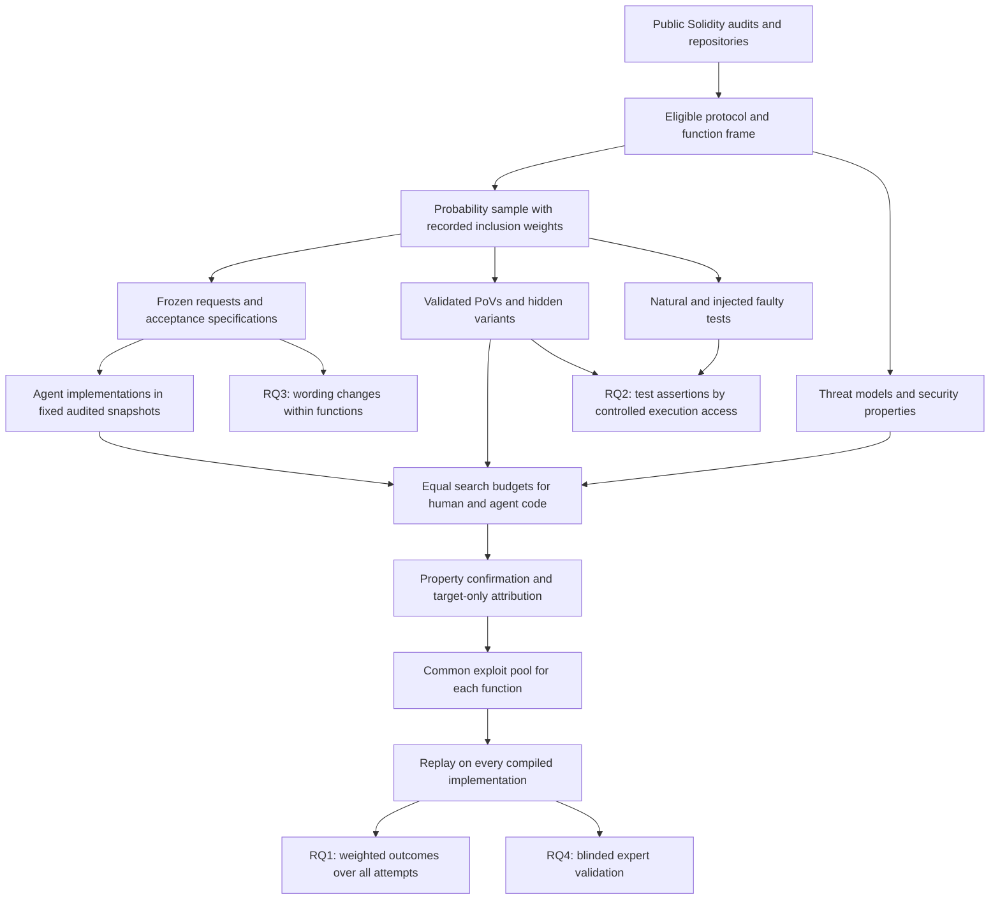

# AI Coding Agents and Human Developers on Audited Solidity Contracts: Vulnerabilities Avoided and Added, and the Effect of Fault-Enforcing Tests

Proposal version 3.  
21 October 2026.

## 1. Abstract

AI coding agents can produce working code that contains exploitable vulnerabilities. Benchmarks drawn only from human mistakes cannot measure the vulnerabilities agents add elsewhere. We propose a retrospective replacement study on audited Solidity contracts. Agents rewrite individual functions in fixed snapshots. Functions are sampled with known probabilities from audit-flagged and other code. Executable proofs of vulnerability judge both authors against recorded security properties. A flaw counts only when a target-only correction removes it. Every validated exploit runs on every implementation of that function. All attempts remain in the analysis, including compilation failures. A controlled experiment separately varies faulty test assertions and access to their execution results during writing and PoV-guided repair. Natural and injected tests are analyzed separately. The study estimates differences in confirmed vulnerable outputs, distinguishes working replacements from failed implementations, and measures uncertainty from sampling and incomplete evaluation.

## 2. Problem and motivation

**Agents are already used in Solidity development.** The Solidity Developer Survey 2025 reports that 58% of respondents use AI tools daily and 49% use them to write code [Solidity Survey]. These are self-reports, not measurements of deployed code, but they establish that the practice is relevant.

**Solidity security requires more than successful compilation.** Contracts hold and distribute user funds. Public callers can exploit mistakes in access control, accounting, and protocol logic. Zhang et al. studied 516 exploitable smart-contract bugs and found that more than 80% were beyond the automated tools they considered [Web3Bugs]. Li et al. found substantial missed vulnerabilities and low precision among Solidity static analyzers [SAST Study]. These results motivate executable checks of specific attacker outcomes.

Moonwell’s February 2026 oracle incident produced about $1.78 million in bad debt. The associated pull request contained AI co-author trailers. Who chose the faulty line is not established, and the protocol did not attribute the bug to AI [Moonwell]. The incident illustrates the stakes without establishing an AI-specific failure rate.

**Existing benchmarks answer a narrower comparative question.** SusVibes reconstructs real Python coding tasks from vulnerable code. Its best reported configuration passed functional tests on 57.0% of tasks and both functional and security checks on 11.8% [SusVibes]. SecureVibeBench reconstructs vulnerability-introducing scenarios and runs the same PoV on historical human code and agent implementations [SecureVibeBench].

These designs show whether agents reproduce vulnerabilities in tasks selected because a human failed. They do not estimate what happens on functions without known human vulnerabilities. An agent might avoid a historical bug yet introduce new bugs on many other functions.

Other studies compare agent and human patches on the same software issues, including Sajadi et al. [Patch Security]. Solidity systems such as SolAgent compare generated and human code using static warnings [SolAgent]. Our question requires a defined population, a common executable evaluation, and explicit accounting for failed implementations.

**The repair question also needs a narrower claim.** Giving a report or a reproducer to a repair agent is established practice. SysRepair-Bench reports higher repair success with vulnerability reports while also checking that the service remains healthy [SysRepair-Bench]. P2Patch and PatchBench show why blocking one visible exploit does not establish a complete repair [P2Patch; PatchBench].

We therefore ask whether incorrect repository tests change how agents use execution feedback during writing and PoV-guided repair. The practical result would inform where review and testing effort is needed. It would not establish how much human review can safely be removed.

## 3. Key insight and contributions

**Insight 1: the comparison must include both audit strata and every attempt.**

A function without an audit finding is not necessarily safe. We therefore use the audit verdict to define sampling strata, not final security labels. Both human and agent implementations undergo the same search and confirmation process.

The study records whether an agent produces a compiled vulnerable implementation, whether that implementation also passes legitimate-behavior tests, and whether it produces no usable implementation. Compilation failure cannot disappear from the denominator or count as a successful security improvement.

**Insight 2: the developer’s tests may preserve the developer’s mistake.**

Fault-enforcing tests assert faulty behavior [Fault-Enforcing Tests]. In the pilot’s finding 63008, four repository tests expect an iterator to skip a boundary tick. A comment describes the same behavior.

In the pilot repair experiment, OpenHands with GPT-5.4-mini succeeded in 10 of 12 runs without execution and 2 of 12 runs with a terminal. Seven of the latter repairs preserved all four faulty tests. These observations come from one finding. They motivate an experiment; they do not identify test execution as the cause.

**Insight 3: request wording can change what the experiment measures.**

The eight-task pilot used requests written from vulnerable functions. Four requests described the vulnerable design, and four stated the rule restored by the fix. The corresponding compiled runs contained the bug in 13 of 13 and 3 of 15 cases. Different tasks received different wording, so the difference is an association.

The full study freezes requests after a source audit. A separate experiment changes wording within the same function.

The planned contributions are:

1. **A comparison over a defined population.** Inclusion weights connect sampled functions to the eligible population. Common denominators cover every scheduled attempt. Paired outcomes distinguish added vulnerabilities, working replacements that avoid vulnerabilities, and reductions caused by failed implementations.
2. **An executable Solidity benchmark.** Each task includes a threat-model record, an acceptance specification, a frozen request, and PoVs tied to security properties.
3. **A common evaluation for both authors.** Every counted flaw requires evidence that the target function causes it. Search budgets are matched, and every validated exploit is replayed across all implementations.
4. **A controlled study of faulty tests and execution feedback.** The experiment runs during writing and PoV-guided repair. Natural tests and injected tests form separate analysis strata.

Shared exploits, hidden repair tests, report-assisted repair, and differential testing are prior methods [SecureVibeBench; P2Patch; PatchBench; SysRepair-Bench; Diffusc]. The contribution is their use in a sound comparative design and a specific experiment on faulty repository tests.

## 4. Threat model and problem setting

**Setting.** This is a retrospective replacement study. Each agent rewrites one function inside a fixed audited snapshot. The comparison is with the historical human implementation in that snapshot.

The agent sees code and tests that may have been written after the human originally implemented the function. We do not claim to reproduce the human’s original development conditions.

**Assets.** The protected assets are user funds, protocol solvency, and availability of core operations.

**Attacker.** The attacker is an unprivileged external account. It may deploy contracts, call public interfaces, use specified flash loans, and transact across blocks. Each protocol record bounds available capital and environmental actions.

The attacker cannot steal keys, assume an administrator or oracle-operator role, alter deployed code, or compromise the agent. Findings requiring privileged attackers are outside the study.

**Environment.** Every exploit runs offline. Setup uses documented deployment procedures and permitted state transitions. Mock tokens and oracles must obey the protocol’s recorded assumptions. Arbitrary storage changes cannot manufacture the vulnerable state.

**Threat-model record.** Before evaluated agent runs, each protocol receives a record covering:

- attacker roles, capital, and permitted borrowing;
- valid initial states and allowed environmental changes;
- token and oracle assumptions;
- protected assets and security properties;
- the audit platform’s severity criteria.

Properties must describe legitimate entitlements and operations. For example, only active positions may receive a specified reward. Generic statements such as “an account must never make a profit” are insufficient.

**What counts as an attributable vulnerability.** A compiled implementation has a confirmed vulnerability only when:

1. a valid PoV demonstrates a recorded High or Medium property violation;
2. execution evidence identifies how the target function contributes to the violation;
3. replacing only that function with an independently justified correction removes the violation under the same setup and attack;
4. the corrected function passes the legitimate-behavior suite.

The intervention keeps the function signature, surrounding code, dependencies, and initial-state procedure unchanged. It cannot remove the feature, forbid legitimate users, or hide the loss through altered accounting.

The correction may be the historical fix, another implementation that lacks the flaw, or a minimal correction reviewed by a person. Neither author’s implementation is presumed correct.

The flawed implementation need not pass every functional test. A function can be both broken and exploitable. Functional status is recorded separately.

If the violation remains after a valid target-only correction, it does not establish a flaw attributable to this target. If attribution cannot be established, the candidate remains unresolved.

**Scope.** The study excludes low-severity findings, gas optimization, privileged misuse, and defects caused entirely by unchanged surrounding code. Interactions between the target and other protocol code remain in scope when the attribution test succeeds.

## 5. Approach

### 5.1 Selecting findings

The existing pipeline downloaded 19,666 Solidity findings. Of these, 7,826 linked complete source files. Filtering produced 77 recent candidates, of which 43 had public history suitable for further investigation.

These are screening counts, not validated benchmark sizes. The pilot selected eight cases partly because their proofs of concept were convenient to adapt.

Month one refreshes the pool and includes reports that link a contest repository rather than an individual file. Publication dates, code-publication dates, audit sources, and exclusion reasons are recorded separately.

The historical cutoff filter reduces some exposure risks. It does not establish that models have not seen the vulnerable code.

### 5.2 Eligible population and sampling

Development cases used to design the harness are identified before the main sample. They are reported separately from the confirmatory study.

A protocol is eligible when its audited snapshot is available, its dependencies can be pinned, it builds offline, and its documented behavior supports a threat-model record.

A function is eligible when it is in audit scope, has at least five statements, performs meaningful computation or state changes, remains syntactically valid when its body is removed, and is reachable through tests or a documented call path. These criteria define the study’s population rather than all Solidity code.

**Audit stratum V** contains eligible functions linked to the root cause of a reported High or Medium vulnerability within the threat model.

**Audit stratum N** contains the other eligible functions. Membership means no qualifying audit label, not proven correctness.

The frame records protocol and stratum sizes before sampling. If the study cannot include every eligible protocol, protocols are selected by a seeded probability draw. Functions are then sampled within each protocol and audit stratum. Each function’s weight is the inverse of its joint inclusion probability.

The provisional resource calculation uses 25 protocols, two V functions and four N functions per protocol. Actual allocations depend on frame sizes and the corrected simulation. Small strata may be censused.

A sampled function that cannot yield a valid task or PoV is retained as a missing evaluation. It is not replaced by an easier function. The main report gives weighted missing fractions and outcome bounds. Any model-based imputation is secondary and states its assumptions.

### 5.3 Tracing a finding

History establishes the audited version, candidate introducing changes, and the fix. Line tracing supplies candidates, not ground truth.

A person checks the relevant changes and records uncertainty. Missing checks, refactorings, and squash merges are handled explicitly. Where possible, executable evidence confirms the affected versions.

For finding 63008, line blame pointed to a later rewrite. Reading the history identified the earlier faulty implementation. This illustrates why a blame result alone is insufficient.

Tracing supports source provenance and audit-stratum assignment. The agent’s starting state remains the audited snapshot.

### 5.4 Task framing

The task preserves the target function’s signature and replaces its body with a placeholder revert. The agent must provide a replacement body.

Only the target function is applied to the evaluation snapshot. Edits to tests, build settings, unrelated functions, or dependencies do not change evaluation. Necessary exceptions are defined before sampling outcomes are known; otherwise the task remains unresolved.

The workspace contains a fresh one-commit history. Original history, hidden tests, fixes, cached copies of the target, and generated artifacts that expose the missing implementation are excluded.

The main comparison uses the repository context as audited. The controlled test experiment changes only its declared factors.

### 5.5 Feature requests

Requests may use the function signature, surrounding snapshot code, existing comments, issue text, commit descriptions, and protocol documentation. The request writer does not see the removed body, vulnerability report, or fix.

Every sentence has a source. A person checks that the sentence follows from that source. The request is then frozen.

A later diagnostic records whether the request favors the vulnerable or corrected implementation. This diagnostic does not trigger rewriting. Conflicts between sources, requested behavior, and security properties are recorded. A task without a coherent acceptance specification remains unresolved rather than receiving an improvised specification after agent results are known.

The within-function wording experiment is separate from construction of the main benchmark.

### 5.6 Acceptance specification and PoV outcomes

Each task has two sets of checks:

- **Legitimate behavior:** operations and outputs that must continue to work.
- **Forbidden outcomes:** attacker effects that violate recorded security properties.

Fault-enforcing tests are replaced by corrected tests for final evaluation. Additional functional tests cover missing cases, including implementations that always revert or disable the feature. These checks are frozen before evaluated runs.

A PoV produces one of three semantic results:

| Result | Meaning |
|---|---|
| Violation observed | Valid setup and execution demonstrate the forbidden outcome. |
| Violation checked and absent | The scenario executes, and its outcome check establishes that the forbidden outcome did not occur. |
| Unresolved | Setup, execution, instrumentation, or interpretation prevents a valid check. |

A test-process exit code is not itself a security verdict.

A defensive revert may produce “checked and absent” when the harness catches it, verifies the resulting state, and confirms that the revert is a permitted defense. An unexpected setup revert is unresolved.

For a particular attack, **blocked** means “checked and absent” together with a passing legitimate-behavior suite. A run that reaches the final assertion and disproves the attack is therefore handled correctly.

### 5.7 PoVs and held-out variants

For each sampled V function, the report’s reproducer is adapted into a property check. It must observe the violation on the historical implementation and its absence after a valid target-only correction.

Each case also receives at least one hidden variant using a different boundary, state, or call sequence. Variants must satisfy the same threat model and attribution requirements.

PoV generation from audit reports and validation against corrections follow prior work such as PoCo [PoCo]. A person checks that each PoV observes protocol behavior rather than a computation performed only inside the harness.

Shown repair tests and hidden evaluation tests are separate artifacts. Hidden variants remain outside every agent workspace.

New PoVs discovered during evaluation are marked as later discoveries. They do not retroactively become part of the frozen test set. Their effect is reported separately and replayed consistently across the relevant cohort.

### 5.8 Natural and injected fault-enforcing tests

A natural candidate passes on the vulnerable implementation and fails on a correction. A person must also establish that its assertion endorses the faulty behavior. Failure caused by an unrelated interface change does not qualify.

Each qualifying test has a corrected counterpart. The two versions preserve names, inputs, structure, and surrounding comments where possible. The intended treatment is the incorrect expectation, not an obvious warning about a vulnerability.

For selected V functions without natural cases, injected tests record faulty outputs on inputs that distinguish vulnerable and corrected behavior. These tests use the repository’s style but are labeled as synthetic in the research data.

**Blinded realism check.** A human reviewer who did not construct the tests and an LLM receive randomized sets of comparable tests from the same repository. Some sets contain an injected test; others contain only real tests. They identify suspected injections and state their reasons.

We report detection rates and false alarms. We also report size and structural differences between natural and injected tests. Passing this exercise does not prove realism.

The primary analyses separate natural and injected tests. Pooled estimates are supplementary. A small natural sample cannot be enlarged statistically by treating injections as natural observations.

### 5.9 Agents, models, and configuration manifest

| Configuration | Role | Required record |
|---|---|---|
| Aider 0.86.2 with GPT-5.4-mini | Experimental pilot configuration | Context access, reasoning settings, execution restrictions |
| Aider 0.86.2 with Claude Sonnet 4.5 | Experimental pilot configuration | Thinking budget and editing settings |
| OpenHands SDK 1.53.0 with GPT-5.4-mini | Experimental pilot configuration | Reasoning effort and complete tool list |
| OpenHands SDK 1.53.0 with Claude Sonnet 4.5 | Experimental pilot configuration | Thinking settings and complete tool list |
| Codex CLI with GPT-5.4-mini | Experimental integration | Pinned CLI version and fallback behavior |
| Codex CLI with Claude Sonnet 4.5 | Experimental integration | Translation layer, fallback behavior, and token limits |
| Claude Code with a supported current Claude model | Supported baseline | Exact versions and settings fixed at month two |
| Codex CLI with a supported current GPT model | Supported baseline | Exact versions and settings fixed at month two |

The manifest preserves the distinction between supported products and experimental integrations. No result from a translated integration is described as the vendor’s supported agent performance.

The six pilot configurations receive three independent attempts per sampled task. Supported baselines run on a declared common subset with compatible exposure criteria. Comparisons use the same tasks and denominators.

Each session starts fresh. The main run limit is 20 minutes; repair runs have a separately declared limit. Memory, reasoning settings, and tool budgets are pinned. Network access is restricted to model APIs. Hosted search is disabled.

The controlled execution experiment uses the restricted, identical tool sets described in section 6.4. Its results are not presented as measurements of unrestricted default agents.

### 5.10 Common discovery, confirmation, and replay

Evaluation is organized by function and study cohort. The main comparison, test experiment, and wording experiment have separate primary discovery pools.

**Fixed reference.** Before evaluated outputs exist, each function receives one reference implementation constructed from its acceptance specification. It is checked for legitimate behavior but is not assumed to be secure. It serves only as a source of differential-test candidates.

If a usable reference cannot be constructed, differential search is unavailable for every version of that function. The other checks remain available, and this limitation is recorded.

**Equal discovery budget.** Every distinct compiled implementation, including the human’s, receives:

1. one property-checking and differential-fuzzing campaign with the same seeds and execution limit;
2. one review from each of the same two LLM reviewers;
3. the same maximum number and duration of candidate-confirmation attempts.

Reviewers receive the implementation, callers, frozen request, threat-model record, and acceptance specification. Author and experimental arm are hidden.

Candidate limits and ordering rules are fixed at month two. Candidates beyond the budget are recorded as unevaluated; they do not become negative evidence.

Identical implementations within a cohort may reuse discovery results. Deduplication uses the complete evaluated artifact, not merely a similar-looking function.

**Confirmation and attribution.** A candidate must satisfy section 4. The confirmation record includes the attack, observed property violation, target-only correction, unchanged context, legitimate-behavior results, and human adjudication.

**Common replay.** Every validated PoV for a function is replayed on every compiled implementation of that function in the cohort. An exploit discovered from one author’s code can therefore identify the same flaw in the other author’s code.

Attribution is checked for every implementation against which the exploit succeeds. A successful attack against unchanged surrounding code does not count against the target.

PoVs discovered in another cohort receive a separate supplementary replay. This prevents optional experiments from silently changing the main study’s evaluation effort.

LLM agreement is not proof. Prior work documents unreliable vulnerability judgments and unstable findings [Detection Study; VulnBench JS]. We report confirmation failures, unresolved candidates, and reviewer stability on a random 10% repeat sample.

### 5.11 Repair study

Every repair starts from the same historical vulnerable implementation for that task. The agent receives either the redacted report or a shown PoV, as specified in section 6.4.

A repair succeeds only when it:

- submits a compiled implementation;
- passes legitimate-behavior tests;
- blocks every frozen attack;
- has no confirmed new attributable High or Medium vulnerability;
- has no unresolved required evaluation.

A repair that blocks the shown exploit but fails a hidden one is incomplete. Remaining attacker gains and victim losses are reported for the specified scenario. They are not estimates of unrestricted maximum loss or losses on a live deployment.

Frozen-test success and success after later discovery are reported separately.

### 5.12 Worked example: finding 63008

The case concerns the downward tick iterator in Sorella L2 Angstrom. The audited snapshot is `386baff`. The faulty implementation was traced to `661468b`; the relevant fix is in `c01b6c7`.

The downward iterator initializes its current tick and advances in a way that skips the starting boundary. The security properties concern reward entitlement and valid swaps.

The report supplies three attack scenarios:

- P1 swaps to a boundary, adds liquidity, and swaps back.
- P2 performs a downward swap from a boundary and triggers a revert.
- P3 steals rewards.

In the recorded P3 scenario, an honest liquidity provider has 49 ETH of pending rewards. The attacker obtains 48.88 ETH net. With the tested correction, the attacker ends 0.098 ETH down. These are local scenario results.

Four repository tests expect the faulty boundary behavior. A parameter comment calls the start tick “exclusive.”

In six initial pilot configurations, four implementations preserved the historical bug and two wrote the corrected boundary adjustment. Each configuration ran once, so these are individual outcomes.

The pilot also generated two control functions. Two of twelve agent attempts produced compiled implementations with a confirmed new vulnerability; eleven attempts compiled. Both vulnerable implementations also failed a functional test. Under the proposed analysis, all twelve attempts remain in the denominator. The two failures count toward the endpoint for any confirmed vulnerable compiled output, but not toward the endpoint requiring a passing functional suite.

In repair, one patch blocked the shown P2 while the hidden P3 still obtained 48.88 ETH. The later 144-run study found the large execution-access contrast described in section 3.

These findings motivate the design. The existing artifacts still require the new attribution and evaluation checks before inclusion in a v3 result. In particular, the new procedure must verify target-only corrections against the full acceptance specification.

## 6. Research questions and evaluation plan

### 6.1 Research questions

- **RQ1:** Over the eligible population, how often do agents produce confirmed vulnerable implementations compared with historical human implementations, and which paired outcomes explain the difference?
- **RQ2:** Does execution feedback from fault-enforcing tests change whether agents reproduce or retain a vulnerability during writing and PoV-guided repair?
- **RQ3:** Within a function, how does request wording change vulnerability reproduction?
- **RQ4:** How well does the evaluation agree with blinded expert investigation, and does detection differ between human and agent implementations?

RQ1 is the core study. RQ2 retains the project’s use of PoVs to study repair. RQ3 is a secondary experiment and the first candidate for removal if resources are insufficient.

### 6.2 Outcomes and common denominators

For each author and function, record compilation, legitimate behavior, confirmed attributable vulnerabilities, and unresolved checks separately.

| Outcome | Interpretation |
|---|---|
| No submitted implementation or compilation failure | No compiled artifact was produced; this is not a secure solution. |
| Confirmed vulnerability and legitimate suite passes | The implementation passes the chosen functional checks but contains an attributable vulnerability. |
| Confirmed vulnerability and legitimate suite fails | The implementation is both functionally faulty and vulnerable. |
| No confirmed vulnerability and legitimate suite passes | No vulnerability was found under the specified search budget; security is not proved. |
| No confirmed vulnerability and legitimate suite fails | The feature is faulty without a confirmed security effect. |
| Unresolved evaluation | Required evidence is missing or inconclusive. |

A confirmed flaw fixes vulnerability status even if another candidate remains unresolved. Other dimensions may remain unknown.

Let:

- \(C=1\) when a submitted implementation compiles;
- \(L=1\) when it passes the legitimate-behavior suite;
- \(V=1\) when a High or Medium vulnerability is confirmed and attributed to the target.

The primary measurable endpoint is:

\[
K=C\,V.
\]

It records **any confirmed vulnerable compiled output per scheduled attempt**.

A secondary endpoint is:

\[
D=C\,L\,V.
\]

It records a **confirmed vulnerable output that passes the chosen build and functional checks per scheduled attempt**. “Deployable” refers only to these checks, not approval for deployment.

Both endpoints use all scheduled attempts as their denominator. Compilation failures contribute zero to these joint events, but remain a separate failure outcome. They never count as successful vulnerability avoidance.

The human implementation supplies one observation per function. It is paired with each agent attempt for calculation but is not treated as multiple independent human observations.

Operational failures have a preregistered retry rule. Attempts are not repeated because their code is poor. Unresolved evaluations remain in the denominator and receive bounds consistent with known compilation and functional status.

Conditional rates among compiled outputs may be reported descriptively. They do not replace the common-denominator comparison.

### 6.3 RQ1: estimation, uncertainty, and detection limits

For endpoint \(Y\), let \(\overline{Y}_{Ai}\) be the mean across all scheduled agent attempts for function \(i\), and \(Y_{Hi}\) the human result.

Let \(w_i\) be the inverse joint inclusion probability. Let \(\pi_s\) be the eligible population’s share in audit stratum \(s\). Estimate:

\[
\widehat{\Delta}^{Y}
=
\sum_{s\in\{V,N\}}\pi_s
\frac{\sum_{i\in S_s}w_i
(\overline{Y}_{Ai}-Y_{Hi})}
{\sum_{i\in S_s}w_i}.
\]

The primary endpoint is \(\Delta^K\). We also report \(\Delta^D\), compilation, functional success, and unresolved evaluation.

We do not automatically set the human rate in V to one. That is justified only where the new confirmation and attribution requirements succeed.

**Paired transitions.** We report implementations that introduce a confirmed vulnerability where none was confirmed in the human version, and implementations that replace a confirmed vulnerable human version without a confirmed flaw.

The latter are split into working replacements, broken replacements, and absent or noncompiling outputs. Only working replacements support a claim that the agent avoided the vulnerability successfully. Both authors may also remain vulnerable, including through different flaws.

**Uncertainty.** The primary analysis uses a paired, rescaled multistage survey bootstrap reflecting protocol selection, function sampling within audit strata, and agent attempts. The same bootstrap weights apply to both authors. Sampling fractions are retained. Bootstrap methods for complex samples provide the relevant starting point [Survey Bootstrap].

The six experimental configurations form one family of primary tests, corrected with Holm’s method. Supported configurations on a different exposure-compatible population are reported separately.

**Power status.** All numerical power results in v2 are superseded. The previous simulation confused conditional and marginal rates and used different tests from the proposed analysis. No valid power result is currently claimed.

Before the month-two gate, the corrected simulation must calibrate marginal endpoints, implement this estimator and bootstrap, test null rejection and interval coverage, and report simulation uncertainty. Sample targets are provisional until that work is complete.

**Incomplete detection.** The estimate concerns confirmed vulnerabilities under the stated procedure. It is not a complete census of latent vulnerabilities. We report bounds for unresolved evaluations and sensitivity to unequal missed-vulnerability rates. Expert investigation informs these limits but does not establish that all other code is safe.

### 6.4 RQ2: faulty assertions and controlled test execution

The experiment crosses two factors within each selected agent configuration:

1. repository tests assert the faulty behavior or the corrected behavior;
2. the agent can or cannot request execution of that frozen repository suite.

The test source is visible in both execution arms. Comments, requests, surrounding code, and file access remain fixed within a task.

**Execution control.** Both arms receive identical tools to read, search, and edit files, plus a fixed build command. Neither receives an unrestricted terminal. Only one arm receives the tool that executes the frozen repository suite.

The build tool uses fixed configuration and cannot run tests or arbitrary scripts. The test tool restores the assigned test version and fixed build settings outside the writable workspace. Foreign-function execution is disabled.

Agents may write additional tests, but cannot execute them in either arm. In the PoV repair condition, both execution arms receive the same separate tool for rerunning the shown PoV. Thus, the manipulated factor is repository-test feedback, not access to the shown exploit or compiler.

The full-terminal alternative is not used for causal identification. With unrestricted execution and visible test code, denying one command does not prevent execution through another path.

**Validation before data.** Each configuration must demonstrate equal file and build access, correct denial of repository-test execution, and resistance to changed test names, scripts, build settings, and test files. Failed checks stop that configuration’s factorial experiment until corrected. Denied tool requests are logged.

**Writing and repair.** The writing experiment starts with the target removed. The repair experiment starts with the historical vulnerable target. Repair additionally crosses report input R with shown-PoV input P. A location-only condition is descriptive and optional.

**Natural and injected tests.** They form separate primary analysis strata. The sample and all exclusions are fixed before agent outcomes are seen. The blinded realism exercise is reported alongside injected-test effects.

**Analysis.** The writing outcome is reproduction of the attributed historical vulnerability. The repair outcome is success under section 5.11. Models include test content, execution permission, and their interaction, with protocol and function random effects.

For one configuration selected before the experiment, the four planned primary interactions are writing and PoV-guided repair, each split into natural and injected tests. Holm’s method controls this family. Other configurations are replications. Report-input contrasts and pooled analyses are secondary.

The logistic interaction is tested by a likelihood-ratio test with parametric-bootstrap calibration. Probability-scale differences in differences are also reported because they are easier to interpret, but they answer a different statistical question.

Insufficient natural cases lead to a natural-case series, not a pooled claim supported mainly by injected tests. Corrected power calculations must reflect the actual number of natural functions and protocols.

A report’s benefit is not a novelty claim. SysRepair-Bench already supplies related evidence [SysRepair-Bench]. Our main repair question is whether incorrect repository assertions interact with access to their execution results.

### 6.5 RQ3: request wording within functions

A random subset of 20 V functions receives four request conditions:

- the frozen main-study request;
- a minimal request containing the signature and existing comments;
- a request written from the vulnerable implementation;
- a request written from the correction.

The last two are explicitly experimental and never replace the main request.

Each of the six experimental configurations receives three fresh attempts per condition. Run order is randomized. The same tools and budgets apply within a configuration.

The outcome is reproduction of the attributed historical vulnerability. Analysis accounts for function and protocol clustering. Results are exploratory and are reported by request condition with uncertainty.

### 6.6 RQ4: independent validation

Two paid auditors review a stratified random sample of about 150 compiled implementations. Sampling spans both authors, both audit strata, and positive, negative, and unresolved automatic results.

Auditors are blinded to author, configuration, arm, and automatic verdict. They receive the protocol context needed to assess the property and attack assumptions. Each gets the same initial review budget.

Every proposed flaw requires executable confirmation and target attribution. Failed confirmation is distinguished from a disproved claim. Unresolved cases remain visible.

The reference standard is expert investigation under a stated budget, not proof of absence. We report weighted agreement, sensitivity, specificity, unresolved fractions, and uncertainty. Estimates are split by author and reviewer model family where the sample supports them.

The construction team does not substitute its own unblinded review for this validation. Any findings added through expert review are replayed across the relevant function cohort.

### 6.7 Baselines and ablations

The historical human implementation is RQ1’s baseline. Supported native agent configurations complement the six experimental integrations.

For evaluation, Slither and a single LLM reviewer are compared with the full procedure. Their outputs do not determine the main labels.

For the test experiment, corrected assertions with execution available provide a reference condition. Report-only repair is a prior-art condition. Shown-PoV repair is compared with it only when both arms are retained.

Ablations remove candidate-search components while holding final replay and attribution rules fixed. They measure what each component discovers, not whether a weaker label should replace confirmed evidence.

### 6.8 Threats to validity

**Historical context.** The study estimates replacement in audited snapshots, not performance under the developer’s original conditions.

**Task selection.** Conclusions are limited to the declared eligible population. Unbuildable and undocumented protocols may differ systematically. Sampled construction failures are retained as missing evaluations.

**Contamination and recall.** Report dates alone do not establish exposure. We record when vulnerable code and fixes became public and inspect dependencies, caches, and generated files for leaked copies.

Every saved edit is compared with historical vulnerable and fixed implementations. The check records first appearance, maximum overlap, final overlap, distinctive strings, and whether earlier tool output exposed those strings. Human adjudication distinguishes plausible common code from stronger evidence of recall.

Endor Labs’ vendor reports describe substantial training recall and edits that initially reproduce a fix before diverging [Endor Recall; Endor Trajectories]. These are warnings about measurement, not universal recall rates.

Results are reported with recall flags visible and in a sensitivity analysis excluding strongly supported recall cases. Exclusion changes the analyzed population and is labeled accordingly. Failure to detect recall is not evidence of its absence.

ConstraintDial uses protocol mutation to make public attacks stop working while preserving a security task [ConstraintDial]. Such mutation could support future contamination studies, but it changes the historical program. It is not substituted for the original human comparison here.

**Properties and attribution.** Recorded properties may be incomplete. Corrections may remove a symptom without establishing the intended cause. Human review, target-only interventions, and unresolved outcomes limit these risks without eliminating them.

**Faulty-test realism.** Injected tests establish effects under a constructed condition. They cannot establish how often the condition occurs naturally.

**Evaluation dependence.** Exploits shared within a function make outcomes dependent. Sampling, analysis, and expert validation preserve function and protocol clusters.

**Generalization.** Results apply to the sampled Solidity setting, tool configurations, and budgets. They do not establish the security of autonomous development as a whole.

## 7. Related work

**Reconstructing vulnerable coding tasks.** SecureVibeBench reconstructs introduction scenarios and uses shared PoVs [SecureVibeBench]. SusVibes reconstructs real tasks and checks both functionality and security [SusVibes]. Asare et al. compare completions at historical vulnerability sites [Copilot Comparison]. These designs motivate ours, but sampling human failures does not estimate the other side of the comparison.

**Comparing human and agent code.** Sajadi et al. compare patches for the same issues using static analysis [Patch Security]. SolAgent compares generated Solidity with human code through static warnings [SolAgent]. Our study uses a probability sample that includes unflagged functions, shared property checks, and target attribution.

**Smart-contract exploits and repair.** EVMbench evaluates detection, patching, and exploitation using executable grading [EVMbench]. PoCo builds executable exploit tests from findings [PoCo]. These establish much of the infrastructure we reuse.

**Repair beyond a visible reproducer.** P2Patch, PatchBench, and SlicePatch demonstrate the need for independent attacks or attack variants [P2Patch; PatchBench; SlicePatch]. Le et al. show that benchmark inputs and execution choices can change apparent repair success without comparable gains on additional tests [Patching Reliability].

**SysRepair-Bench.** Its verified abstract describes 313 repair scenarios, with paired report and no-report conditions and checks that services remain healthy. It reports median success of 90.0% with reports and 49.4% without [SysRepair-Bench]. It is an ICLR 2027 submission under review. This is direct prior evidence for report-assisted repair and against accepting repairs that merely disable a service. Our distinct question concerns faulty repository assertions and controlled execution of those tests, with hidden PoVs. Further implementation details beyond the available abstract remain [uncertain].

**ConstraintDial.** Its verified abstract describes reconstruction and mutation of 203 public smart-contract cases. Mutations alter required attacks while retaining the security task. The reported supplied-answer success falls by 10.9 percentage points compared with reconstruction alone [ConstraintDial]. It is also an ICLR 2027 submission under review. It addresses contamination in detection, exploitation, and patching. Our main comparison retains historical programs and inspects complete edit histories.

**Fault-enforcing tests and execution.** Charoosaei et al. study tests that preserve faults [Fault-Enforcing Tests]. ImpossibleBench introduces conflicts between specifications and tests and varies access and feedback [ImpossibleBench]. Lin et al. study execution access in program repair [Execution Study]. Our natural-test experiment concerns existing developer-written tests that preserve real vulnerabilities. The injected experiment is positioned as a controlled extension of this prior work.

| Work | Human security comparison | Unflagged functions sampled | Executable security check | Repair beyond visible evidence | Faulty-test intervention |
|---|---|---|---|---|---|
| SecureVibeBench | Human vulnerable code validates shared PoV | No | Yes | Not its main task | No |
| SusVibes | Tasks selected from human vulnerabilities | No | Security tests | Not its main task | No |
| Copilot comparison | Conditional on historical human failure | No | Primarily completion assessment | No | No |
| Sajadi et al. | Same-issue human and agent patches | Not this probability design | Static analysis | Not its main question | No |
| SolAgent | Human and generated Solidity | No declared design of this kind | Static warnings | Not its main question | No |
| EVMbench | No author comparison | No | Exploits and execution | Hidden patch checks | Faulty tests noted |
| P2Patch, PatchBench, SlicePatch | No population comparison of authors | No | Yes | Yes | Not their main contribution |
| SysRepair-Bench | No author comparison reported | No | Exploit and service health | Additional hidden exploits not described in abstract | Report availability |
| ConstraintDial | No author comparison reported | No | Execution after mutation | Details not established from abstract | No such intervention described |
| ImpossibleBench | No historical author comparison | No | Task tests | Not a security-repair study | Constructed conflicts and access changes |
| This proposal | Paired, weighted, all-attempt outcomes | Yes | Property checks with target attribution | Frozen hidden PoVs and common later replay | Natural and injected assertions, analyzed separately |

## 8. Feasibility, risks and fallback plans

The pilot establishes that several real cases can be built and that the evaluation needs careful repair. It does not yet establish the labor cost of the full procedure. The new attribution checks, independent references, and symmetric replay must be timed.

**Month-one measurement.** Ten development cases are used to measure complete task construction, including unsuccessful cases. Time records separate tracing, specification, reference construction, PoVs, attribution, and human checking.

**Month-two gate.** Before main agent runs, fix the population, sample, inference code, configurations, search budgets, and funded resource ceiling. The corrected simulation must pass its null checks. If it does not support the desired precision, the proposal reports the attainable precision or reduces claims rather than retaining an unsupported power statement.

### Full workload

The following is a resource scenario, not a power-certified sample size.

| Experiment | Calculation | Agent runs |
|---|---|---:|
| RQ1, six experimental configurations | 150 functions × 6 configurations × 3 attempts | 2,700 |
| Supported baselines, maximum full subset | 150 functions × 2 configurations × 3 attempts | 900 |
| RQ2 writing | 30 functions × 4 configurations × 4 cells × 3 attempts | 1,440 |
| RQ2 repair, report and PoV inputs | 30 × 4 × 4 × 2 × 3 | 2,880 |
| Optional location-only repair | 30 × 4 × 3 | 360 |
| RQ3 wording | 20 functions × 6 configurations × 4 requests × 3 attempts | 1,440 |
| **Maximum planned total before calibration** | | **9,720** |

Calibration, failed infrastructure checks, reference construction, and PoV generation are additional work. They must not be hidden inside these totals.

### Evaluation budget

Let \(V_c\) be the number of distinct compiled implementations requiring discovery, including human implementations. Without deduplication, the full scenario has at most 9,870 such evaluated outputs and human references, before separate harness controls.

The pilot’s approximate input sizes were 15,000 tokens for one reviewer and 25,000 for the other. Their outputs were about 16,000 and 1,000–3,000 tokens.

Thus, 3,000 implementations would require approximately:

- 120 million review input tokens;
- 51–57 million review output tokens;
- an additional 10% for the planned stability repeats.

These are workload estimates, not price quotes. For the full upper count, the same formulas give 394.8 million input tokens and 167.79–187.53 million output tokens before repeats. Model-specific prices and limits are fixed from dated quotes at month two.

Confirmation work is budgeted separately. With a cap of \(q\) candidate attempts per implementation, there are at most \(qV_c\) attempts before deduplication. Unexamined candidates remain visible.

If function \(i\) has \(m_i\) implementations and \(p_i\) validated PoVs, common replay requires \(m_ip_i\) executions. Attribution interventions add further executions. Container time, storage, and human confirmation time are measured separately.

Two expert reviews of 150 implementations at an initial allowance of 20 minutes each require 100 paid hours. Difficult confirmations, adjudication, and the injected-test realism exercise need an additional allowance measured during calibration.

The pilot’s average generation price is not used to price frontier agents, security reviewers, or confirmation agents. The study does not launch until the complete budget is funded.

### Order of reductions

If the full plan exceeds the available time or budget, reduce it in this order:

1. Remove the separate RQ3 wording experiment, retaining frozen requests and diagnostic checks.
2. Remove location-only repair.
3. Remove the report-input half of RQ2, retaining PoV-guided repair and withdrawing any report-versus-PoV claim.
4. Reduce RQ2 from four configurations to two selected before outcomes are known.
5. Limit supported-baseline coverage to a common random subset and state the resulting precision.

The first four reductions leave at most 5,040 agent runs when both supported baselines still cover all 150 functions. This includes RQ1, writing interventions, and PoV-guided repair.

RQ1’s common denominator, probability sampling, attribution, and symmetric evaluation are not traded away. Neither is the core use of PoVs to evaluate repair.

If these protected components remain unaffordable, the study must revise its declared scope before main data collection. It must not select only convenient PoVs or stop when a preferred result becomes significant.

| Risk | Response |
|---|---|
| Too few eligible protocols | Report the precision supported by the corrected simulation; avoid broad population claims. |
| Slow task construction | Lower sampling fractions before the main draw; retain sampled failures as missing. |
| Few natural faulty tests | Report a natural-case series and a separate injected-test experiment. |
| Too many unresolved candidates | Report bounds; do not convert exhausted budgets into clean labels. |
| Execution gate fails validation | Repair it before factorial runs or omit that configuration. |
| Experts unavailable | Reduce exploratory experiments to protect independent validation. |
| Confirmed exposure in deployed code | Follow section 9 before release. |

## 9. Ethics and responsible disclosure

All PoVs run offline with local assets. No exploit is sent to a live deployment.

Each finding has a release record covering its public status, correction, and known deployed or forked copies. A public audit report is not assumed to establish that all exposure is gone.

New vulnerabilities are reported through the protocol’s security contact or bounty process. At 90 days, exposure is reviewed again. Exploit details remain embargoed while a known deployment remains exposed.

Generated implementations are never deployed. Public artifacts exclude credentials, private endpoints, and material that would violate an active disclosure agreement.

The release contains tasks, specifications, manifests, evaluation code, and eligible PoVs. It does not provide an autonomous service for exploiting live contracts.

Expert reviewers are paid. Institutional review requirements are checked before recruitment. The study records how LLMs contributed to requests, references, PoVs, and analysis, and identifies which conclusions received human review.

## 10. Target venues and 12-month timeline

The primary target is the ICSE research track. A security venue is an alternative if the results support strong security claims and the executable artifact is sufficiently mature. Exact submission cycles are checked against official calls; no deadline is assumed here.

| Months | Work |
|---|---|
| 1 | Refresh the frame; time development cases; validate attribution and controlled execution; obtain expert availability and budget quotes. |
| 2 | Correct and validate simulations; choose sample and scope; fix manifests, budgets, and analysis; preregister. |
| 2–5 | Construct sampled tasks, specifications, references, PoVs, variants, and test interventions; conduct blinded realism checks. |
| 5–7 | Run RQ1 and supported baselines; perform symmetric discovery and replay. |
| 6–8 | Run the retained writing and PoV-repair experiments; run RQ3 only if retained. |
| 7–8 | Conduct blinded expert validation and executable adjudication. |
| 9–10 | Estimate weighted outcomes, bounds, interactions, and threats to validity. |
| 10–11 | Write and submit the paper; prepare the reproducibility package. |
| 12 | Release eligible artifacts and continue disclosure follow-up. |

The release preserves every sampling decision, prompt, model identifier, tool configuration, edit history, final implementation, candidate report, PoV result, attribution intervention, and unresolved judgment needed to reproduce the reported estimates.

## References

- **[Solidity Survey]** Solidity team. *Solidity Developer Survey 2025 Results*. 2026. Industry survey. https://soliditylang.org/blog/2026/04/15/solidity-developer-survey-2025-results/
- **[Web3Bugs]** Zhang et al. *Demystifying Exploitable Bugs in Smart Contracts*. ICSE 2023. https://github.com/ZhangZhuoSJTU/Web3Bugs
- **[SAST Study]** Li et al. *Static Application Security Testing Tools for Smart Contracts: How Far Are We?* FSE 2024. https://arxiv.org/abs/2404.18186
- **[Moonwell]** Anthias Labs. *MIP-X43 cbETH Oracle Incident Summary*. 2026. Incident report. https://forum.moonwell.fi/t/mip-x43-cbeth-oracle-incident-summary/2068
- **[SusVibes]** Zhao et al. *Is Vibe Coding Safe? Benchmarking Vulnerability of Agent-Generated Code in Real-World Tasks*. ICML 2026. https://proceedings.mlr.press/v306/zhao26ax.html
- **[SecureVibeBench]** Chen et al. *SecureVibeBench: Benchmarking Secure Vibe Coding of AI Agents via Reconstructing Vulnerability-Introducing Scenarios*. ACL 2026. https://aclanthology.org/2026.acl-long.1107/
- **[Copilot Comparison]** Asare, Nagappan, and Asokan. *Is GitHub’s Copilot as Bad as Humans at Introducing Vulnerabilities in Code?* Empirical Software Engineering, 2023. https://arxiv.org/abs/2204.04741
- **[Patch Security]** Sajadi, Damevski, and Chatterjee. *How Safe Are AI-Generated Patches?* Preprint, 2025. https://arxiv.org/abs/2507.02976
- **[SolAgent]** Chen et al. *SolAgent: A Specialized Multi-Agent Framework for Solidity Code Generation*. Preprint, 2026. https://arxiv.org/abs/2601.23009
- **[EVMbench]** Wang et al. *EVMbench: Evaluating AI Agents on Smart Contract Security*. ICML 2026. https://proceedings.mlr.press/v306/wang26k.html
- **[PoCo]** Andersson et al. *PoCo: Agentic Proof-of-Concept Exploit Generation for Smart Contracts*. Preprint. https://arxiv.org/abs/2511.02780
- **[P2Patch]** Iranmanesh et al. *P2Patch: Exploit-Guided Vulnerability Repair*. Preprint, 2026. https://arxiv.org/abs/2610.20245
- **[PatchBench]** Shen et al. *PatchBench: Evaluating AI Agents for Vulnerability Patching*. Preprint, 2026. https://arxiv.org/abs/2609.04075
- **[SlicePatch]** Wang et al. *Web Application Vulnerability Repair via Context-Aware Fault Localization and Directed Differential Fuzzing*. IEEE S&P 2026. https://seclab.cse.cuhk.edu.hk/papers/sp26-SlicePatch.pdf
- **[Patching Reliability]** Le, Shi, and Xing. *On the Reliability of LLM-Based Vulnerability Patching Benchmarks*. Preprint, 2026. https://arxiv.org/abs/2610.10150
- **[Fault-Enforcing Tests]** Charoosaei, Richter, and Papadakis. *On the Risks of using LLM-Generated Tests for Regression Testing*. Preprint, 2026. https://arxiv.org/abs/2610.11835
- **[ImpossibleBench]** Zhong, Raghunathan, and Carlini. *ImpossibleBench: Measuring LLMs’ Propensity of Exploiting Test Cases*. ICLR 2026. https://arxiv.org/abs/2510.20270
- **[Execution Study]** Lin et al. *To Run or Not to Run: Analyzing the Cost-Effectiveness of Code Execution in LLM-Based Program Repair*. ISSTA 2026. https://arxiv.org/abs/2606.26978
- **[Diffusc]** Bodell. *Differential fuzz testing upgradeable smart contracts with Diffusc*. Trail of Bits, 2023. Tool description. https://blog.trailofbits.com/2023/07/07/differential-fuzz-testing-upgradeable-smart-contracts-with-diffusc/
- **[Detection Study]** Ding et al. *Vulnerability Detection with Code Language Models: How Far Are We?* ICSE 2025. https://arxiv.org/abs/2403.18624
- **[VulnBench JS]** Tal et al. *Snyk VulnBench JS 1.0: Can LLMs Find the Same Bugs Twice?* Preprint, 2026. https://arxiv.org/abs/2606.15762
- **[SysRepair-Bench]** Anonymous authors. *SysRepair-Bench: Measuring Whether Agents Can Fix a Vulnerability Without Breaking the Service*. ICLR 2027 submission, under review. Abstract verified in the supplied literature through OpenReview’s API. https://openreview.net/forum?id=tEkcE3HKIV
- **[ConstraintDial]** Anonymous authors. *Beyond Copying: Lifelong Smart Contract Security Task Construction via Protocol Mutation*. ICLR 2027 submission, under review. Abstract verified in the supplied literature through OpenReview’s API. https://openreview.net/forum?id=EoypgLdcmo
- **[Endor Recall]** Compagna. *Recall, not reasoning: how AI coding agents cheat security benchmarks*. Endor Labs, 2026. Vendor report. https://www.endorlabs.com/learn/recall-not-reasoning-how-ai-coding-agents-cheat-security-benchmarks
- **[Endor Trajectories]** Compagna. *Best in Class, Novel in Method: Opus 5 and the Recall-Then-Diverge Pattern*. Endor Labs, 2026. Vendor report. https://www.endorlabs.com/learn/best-in-class-novel-in-method-opus-5-and-the-recall-then-diverge-pattern
- **[Survey Bootstrap]** Statistics Canada. *Methodology of the Canadian Labour Force Survey, Chapter 7: Variance estimation*. Official methodological guidance describing the Rao-Wu bootstrap for complex samples. https://www150.statcan.gc.ca/n1/pub/71-526-x/2017001/chapt7-eng.htm

