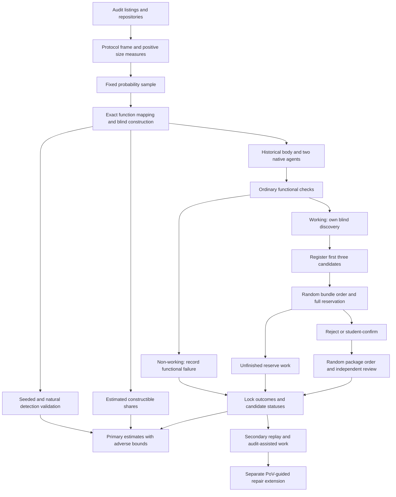

# AI Agent Function-Body Replacements in Audited Solidity: Executable Vulnerability Comparisons with Historical Developer Code

Proposal version 30 (author of this revision: Peer A, Loop 1 round 29; version 29 was written by Peer B in round 28).

## 1. Abstract

We compare AI-generated function replacements with historical developer implementations in audited Solidity contracts. A probability sample includes audit-flagged and unflagged functions. Each working implementation receives its own audit-blind discovery campaign. A counted vulnerability requires an executable attack, a correction confined to the target body, and independent adjudication. The principal comparison measures detected vulnerability among working implementations, standardized across the constructible population. Functional failure is reported separately. Adverse bounds retain unresolved outcomes. Confirmation and review follow a fixed procedure with bounded reserves. Simulations show that useful power depends strongly on confirmation time and candidate demand. Development determines a pre-collection reserve choice under explicit limits. A pre-specified margin states what a null result can rule out. The flagged-only comparison is descriptive. PoV-guided repair is a separate extension. The student has signed a dated commitment; the timed case is pending. Funding and final validation are required before collection.

## 2. Problem and motivation

Solidity developers already use AI tools. The Solidity Developer Survey 2025 reports that 58% of respondents use them daily and 49% use them to write code [Solidity Survey]. These are self-reports. They establish relevance, not security.

Contract failures can transfer funds or prevent legitimate operations. In a study of 516 exploitable smart-contract bugs, more than 80% were beyond the automated tools examined [Web3Bugs]. A separate study found substantial limitations in Solidity static analyzers [SAST Study]. These results motivate executable evidence of specific attacker effects.

Existing benchmarks answer useful but different questions. SecureVibeBench reconstructs tasks around historical vulnerabilities and applies executable checks to developer and agent implementations [SecureVibeBench]. SusVibes evaluates functional and security outcomes on reconstructed vulnerable tasks [SusVibes]. Foresight-SWE studies tasks associated with later-fixed general defects [Foresight-SWE].

Selecting functions because a developer previously failed cannot establish the average difference across other functions. Agents might avoid known mistakes while introducing different vulnerabilities elsewhere. A benchmark of historical failures may exaggerate the apparent advantage of replacement.

Unconditional comparisons are not new. Sajadi et al. compare human and agent patches for the same issues [Patch Security]. Cotroneo et al. compare human and AI functions paired by documentation [Cotroneo]. SolEval regenerates function bodies in real Solidity repositories [SolEval]. SolAgent compares generated and historical Solidity using static analysis [SolAgent].

The first paper proposes a population comparison using executable, function-attributed security evidence. It includes functions without qualifying audit findings. Its principal question concerns detected vulnerability among working implementations. It also describes how a flagged-only analysis changes the estimate.

This is an empirical contribution. Probability weighting and conditional-rate estimation are not claimed as new techniques. Its value depends on achieved precision, detection evidence and a reproducible account of failures.

A separate extension concerns repair. Incorrect tests can mislead agents [ImpossibleBench; ExecCritic; Calibration]. We ask whether executing assertions that endorse an exploitable behavior preserves that behavior despite contrary PoV evidence, beyond the effect of matched ordinary incorrect assertions.

Neither study estimates how much human review developers can safely remove.

## 3. Key insight and contributions

### Paper 1: separate detected security from functional failure

Audit labels define sampling strata. They are not security verdicts.

RQ1b is principal. For each agent configuration, it compares detected vulnerability among working agent and historical implementations. It standardizes stratum-specific differences using the function shares of the constructible domain.

This is not the probability that an agent introduces a flaw into a function that the developer implemented safely. Conditioning on working outputs does not create a causal comparison between equivalent sets of implementations.

The study reports working rates and the joint working-and-vulnerable endpoint beside the conditional comparison. An exact decomposition shows the contribution of functional failure.

In the strict counts, V functions are 54 of 3,674 eligible functions with observed fixes, or 1.5%. Including admissible recommendations gives 109 of 3,729, or 2.9%. RQ1b is therefore mostly a comparison on functions the audit did not flag.

The flagged-only comparison, formerly RQ1a, is descriptive.

The examined design cannot support a general conclusion that agents are safer. Simulated negative differences are small because historical detected rates are low, and worst-frame power is low.

A study without a directional result reports its upper confidence limit and a pre-specified test against +0.05. Broad uncertainty remains inconclusive.

### Committee decisions and operating assumptions

The iteration-4 committee approved RQ1b as principal, RQ1a as descriptive, and minimum correct-direction power of 0.60 at an exact +0.15 conditional difference, subject to its stated conditions.

This substantially reduces the former 0.80 requirement. In V42, an exact +0.15 difference corresponds to an agent detected N rate about 2.9 to 7.8 times the historical rate. Even a large excess may be missed.

Earlier RQ1a designs did not support their promised precision. V27’s earlier allocation of 20 protocols with two V and six N functions had a largest mean security-component half-width of 0.338. Its observed-fix-only scenario gave 0.422. Those runs used earlier counts and favorable completion assumptions. They do not rule out every alternative design.

Adverse bounds remain principal. The committee approved conditional readiness instead of development-based certification of rare unresolved rates. Three development protocols cannot certify those rates.

Construction yields also remain planning assumptions. Development reports them descriptively and applies a warning for gross failure.

V44 shows that reserve adequacy is a separate condition. Three tested workloads pass their corner checks. Three others fail power because confirmation demand exhausts the reserve. The full-grid result applies to the tested three-candidate workload with 0.5 hours per candidate. It is not a guarantee for arbitrary workloads with similar mean time.

V45 repeats V44 on the real frame of 187 protocols (sections 5.1 and 6.3). Error, coverage and reading checks still pass everywhere. The power region is smaller. When unresolved outcomes cluster by protocol, the corner (0.0075, 0.0075, 0.0075) no longer meets the power requirement.

Section 8 defines how development informs a reserve choice. Missing demand information does not receive a favorable fallback. The selected design must pass the full final-check matrix before launch.

### Count discoveries made under a common procedure

An audit gives historical code an extra source of known vulnerabilities. Replaying audit-derived attacks does not provide an equally strong search for different agent flaws.

The primary endpoint uses only flaws found through each implementation’s own campaign. Campaigns receive no audit report, finding list, audit-derived PoV or audit-derived correction.

Every known-working implementation receives the same frozen discovery procedure. Functional failures remain in the working-rate analysis. They do not enter primary security confirmation.

Common replay is secondary and cannot change locked primary labels. Pooling discovered attacks could otherwise favor flaws shared by many agent attempts.

This compares detected vulnerabilities under a stated procedure. It does not establish equal sensitivity or compare all latent vulnerabilities.

### Planned repair extension

The pilot motivates a hypothesis but does not establish it.

The two preregistered OpenHands contrasts were:

- adding the shown PoV, with a full terminal in both arms: 0 of 12 successes versus 2 of 12, with Holm-adjusted p = 0.96;
- allowing the shown PoV to be rerun: 10 of 12 versus 9 of 12, with Holm-adjusted p = 1.00.

The exploratory comparison between no execution and a full terminal was 10 of 12 versus 2 of 12. OpenHands succeeded in 9 of 12 runs with the shown-test tool. Codex succeeded in 6 of 12 with that tool and with a full terminal.

These results concern one finding. A person has not reviewed the repairs. The faulty-test hypothesis was formed after inspecting the pilot.

The extension compares wrong assertions endorsing a vulnerability with matched wrong assertions endorsing an ordinary error. It is not a claimed contribution of the protected twelve-month study.

## 4. Threat model and problem setting

### Historical replacement

Each task replaces one function body in a fixed audited snapshot. The historical implementation supplies the developer baseline.

Agents see mature surrounding code and repository tests. These may postdate the original function. The study does not recreate original development conditions or estimate the causal effect of replacing a human worker.

Historical code may contain AI assistance. Provenance is recorded rather than assumed.

### Attacker and environment

The attacker is an unprivileged external account. It may deploy contracts, call public interfaces and use borrowing or transaction ordering allowed by the protocol record.

It cannot steal keys, assume administrator privileges, change trusted oracle behavior outside the recorded assumptions or modify deployed code.

Each protocol record specifies protected assets, entitlements, capital, borrowing, reachable states, token and oracle behavior, transaction ordering, block assumptions and legitimate operating limits.

All execution is offline. Arbitrary storage changes cannot manufacture an otherwise unreachable vulnerable state.

### Severity

The study applies one rubric across audit platforms while retaining original audit labels.

High severity includes unauthorized loss of principal, insolvency and irreversible loss of access to protected assets. Medium severity includes theft of earned entitlements and attacker-induced loss of a core operation under the stated resource and recovery limits.

Ordinary implementation failure is not automatically a vulnerability. Availability findings require an attacker action and demonstrated harm to legitimate users.

Financial effects must reflect entitlement or backing. Profit alone is insufficient. Gas optimization, temporary inconvenience, privileged misuse and effects outside the threat model are excluded.

A frozen tie rule excludes borderline cases from the primary count and includes them in a secondary count. Exclusion does not establish harmlessness.

### Attribution and confirmation

A counted flaw requires:

- an executable qualifying violation;
- a connection to the target function;
- removal of the violation by changing only that body;
- preserved required functionality under the acceptance checks.

The correction preserves signatures, surrounding code, dependencies and initial-state procedures. It cannot disable the feature or hide loss through changed accounting.

New declarations outside the body are not permitted. Historical code can serve as a correction only after the same checks.

Two independent adjudicators assess severity and attribution. Packages conceal author and configuration where possible. Construction staff cannot adjudicate their own packages.

## 5. Approach

### 5.1 Frame and sampling unit

The downloaded data contain 19,627 distinct High and Medium findings. The earlier total of 19,666 was inconsistent with its batch totals. Complete source files were obtained for 7,826 findings. Earlier filtering left 77 recent candidates and 43 with suitable public history. These are screening counts, not a validated sample.

The inventory contains 313 Code4rena, Sherlock and Cantina records from 2024 and 2025 with a Solidity signal: 235 from 2024 and 78 from 2025.

The frame was built on 26 October 2026 (`evidence/frame_build/`). An audit enters it only if its findings link to a public GitHub repository that can be fetched without a login and whose linked version contains the audited Solidity code. 190 audits qualify: 87 Code4rena and 103 Sherlock audits, 146 from 2024 and 44 from 2025.

The other 123 audits are outside the frame:

- 106 have no linked repository. 103 of these are Cantina audits, mostly private reviews.
- 16 link only to repositories that need a login.
- One links to a repository whose linked branch holds only a README.

The population is therefore Code4rena and Sherlock audits with public linked code. Cantina private reviews are outside it, and the results do not extend to them. This replaces the earlier plan to include them and the earlier planning assumption of about 230 protocols.

The three development protocols were drawn from the 190 on 26 October 2026 and removed (section 8). The main frame has 187 protocols.

The earlier 70-audit list supplied the measured V and N pairs. Its processed audits are recent. Accessible 2024 audits may differ.

Public listings may permit audits without qualifying findings to enter. If the practical frame remains finding-derived, the population is explicitly restricted to represented audits.

The first-stage unit is a protocol audit and fixed snapshot. Multiple audits of the same project are identified before sampling. Overlapping snapshots cannot be treated as independent protocols without accounting for dependence.

The second-stage unit is a function body identified by repository, snapshot, full path, contract and signature.

Functions must contain meaningful computation or state changes, support reachability and allow body replacement without changing surrounding code.

Functions whose qualifying findings require changes outside the target body are excluded. Unresolved finding mappings are not silently assigned to N.

V contains eligible functions linked to qualifying High or Medium findings. N contains eligible functions without those links.

#### Automated size measures and exact sampled mapping

Scripts enumerate candidate eligible functions for every frame protocol. The resulting count is a size proxy, not a completed human N classification.

Every retained protocol has a positive size measure. A zero count uses one. Parse failures use a frozen, recorded fallback rather than silent exclusion.

A random 10% of protocols receives a human spot check of scope and enumeration.

In the built frame, scope comes from the Code4rena `scope.txt` file for 77 audits, from the README's scope section for 110 and from every Solidity file outside test, mock, script and library folders for 4. For the 20 frame audits that are also in the 25-audit hand count, the automated eligible count equals the hand count exactly. It is 3% to 40% larger than strict N (median 7%), with Spearman correlation 0.986.

Exact V and N lists are built for the three development protocols and 22 main protocols before their function draws. First-stage probabilities remain those actually used. Conditional function probabilities use the exact lists.

An imperfect size measure changes efficiency rather than design weights only when frame coverage, positive probabilities and recorded selection probabilities are preserved. Weighting does not repair omitted protocols.

#### Existing evidence

The 43 pilot findings have the following identified fix scopes:

| Scope | Findings | High confidence |
|---|---:|---:|
| One body | 17 | 14 |
| Several bodies | 2 | 2 |
| Signature, storage or another declaration | 15 | 14 |
| Undetermined | 9 | Not applicable |

Three judgment calls move the one-body count between 15 and 18. Panoptic contributes 9 of the 17. These classifications do not prove that no narrower correction exists.

The full inventory groups findings into 2,481 audits and could not map 61.0% of findings. Its modeled function counts remain historical planning evidence.

The random audit sample contains 352 High and Medium findings. Agent readers performed the classifications, followed by merge checks and a spot check. This was not human adjudication, and repository code was not run.

The strict recount supersedes earlier function counts:

| Strict count | Total | Mean per audit | Median | Audits with zero |
|---|---:|---:|---:|---:|
| V, observed fixes | 54 | 2.16 | 1 | 10 of 25 |
| V, including admissible recommendations | 109 | 4.36 | 4 | 1 of 25 |
| N | 3,620 | 144.8 | 92 | 0 of 25 |

N ranges from 24 to 672 per audit.

Recommendation-inclusive counts are not proven upper bounds. Recommendations can understate necessary changes, and unresolved findings may contain eligible functions. The simulation label “upper” means recommendation-inclusive.

Exact sampled mapping must settle the common severity rubric, close body-only calls, full identities and snapshot provenance before function sampling.

### 5.2 Allocation and construction

The main sample contains 22 distinct protocol audits, with up to one V and six N functions per audit. Small strata are censused.

Fixed-size first-stage inclusion probabilities are proportional to the positive size measure and capped at one. Randomized systematic sampling records the frame permutation, uniform start, probabilities and seed.

Functions are sampled uniformly without replacement within exact strata. Their inverse joint inclusion probabilities supply analysis weights.

Both primary agents receive two fresh attempts per constructed function.

Every function receives the same construction procedure and its own 2.25-hour allowance. Protocol preparation has a separate allowance.

Let \(B_i=1\) when the task passes the construction checklist within its allowance. Otherwise \(B_i=0\), with a reason. This precedes generation and applies to the whole function cohort.

The principal population is the constructible domain. Its stratum shares are estimated from weighted constructed counts.

Missing staff or another function’s delay cannot make a function unconstructible. Failure to supply the procedure is a deviation.

Sampled protocols are not replaced for being slow. Each constructed sampled V task enters scheduled audit-assisted work.

Development uses the same allocation and attempt count. It checks the procedure and resources, not a certified population yield.

### 5.3 Provenance and AI assistance

The study records introduction history, agent instruction files, AI co-author trailers and relevant pull-request text.

Categories are evidence of assistance, no observed evidence and unresolved provenance. An instruction file does not prove target-line generation. Absence of a marker does not establish human-only authorship.

All categories remain in the historical-developer comparison. A subset without observed assistance is secondary.

Code, fix and report dates are separate. A report published after a model cutoff does not prove that the code was unseen.

### 5.4 Audit-blind construction

Builders do not receive audit findings, fixes or the removed body. They receive permitted documentation, signatures, callers and surrounding code.

Each request sentence records its source. Requests and primary properties are frozen before agent runs.

The checklist requires a coherent request, legitimate behavior, reachable setup, ordinary checks, primary security properties and a threat-model record. It does not require discovering a flaw.

For an unfamiliar protocol, a second person maps functions and seals labels. The student constructs tasks, confirms own-campaign candidates and locks primary records after independent adjudication. Audit access follows locking.

For a protocol known to the student, the student prepares mappings and an unexposed funded person performs blind work. Missing eligible staff is a deviation.

The same rules apply to development and validation.

For 15 randomly selected sampled functions, two unexposed builders independently prepare requests. The designated primary construction determines \(B_i\). A duplicate cannot rescue primary construction failure.

Both evaluable requests receive generation and discovery. Added work uses at most \(15\times5\) campaigns. Effects on working status and defined security estimates are secondary.

An audit-informed request classification occurs only after locking and cannot change \(B_i\).

### 5.5 Functional and security checks

Ordinary checks establish intended operations and useful completion. Explicit security checks establish forbidden attacker effects.

Historical code is not assumed to pass. Original repository-test results remain visible.

If a blind-process correction removes a confirmed violation but fails an ordinary check, two author-blind adjudicators assess whether the check asserts the forbidden outcome. Any approved revision applies to every implementation of that function before locking.

Audit-assisted corrections cannot reopen the primary endpoint. Later revisions define a secondary suite.

An implementation that fails ordinary checks normally has known \(W=0\). Its primary security candidates are closed without confirmation. This is a deliberate restriction of the primary security procedure.

Candidate logs from those implementations may support a separately funded secondary assessment. They do not provide a measured primary vulnerability rate among non-working code.

A PoV outcome is a demonstrated violation, an executed check showing the violation absent, or unresolved. Setup failure is not absence of a violation.

### 5.6 Agent configurations

The primary configurations are Claude Code and Codex CLI with vendor-supported models current at the freeze.

Model identifiers, versions, reasoning settings, prompts, permissions and budgets are pinned. Both run on the complete constructed sample.

Every attempt starts from a fresh workspace. Only the submitted target body enters evaluation. Changes to tests, dependencies or unrelated code cannot alter the artifact.

History, fixes, cached bodies and revealing generated artifacts are removed. Network access is restricted to model APIs.

Pilot configurations and SolAgent adaptations remain separately funded extensions.

### 5.7 Primary discovery and confirmation state machine

Working implementations receive Foundry property-based fuzzing and the same two LLM reviewers. Reviewer identities, versions and candidate ordering are frozen.

Reviewers see permitted context and the request, without author labels or audit material. They cannot access other implementations’ reports.

A secondary analysis filters results to fuzzing and the other-family reviewer without rerunning campaigns.

The following procedure applies equally to historical code and both configurations.

#### Registration

1. Record functional status before primary confirmation.
2. Known non-working implementations retain \((W,D)=(0,0)\). Their candidate records are closed without confirmation.
3. For each known-working implementation, register its first three candidates in frozen order. Candidates beyond the limit are recorded separately.
4. No candidate is invented when the campaign returns none.
5. Register all bundles of a source before drawing that source’s confirmation order.

Unknown functional status remains unresolved. It is not converted to working or non-working merely to enter the confirmation queue.

#### Confirmation reservation and processing

1. Draw a seeded random order of nonempty implementation bundles.
2. Admit the next bundle only if the reserve holds 1.0 student hour for each registered candidate in it.
3. If it cannot be admitted, stop. Every candidate in that bundle and every later bundle is “unfinished: reserve.” Do not skip to a smaller bundle.
4. Process candidates in their frozen order.
5. A completed failed confirmation is “rejected,” with its failed criterion recorded.
6. A candidate whose PoV executes and whose body-only correction blocks the violation is “student-confirmed.” This is provisional, not the final positive label.
7. Stop that bundle at its first student-confirmed candidate. Later candidates are “not needed” under this procedure.
8. Return reserved but unused time to the same source reserve at bundle end. This permits later bundles to start; it never enlarges any candidate’s allowance.

Campaign operation has a 0.15-hour student cap per scheduled implementation. Confirmation has a 1.0-hour cap per candidate, including evidence, correction and packaging.

A confirmation that cannot reach a valid decision within its allowance is unfinished. It is not a rejection.

#### Independent review

Student-confirmed packages enter a separately seeded random review order.

Each package reserves 0.5 hours from each adjudicator. Packages beyond the review reservation are “unfinished: review.”

A package is finally confirmed only when both adjudicators complete positive decisions. Completed substantive rejection or disagreement produces “not confirmed.” Inability to judge, missing evidence or an unfinished review remains unresolved.

The confirmation queue is not reopened after a completed review rejects the student’s package. Later candidates remain “not needed.” This makes the procedure reproducible and keeps review from selectively extending discovery.

V44 simplifies this branch by assuming that the student submits only true flaws and completed reviews confirm them. Real rejections remain recorded. Evidence that this assumption materially changes demand requires an added simulation before launch.

#### Final implementation outcome

- A finally confirmed package establishes a positive outcome.
- If no package is confirmed and a required assessment remains unfinished, security is unresolved.
- Otherwise the completed prescribed campaign is not confirmed.

Known W is retained. “Not needed” is a terminal procedural status, not evidence that a candidate is false.

No confirmation-selection weight is added. Every scheduled implementation remains in the analysis.

Source reserves are fixed before that source begins. Unused reservations cannot be transferred between sources according to findings.

### 5.8 Secondary replay and audit rediscovery

Validated own-campaign PoVs are replayed after primary locking. Attribution is checked separately.

Audit-assisted work covers the constructed V task in each selected protocol. It cannot alter primary labels.

The report separates own discoveries, pooled discoveries, audit-assisted outcomes and their estimated increment.

For additional selection probability \(q_i\),

\[
\widehat T_{\mathrm{increment}}
=\sum_{i\in S_V}a_iB_i\frac{A_i}{q_i}
(Y_i^{\mathrm{audit}}-Y_i^{\mathrm{primary}}).
\]

Here \(q_i=1\) for constructed sampled V tasks.

Conditional rates estimate numerator and working denominator separately. Unresolved outcomes retain bounds.

Rediscovery is a weighted ratio among audit flaws satisfying the same confirmation standard. Numerical secondary inference requires validation of the secondary estimator.

### 5.9 Detection validation

#### Matched seeds

A separate builder inserts matched vulnerability patterns into historical and agent implementations. Patterns come from other protocols.

Seeds must compile, preserve unrelated behavior and produce an attributable violation. Invalid seeds remain recorded.

The initial plan contains 60 pairs, or 120 seeded artifacts, with 15 pairs per stratum and configuration combination. The catalogue contains at least 20 patterns, used in no more than three pairs each.

Seeded artifacts and unseeded controls receive blind discovery. Locations and attacks remain sealed until locking. They do not enter natural vulnerability estimates.

The planning half-width expression is

\[
1.96\sqrt{\frac{\operatorname{deff}(\delta-d^2)}{n}}.
\]

At \(d=0.1\), design effect 1.5 and 60 pairs, it gives 0.135 to 0.194. With design effect 3.1, it gives 0.194 to 0.278.

These are assumptions, not evidence of equal recall within 0.05.

Section 8 may reduce the allocation to 45 pairs before validation collection. Allocation then differs by at most one pair between the four cells, with the extra cell selected by a recorded random permutation.

Precision for 45 pairs is **[pending]**. The 60-pair numbers cannot be reused. Final uncertainty reflects valid pairs and protocol and pattern dependence.

#### Natural investigation

The maximum remains 48 first assessments and 12 duplicates, each with two hours, within 120 auditor hours.

The original 12 cells are defined by author, stratum and campaign category, with up to three assessments each. Six additional cells contain campaigns with cut or unfinished candidate lists, with up to two extended assessments each.

Smaller cells are censused. Unused slots are not transferred after outcomes. Selection probabilities support weighted sensitivity estimates.

Non-confirmed cells include completed negatives and unresolved cases. Where both exist, one of each is selected before remaining uniform draws.

Up to 12 randomly selected cases receive a second assessment. Auditors receive permitted context and the harness without campaign reports or author labels where possible.

This is a bounded reference assessment, not proof of absence.

#### Audit-missed flaws

A separate set targets 10 to 20 later-discovered flaws demonstrably present in earlier audited code. Later-introduced flaws do not qualify.

Availability remains unknown. Fewer than 10 cases leave historical N sensitivity at its full feasible range unless another explicit assumption is examined.

#### Discovery gate

Eight qualifying flaws are assessed, with five confirmed rediscoveries required. One revision is permitted, followed by eight fresh flaws with six required.

Blind candidate lists are locked before matching against the sealed target. At most one target package per gate flaw enters confirmation. Matching cannot supply audit information to the blind confirmer.

A match alone does not count. Execution and both adjudications must succeed within the main allowances.

Both assessments reserve 16 packages and 18.4 student hours for operation and confirmation.

| Assumed recall | First assessment | Revision assessment | Overall pass probability |
|---|---:|---:|---:|
| 0.3 | 0.058 | 0.011 | 0.069 |
| 0.5 | 0.363 | 0.145 | 0.455 |
| 0.7 | 0.806 | 0.552 | 0.913 |

These are independent-binomial planning calculations, not guarantees for clustered findings or adaptive revision.

The eight built pilot tasks that shaped prompts are excluded.

#### Existing blind rediscovery evidence

Fresh Claude and Codex reviewers assessed 17 pilot findings without audit text. A blinded judge matched their lists to sealed keys.

| Reviewer | All cases | Excluding three weak keys |
|---|---|---|
| Claude | 17 of 17 | 14 of 14 |
| Codex | 13 of 17 | 13 of 14 |

Reported Wilson intervals are 0.82 to 1.00 and 0.53 to 0.90 overall, and 0.78 to 1.00 and 0.69 to 0.99 after exclusions. They assume independent trials.

Weak keys 64083, 64693 and 65044 concern an owner attacker, no demonstrated outside attacker, or informational severity.

Candidate matching is not executable confirmation. Training exposure remains possible.

### 5.10 Repair extension

A shown PoV supplies executable evidence for a validated vulnerable implementation. Hidden attacks use different states, boundaries or call sequences.

Repair success requires compilation, legitimate behavior, blocked frozen attacks and no confirmed new attributable flaw under the declared procedure. Required unresolved checks prevent success.

Passing the shown attack alone is insufficient.

### 5.11 Worked example: finding 63008

The Sorella L2 Angstrom pilot concerns a downward tick iterator that skips a starting boundary.

Version 2 of the evidence package contains violation tests, fixed-state assertions, a body-only patch, an independent H-02 patch and an outcome-checking runner.

The patch adds `self.currentTick = startTick + 1` after the empty-range early return in `reset(TickIteratorDown)`.

| Code state | Violation tests | Fixed-state tests | Original suite |
|---|---|---|---|
| Vulnerable `386baff` | Both observe violation | Both fail | 60 pass |
| Version-2 correction | Both show violation absent | Both pass | 56 pass, 4 fail |
| H-02 correction only | Both observe violation | Both fail | 60 pass |
| Both corrections | Both show violation absent | Both pass | 56 pass, 4 fail |

The four remaining failures assert the old boundary behavior. Empty-range tests pass in every state. The runner matched all 12 expected outcomes.

On vulnerable code, the honest provider is owed about 49 ether and the attacker receives 48.99999755 ether. Remaining backing is about 0.0245 ether against about 49.0245 ether owed. Claims and withdrawal revert.

With the correction, the honest provider receives 49.000012243878672857 ether and withdraws principal. The attacker receives 0.024487756121327142 ether, its calculated share of its own swap tax.

H-02 correction `cd0ac3c` alone leaves the attack unchanged.

The attacker’s capital ceilings are 100 ether and \(10^9\) tokens. The scenario assumes the attacker wins the relevant top-of-block swap. It does not simulate a competitive auction.

The original capital run records net profit 48.877274256875928055 ether. Version 2 reruns reward and withdrawal assertions, not that separate profit test.

Automated version-2 work took 598 seconds. This is not human construction or adjudication time.

The repository contained a `CLAUDE.md` before the faulty commit. The baseline is historical developer code.

The pilot’s two added control flaws failed functional tests. Under the revised primary procedure they contribute functional failures, not measured conditional security outcomes.

## 6. Research questions and evaluation plan

### 6.1 Questions

**RQ1b:** How do agents and historical developers differ in detected vulnerability among working implementations, standardized across constructible strata?

A secondary comparison uses functions where the historical body works and at least one attempt of the configuration works. It reports retained counts by stratum and configuration.

The flagged-only result is descriptive, with sample sizes and identification bounds.

**RQ4:** How does discovery vary across authors, strata and known flaw patterns, and how do missed flaws affect interpretation?

**RQ2, extension:** Does executing wrong assertions affect vulnerability retention differently from retention of a matched ordinary error?

**RQ3, optional extension:** How does request wording affect vulnerability reproduction?

### 6.2 Outcomes and terminal states

Let C indicate compilation, L passing ordinary checks, and \(V_{\mathrm{own}}\) final own-campaign confirmation.

\[
W=CL,\qquad D=WV_{\mathrm{own}}.
\]

Every scheduled attempt on a built task remains recorded.

The primary procedure does not estimate vulnerability among known non-working code. The earlier K outcome is retained only where separately assessed; unassessed cases are not reported as secure.

Within stratum s,

\[
d^D_s
=w_{As}v_{As}-w_{Hs}v_{Hs}
=(v_{As}-v_{Hs})+(w_{As}-1)v_{As}+(1-w_{Hs})v_{Hs}.
\]

This is descriptive. Working sets can differ across authors.

Admissible pairs include:

- known failure: \((0,0)\);
- working and confirmed: \((1,1)\);
- working with a completed non-confirmed campaign: \((1,0)\);
- working with unfinished security assessment: \((1,0)\) or \((1,1)\);
- unknown functionality: all pairs consistent with the observed checks.

Reserve exhaustion alone never changes known W.

| Candidate or package state | Meaning | Implementation consequence |
|---|---|---|
| Closed: non-working | Functional failure established before confirmation | W = 0 and D = 0 |
| Rejected | Student completed a negative confirmation assessment | No positive from this candidate |
| Student-confirmed | Executed PoV and body-only correction completed | Await independent review |
| Not needed | Later candidate after the first student-confirmed candidate | Closed under the fixed procedure |
| Unfinished: confirmation | Candidate assessment could not finish within its cap | Unresolved unless another final positive exists |
| Unfinished: reserve | Bundle could not receive its full reservation | Unresolved unless a positive is already established |
| Unfinished: review | Required review could not finish or be reserved | Unresolved |
| Review confirmed | Both adjudicators completed positive decisions | Positive |
| Review rejected or completed disagreement | Confirmation standard not met after complete assessments | Not confirmed; secondary disagreement bound applies |

An adjudicator’s inability to judge is unfinished review, not rejection. The bundle is not reopened after a completed review rejection.

Other unresolved sources include invalid environment execution and audit contamination. One environment rerun is permitted within the operation allowance. A breach before primary locking remains unresolved in the primary analysis.

If an author-stratum has no working or unresolved implementation, its conditional rate receives the admissible range [0,1]. A stratum with no built function contributes zero through its estimated zero share.

### 6.3 Estimation, simulation and readiness

#### Estimator

Let \(U_B=\{i:B_i=1\}\) be the constructible domain after development protocols are removed.

With inverse joint sampling weight \(a_i\),

\[
\widehat T_{sB}=\sum_{i\in S_s}a_iB_i,\qquad
\widehat\pi_{sB}=
\frac{\widehat T_{sB}}{\widehat T_{VB}+\widehat T_{NB}},
\]

\[
\widehat w_{as}=
\frac{\sum_i a_iB_i\overline W_{ai}}{\widehat T_{sB}},
\qquad
\widehat v_{as}=
\frac{\sum_i a_iB_i\overline D_{ai}}
{\sum_i a_iB_i\overline W_{ai}},
\]

\[
\widehat\Delta^S_{Bc}
=\sum_s\widehat\pi_{sB}
(\widehat v_{A_cs}-\widehat v_{Hs}).
\]

Agent observations are averaged within function. Historical code supplies one observation.

The companion difference is

\[
\widehat\Delta^D_{Bc}
=\sum_s\widehat\pi_{sB}
(\widehat w_{A_cs}\widehat v_{A_cs}
-\widehat w_{Hs}\widehat v_{Hs}).
\]

Bounds minimize and maximize these quantities over admissible completions. All totals, shares and ratios are recomputed in uncertainty replicates.

The same-function secondary estimate uses inverse inclusion weights and working agent attempts within each retained function. Unknown outcomes or membership retain bounds. It has no validated confidence interval or power requirement.

#### Decisions and intervals

A positive claim uses the lower identification bound. A negative claim uses the upper bound. Holm adjusts the two configurations at 0.03.

The jackknife deletes every sampled protocol, including certainty protocols. This is a tested procedure, not a generally conservative theorem.

The interval is

\[
[
\widehat L-1.175\,t_{0.975,P-1}\widehat{\mathrm{se}}(\widehat L)-z_H,\quad
\widehat U+1.175\,t_{0.975,P-1}\widehat{\mathrm{se}}(\widehat U)+z_A
].
\]

For an author-stratum with no detected flaw and n resolved working implementations, the widening term adds its estimated share times

\[
1-0.025^{1/n}.
\]

A rate already bounded by [0,1] needs no extra widening. This is a binomial-based adjustment, supported by simulation rather than an exact clustered-data result.

Undefined intervals receive no directional claim and count as coverage failures.

Targets are marginal coverage at least 0.95 and directional family-wise error at most 0.05.

#### Reading the upper limit

The margin is +0.05. It is a judgment of a material excess, not a deployment-safety threshold.

For each configuration,

\[
p_c=F_{t,P-1}
\left(
\frac{\widehat U_c+z_{A_c}-0.05}
{\widehat{\mathrm{se}}(\widehat U_c)}
\right).
\]

Holm at 0.01 adjusts the two claims that a difference is below the margin.

V42’s earlier full-grid reading-error bound was at most 0.0320. At the exact null, its lowest marginal configuration claim frequencies ranged from 0.086 to 0.103 across frame groups. Median-frame values ranged from 0.218 to 0.234.

These are marginal frequencies, not the probability of both claims together. They precede the final workload choice. A null result remains non-equivalence.

#### V44: state machine and workload assumptions

V44 retains the V42 frame generator and estimator. It uses 60 simulated frames of 230 protocols, removes three development protocols, and samples 22 main protocols.

The three frame groups cover the base setting, working status linked to difficulty with historical failures, and low V construction yield.

Only working implementations register candidate bundles. Reserve-related masks therefore affect known-working outcomes. The separate implementation-level mechanisms represent genuinely unknown working status.

For a working implementation with a detected flaw, the model supplies one or three candidates with one confirming candidate at a uniform position.

For a working implementation without a detected flaw, rejected candidates follow

\[
\operatorname{Binomial}\left(3,\frac{3/13}{3}\right).
\]

This distribution is fixed before each simulated study. It is not recalibrated using realized positives.

The 3/13 input is a planning mean for rejected candidates in this conditional group. It is not a measured conditional rate, nor the overall candidate rate after positive bundles are added.

Three time modes are tested:

- 0.5 hours for every processed candidate;
- 1.0 hour for every processed candidate;
- 1.0 hour for the confirming candidate and 0.5 for rejected candidates.

The main reserve is 177.7 confirmation hours and 178 review packages. Development uses 24.2 hours and 25 packages.

V44 assumes student-confirmed packages concern true flaws and completed reviews confirm them. Adjudicator inability is represented by the package mechanism. It does not establish robustness to arbitrary false submissions or review disagreement.

The state machine in section 5.7 governs the actual study, including completed review rejection. If development shows material workload from that branch, it enters the final simulation rather than being ignored.

#### Verified V44 results

All six workloads are checked at the retained region corners over all ten conditions. These checks use 4,000 studies per frame and condition.

The per-workload Bonferroni counts are 1,800 directional-error checks, 12,000 coverage checks, 1,200 power checks and 4,200 reading-error checks.

| Positive bundle and time mode | Confirmation exhaustion at +0.15 | Corner power requirement |
|---|---:|---|
| One candidate, 0.5 hours | 0.000 | Passes |
| One candidate, 1.0 hour | 0.392 | Fails |
| One candidate, adverse time | 0.030 | Passes |
| Three candidates, 0.5 hours | 0.037 | Passes |
| Three candidates, 1.0 hour | 0.962 | Fails |
| Three candidates, adverse time | 0.419 | Fails |

Exhaustion frequencies are pooled across frames. Passing is based on worst retained checks, not pooled power.

The three-candidate, 0.5-hour workload also receives the full V42 grids: 76 ordered implementation-rate vectors under four mechanisms and 64 package-rate vectors.

| Mechanism | Worst error upper bound | Worst coverage lower bound | Worst reading-error upper bound |
|---|---:|---:|---:|
| Independent | 0.0436 | 0.9515 | 0.0357 |
| Task | 0.0436 | 0.9515 | 0.0357 |
| Protocol | 0.0436 | 0.9515 | 0.0357 |
| Difficulty | 0.0436 | 0.9515 | 0.0357 |
| Package | 0.0435 | 0.9516 | 0.0356 |

The worst undefined share is zero in these runs.

On frames of 230, the full-grid result retains the implementation-rate region with maximal vectors

\[
(0.0075,0.0075,0.0075),\qquad
(0.013,0.013,0.005),
\]

ordered as configuration 1, configuration 2 and historical code.

The package-model region has maximal vector

\[
(0.05,0.05,0.2).
\]

These are mechanism-specific regions. They are not a validated joint region for all simultaneous causes.

The other five workloads have corner checks, not full-grid validation. A workload chosen at launch must receive full-grid checks. The tested 0.5-hour scenario is not proved to dominate every workload with lower average demand.

The initial 2,000-study run is retained in the record. Its wider Monte Carlo bounds did not certify all requirements. The 4,000-study run supplies the reported results.

#### Demand evidence

The demand script processes all registered bundles without applying a reserve. It pools 400 studies per frame and target across all 60 frames.

| Workload | Pooled 95th percentile at the null | Pooled 95th percentile at +0.15 |
|---|---:|---:|
| One candidate, 0.5 hours | 90 hours | 111 hours |
| One candidate, 1.0 hour | 180 hours | 222 hours |
| One candidate, adverse time | 124 hours | 172 hours |
| Three candidates, 0.5 hours | 124 hours | 173 hours |
| Three candidates, 1.0 hour | 248 hours | 346 hours |
| Three candidates, adverse time | 158 hours | 234 hours |

These pooled percentiles cannot select the launch reserve. Section 8 uses the largest frame-specific percentile across retained profiles.

Total consumed hours also do not determine exhaustion exactly. Admission requires the next bundle’s full reservation. The final state-machine simulation remains necessary.

#### V45: the real frame

V45 repeats V44 unchanged on the built frame (`tools/power_sim_v45.py`, `tools/power_results_v45.txt`). The frame has 187 protocols: the 190 counted audits less the three development protocols. Main inclusion probabilities use the automated eligible counts, as the design does. One protocol, with 1,020 eligible functions, is selected with certainty. The largest other inclusion probability is 0.692.

True strict counts are unknown for most frame protocols. For the 20 protocols in the hand count, V45 uses their hand strict N and strict V. For each other protocol, every simulated frame borrows the linked-function share and V share of a randomly chosen hand-counted audit. So the size measure differs from strict N, as it will in the study. These borrowed counts are simulation inputs, not estimates. In the two frames the results file describes, the V share is 1.7% with observed fixes and 3.5% with recommendations.

The checks use 4,000 studies per frame and condition, the same 60 frame settings and the same Bonferroni counts as V44.

| Check | V44, frames of 230 | V45, real frame |
|---|---:|---:|
| Worst directional-error upper bound, full grids | 0.0436 | 0.0466 |
| Worst coverage lower bound, full grids | 0.9515 | 0.9551 |
| Worst reading-error upper bound, full grids | 0.0357 | 0.0351 |
| Undefined estimates | None | None |
| Lowest +0.15 power with no unresolved outcome (lower bound) | 0.744 (0.716) | 0.732 (0.703) |
| Protocol mechanism at (0.0075, 0.0075, 0.0075): lowest +0.15 power (lower bound) | 0.635 (0.605) | 0.622 (0.592) |

The workload pattern is unchanged. The three workloads that failed in V44 fail again: confirmation runs out at +0.15 in 0.373, 0.953 and 0.400 of studies. In the other three, every corner passes except one.

That corner is the protocol mechanism at (0.0075, 0.0075, 0.0075). Its power lower bound is 0.592, below the 0.60 requirement. The lowest frames are the hardest setting: higher historical recall, historical N rate 0.10, construction link 0.6 and yield 0.7. In V44 the same corner passed narrowly.

The full grids for the three-candidate, 0.5-hour workload give these regions on the real frame:

| Mechanism | Maximal passing vectors |
|---|---|
| Independent | (0.013, 0.013, 0.0075) |
| Task | (0.0075, 0.013, 0.0075); (0.013, 0.005, 0.0075); (0.013, 0.013, 0.005) |
| Protocol | (0, 0, 0.0075); (0.013, 0.013, 0.005) |
| Difficulty | (0.013, 0.013, 0.0075) |
| Package | (0.05, 0.05, 0.2) |

The common implementation region therefore has maximal vectors (0, 0, 0.0075) and (0.013, 0.013, 0.005). Under the protocol mechanism, a historical unresolved rate of 0.0075 now meets the power requirement only if neither agent configuration has unresolved outcomes. The package region is unchanged.

We adopt the smaller region and do not change the design to recover the lost corner. The region is an operating assumption, and three development protocols cannot certify rare unresolved rates (section 3). The final check on the frozen frame decides the region for launch.

Demand on the real frame is close to V44. The pooled 95th percentiles at +0.15 are 109, 217, 168, 169, 338 and 230 hours for the six workloads in the order of the demand table above. Each is within 8 hours of V44.

The largest frame-specific 95th percentile at +0.15 is 386 hours. It comes from three-candidate bundles at 1.0 hour per candidate. The largest reserve the funding sequence can reach is about 256 hours: 177.7, plus about 46 from seeds, plus 32 from month 10. So if development leaves the planning limits at their maxima, the demand rule returns the design to review.

#### Observable package warning

Each candidate receives a recorded terminal status.

For each author, the denominator n contains assessed records: rejected, student-confirmed or unfinished. It excludes “not needed” and candidates closed because the implementation is non-working.

The numerator x contains unfinished confirmation records, unreviewed packages and assessments invalidated by a documented unresolved execution or interpretation failure.

A completed final confirmation is not erased because a different record is unfinished.

Define

\[
d=
\begin{cases}
0,&x=0,\\
\operatorname{Beta}^{-1}(0.05;x,n-x+1),&x>0.
\end{cases}
\]

The warning fires if either configuration exceeds 0.05 or historical code exceeds 0.2.

If an author has no assessed record, the warning is unassessable. Record this without automatically stopping launch. Missing demand information instead receives section 8’s conservative defaults.

A firing development warning returns the procedure to review. No case is added to obtain a better result.

This is a diagnostic, not an exact population confidence limit. Clustering, selection and shared reserves matter.

V44 counts empty development samples as unassessable. Its pooled unassessability is 0.013 or 0.014 across the displayed workloads. Warning behavior varies sharply with workload. It must not be summarized as universal sensitivity.

#### Full validation before launch

The final check uses the frozen frame, recorded size measures, exact weighting rules, selected confirmation and review reserves, and all retained demand profiles.

It includes both strict-count planning interpretations where relevant, all recall and construction settings, linked working status, low V yield, and a protocol-effect standard deviation of 0.9 beside the earlier setting.

| Criterion | Scope | Rule |
|---|---|---|
| Directional error | Global null and both ordered partial nulls; every retained profile and full mechanism grid | Every upper bound at most 0.05 |
| Coverage | Both configurations, all ten conditions, full grids and profiles | Every lower bound at least 0.95 |
| Power | Exact +0.15, both configurations, tested inside-region vectors | Every lower bound at least 0.60 |
| Margin-reading error | Every condition where either contrast is at or above +0.05, including both ordered partial-margin conditions | Every upper bound at most 0.05 |
| Undefined estimates | Every condition | Report all; undefined intervals fail coverage |
| Warning | Main and development samples with candidate-level statuses | Report firing and unassessability separately |

The ten conditions are the global null, both +0.10 partial nulls, equal +0.025, equal +0.05, both ordered partial-margin conditions, equal +0.10, equal +0.15 and the feasible negative target.

Initial validation uses Holm 0.03, multiplier 1.175, reading Holm 0.01 and 4,000 fresh studies per frame and condition.

Bonferroni counts are recomputed from actual checks within each mechanism and criterion family. Every retained workload profile enters the counts. Outside-region error and coverage cannot be discarded.

If necessary, separate calibration uses 2,000 studies. It selects the largest directional Holm level passing every error check and the smallest multiplier passing every coverage check. Any changed reading level receives its full error-domain calibration.

The selected procedure is frozen and checked on another 4,000 fresh studies. Failure returns the design to review. No failed candidate is restored after seeing main-study outcomes.

The frame is now built. V45 is the first check on it, but it borrows strict counts for unsampled protocols. It does not replace this final check.

Final numerical results remain **[pending]**.

### 6.4 Descriptive flagged-only comparison

\[
G^S_c=d^S_{Vc}-\Delta^S_{Bc}
=(1-\pi_{VB})(d^S_{Vc}-d^S_{Nc}).
\]

The report gives this estimate, identification bounds and sampled, constructed and working counts. It makes no inferential directional claim.

Historical V35 and V37 results used an uncalibrated multiplier for this estimand:

| Run | Lowest coverage | Largest mean half-width |
|---|---|---:|
| V35 | 0.933 to 0.947 | 0.710 |
| V37 | 0.940 to 0.945 | 0.711 |

These are not current validated precision. Later inference would require separate pre-collection calibration.

### 6.5 Detection sensitivity

With detected rate \(r_{as}\), assumed sensitivity \(\rho_{as}\), and negligible false confirmations,

\[
v^{\mathrm{latent}}_{as}=r_{as}/\rho_{as},
\]

restricted to feasible values.

\[
\Delta^{S,\mathrm{latent}}_{Bc}
=\sum_s\pi_{sB}
\left(\frac{r_{A_cs}}{\rho_{A_cs}}-\frac{r_{Hs}}{\rho_{Hs}}\right).
\]

For positive detected rates, the sign-reversal boundary is \(\rho_A/\rho_H=r_A/r_H\).

Seeds, audit rediscovery, later-discovered flaws and natural investigation concern different populations. Transfer is an assumption.

The primary display retains full feasible ranges. Restricted ranges state assumptions. If plausible ranges reverse the comparison, its latent sign is not identified.

Challenges to positives trigger consistent re-adjudication.

### 6.6 Repair experiment

The extension has separate resources, sample and preregistration.

It varies correct versus incorrect assertions, repository-test execution permission, and security versus matched ordinary assertions.

Execution arms receive identical source, contrary evidence and read, search, edit and fixed-build tools. Only one receives the repository-test tool. There is no unrestricted terminal.

Security arms receive the same shown PoV and rerun tool. Ordinary arms receive a matched failing specification check. Hidden evaluation remains inaccessible.

The common outcome is retention of the endorsed behavior. Security retention is also reported separately.

With \(I_k\) the interaction of wrong assertions and execution for type k,

\[
\theta=I_{\mathrm{security}}-I_{\mathrm{ordinary}}.
\]

Equal interactions define a modeling null, not a theorem about agents.

V14 uses 20 protocols, three attempts per cell and 1,000 studies per row. Equal-interaction rejection rates are 0.040 to 0.067. At 160 functions, displayed alternative rates are 0.529 to 0.812.

A confirmatory extension must align estimator and estimand and validate heterogeneous baselines. The 160-function allocation remains a candidate.

### 6.7 Other extensions

Natural faulty tests require semantic confirmation. Passing on vulnerable code and failing on a correction is only a screen.

A census requires separate resources. Natural cases do not enlarge the injected experiment statistically.

Broader requests, pilot agents, SolAgent and multi-function replacement remain separately funded extensions.

### 6.8 Threats to validity

Historical snapshots do not reproduce original development. Assistance provenance and training exposure are incomplete.

Post-cutoff subsets are reported where available. Distinctive reproduction of bodies, fixes and reviewer text is flagged. The planned normalized-token threshold is 0.9, frozen after development. Exclusion analyses remain secondary.

Equal discovery does not establish equal sensitivity. Working outputs differ in composition. Closing non-working candidates narrows the security question.

Accessible audits and public fixes restrict the population. Construction limits select a domain that may depend on difficulty.

V44 assumes specified candidate counts, costs, ordering and accurate student submissions. Actual mixtures may differ. Full-grid validity is presently established for one workload, with corner evidence for five others.

Development planning limits are not simultaneous population confidence bounds. Sparse positives and censored work can force conservative defaults and prevent launch.

The warnings cannot certify operating conditions. Passing tests and absence of confirmed flaws do not establish deployment safety.

## 7. Related work

The contribution is a probability-defined historical comparison in Solidity, supported by executable attribution and explicit detection limits.

SolEval supplies a close function-body generation setup but uses Slither for security measurement [SolEval]. Sajadi et al. and Cotroneo et al. compare human and generated code without selecting only historical failures [Patch Security; Cotroneo].

Mahmud et al. compare human and AI code on competitive-programming tasks using runtime verification [Illusion of Safety]. This proposal instead uses agents, audited repositories, attacker effects, probability sampling and body attribution.

SolBehave evaluates behavioral equivalence through differential fuzzing and replay [SolBehave]. Behavioral equivalence differs from executable attacker violations.

SecureVibeBench provides reconstructed tasks and common PoVs [SecureVibeBench]. EVMbench supplies executable Solidity evaluation [EVMbench]. PoCo’s audit-derived exploit construction remains secondary here [PoCo].

| Work | Closest overlap | Difference addressed here |
|---|---|---|
| SolEval | Solidity body generation | Historical comparison with executable attribution |
| Illusion of Safety | Human and AI code with runtime verification | Agents, repositories, attacker outcomes and sampling |
| SolBehave | Generated and original Solidity behavior | Security rather than equivalence |
| Cotroneo et al. | Paired human and generated functions | Probability sampling and attacks |
| Sajadi et al. | Patches for common issues | Flagged and unflagged body replacement |
| SolAgent | Solidity generation and historical comparison | Executable outcomes rather than static warnings |
| SecureVibeBench | Historical flaws and common PoVs | Unflagged sampling and own-campaign labels |
| SusVibes | Functional and security outcomes | A domain beyond historical failures |
| Foresight-SWE | Historical defect tasks | Security attribution and unflagged functions |
| EVMbench | Detection, patching and exploitation | Historical replacement and population comparison |
| PoCo | Audit-derived exploit generation | Secondary evaluation |
| P2Patch and PatchBench | Exploit-guided repair | Matched faulty-assertion experiment |
| Fault-Enforcing Tests | Tests preserving faults | Matched experimental contrast |
| ImpossibleBench | Conflicting tests and execution | Matched endorsed behaviors |
| SpecGuard | Corrupted tests removing defenses | Separately calibrated contrast |
| ExecCritic | Incorrect tests and validation | Repository assertions during repair |
| Calibration, Not Compilation | Harmful test feedback | Executable attacker outcomes |

Sampling bias itself is not novel. The principal comparison must be judged with its limited power.

Fault-enforcing tests are an existing construct [Fault-Enforcing Tests]. The repair extension must establish its matched contrast rather than rely on Solidity alone.

Foresight-SWE is under review. Claims remain limited to its verified abstract.

## 8. Feasibility, demand selection and fallback plans

### Student evidence

Automated timings include 1,373 seconds for the original 63008 package, 598 seconds for version 2 and 864 seconds for classifying 43 pilot fixes.

These are not human measurements.

The student signed a dated commitment on 26 October 2026 (`dev_case/commitment.md`). It gives 37.5 research hours a week with no coursework or teaching. Timed case 1 is planned from 30 October to 13 November 2026.

The three development protocols were drawn on 26 October 2026 with seed 20261026, which was fixed before the frame was built. In draw order they are The Wildcat Protocol (Code4rena 2024), Perennial V2 Update #3 (Sherlock 2024) and Fenix Finance (Code4rena 2024). None is a pilot protocol. Case 1, the timed case, is The Wildcat Protocol.

Several items are still open. The student's exposure record for the three protocols is blank. The commitment names no second person and no adjudicators, and funding is not yet secured. Case 1 cannot reach review without two adjudicators.

The complete timed case remains unsupplied. The committee requires it before acceptance. Scheduling it is not a substitute.

The case must use probability-selected functions, valid roles and the stated caps. It must include confirmation and both adjudications.

If no natural candidate arises, another person inserts a separately budgeted seed while keeping the student blind. It is not counted twice in later validation.

### Preparation budget

Automated enumeration supplies first-stage size measures.

A random 10% receives a 0.5-hour paid spot check. With 190 protocols, 19 checks require 9.5 hours.

Exact mapping of the 25 sampled protocols requires 50 to 100 hours at 2 to 4 hours each.

Preparation has a 112-hour ceiling within the shared 220-hour support budget. Remaining unexposed construction, duplicate requests and validation preparation need a named ledger before development.

Failure to supply required checks or staff is not recorded as task unconstructibility.

### Fixed development

Three protocols are drawn before outcomes and removed from the main frame. Main probabilities are recomputed on the remainder.

Each case samples up to one V and six N functions. Each built function receives one historical implementation and two attempts from each configuration.

Exposure changes personnel, not sampled cases. No additional case is added to improve a result.

| Stage | Student cap |
|---|---:|
| Protocol preparation | 9 hours per case |
| Construction | 2.25 hours per sampled function |
| Operation | 0.15 hours per scheduled implementation |
| Confirmation | 1.0 hour per candidate within the source reserve |
| Audit-assisted work and packaging | 3.75 hours per case |

A full case before confirmation requires

\[
9+7(2.25)+35(0.15)+3.75=33.75
\]

hours.

Three-case confirmation is provisioned at about 24.2 hours. Planned development totals about 125.5 hours.

The gate adds 18.4 hours across months 1 and 2. Month-one and month-two ceilings are each 150 hours. Named unfinished preparation may move to month two without enlarging case allowances.

### Development decision procedure

1. Freeze protocols, probabilities, roles, exposure, tools, orders and reserves.
2. Execute fixed stages, recording human and machine time separately.
3. Apply the section 5.7 state machine and section 6.2 outcomes.
4. Lock primary records before audit access.
5. Check that required roles, valid execution and logging were supplied within caps.
6. Report sampled and built counts by protocol and stratum.
7. Apply the construction warning. If n functions were sampled and b built, use
   \[
   U_{\mathrm{build}}=
   \begin{cases}
   1,&b=n,\\
   \operatorname{Beta}^{-1}(0.95;b+1,n-b),&b<n.
   \end{cases}
   \]
   No sampled functions is inadequate development. A value below 0.7 returns the design to review. So does sampling V functions but building none.
8. Apply the package warning once. A firing warning returns the procedure to review. An unassessable warning is reported without an automatic stop.
9. Complete the discovery gate.
10. Apply the demand and funding rule below, then the full final validation. Launch only if all conditions pass.

The construction warning is diagnostic. V37’s pooled firing rates were 0.000 at target yield 0.9 and 0.033 at target yield 0.7. Neither those results nor a non-firing warning certify stratum yields.

### Preregistered demand rule

The rule is fixed before development outcomes. It selects resources, not a favorable main-study result.

#### Records

For every author and protocol, record:

- working implementations and unknown functional status;
- every registered candidate, including unfinished records;
- bundle size and candidate order;
- the first student-confirmed position, if any;
- actual time and reserved time;
- completed rejection, unfinished assessment and review outcome.

An unfinished candidate is assigned its full 1.0-hour allowance for demand planning. “Not needed” candidates remain recorded but have no consumed time.

Unknown candidate classification is not assumed rejected or inexpensive.

#### Planning limits

For each author and candidate class, calculate protocol-level rates and mean candidate times from all three cases. Use the recorded sampling weights for pooled ratio estimates.

Calculate a delete-one-protocol standard error. A one-sided planning limit is

\[
U=\min\{M,\max(\widehat\theta,\theta_{\max,\mathrm{observed}},
\widehat\theta+t_{0.80,m-1}\widehat{\mathrm{se}})\},
\]

where M is the known maximum and m is the number of protocols supplying the relevant denominator. Use \(M=1.0\) hour for time and \(M=3\) candidates for candidate counts.

These are planning limits, not exact or simultaneous 80% population confidence bounds. The maximum observed value prevents a low mean from hiding a measured expensive case.

If fewer than two protocols supply the relevant data, the denominator is zero, or the replicate calculation is undefined, use M. Do not substitute a passing 0.5-hour scenario.

For the rejected-candidate mean, use at least the planning value 3/13 and no more than three. Include feasible adverse classifications of unfinished records. If classification cannot support the conditional denominator, use three.

The retained workload set includes:

- author-specific planning limits;
- the observed protocol profiles;
- three-candidate positive bundles;
- both a uniform confirming position and the last position;
- fixed rejected-candidate distributions with the selected mean, including concentration at three candidates as a tail check.

Unfinished records are evaluated under the feasible assignments that increase confirmation demand. Known functional failures remain outside primary confirmation.

The tail check and author-specific profiles are additional launch scenarios. Their numerical results are **[pending]**.

The rule deliberately does not certify future time or workload from three cases. It defines a conservative planning set and may reject the proposed study. Material student-confirmed packages later rejected by adjudicators require that branch to be added to the model before launch.

#### Demand and reserve choice

Run the demand simulation at exact +0.15 for every retained frame and workload profile. Compute the 95th percentile separately for each. Let \(Q\) be their maximum.

Do not use the pooled percentile in the existing demand file.

Choose the smallest confirmation reserve covering Q under this fixed sequence:

1. Retain the current 177.7-hour reserve if sufficient.
2. If insufficient, reduce seeded validation from 60 to 45 pairs before selecting its tasks.
3. If still insufficient, use month-10 analysis time only down to a protected 30-hour minimum.
4. If the reserve still cannot cover Q, return the design to review.

The seeded reduction frees

\[
30(0.15+1.0)+30(0.15+3/13)
\]

student hours, approximately 46 hours. The second source is the difference between the currently planned 62 analysis hours and the protected 30 hours.

No writing or release month is borrowed. Protocol and function sample sizes remain fixed.

The review reserve remains 178 main packages unless a separately reconciled pre-collection ledger and validation support a change. Lower seed-review demand is recorded explicitly, not treated as unlimited capacity.

Covering Q is necessary, not sufficient. Full-bundle admission can fail before total consumed demand reaches the reserve. The chosen reserve must pass the complete state-machine validation, including review limits.

All numerical results for the selected reserve are **[pending]**. Nothing changes after main collection begins.

### Student ledger

The initial main allocation requires approximately

\[
22[9+7(2.25)+35(0.15)+3.75+35(3/13)(1.0)]
\]

or 920.2 hours, within the initial 921-hour ceiling.

The student ceiling is 1,800 hours over twelve months, assuming no coursework or teaching.

| Source | Planned hours |
|---|---:|
| Main work | 920.2 |
| Seeded artifacts and controls, 60 pairs | 183.7 |
| Duplicate requests and coordination | 34 |
| Total | 1,137.9 |

Months 3 to 9 provide 1,050 hours. About 88 hours therefore extend into month 10, initially leaving 62 analysis hours.

The funding sequence reallocates only the named amounts before collection. An enlarged main reserve raises its source ceiling by the same explicit transfer. The total student ceiling does not increase.

### Adjudicator ledger

Each adjudicator has a 205-hour ceiling.

| Source | Packages | Hours per adjudicator |
|---|---:|---:|
| Main | 178 | 89.0 |
| Development | 25 | 12.5 |
| Development audit-assisted | 3 | 1.5 |
| Gate and revision | 16 | 8.0 |
| Duplicate requests | 18 | 9.0 |
| Seeded artifacts | 120 | 60.0 |
| Controls | 28 | 14.0 |
| Main audit-assisted | 22 | 11.0 |
| Total | | 205.0 |

If 45 seeded pairs are selected, their seeded and control reservations are recalculated before collection using whole packages. Freed paid time is not counted as student confirmation time.

Other ceilings remain 120 auditor hours for natural investigation and 220 paid support hours.

Compute prices remain unmeasured. Development records use per implementation. Launch needs a funded ceiling for scheduled work plus 50%.

### Monthly schedule and fallback

| Month | Work | Student limit |
|---|---|---:|
| 1 | Development, timing, exposure and scheduled gate work | 150 hours |
| 2 | Remaining preparation, frame freezing, simulations and preregistration | 150 hours |
| 3–9 | Main sample, seeds and duplicate requests | 1,050 hours |
| 10 | Complete collection and analysis under the reserve rule | 150 hours |
| 11 | Writing and submission | 150 hours |
| 12 | Release and disclosure | 150 hours |

The repair extension receives no hours in this protected year.

An unassessable warning is not a pass or proof of low demand. Conservative defaults may still prevent launch.

If the funded design fails final validation, it returns to review. It does not shrink after seeing main outcomes.

Once sampled, slow protocols are not replaced. Exhaustion remains visible through adverse bounds. Inability to complete the study is reported as a failure, not renamed as a successful smaller study.

## 9. Ethics and responsible disclosure

Attacks run offline with local assets. Generated code is never deployed.

Every finding has a release record covering public status, known fixes and live or forked exposure. A public audit does not prove that exposure has ended.

New findings use protocol security contacts or bounty processes. Exposure is reviewed again at 90 days. Exploit details remain embargoed while a known deployment is exposed.

Submission does not override disclosure restrictions. Aggregate results may be published while artifacts remain withheld.

Seeds stay in local copies and are clearly marked on release. They are never submitted as real findings.

Reviewers are paid. Institutional requirements are checked before recruitment. LLM help is recorded separately from human adjudication.

Released material excludes credentials, private endpoints and restricted data.

## 10. Venues and timeline

Paper 1 targets ICSE, with FSE as a backup. It combines the historical comparison, functional outcomes, detection validation and descriptive flagged-only analysis.

A security venue is considered only if confirmed findings support a distinct security contribution.

The repair extension would target FSE or ISSTA after the protected year, with separate funding and validation.

| Months | Milestone |
|---|---|
| 1 | Fixed development and human timing |
| 2 | Freeze frame, demand assumptions, reserves and inference |
| 3–9 | Execute the probability sample |
| 10 | Complete collection and secondary analysis |
| 11 | Prepare paper 1 if evidence is complete |
| 12 | Release eligible artifacts and continue disclosure |

Official deadlines will be checked. Acceptance is not guaranteed.

The study is not ready for confirmatory collection. The student commitment is signed, but the timed case remains unsupplied. Selected-reserve and final-frame checks remain pre-collection requirements.

## Appendix A. Simulation history

| Versions | Purpose | Current interpretation |
|---|---|---|
| V10 | Earlier inference and seeded precision | Seeded planning evidence |
| V11–V13 | Design comparison and unresolved outcomes | Historical |
| V14 | Matched repair outcome | Extension planning |
| V15–V23 | Allocation and modeled counts | Superseded; V23 defect acknowledged |
| V24–V29 | Conditional targets, audited counts and sampling | Earlier combined checks |
| V30–V33 | Calibration and fresh validation | Source of the frozen levels |
| V34–V38 | Missingness mechanisms and diagnostics | Earlier evidence |
| V39 | Small frames and added mechanisms | Failed tested settings; no universal minimum-frame claim |
| V40–V41 | Empty strata and empty author denominators | Superseded by common-estimator checks |
| V42 | Full mechanism grids and expanded margin tests | Evidence without the final reserve state machine |
| V43 | First reserve simulation | Superseded because workload and outcome rules differed |
| V44 | Explicit state machine, fixed rejected demand and all conditions | Six corner checks; full grids for the three-candidate, 0.5-hour workload |
| V44 demand | Unlimited-reserve consumption | Pooled planning percentiles, not launch-reserve selection |
| V45 | V44 on the real 187-protocol frame | Validity passes; smaller protocol-mechanism power region |
| V45 demand | Unlimited-reserve consumption on the real frame | Within 8 hours of V44's pooled percentiles |
| Selected reserve and final frame check | Actual launch design | Pending |

The 2,000-study V44 run remains available. The 4,000-study run supplies the stated validation bounds.

The full-grid workload does not mathematically dominate every other workload. Each selected launch profile must pass the full matrix.

Scripts, inputs and results are frozen with hashes. Reproducing old defaults is provenance evidence, not validation of a new option.

## Appendix B. Factual answers

- **Frame:** 190 Code4rena and Sherlock audits with public linked code; 187 after the development draw. Cantina private reviews and audits without accessible code are outside the population.
- **Student evidence:** The commitment is signed (26 October 2026). The timed case, the exposure record, the adjudicators and funding are still missing.
- **Candidate cap:** Up to three per known-working implementation, at most 1.0 student hour each.
- **Unused reservation:** Returned to the same source at bundle end without enlarging any candidate’s cap.
- **Early stop:** The first student-confirmed candidate stops the bundle. Later candidates are “not needed.” Review can still reject the package.
- **Non-working code:** Retains W = 0 and D = 0. Primary confirmation does not establish its security.
- **Review:** Independent completed decisions are required for a positive. Inability is unresolved.
- **Body-only rule:** Retains 50 of 119 High and 81 of 233 Medium findings; among determined scopes, 50 of 91 and 81 of 163.
- **LLM assistance:** Permitted under supervision for PoV and correction construction, with machine use logged and no audit access before locking.
- **Support budget:** Preparation receives up to 112 hours within the 220-hour paid ceiling.
- **Adjudication:** Initial ceiling 205 hours per adjudicator, by source.
- **Warning:** Candidate-level unfinished assessments form its numerator. “Not needed” and non-working closures are excluded. Unassessability does not automatically stop launch.
- **Demand fallback:** Missing information uses the full relevant cap, never a passing-workload default.
- **Reserve choice:** Uses the maximum frame-specific 95th percentile and then full inference validation.
- **Seed reduction:** May change 60 pairs to 45 before collection. Its precision must be recalculated.
- **Compute:** Unpriced until measured; funding is a launch condition.
- **Operating regions:** On the real frame (V45), the common implementation corners are (0, 0, 0.0075) and (0.013, 0.013, 0.005). V44's corner (0.0075, 0.0075, 0.0075) fails power under the protocol mechanism. The separate package corner is (0.05, 0.05, 0.2).
- **Repair:** Separate later study with no protected-year hours.

## References

- **[Solidity Survey]** Solidity team. *Solidity Developer Survey 2025 Results*. 2026. https://soliditylang.org/blog/2026/04/15/solidity-developer-survey-2025-results/
- **[Web3Bugs]** Zhang et al. *Demystifying Exploitable Bugs in Smart Contracts*. ICSE 2023. https://github.com/ZhangZhuoSJTU/Web3Bugs
- **[SAST Study]** Li et al. *Static Application Security Testing Tools for Smart Contracts: How Far Are We?* FSE 2024. https://arxiv.org/abs/2404.18186
- **[SecureVibeBench]** Chen et al. *SecureVibeBench: Benchmarking Secure Vibe Coding of AI Agents via Reconstructing Vulnerability-Introducing Scenarios*. ACL 2026. https://aclanthology.org/2026.acl-long.1107/
- **[SusVibes]** Zhao et al. *Is Vibe Coding Safe? Benchmarking Vulnerability of Agent-Generated Code in Real-World Tasks*. ICML 2026. https://proceedings.mlr.press/v306/zhao26ax.html
- **[Foresight-SWE]** Anonymous authors. *Do Coding Agents Catch Their Own Bugs? (They Don’t)*. ICLR 2027 submission, under review. https://openreview.net/forum?id=rtJNEHQA79
- **[Patch Security]** Sajadi, Damevski and Chatterjee. *How Safe Are AI-Generated Patches?* Preprint, 2025. https://arxiv.org/abs/2507.02976
- **[Cotroneo]** Cotroneo et al. *Human-Written vs. AI-Generated Code: A Large-Scale Study of Defects, Vulnerabilities, and Complexity*. ISSRE 2025. https://arxiv.org/pdf/2508.21634
- **[Illusion of Safety]** Mahmud et al. *The Illusion of Safety: Multi-Tier Verification of AI vs. Human C++ Code*. Preprint, 2026. https://arxiv.org/abs/2607.00107
- **[SolBehave]** Delvecchio et al. *SolBehave: Evaluating the Behavioural Correctness of LLM-Generated Smart Contracts*. Preprint, 2026. https://arxiv.org/abs/2610.18745
- **[SolEval]** Peng et al. *SolEval: Benchmarking Large Language Models for Repository-level Solidity Smart Contract Generation*. EMNLP 2025. https://aclanthology.org/2025.emnlp-main.218/
- **[SolAgent]** Chen et al. *SolAgent: A Specialized Multi-Agent Framework for Solidity Code Generation*. Preprint, 2026. https://arxiv.org/abs/2601.23009
- **[EVMbench]** Wang et al. *EVMbench: Evaluating AI Agents on Smart Contract Security*. ICML 2026. https://proceedings.mlr.press/v306/wang26k.html
- **[PoCo]** Andersson et al. *PoCo: Agentic Proof-of-Concept Exploit Generation for Smart Contracts*. Preprint. https://arxiv.org/abs/2511.02780
- **[P2Patch]** Iranmanesh et al. *P2Patch: Exploit-Guided Vulnerability Repair*. Preprint, 2026. https://arxiv.org/abs/2610.20245
- **[PatchBench]** Shen et al. *PatchBench: Evaluating AI Agents for Vulnerability Patching*. Preprint, 2026. https://arxiv.org/abs/2609.04075
- **[Fault-Enforcing Tests]** Charoosaei, Richter and Papadakis. *On the Risks of using LLM-Generated Tests for Regression Testing*. Preprint, 2026. https://arxiv.org/abs/2610.11835
- **[ImpossibleBench]** Zhong, Raghunathan and Carlini. *ImpossibleBench: Measuring LLMs’ Propensity of Exploiting Test Cases*. ICLR 2026. https://arxiv.org/abs/2510.20270
- **[ExecCritic]** Tao, Peng et al. *ExecCritic: Learn to Test, Test to Improve for Coding Agents*. Preprint, 2026. https://arxiv.org/abs/2609.09133
- **[SpecGuard]** Biyani et al. *SpecGuard: Proving a Task Is Broken Before the Agent Cheats*. Preprint, 2026. https://arxiv.org/abs/2610.09159
- **[Calibration]** Xu, Zeng, Paisley and Zhao. *Calibration, Not Compilation: Detecting and Repairing Misspecified Probabilistic Programs Written by Language Models*. Preprint, 2026. https://arxiv.org/abs/2606.31630
