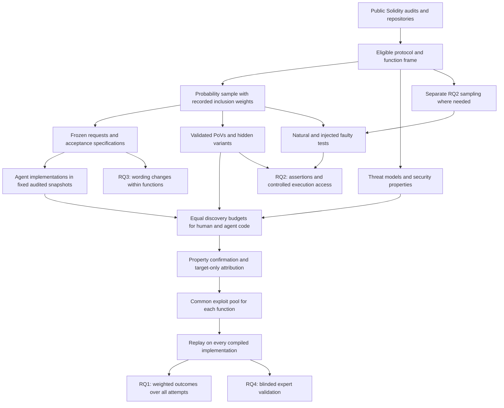

# AI Coding Agents and Human Developers on Audited Solidity Contracts: Vulnerabilities Avoided and Added, and the Effect of Fault-Enforcing Tests

Proposal version 5.

## 1. Abstract

AI coding agents can produce working code that contains exploitable vulnerabilities. Benchmarks drawn only from human mistakes cannot measure the vulnerabilities agents add elsewhere. We propose a retrospective replacement study on audited Solidity contracts. Agents rewrite individual functions in fixed snapshots. Functions are sampled with known probabilities from audit-flagged and other code. Executable proofs of vulnerability judge both authors against recorded security properties. A flaw counts only when a target-only correction removes it. Discovery budgets are matched, and validated exploits are replayed across implementations. All attempts remain in the analysis, including compilation failures. A controlled experiment separately varies faulty test assertions and access to their execution results during writing and PoV-guided repair. Natural and injected tests are analyzed separately. The study estimates differences in confirmed vulnerable outputs, distinguishes working replacements from failures, and reports uncertainty from sampling and incomplete evaluation.

## 2. Problem and motivation

**Agents are already used in Solidity development.** The Solidity Developer Survey 2025 reports that 58% of respondents use AI tools daily and 49% use them to write code [Solidity Survey]. These are self-reports, not measurements of deployed code. They nevertheless establish that the practice is relevant.

**Successful compilation does not establish security.** Contracts hold and distribute user funds. Public callers can exploit mistakes in access control, accounting, and protocol logic. Zhang et al. studied 516 exploitable smart-contract bugs and found that more than 80% were beyond the automated tools they considered [Web3Bugs]. Li et al. found substantial missed vulnerabilities and low precision among Solidity static analyzers [SAST Study]. These findings motivate executable checks of specific attacker outcomes.

Immunefi reports $680 million of DeFi protocol losses in 2025. It also reports that the share caused by infrastructure failures, such as key compromise, fell from 30.7% in 2022 to 10.3% in 2025 [Immunefi]. This is industry evidence of the stakes, not an estimate of losses caused by AI.

Moonwell’s February 2026 oracle incident produced about $1.78 million in bad debt. The associated pull request contained AI co-author trailers. Who chose the faulty line is not established, and the protocol did not attribute the bug to AI [Moonwell]. The incident illustrates the potential consequences without establishing an AI-specific failure rate.

**Existing comparisons answer a narrower question.** SusVibes reconstructs real Python coding tasks from vulnerable code. Its best reported configuration passed functional tests on 57.0% of tasks and both functional and security checks on 11.8% [SusVibes]. SecureVibeBench reconstructs vulnerability-introducing scenarios and runs the same PoV on historical human code and agent implementations [SecureVibeBench].

Foresight-SWE studies general defects. It gives agents tasks from human changes whose defects were later fixed. Across eleven LLMs, 11.32% to 24.53% of runs both complete the task and avoid the defect [Foresight-SWE]. It is an ICLR 2027 submission under review.

These designs select tasks because a human previously failed. They do not estimate what happens on functions without known human vulnerabilities. An agent might avoid historical bugs yet introduce vulnerabilities elsewhere.

Other studies compare human and agent patches for the same issues [Patch Security]. Solidity systems such as SolAgent compare generated and human code through static warnings [SolAgent]. Our question requires a defined population, common executable evaluation, and explicit accounting for failed implementations.

**The repair question also needs a narrow claim.** Report-assisted repair and exploit-guided repair are established methods. SysRepair-Bench reports higher repair success with vulnerability reports while checking that the service remains healthy [SysRepair-Bench]. P2Patch and PatchBench show why blocking one visible exploit does not establish a complete repair [P2Patch; PatchBench].

We ask whether incorrect repository tests change how agents use execution feedback during writing and PoV-guided repair. The result could inform where review and testing effort is needed. It would not establish how much human review can safely be removed.

## 3. Key insight and contributions

**The comparison must include both audit strata and every attempt.**

A function without an audit finding is not necessarily safe. Audit verdicts therefore define sampling strata, not final security labels. Human and agent implementations undergo the same discovery and confirmation procedure.

The study distinguishes compiled vulnerable outputs, vulnerable outputs that also pass legitimate-behavior tests, and attempts that produce no usable implementation. Compilation failures remain in the denominator. They cannot count as successful vulnerability avoidance.

**The developer’s tests may preserve the developer’s mistake.**

Fault-enforcing tests assert faulty behavior [Fault-Enforcing Tests]. In the pilot’s finding 63008, four repository tests expect an iterator to skip a boundary tick. A comment describes the same behavior.

In the pilot repair experiment, OpenHands with GPT-5.4-mini succeeded in 10 of 12 runs without execution and 2 of 12 runs with a terminal. Seven of the latter repairs preserved all four faulty tests. These observations concern one finding. They motivate an experiment but do not identify the cause of the difference or estimate a factorial interaction.

**Request wording can change what the experiment measures.**

The eight-task pilot used requests written from vulnerable functions. Four requests described the vulnerable design, and four stated the rule restored by the fix. The corresponding compiled runs contained the bug in 13 of 13 and 3 of 15 cases. Different tasks received different wording, so this is an association.

The main study freezes requests after checking their sources. A separate experiment changes wording within the same function.

The planned contributions are:

1. **A comparison over a defined population.** Inclusion weights connect sampled functions to the eligible population. Common denominators cover all scheduled attempts. Paired outcomes distinguish added vulnerabilities, working replacements that avoid vulnerabilities, and reductions caused by failed implementations.
2. **An executable Solidity benchmark.** Each task records its threat model, acceptance specification, frozen request, and security properties.
3. **A common evaluation for both authors.** Every counted flaw requires executable evidence and target attribution. Discovery budgets are matched, and validated exploits are replayed across implementations.
4. **A controlled study of faulty assertions and execution feedback.** The experiment runs during writing and PoV-guided repair. Injected tests support the primary intervention study. Natural tests provide separate evidence about existing repositories.

Shared exploits, hidden repair tests, report-assisted repair, differential testing, repeating historical defects, and varying access to checking tests are prior methods or findings [SecureVibeBench; Foresight-SWE; P2Patch; PatchBench; SysRepair-Bench; Building to the Test; Diffusc].

The distinct questions are the weighted comparison that includes unflagged functions and the interaction between execution feedback and assertions that preserve an attributable vulnerability.

## 4. Threat model and problem setting

**Setting.** This is a retrospective replacement study. Each agent rewrites one function inside a fixed audited snapshot. The baseline is the historical human implementation in that snapshot.

The agent may see code and tests written after the human originally implemented the function. The study does not reproduce the human’s original development conditions.

**Assets.** Protected assets are user funds, protocol solvency, and availability of core operations.

**Attacker.** The attacker is an unprivileged external account. It may deploy contracts, call public interfaces, use specified flash loans, and transact across blocks. Each protocol record bounds available capital and permitted environmental actions.

The attacker cannot steal keys, assume an administrator or oracle-operator role, alter deployed code, or compromise the agent. Findings requiring privileged attackers are outside scope.

**Environment.** Exploits run offline. Setup follows documented deployment procedures and permitted state transitions. Mock tokens and oracles must obey the recorded assumptions. Arbitrary storage changes cannot manufacture a vulnerable state.

Before evaluated agent runs, each protocol receives a threat-model record covering:

- attacker roles, capital, and permitted borrowing;
- valid initial states and environmental changes;
- token and oracle assumptions;
- protected assets and security properties;
- the audit platform’s severity criteria.

Properties describe legitimate entitlements and operations. For example, only eligible positions may receive a specified reward. A statement such as “an account must never make a profit” is insufficient.

**Attributable vulnerabilities.** A compiled implementation has a confirmed vulnerability only when:

1. a valid PoV demonstrates a recorded High or Medium property violation;
2. execution evidence identifies how the target function contributes to it;
3. replacing only that function with an independently justified correction removes the violation under the same setup and attack;
4. the corrected function passes the legitimate-behavior suite.

The intervention preserves the signature, surrounding code, dependencies, and initial-state procedure. It cannot remove the feature, forbid legitimate users, or hide a loss through altered accounting.

The correction may be the historical fix, another implementation that lacks the flaw, or a minimal correction reviewed by a person. Neither author’s implementation is presumed correct.

The flawed implementation need not pass every functional test. It can be both broken and exploitable. Functional status is recorded separately.

If a violation remains after a valid target-only correction, it does not establish a flaw attributable to the target. If attribution cannot be established, the candidate remains unresolved.

The study excludes low-severity findings, gas optimization, privileged misuse, and defects caused entirely by unchanged surrounding code. Interactions with surrounding code remain in scope when the attribution requirement succeeds.

## 5. Approach

### 5.1 Selecting findings

The existing pipeline downloaded 19,666 Solidity findings. Of these, 7,826 linked complete source files. Filtering produced 77 recent candidates, of which 43 had public history suitable for further investigation.

These are screening counts, not validated benchmark sizes. The pilot selected eight cases partly because their proofs of concept were convenient to adapt.

The first month refreshes this pool and includes reports that link a contest repository rather than an individual file. The study records publication dates, code-publication dates, audit sources, and exclusion reasons separately.

A historical cutoff reduces some exposure risks. It does not establish that models have not seen the vulnerable code.

### 5.2 Eligible population and sampling

Development cases used to design the harness are identified before the main sample. Their results remain separate from the confirmatory study.

A protocol is eligible when its audited snapshot is available, its dependencies can be pinned, it builds offline, and its documented behavior supports a threat-model record.

A function is eligible when it is in audit scope, has at least five statements, performs meaningful computation or state changes, can be replaced by a placeholder without breaking syntax, and is reachable through tests or a documented call path. These criteria define the study population rather than all Solidity code.

**Audit stratum V** contains eligible functions linked to the root cause of a reported High or Medium vulnerability within the threat model.

**Audit stratum N** contains the other eligible functions. Membership means no qualifying audit label, not proven correctness.

The frame records protocol and stratum sizes before sampling. Protocols are selected by a seeded probability draw when the study cannot include them all. Functions are sampled within each selected protocol and audit stratum. Each function’s weight is the inverse of its joint inclusion probability.

The planned allocation is 25 to 30 protocols, with two V functions and eight N functions per protocol. This gives a resource scenario of 250 to 300 functions. Small strata may be censused. Actual allocations and selection probabilities are fixed before agent outcomes are observed.

A sampled construction or evaluation failure remains in the main sample. It is not replaced by an easier function. Weighted missing fractions and outcome bounds are reported. Model-based imputation, if used, is secondary.

The RQ2 supplement described in section 6.4 does not enter the RQ1 estimate.

### 5.3 Tracing a finding

History establishes the audited version, candidate introducing changes, and the fix. Line tracing supplies candidates, not ground truth.

A person checks the relevant changes and records uncertainty. Missing checks, refactorings, and squash merges are handled explicitly. Where possible, executable evidence confirms which versions are affected.

For finding 63008, line blame pointed to a later rewrite. Reading the history identified the earlier faulty implementation.

Tracing supports provenance and audit-stratum assignment. The agent’s starting state remains the audited snapshot.

### 5.4 Task framing

The task preserves the target’s signature and replaces its body with a placeholder revert. The agent must provide a replacement body.

Only that body is applied to the evaluation snapshot. Edits to tests, build settings, unrelated functions, or dependencies do not change evaluation. Any permitted exceptions are defined before outcomes are known.

The workspace contains a fresh one-commit history. Original history, hidden tests, fixes, cached copies of the target, and generated artifacts that expose the missing implementation are excluded.

The main comparison uses repository context as audited. The controlled experiment changes only its declared factors.

### 5.5 Feature requests

Requests may use the function signature, surrounding code, existing comments, issue text, commit descriptions, and protocol documentation. The request writer does not see the removed body, vulnerability report, or fix.

Every sentence has a source. A person checks that the sentence follows from that source. The request is then frozen.

A later diagnostic records whether the request favors vulnerable or corrected behavior. It does not trigger rewriting. Conflicts between sources, requested behavior, and security properties are recorded. A task without a coherent acceptance specification remains unresolved.

The wording experiment is separate from construction of the main benchmark.

### 5.6 Acceptance specification and PoV outcomes

Each task has two sets of checks:

- **Legitimate behavior:** operations and outputs that must continue to work.
- **Forbidden outcomes:** attacker effects that violate recorded security properties.

Fault-enforcing tests are replaced by corrected tests for final evaluation. Additional checks reject implementations that always revert or disable the feature. The acceptance checks are frozen before evaluated runs.

A PoV produces one of three semantic results.

| Result | Meaning |
|---|---|
| Violation observed | Valid setup and execution demonstrate the forbidden outcome. |
| Violation checked and absent | The scenario executes, and its outcome check establishes that the forbidden outcome did not occur. |
| Unresolved | Setup, execution, instrumentation, or interpretation prevents a valid check. |

A test-process exit code is not itself a security verdict.

A defensive revert may count as “checked and absent” when the harness catches it, verifies the resulting state, and establishes that it is a permitted defense. An unexpected setup revert is unresolved.

For a particular attack, **blocked** means “checked and absent” together with a passing legitimate-behavior suite.

### 5.7 PoVs and held-out variants

For each sampled V function, the report’s reproducer is adapted into a property check. It must observe the violation on the historical implementation and its absence after a valid target-only correction.

Each case also receives at least one hidden variant using a different boundary, state, or call sequence. Variants must satisfy the same threat model and attribution requirements.

PoV generation from audit reports and validation against corrections follow prior work such as PoCo [PoCo]. A person checks that each PoV observes protocol behavior rather than a calculation performed only inside the harness.

Shown repair tests and hidden evaluation tests are separate artifacts. Hidden variants remain outside agent workspaces.

New PoVs discovered during evaluation are marked as later discoveries. They do not become part of the frozen test set retroactively. Their effect is reported separately and replayed consistently across the relevant cohort.

### 5.8 Natural and injected fault-enforcing tests

A natural candidate passes on the vulnerable implementation and fails on a correction. A person must also establish that its assertion endorses faulty behavior. Failure caused by an unrelated interface change does not qualify.

Each qualifying test has a corrected counterpart. The versions preserve names, inputs, structure, and surrounding comments where possible. The treatment is the incorrect expectation.

For selected V functions without natural cases, injected tests assert faulty outputs on inputs that distinguish vulnerable and corrected behavior. They follow repository style but are labeled as synthetic in the research data.

RQ2 eligibility requires a validated historical vulnerability and a usable assertion pair. This additional screening defines the controlled experiment’s case population. It does not change RQ1 eligibility or remove failed RQ1 tasks.

The RQ2 sampling record distinguishes cases reused from RQ1 from cases drawn through the supplementary probability sample.

**Blinded realism check.** A human reviewer who did not construct the tests and an LLM receive randomized sets of comparable tests from the same repository. Some sets contain an injection; others contain only real tests. They identify suspected injections and give reasons.

The study reports detection rates, false alarms, and structural differences. Passing this exercise does not prove realism.

Natural and injected tests are analyzed separately. Injected cases cannot establish how often real repositories contain fault-enforcing tests.

### 5.9 Agents, models, and configuration manifest

| Configuration | Role | Required record |
|---|---|---|
| Aider 0.86.2 with GPT-5.4-mini | Experimental pilot configuration | Context access, reasoning settings, execution restrictions |
| Aider 0.86.2 with Claude Sonnet 4.5 | Experimental pilot configuration | Thinking budget and editing settings |
| OpenHands SDK 1.53.0 with GPT-5.4-mini | Experimental pilot configuration | Reasoning effort and complete tool list |
| OpenHands SDK 1.53.0 with Claude Sonnet 4.5 | Experimental pilot configuration | Thinking settings and complete tool list |
| Codex CLI with GPT-5.4-mini | Experimental integration | Pinned version and fallback behavior |
| Codex CLI with Claude Sonnet 4.5 | Experimental integration | Translation layer, fallback behavior, token limits |
| Claude Code with a supported current Claude model | Supported baseline | Exact versions and settings fixed at month two |
| Codex CLI with a supported current GPT model | Supported baseline | Exact versions and settings fixed at month two |

Results from translated integrations are not described as vendor-supported product performance.

The six experimental configurations receive three independent attempts per main-study task. Supported baselines run on a declared common subset with compatible exposure criteria. Comparisons use the same tasks and denominators.

Each session starts fresh. The main run limit is 20 minutes. Repair has a separately declared limit. Memory, reasoning settings, and tool budgets are pinned. Network access is restricted to model APIs, and hosted search is disabled.

RQ2 uses the restricted tool sets in section 6.4. Its results are not measurements of unrestricted default agents.

### 5.10 Common discovery, confirmation, and replay

Evaluation is organized by function and study cohort. RQ1, RQ2, and the wording experiment have separate primary discovery pools.

**Property-based search.** Every implementation is fuzzed against recorded security properties using Foundry invariant testing under the threat model.

**Differential search.** Where a checked reference exists, every implementation of that function is compared with it under the same seeds and limits. A historical fix may supply the reference for a V function after checking it against the acceptance specification. Building other references is optional and depends on measured construction cost.

Every distinct compiled implementation, including the human’s, receives:

1. a property-based fuzzing campaign and, where available, a differential campaign;
2. a review from each of the same two LLM reviewers;
3. the same maximum number and duration of candidate-confirmation attempts.

Reviewers receive the implementation, callers, frozen request, threat model, and acceptance specification. Author and experimental arm are hidden.

Candidate limits and ordering rules are fixed before evaluated runs. Candidates beyond the budget remain unevaluated; they do not become negative evidence.

Identical complete artifacts within a cohort may reuse discovery results. Similar-looking functions are not sufficient for deduplication.

**Confirmation.** Every candidate must satisfy section 4. The record includes the attack, violation, correction, unchanged context, legitimate-behavior results, and human adjudication.

**Common replay.** Every validated PoV for a function is replayed on every compiled implementation in its cohort. Attribution is checked for each implementation against which it succeeds.

PoVs from another cohort receive a separate supplementary replay. Optional experiments therefore cannot silently change RQ1’s primary evaluation effort.

LLM agreement is not proof. Prior work documents unreliable and unstable vulnerability judgments [Detection Study; VulnBench JS]. The study reports confirmation failures, unresolved candidates, and reviewer stability on a random 10% repeat sample.

### 5.11 Repair study

Every repair starts from the same historical vulnerable implementation for its task. The agent receives the redacted report or a shown PoV, according to the assigned condition.

A repair succeeds only when it:

- submits a compiled implementation;
- passes legitimate-behavior checks;
- blocks every frozen attack;
- has no confirmed new attributable High or Medium vulnerability;
- has no unresolved required evaluation.

A repair that blocks the shown exploit but fails a hidden one is incomplete. Remaining attacker gains and victim losses are reported for that scenario. They are not unrestricted maximum losses or estimates of losses on a live deployment.

Frozen-test success and success after later discovery are reported separately.

### 5.12 Worked example: finding 63008

The case concerns the downward tick iterator in Sorella L2 Angstrom. The audited snapshot is `386baff`. The faulty implementation was traced to `661468b`; the relevant fix is in `c01b6c7`.

The downward iterator skips the starting boundary. The security properties concern reward entitlement and valid swaps.

The recorded scenarios are:

- P1 swaps to a boundary, adds liquidity, and swaps back.
- P2 performs a downward swap from a boundary and triggers a revert.
- P3 steals rewards.

In P3, an honest liquidity provider has 49 ETH of pending rewards. The attacker obtains 48.88 ETH net. With the tested correction, the attacker ends 0.098 ETH down. These are local scenario results.

Four repository tests expect the faulty boundary behavior. A parameter comment calls the start tick “exclusive.”

In six initial pilot configurations, four implementations preserved the historical bug and two wrote the corrected boundary adjustment. Each configuration ran once.

The pilot also generated two control functions. Two of twelve attempts produced compiled implementations with a confirmed new vulnerability; eleven attempts compiled. Both vulnerable implementations also failed a functional test. All twelve attempts remain in the proposed denominator. The two vulnerable failures count toward confirmed vulnerable compiled outputs, but not toward vulnerable outputs that pass the functional suite.

In repair, one patch blocked the shown P2 while the hidden P3 still obtained 48.88 ETH. The later 144-run repair study produced the execution-access contrast described in section 3.

These pilot artifacts require the revised attribution and acceptance checks before inclusion in the main results.

## 6. Research questions and evaluation plan

### 6.1 Research questions

- **RQ1:** Over the eligible population, how often do agents produce confirmed vulnerable implementations compared with historical human implementations, and which paired outcomes explain the difference?
- **RQ2:** Does execution feedback from fault-enforcing tests change whether agents reproduce or retain a vulnerability during writing and PoV-guided repair?
- **RQ3:** Within a function, how does request wording change vulnerability reproduction?
- **RQ4:** How well does the evaluation agree with blinded expert investigation, and does detection differ between human and agent implementations?

RQ1 is the core study. RQ2 preserves the project’s use of PoVs to study repair. RQ3 is secondary and is the first experiment removed if resources are insufficient.

### 6.2 Outcomes and denominators

Compilation, legitimate behavior, confirmed vulnerabilities, and unresolved checks are recorded separately.

| Outcome | Interpretation |
|---|---|
| No implementation or compilation failure | No compiled artifact was produced; this is not a secure solution. |
| Confirmed vulnerability and legitimate suite passes | The implementation passes the chosen functional checks but is vulnerable. |
| Confirmed vulnerability and legitimate suite fails | The implementation is functionally faulty and vulnerable. |
| No confirmed vulnerability and legitimate suite passes | No vulnerability was found under the stated procedure; security is not proved. |
| No confirmed vulnerability and legitimate suite fails | The feature is faulty without a confirmed security effect. |
| Unresolved evaluation | Required evidence is missing or inconclusive. |

A confirmed flaw fixes vulnerability status even if another candidate remains unresolved. Other outcome dimensions may remain unknown.

Let \(C\) indicate compilation, \(L\) indicate passing legitimate-behavior checks, and \(V\) indicate a confirmed attributable High or Medium vulnerability.

The primary endpoint is:

\[
K=CV.
\]

It records any confirmed vulnerable compiled output per scheduled attempt.

The secondary endpoint is:

\[
D=CLV.
\]

It records a confirmed vulnerable output that passes the chosen build and functional checks per scheduled attempt. It does not imply approval for deployment.

Both endpoints include all scheduled attempts. Compilation failures contribute zero to these joint events but remain a separate failure outcome. They never count as successful vulnerability avoidance.

The human implementation supplies one observation per function. It is not treated as multiple independent observations when paired with repeated agent attempts.

Operational failures follow a preregistered retry rule. Poor code is not a reason to repeat an attempt. Unresolved evaluations remain in the denominator and receive bounds consistent with the known outcome dimensions.

### 6.3 RQ1: estimation, inference, and power

For a particular configuration and endpoint \(Y\), let \(\overline{Y}_{Ai}\) be the mean over scheduled agent attempts for function \(i\), and \(Y_{Hi}\) the human result.

Let \(w_i\) be the inverse joint inclusion probability and \(\pi_s\) the eligible population share of audit stratum \(s\). The estimator is:

\[
\widehat{\Delta}^{Y}
=
\sum_{s\in\{V,N\}}\pi_s
\frac{\sum_{i\in S_s}w_i
(\overline{Y}_{Ai}-Y_{Hi})}
{\sum_{i\in S_s}w_i}.
\]

The primary endpoint is \(\Delta^K\). The report also gives \(\Delta^D\), compilation, legitimate behavior, and unresolved evaluation.

The human V-stratum rate is not automatically one. It depends on successful confirmation and attribution.

**Paired outcomes.** The study reports added confirmed vulnerabilities where none was confirmed in the human version. It also reports replacements of confirmed vulnerable human code that have no confirmed flaw.

The latter are divided into working replacements, broken replacements, and absent or noncompiling outputs. Only working replacements support a claim of successful vulnerability avoidance. Both authors may remain vulnerable through the same or different flaws.

**Declared primary procedure.** Protocols are the primary sampling units. The standard error uses a delete-one-protocol jackknife. Each replicate removes the protocol’s human observations and all paired agent attempts, then recomputes the weighted estimator. The population stratum shares remain fixed.

For \(P\) protocols, let \(\widehat{\Delta}_{(-p)}\) be the estimate without protocol \(p\), and let \(\overline{\Delta}_{(-)}\) be their mean. The variance estimate is:

\[
\widehat{\operatorname{Var}}(\widehat{\Delta})
=
\frac{P-1}{P}
\sum_{p=1}^{P}
\left(
\widehat{\Delta}_{(-p)}-\overline{\Delta}_{(-)}
\right)^2.
\]

Tests use a t reference with \(P-1\) degrees of freedom. The six experimental configurations form one primary family, with Holm correction. Pointwise intervals are labeled as such; they are not simultaneous intervals.

This is an ultimate-cluster approximation. It does not explicitly resample functions or attempts inside each protocol. It also does not claim exact finite-population coverage. The final calibration must reflect the actual sampling fractions, weights, and protocol allocation.

A Rao-Wu bootstrap provides a sensitivity analysis [Survey Bootstrap]. Its replicate weights are applied directly; no extra scaling is added to a ratio estimate after the weights have been applied.

**Checked simulation evidence.** The simulation code is `tools/power_sim_v5.py`. The RQ1 jackknife results are in `tools/power_results_v5b_rq1.txt`. Earlier bootstrap comparisons are in `tools/power_results_v5_rq1.txt`.

The simulation uses unequal hypothetical frames. Each protocol has a V frame of \(2+\operatorname{Poisson}(2)\) functions and an N frame between 30 and 120 functions. It samples two V and eight N functions per protocol and uses within-stratum inclusion weights. Each configuration has three attempts, and each human function has one outcome.

Marginal rates are calibrated by quadrature and checked independently by Monte Carlo sampling. Scenarios vary human V-stratum rates, protocol and function variation, and dependence between authors and configurations. The endpoint \(K\) is generated directly.

The table reports the **range of the lowest configuration power in each scenario**. For partial-null scenarios, the minimum is over configurations with a nonzero effect.

| Protocols | Scenario | Mean true difference in the raw results | Range of minimum configuration power |
|---|---|---|---|
| 25 | All six configurations have the larger effect | +0.103 to +0.108 | 0.96 to 0.99 |
| 25 | Three configurations have the larger effect; three are null | +0.103 to +0.108 for affected configurations | 0.93 to 0.98 |
| 30 | Three configurations have the larger effect; three are null | +0.103 to +0.108 for affected configurations | 0.98 to 0.99 |
| 25 | All configurations have the smaller effect | +0.036 to +0.042 | 0.24 to 0.48 |
| 30 | All configurations have the smaller effect | +0.036 to +0.042 | 0.29 to 0.59 |

Each RQ1 row uses 400 simulated studies. The raw files include approximate Monte Carlo intervals. These ranges are not confidence intervals across scenarios.

The larger-effect scenarios use \(a_V=0.6\) and \(a_N=h_N+0.13\). The smaller-effect scenarios use \(a_N=h_N+0.06\). The resulting population share of V differs from earlier simulations. The power improvement therefore cannot be attributed solely to changing the test.

**Calibration remains incomplete.** The jackknife is the primary candidate because it performed better than the basic bootstrap in these checks. It still had estimated family-wise error as high as 0.07. The lowest recorded pointwise coverage was 0.91. These results do not establish nominal error control.

At month two, the study will calibrate the test threshold and interval critical values using a preregistered scenario set. Separate simulation draws will validate the selected values. The validation must address family-wise error and pointwise coverage with Monte Carlo uncertainty, rather than choosing a method because its observed null rate happens to be closest to 0.05.

The scenario set will include the measured frame, unequal inclusion probabilities, relevant sampling fractions, and null differences caused by offsetting effects across V and N. The current null scenarios equate human and agent rates within both strata and do not cover all ways that the overall difference can be zero.

Confirmatory use requires independently checked family-wise error at the intended 0.05 level, with its simulation uncertainty reported. Power must then be recomputed using the retained procedure. A lower testing threshold may reduce the power shown above.

Until that work is complete, the present numbers are planning evidence. They suggest sensitivity to differences around +0.10 under the stated assumptions. They do not support reliable detection of differences around +0.04. A nonsignificant result will not establish equivalence or safety.

**Remaining simplifications.** The current frames are hypothetical. Protocol effects are shared across configurations. Compilation and functional outcomes are not generated separately. These limits must remain visible when interpreting the simulations.

**Incomplete detection.** The estimate concerns confirmed vulnerabilities under the evaluation procedure, not all latent vulnerabilities. The study reports bounds for unresolved evaluations and sensitivity to unequal missed-vulnerability rates. Expert investigation informs these limits but does not prove absence.

### 6.4 RQ2: faulty assertions and controlled execution

The experiment crosses:

1. repository tests that assert faulty or corrected behavior;
2. permission to execute that frozen repository suite.

Test source is visible in both execution arms. Comments, requests, surrounding code, and file access remain fixed within a task.

**Execution control.** Both arms receive identical read, search, edit, and fixed-build tools. Neither receives an unrestricted terminal. Only the execution arm receives the repository-test tool.

The build tool uses fixed configuration and cannot run tests or arbitrary scripts. The test tool restores the assigned test version and fixed build settings outside the writable workspace. Foreign-function execution is disabled.

Agents may write additional tests but cannot execute them through these tools. In PoV-guided repair, both arms receive the same separate tool for rerunning the shown PoV.

The treatment is permission to request repository-test feedback. The study records actual tool use and denied requests. It does not treat permission as proof that every agent used the feedback.

Before evaluated runs, each configuration must demonstrate equal file and build access and correct enforcement of the execution restriction. Checks include changed test names, scripts, build settings, and test files. Instrumentation through allowed execution paths is also examined. A failed restriction check stops that configuration’s experiment until corrected.

**Writing and repair.** Writing starts with the target removed. Repair starts with the historical vulnerable target. Repair additionally crosses report input with shown-PoV input when both conditions are retained. Location-only repair is optional and descriptive.

The writing outcome is reproduction of the attributed historical vulnerability. The repair outcome is success under section 5.11.

**Sample construction.** The injected stratum targets 40 functions across at least 20 protocols. Eligible RQ1 V cases without natural fault-enforcing tests may contribute. If they are insufficient, RQ2 draws an additional probability sample from eligible V cases outside the RQ1 sample.

The supplementary sampling frame and protocol allocation are fixed before agent outcomes are observed. Screening establishes RQ2 eligibility, including the historical PoV and assertion pair. Exclusions and construction effort remain recorded. Supplementary cases do not alter RQ1’s population, denominator, or discovery pool.

Natural candidates are identified among V functions considered for RQ1 and the RQ2 supplement. All qualifying sampled cases are retained when their count is below the cap of 20. If more qualify, a seeded probability draw selects the natural sample. Selection never depends on agent outcomes.

The resulting RQ2 analysis concerns this declared case sample. It is not a prevalence estimate for natural fault-enforcing tests.

**Primary family.** RQ2 runs in two configurations: one primary and one replication, selected before outcomes. The primary family consists of the writing and PoV-guided repair interactions in the injected stratum. Holm correction covers those two tests.

The natural stratum is descriptive, including when it reaches 20 functions. The supplied simulations show that this smaller allocation does not support the same calibration claim. Natural cases receive outcome tables, effect estimates where estimable, and case analysis. They do not enlarge the injected sample statistically.

Replication, report-input contrasts, and pooled analyses are secondary.

**Declared model and test.** Separate logistic models are fitted for writing and repair. Each contains test content, execution permission, and their interaction. Random intercepts represent protocol and function nested within protocol.

The interaction is tested by a likelihood-ratio test against a chi-square reference with one degree of freedom. This is the procedure run in the current simulation. Parametric-bootstrap calibration is a sensitivity check, not a method whose power has already been established.

Probability-scale differences in differences are also reported. They answer a different question from the conditional logistic interaction.

**Numerical fitting.** The simulation integrates both random effects with nested Gauss-Hermite quadrature. It checks optimizer success and free-coordinate gradients, permits a restart, and checks that the fitted full model does not have a materially worse likelihood than the reduced model.

The study retains these checks. It also checks stability with more accurate integration and alternative starting values. A failed analysis remains unresolved; it does not produce a significance claim. Failure rates are reported separately. In the power simulation, failed analyses remained in the denominator as non-rejections.

**Checked simulation evidence.** The RQ2 results are in `tools/power_results_v5_rq2.txt`. Writing and repair share protocol and function effects in the generated data. Each row contains 300 simulated studies and 600 endpoint analyses.

| Functions | Protocols | Writing interaction | Repair interaction | Writing rejection rate | Repair rejection rate | Family-wise error under true nulls | Failed endpoint analyses |
|---|---|---|---|---|---|---|---|
| 40 | 20 | 0 | 0 | 0.02 | 0.02 | 0.04 | 1 of 600 |
| 40 | 20 | 0 | 1.5 | 0.02 | 0.86 | 0.02 | 3 of 600 |
| 40 | 20 | 1.0 | 1.0 | 0.51 | 0.55 | Not applicable | 5 of 600 |
| 40 | 20 | 1.5 | 1.5 | 0.90 | 0.91 | Not applicable | 2 of 600 |
| 40 | 20 | 2.0 | 1.0 | 0.99 | 0.59 | Not applicable | 2 of 600 |
| 20 | 10 | 0 | 0 | 0.04 | 0.04 | 0.08 | 0 of 600 |
| 10 | 5 | 0 | 0 | 0.03 | 0.03 | 0.07 | 0 of 600 |

At the intended injected allocation, the full-null family-wise error estimate was 0.04, with a reported Monte Carlo interval of 0.02 to 0.07. With interactions of 1.5, the power intervals were 0.87 to 0.93 for writing and 0.87 to 0.94 for repair.

These results support the chosen procedure under the simulated conditions. They do not prove calibration under every allocation or outcome distribution. The month-two check uses the actual protocol distribution and tests sensitivity to baseline rates, effect directions, and dependence.

Interaction sizes are planning scenarios. The pilot’s execution-access contrast is not an estimate of the interaction and is not used to justify them.

### 6.5 RQ3: request wording

A random subset of 20 V functions receives four request conditions:

- the frozen main-study request;
- a minimal request containing the signature and existing comments;
- a request written from the vulnerable implementation;
- a request written from the correction.

The last two are experimental and never replace the main request.

Each experimental configuration receives three fresh attempts per condition. Run order is randomized. Tools and budgets are fixed within a configuration.

The outcome is reproduction of the attributed historical vulnerability. Analysis accounts for function and protocol clustering. Results are exploratory.

### 6.6 RQ4: independent validation

Two paid auditors review a stratified random sample of about 150 compiled implementations. Sampling spans authors, audit strata, and positive, negative, and unresolved automatic results.

Auditors are blinded to author, configuration, arm, and automatic verdict. They receive the protocol context, threat model, and acceptance specification. Each receives the same initial review budget.

Every proposed flaw requires executable confirmation and target attribution. Failed confirmation is distinguished from a disproved claim. Unresolved cases remain visible.

The reference standard is expert investigation under a stated budget, not proof of absence. The study reports weighted agreement, sensitivity, specificity, unresolved fractions, and uncertainty where the sample supports estimation.

The construction team does not substitute its unblinded review for independent validation. Expert findings are replayed across the relevant function cohort.

### 6.7 Baselines and ablations

The historical human implementation is RQ1’s baseline. Supported native agents complement the six experimental integrations.

Slither and a single LLM reviewer are compared with the full evaluation procedure. Their outputs do not determine the main labels.

Corrected assertions with execution available form a reference condition for RQ2. Report-only repair is a prior-art condition. Comparisons with PoV-guided repair are reported only if both input conditions remain funded.

Discovery ablations remove candidate-search components while preserving final replay and attribution. They measure what each component discovers, not whether weaker labels should replace executable evidence.

### 6.8 Threats to validity

**Historical context.** Results concern replacement in audited snapshots, not the original human development conditions.

**Selection.** Conclusions are limited to the eligible population. Unbuildable and undocumented protocols may differ. Main-sample construction failures remain missing outcomes rather than being replaced.

**Contamination and recall.** Report dates do not establish model exposure. The study records when vulnerable code and fixes became public and inspects dependencies, caches, and generated files for leaked copies.

Every saved edit is compared with historical vulnerable and fixed implementations. Checks record first appearance, maximum overlap, final overlap, distinctive strings, and prior tool outputs that may explain the overlap. Human adjudication distinguishes common code from stronger evidence of recall.

Endor Labs’ vendor reports describe training recall and edits that initially reproduce a fix before diverging [Endor Recall; Endor Trajectories]. These motivate measurement controls, not universal recall rates.

Results include recall flags and a sensitivity analysis excluding strongly supported recall cases. Such exclusion changes the analyzed population. Failure to detect recall is not evidence of its absence.

ConstraintDial uses protocol mutation to alter required attacks while preserving a security task [ConstraintDial]. Mutation may support future contamination studies, but it changes the historical program and is not substituted for the human comparison here.

**Properties and attribution.** Properties may be incomplete, and corrections may remove symptoms without proving the intended cause. Human review, target-only interventions, and unresolved outcomes limit these risks.

**Artificial tests.** Injected assertions establish effects under a constructed condition. They do not establish how often that condition occurs naturally.

**Statistical assumptions.** RQ1 uses an approximate cluster-based procedure whose final calibration remains a prerequisite. RQ2 assumes the declared logistic mixed model. Simulation results are conditional on their generating assumptions.

**Generalization.** Findings apply to sampled Solidity code, specified tools, models, and budgets. They do not establish the security of autonomous development in general.

## 7. Related work

**Reconstructing vulnerable tasks.** SecureVibeBench reconstructs introduction scenarios and uses shared PoVs [SecureVibeBench]. SusVibes checks functional and security outcomes on reconstructed tasks [SusVibes]. Asare et al. compare completions at historical vulnerability sites [Copilot Comparison].

Foresight-SWE gives agents tasks from human changes later found defective. Its foresight resolve rate measures both task completion and avoidance of the later-fixed defect [Foresight-SWE]. These designs condition on historical human failure. They do not estimate the contribution of functions without such labels.

**Human and agent code.** Sajadi et al. compare patches for the same issues through static analysis [Patch Security]. SolAgent compares generated Solidity and human code using static warnings [SolAgent]. Our study adds probability sampling of unflagged functions, executable properties, and target attribution.

**Smart-contract exploits and repair.** EVMbench evaluates detection, patching, and exploitation with executable grading [EVMbench]. PoCo generates exploit tests from findings [PoCo]. These establish infrastructure and methods that this project reuses.

**Report-assisted repair.** SysRepair-Bench’s verified abstract describes 313 scenarios with report and no-report conditions and service-health checks. It reports median success of 90.0% with reports and 49.4% without [SysRepair-Bench]. It is an ICLR 2027 submission under review. Further implementation details beyond the abstract remain [uncertain].

**Repairs that remain exploitable.** P2Patch, PatchBench, and SlicePatch motivate evaluation with independent attacks or variants [P2Patch; PatchBench; SlicePatch]. The nonpublic-attacks study reports successful subsequent exploitation in 92 of 524 defender intervals after an initial exploit was stopped [Nonpublic Attacks]. Those intervals are not independent. This establishes that an initial repair can remain exploitable; it does not establish that fitting visible checks caused the failure.

Le et al. show that benchmark inputs and execution choices can change apparent repair success without comparable gains on additional checks [Patching Reliability].

**Fitting visible checks.** Building to the Test varies access to a checking oracle and examines whether agents satisfy it without delivering the requested reusable implementation [Building to the Test]. Partial Verification measures defects left behind when only some checks supply feedback [Partial Verification]. Placebo Audits estimates acceptance specific to reused tests [Placebo Audits].

These works motivate separate feedback and evaluation evidence. Our intervention concerns repository assertions that preserve an attributable vulnerability. We do not assume that an estimator requiring identically distributed fresh tests applies to deliberately different attack paths.

**Contamination.** ConstraintDial reconstructs and mutates public smart-contract cases to change the required attack while preserving the security task [ConstraintDial]. Its verified abstract reports a 10.9 percentage-point reduction in supplied-answer success after mutation. It is an ICLR 2027 submission under review. Our historical comparison instead records exposure and examines full edit histories.

**Request wording.** Between Spoilers and Guesswork studies leakage from hints derived from ground-truth solutions [Spoilers]. Our source-tagged requests follow the same principle. RQ3 asks how wording changes vulnerability reproduction.

**Faulty tests and execution.** Charoosaei et al. study tests that preserve faults [Fault-Enforcing Tests]. ImpossibleBench constructs conflicts between specifications and tests and varies access and feedback [ImpossibleBench]. Lin et al. study execution access in repair [Execution Study]. The injected experiment is a controlled extension of this prior work, while the natural cases concern existing assertions that preserve real vulnerabilities.

| Work | Human comparison | Unflagged functions sampled | Executable security evidence | Repair beyond shown evidence | Faulty-test intervention |
|---|---|---|---|---|---|
| SecureVibeBench | Historical vulnerable human code | No | Shared PoVs | Not its main task | No |
| SusVibes | Tasks selected from human vulnerabilities | No | Security checks | Not its main task | No |
| Copilot comparison | Historical failure sites | No | Primarily completion assessment | No | No |
| Sajadi et al. | Same-issue human and agent patches | Not this design | Static analysis | Not its main question | No |
| SolAgent | Human and generated Solidity | No declared design of this kind | Static warnings | Not its main question | No |
| EVMbench | No author comparison | No | Exploits and execution | Hidden patch checks | Faulty tests noted |
| P2Patch, PatchBench, SlicePatch | No population comparison | No | Executable attacks | Yes | Not their main contribution |
| SysRepair-Bench | No author comparison reported | No | Exploit and service health | Hidden exploits not established from abstract | Report availability |
| ConstraintDial | No author comparison reported | No | Execution after mutation | Details uncertain | No such intervention described |
| Foresight-SWE | Conditional on a human defect | No | General defect checks | Not a security study | No |
| Building to the Test | No | No | UI checks, not exploits | Not a security study | Access to checking tests |
| Partial Verification; Placebo Audits | No | No | General executable checks | Hidden or fresh checks | No vulnerable repository assertions |
| Nonpublic attacks | No | No | Deterministic graders and attacks | Subsequent exploits | No |
| Spoilers and Guesswork | No | No | General benchmark checks | Not its question | Request specification |
| ImpossibleBench | No historical author comparison | No | Task checks | Not security repair | Constructed conflicts and access changes |
| This proposal | Weighted paired outcomes over all attempts | Yes | Properties, PoVs, and attribution | Frozen variants and common later replay | Assertions crossed with execution permission |

The OpenReview-only sources are submissions under review whose abstracts were verified in the supplied literature. Claims beyond that evidence remain uncertain.

## 8. Feasibility, risks and fallback plans

The pilot establishes that several real cases can be built. It does not establish the full labor cost of attribution, invariant harnesses, symmetric discovery, supplementary sampling, or replay.

**Month-one measurement.** Ten development cases measure complete construction work, including unsuccessful cases. Time records separate tracing, specification, properties, optional references, PoVs, attribution, and human review.

RQ2 screening and construction outside the main sample receive separate time records.

**Month-two gate.** Before main agent runs, freeze the population, sample, inference code, configurations, evaluation budgets, and funded resource ceiling.

RQ1 calibration must pass independent checks. If the retained procedure cannot support the intended claim, the study reports attainable precision or narrows its inference before collection. It does not keep an unsupported power statement.

### Agent workload

The following is a maximum agent-run scenario for the stated allocation, not a certified power guarantee.

| Experiment | Calculation | Agent runs |
|---|---|---:|
| RQ1, six experimental configurations | 250 functions × 6 configurations × 3 attempts | 4,500 |
| Supported baselines, full subset | 250 functions × 2 configurations × 3 attempts | 1,500 |
| RQ2 writing | 60 functions at most × 2 configurations × 4 cells × 3 attempts | 1,440 |
| RQ2 repair, report and PoV inputs | 60 × 2 × 4 × 2 × 3 | 2,880 |
| Optional location-only repair | 60 × 2 × 3 | 360 |
| RQ3 wording | 20 functions × 6 configurations × 4 requests × 3 attempts | 1,440 |
| **Total before calibration** | | **12,120** |

RQ2’s total consists of 40 injected cases and at most 20 natural cases. Supplementary functions receive only their assigned RQ2 runs; they do not receive the full RQ1 configuration grid.

With 30 protocols and 300 main functions, RQ1 and supported baselines add 1,200 runs.

Screening, supplementary task construction, failed infrastructure checks, PoV generation, and calibration are additional work. They are not hidden inside the agent-run total.

### Evaluation workload

Let \(R\) be the number of generated outputs requiring evaluation. Let \(F_1\), \(F_2\), and \(F_3\) be the numbers of human implementations evaluated in the separate RQ1, RQ2, and RQ3 cohorts.

Before deduplication, the discovery workload is bounded by:

\[
V_c \le R+F_1+F_2+F_3.
\]

This explicitly includes human evaluations for supplementary RQ2 functions and separate cohorts. Harness controls and attribution corrections are additional work.

The pilot’s reviewer input sizes were approximately 15,000 and 25,000 tokens. Outputs were about 16,000 and 1,000–3,000 tokens. The resulting planning formulas are:

- review input: approximately \(40{,}000V_c\) tokens;
- review output: approximately \(17{,}000V_c\) to \(19{,}000V_c\) tokens;
- stability repeats: an additional 10%.

These are workload estimates, not price quotes. Dated model-specific prices and limits are obtained at month two.

With a cap of \(q\) candidate-confirmation attempts per implementation, the cap is \(qV_c\) before deduplication. Unexamined candidates remain visible.

If function \(i\) has \(m_i\) implementations and \(p_i\) validated PoVs, common replay requires \(m_ip_i\) executions. Attribution interventions add further executions.

Two expert reviews of 150 implementations, at an initial allowance of 20 minutes each, require 100 paid hours. Confirmation, adjudication, and the realism exercise require an additional measured allowance.

The study does not launch until construction, generation, review, confirmation, replay, and expert work fit a funded budget.

### Order of reductions

If the full plan exceeds the available budget or time:

1. Remove the separate wording experiment.
2. Remove location-only repair.
3. Remove the report-input half of RQ2, retaining PoV-guided repair.
4. Remove the RQ2 replication configuration.
5. Limit supported-baseline coverage to a common random subset.

The first four reductions leave at most 7,440 agent runs when supported baselines cover all 250 main functions. Supplementary construction and evaluation costs still apply.

Probability sampling, common denominators, target attribution, symmetric evaluation, and the core PoV repair experiment are protected.

If those components remain unaffordable, scope must change before main collection. The study must not select convenient PoVs or stop when a preferred result becomes significant.

| Risk | Response |
|---|---|
| Too few eligible protocols | Report the supported precision and narrow population claims. |
| Slow task construction | Revise sampling fractions before the main draw; retain sampled failures. |
| Insufficient injected cases | Revisit allocation and power before factorial runs. |
| Few natural cases | Retain a descriptive case series. |
| RQ1 calibration remains inadequate | Withhold confirmatory claims until the procedure is revised and checked. |
| RQ2 numerical instability | Apply fixed diagnostics and report unresolved analyses. |
| Execution restriction fails | Correct it before factorial runs or omit the configuration. |
| Experts unavailable | Remove exploratory work to protect independent validation. |
| Deployed exposure is discovered | Follow the disclosure procedure before release. |

## 9. Ethics and responsible disclosure

All PoVs run offline with local assets. No exploit is sent to a live deployment.

Each finding has a release record covering its public status, correction, and known deployed or forked copies. A public audit report does not establish that exposure is gone.

New vulnerabilities are reported through the protocol’s security contact or bounty process. At 90 days, exposure is reviewed again. Exploit details remain embargoed while a known deployment remains exposed.

Generated implementations are never deployed. Public artifacts exclude credentials, private endpoints, and material covered by active disclosure agreements.

The release contains tasks, specifications, manifests, evaluation code, and eligible PoVs. It does not provide an autonomous service for exploiting live contracts.

Expert reviewers are paid. Institutional review requirements are checked before recruitment. The study records LLM contributions and identifies conclusions that received human review.

## 10. Target venues and 12-month timeline

The primary target is the ICSE research track. A security venue is an alternative if the results support strong security claims and the executable artifact is sufficiently mature. Exact submission cycles will be checked against official calls.

| Months | Work |
|---|---|
| 1 | Refresh the frame; time construction; validate attribution and execution restrictions; obtain expert availability and budget quotes. |
| 2 | Complete inference calibration; choose sample and scope; freeze manifests, budgets, and analysis; preregister. |
| 2–5 | Construct main and supplementary tasks, specifications, PoVs, variants, and test interventions; conduct realism checks. |
| 5–7 | Run RQ1 and supported baselines; perform symmetric discovery and replay. |
| 6–8 | Run retained writing and repair experiments; run wording study only if retained. |
| 7–8 | Conduct blinded expert validation and executable adjudication. |
| 9–10 | Estimate weighted outcomes, bounds, interactions, and threats to validity. |
| 10–11 | Write and submit the paper; prepare reproducibility artifacts. |
| 12 | Release eligible artifacts and continue disclosure follow-up. |

The release preserves sampling decisions, prompts, model identifiers, tool configurations, edit histories, implementations, candidate reports, PoV results, attribution interventions, unresolved judgments, and simulation records.

## References

- **[Solidity Survey]** Solidity team. *Solidity Developer Survey 2025 Results*. 2026. Industry survey. https://soliditylang.org/blog/2026/04/15/solidity-developer-survey-2025-results/
- **[Web3Bugs]** Zhang et al. *Demystifying Exploitable Bugs in Smart Contracts*. ICSE 2023. https://github.com/ZhangZhuoSJTU/Web3Bugs
- **[SAST Study]** Li et al. *Static Application Security Testing Tools for Smart Contracts: How Far Are We?* FSE 2024. https://arxiv.org/abs/2404.18186
- **[Immunefi]** Immunefi. *The Ecosystem Vulnerability Scoreboard: 6 Years of DeFi Loss Data*. 2026. Industry report. https://immunefi.com/blog/research/the-ecosystem-vulnerability-scoreboard-6-years-of-defi-loss-data/
- **[Moonwell]** Anthias Labs. *MIP-X43 cbETH Oracle Incident Summary*. 2026. Incident report. https://forum.moonwell.fi/t/mip-x43-cbeth-oracle-incident-summary/2068
- **[SusVibes]** Zhao et al. *Is Vibe Coding Safe? Benchmarking Vulnerability of Agent-Generated Code in Real-World Tasks*. ICML 2026. https://proceedings.mlr.press/v306/zhao26ax.html
- **[SecureVibeBench]** Chen et al. *SecureVibeBench: Benchmarking Secure Vibe Coding of AI Agents via Reconstructing Vulnerability-Introducing Scenarios*. ACL 2026. https://aclanthology.org/2026.acl-long.1107/
- **[Copilot Comparison]** Asare, Nagappan, and Asokan. *Is GitHub’s Copilot as Bad as Humans at Introducing Vulnerabilities in Code?* Empirical Software Engineering, 2023. https://arxiv.org/abs/2204.04741
- **[Patch Security]** Sajadi, Damevski, and Chatterjee. *How Safe Are AI-Generated Patches?* Preprint, 2025. https://arxiv.org/abs/2507.02976
- **[SolAgent]** Chen et al. *SolAgent: A Specialized Multi-Agent Framework for Solidity Code Generation*. Preprint, 2026. https://arxiv.org/abs/2601.23009
- **[EVMbench]** Wang et al. *EVMbench: Evaluating AI Agents on Smart Contract Security*. ICML 2026. https://proceedings.mlr.press/v306/wang26k.html
- **[PoCo]** Andersson et al. *PoCo: Agentic Proof-of-Concept Exploit Generation for Smart Contracts*. Preprint. https://arxiv.org/abs/2511.02780
- **[P2Patch]** Iranmanesh et al. *P2Patch: Exploit-Guided Vulnerability Repair*. Preprint, 2026. https://arxiv.org/abs/2610.20245
- **[PatchBench]** Shen et al. *PatchBench: Evaluating AI Agents for Vulnerability Patching*. Preprint, 2026. https://arxiv.org/abs/2609.04075
- **[SlicePatch]** Wang et al. *Web Application Vulnerability Repair via Context-Aware Fault Localization and Directed Differential Fuzzing*. IEEE S&P 2026. https://seclab.cse.cuhk.edu.hk/papers/sp26-SlicePatch.pdf
- **[Patching Reliability]** Le, Shi, and Xing. *On the Reliability of LLM-Based Vulnerability Patching Benchmarks*. Preprint, 2026. https://arxiv.org/abs/2610.10150
- **[Fault-Enforcing Tests]** Charoosaei, Richter, and Papadakis. *On the Risks of using LLM-Generated Tests for Regression Testing*. Preprint, 2026. https://arxiv.org/abs/2610.11835
- **[ImpossibleBench]** Zhong, Raghunathan, and Carlini. *ImpossibleBench: Measuring LLMs’ Propensity of Exploiting Test Cases*. ICLR 2026. https://arxiv.org/abs/2510.20270
- **[Execution Study]** Lin et al. *To Run or Not to Run: Analyzing the Cost-Effectiveness of Code Execution in LLM-Based Program Repair*. ISSTA 2026. https://arxiv.org/abs/2606.26978
- **[Diffusc]** Bodell. *Differential fuzz testing upgradeable smart contracts with Diffusc*. Trail of Bits, 2023. Tool description. https://blog.trailofbits.com/2023/07/07/differential-fuzz-testing-upgradeable-smart-contracts-with-diffusc/
- **[Detection Study]** Ding et al. *Vulnerability Detection with Code Language Models: How Far Are We?* ICSE 2025. https://arxiv.org/abs/2403.18624
- **[VulnBench JS]** Tal et al. *Snyk VulnBench JS 1.0: Can LLMs Find the Same Bugs Twice?* Preprint, 2026. https://arxiv.org/abs/2606.15762
- **[SysRepair-Bench]** Anonymous authors. *SysRepair-Bench: Measuring Whether Agents Can Fix a Vulnerability Without Breaking the Service*. ICLR 2027 submission, under review. Abstract verified through OpenReview’s API in the supplied literature. https://openreview.net/forum?id=tEkcE3HKIV
- **[ConstraintDial]** Anonymous authors. *Beyond Copying: Lifelong Smart Contract Security Task Construction via Protocol Mutation*. ICLR 2027 submission, under review. Abstract verified through OpenReview’s API in the supplied literature. https://openreview.net/forum?id=EoypgLdcmo
- **[Endor Recall]** Compagna. *Recall, not reasoning: how AI coding agents cheat security benchmarks*. Endor Labs, 2026. Vendor report. https://www.endorlabs.com/learn/recall-not-reasoning-how-ai-coding-agents-cheat-security-benchmarks
- **[Endor Trajectories]** Compagna. *Best in Class, Novel in Method: Opus 5 and the Recall-Then-Diverge Pattern*. Endor Labs, 2026. Vendor report. https://www.endorlabs.com/learn/best-in-class-novel-in-method-opus-5-and-the-recall-then-diverge-pattern
- **[Foresight-SWE]** Anonymous authors. *Do Coding Agents Catch Their Own Bugs? (They Don’t)*. ICLR 2027 submission, under review. Abstract verified through OpenReview’s API in the supplied literature. https://openreview.net/forum?id=rtJNEHQA79
- **[Building to the Test]** Anonymous authors. *Coding Agents Can Deliver What You Check, Not What You Requested*. ICLR 2027 submission, under review. Abstract verified through OpenReview’s API in the supplied literature. https://openreview.net/forum?id=gCG1W765UW
- **[Placebo Audits]** Anonymous authors. *Placebo Audits Quantify Audit-Specific Acceptance under Adaptive Reuse of Verifier Tests*. ICLR 2027 submission, under review. Abstract verified through OpenReview’s API in the supplied literature. https://openreview.net/forum?id=1oXmLIjpiq
- **[Partial Verification]** Anonymous authors. *What You Don’t Check, Models Don’t Fix: False Completion under Partial Verification*. ICLR 2027 submission, under review. Abstract verified through OpenReview’s API in the supplied literature. https://openreview.net/forum?id=L8JD2F8NiG
- **[Nonpublic Attacks]** Heldt et al. *Does AI Help Cyber Attackers or Defenders? Evidence from Nonpublic Vulnerabilities and Subsequent Attacks*. Preprint, 2026. https://arxiv.org/abs/2610.06584
- **[Spoilers]** Liu et al. *Between Spoilers and Guesswork: Avoiding Over-Specification in Coding Benchmarks*. Preprint, 2026. https://arxiv.org/abs/2610.22760
- **[Survey Bootstrap]** Statistics Canada. *Methodology of the Canadian Labour Force Survey, Chapter 7: Variance estimation*. Official methodological guidance. https://www150.statcan.gc.ca/n1/pub/71-526-x/2017001/chapt7-eng.htm

