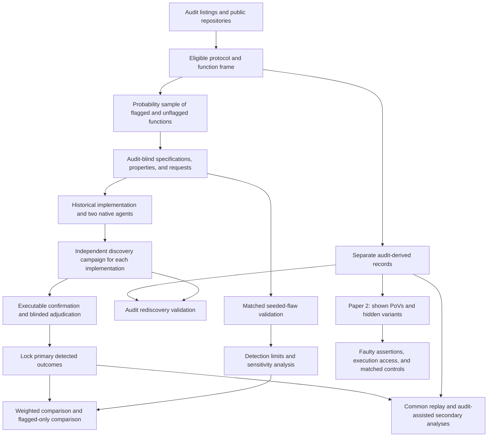

# AI Agent Function-Body Replacements in Audited Solidity: Executable Vulnerability Comparisons with Historical Developer Code

Proposal version 9.

## 1. Abstract

We study AI-generated replacements of individual functions in audited Solidity contracts. The comparison is with historical developer implementations, which may themselves contain AI-assisted code. A probability sample includes functions linked to audit findings and functions without such labels. Each implementation receives an independent discovery campaign that does not receive audit findings. A vulnerability counts only after an executable attack, a function-only correction, and independent adjudication establish it. The primary outcome combines compilation, ordinary functional checks, and a confirmed vulnerability. We compare estimates from flagged functions alone with estimates from the full population. Matched seeded flaws and independent investigation assess detection limits. A smaller core study forms the first paper. A second paper studies whether faulty repository assertions undermine PoV-guided repair. Existing simulations inform planning but do not yet validate the final design. Construction timings, detection validation, and inference checks must precede confirmatory collection.

## 2. Problem and motivation

Solidity developers already use AI tools. The Solidity Developer Survey 2025 reports that 58% of respondents use them daily and 49% use them to write code [Solidity Survey]. These are self-reports. They establish relevance, not the security of generated code.

Security failures in contracts can transfer funds or prevent legitimate operations. In a study of 516 exploitable smart-contract bugs, more than 80% were beyond the automated tools examined [Web3Bugs]. A separate study found substantial limitations in Solidity static analyzers [SAST Study]. These results motivate executable evidence of specific attacker effects.

Existing benchmarks answer several useful but different questions. SecureVibeBench reconstructs tasks around historical vulnerabilities and applies executable checks to developer and agent implementations [SecureVibeBench]. SusVibes evaluates functional and security outcomes on reconstructed vulnerable tasks [SusVibes]. Foresight-SWE studies tasks associated with later-fixed general defects [Foresight-SWE].

Selecting functions because a developer previously failed cannot establish the average difference across other functions. Agents might avoid known mistakes while introducing different vulnerabilities elsewhere. Conversely, a benchmark of historical failures may exaggerate the apparent advantage of replacement.

Unconditional comparisons are not new. Sajadi et al. compare human and agent patches for the same issues [Patch Security]. Cotroneo et al. compare human and AI functions paired by documentation [Cotroneo]. SolEval already regenerates function bodies in real Solidity repositories [SolEval]. SolAgent compares generated and historical Solidity using static analysis [SolAgent].

The first paper asks whether including unflagged functions changes the conclusion under executable security evaluation. Its contribution must be demonstrated on the collected data. Probability weighting alone is not a new technique.

The second paper concerns repair. Existing research already shows that incorrect tests can mislead agents [ImpossibleBench; ExecCritic; Calibration]. We ask a narrower question: does executing assertions that endorse an exploitable behavior preserve that behavior despite contrary PoV evidence, beyond the effect of ordinary incorrect assertions?

Neither paper estimates how much human review developers can safely remove.

## 3. Key insight and contributions

### Paper 1: compare both sampling designs on the same data

Audit labels define sampling strata. They are not security verdicts.

The core study includes functions linked to qualifying findings and functions without those labels. It reports:

- the comparison restricted to flagged functions;
- the weighted comparison over the eligible population;
- the difference between those estimates and any change in agent ranking.

A result showing little difference is informative. The study does not require a ranking reversal to count as successful research.

### Count discoveries made under a common procedure

An audit gives historical code an extra source of known vulnerabilities. Replaying audit-derived attacks does not provide an equally strong search for different agent flaws.

The primary endpoint therefore uses only flaws found by each implementation’s own campaign. Every campaign follows the same procedure and budget. It receives no audit report, finding list, audit-derived PoV, or audit-derived reference correction.

Pooling discovered attacks can also favor flaws shared by many agent attempts. For that reason, common replay is a separate analysis. It does not retroactively change the primary campaign label.

This defines a comparison of **detected vulnerabilities under a stated procedure**. It does not establish equal sensitivity or compare all latent vulnerabilities.

### Keep functionality separate from security

The primary endpoint counts implementations that compile, pass ordinary functional checks, and contain a confirmed vulnerability.

The study also reports compiled vulnerable outputs that fail functional checks. Failed implementations stay in the denominator. A lower vulnerability count caused by failed generation is not evidence of better security.

### Paper 2: distinguish security effects from ordinary test obedience

The pilot motivates a hypothesis but does not establish it.

In the repair study, the two preregistered OpenHands contrasts were:

- adding the shown PoV: 0 of 12 successes versus 2 of 12, with Holm-adjusted p = 0.96;
- allowing the shown PoV to be rerun: 10 of 12 versus 9 of 12, with Holm-adjusted p = 1.00.

The exploratory comparison between no execution and a full terminal was 10 of 12 versus 2 of 12. OpenHands succeeded in 9 of 12 runs with the shown-test tool. Codex succeeded in 6 of 12 both with that tool and with a full terminal.

These results concern one finding. The repairs have not yet been reviewed by a person. The hypothesis about faulty repository tests was formed after inspecting the pilot. The proposed repository-test tool is also a narrower intervention than a full terminal.

Paper 2 will compare security-related wrong assertions with matched wrong assertions about ordinary behavior. Both agent configurations remain part of that study.

## 4. Threat model and problem setting

### Historical replacement

Each task replaces one function body in a fixed audited snapshot. The historical developer implementation supplies the baseline.

The agent sees mature surrounding code and repository tests. These may have been written after the original function. The study does not recreate the developer’s original conditions or estimate a causal effect of replacing a human worker.

Historical code may contain AI assistance. Its provenance is recorded rather than assumed.

### Attacker and environment

The attacker is an unprivileged external account. It may deploy contracts, call public interfaces, and use borrowing or transaction ordering permitted by the protocol record.

The attacker cannot steal keys, assume an administrator role, change trusted oracle behavior outside the recorded assumptions, or modify deployed code.

Each protocol record specifies:

- protected assets and legitimate entitlements;
- available capital and permitted borrowing;
- reachable initial states;
- token and oracle behavior;
- transaction ordering and block assumptions;
- legitimate operation and resource limits.

All execution occurs offline. Arbitrary storage changes cannot manufacture an otherwise unreachable vulnerable state.

### Severity

The study uses one rubric across audit platforms. Original audit labels are retained separately.

High severity includes unauthorized loss of principal, protocol insolvency, and irreversible loss of access to protected assets. Medium severity includes theft of earned protocol entitlements and attacker-induced loss of a core operation under the recorded resource and recovery limits.

Ordinary implementation failure is not automatically a security vulnerability. Availability findings require an attacker action, affected legitimate users, and a demonstrated failure under permitted operating conditions.

Financial effects must reflect entitlement or backing. Attacker profit alone is insufficient. Temporary inconvenience, gas optimization, privileged misuse, and effects outside the threat model are excluded.

Before evaluation, the rubric records how recoverability, repetition, affected users, and protocol resource limits determine inclusion. Borderline cases remain unresolved.

### Attribution

A counted flaw requires all of the following:

- a PoV demonstrates a qualifying property violation;
- execution evidence connects the violation to the target function;
- replacing only that function body with a justified correction removes the violation under the same setup and attack;
- the correction preserves required functionality and passes the acceptance checks.

The intervention preserves signatures, surrounding code, dependencies, and initial-state procedures. It cannot disable the feature or hide a loss by changing accounting.

A historical implementation may serve as a correction only after the same checks. Its authorship is not evidence of correctness.

Two adjudicators outside the construction team assess severity and attribution. Packs conceal author, agent, and experimental arm as far as the code permits. The study records disagreements, resolution, and cases where blinding failed.

## 5. Approach

### 5.1 Frame and sampling unit

The existing pipeline downloaded 19,666 findings. It obtained complete source files for 7,826. Earlier filtering left 77 recent candidates and 43 with suitable public history. These are screening counts, not a validated sample.

The refreshed protocol frame starts from audit contest listings where possible. This allows protocols without qualifying findings to enter. If only a finding-derived frame is practical, the population is explicitly restricted to protocols with at least one qualifying finding.

A protocol must have an available audited snapshot, pinned dependencies, an offline build, and sufficient documentation to define its environment.

A function must be in audit scope, contain meaningful computation or state changes, and be replaceable without changing its signature or surrounding code. Reachability must be supported by tests or a documented call path.

The core unit is one function body.

Before sampling, the frame identifies functions implicated in qualifying findings whose corrective changes span several function bodies. Those functions are excluded from the core. The study reports the excluded share of functions and findings. Unrelated edits in a fix commit do not by themselves establish a multi-function correction.

Multi-function replacement is a named extension. It does not enter the core through an undocumented exception.

Audit stratum V contains eligible functions linked to qualifying High or Medium findings. Stratum N contains the other eligible functions. N means no qualifying audit label, not safe code.

### 5.2 Core allocation

The planning range is 15 to 20 protocols. Each selected protocol contributes up to two V functions and eight N functions. Small strata are censused. A protocol with no V functions can still contribute N functions.

The two primary agents receive three fresh attempts per function.

Protocols and functions are drawn with recorded inclusion probabilities. Allocation and selection rules are fixed before main outcomes. The point estimator uses inverse joint inclusion probabilities.

Construction failures remain in the sample. They are not replaced by convenient cases.

The minimum budget scenario uses 15 protocols. The 20-protocol allocation is an expansion that requires favorable measured costs. Section 8 distinguishes the assumed budget from measured person-hours.

### 5.3 Provenance and AI assistance

For each sampled function, the study records available history around its introduction. Evidence includes agent instruction files, AI co-author trailers, and pull-request text.

The categories are evidence of assistance, no observed evidence, and unresolved provenance. An instruction file is a marker, not proof that the target lines were generated by AI. Absence of a marker is not proof of human-only authorship.

All categories remain in the primary historical-developer comparison. The unflagged subset is a preregistered secondary analysis with its own denominator and uncertainty.

Publication dates for code, fixes, and audit reports are recorded separately. A report published after a model cutoff does not establish that the code was unseen.

### 5.4 Audit-blind task construction

The request and primary-property builders do not receive audit findings, historical fixes, or the removed function body. They receive permitted documentation, signatures, callers, and surrounding code.

Every request sentence records its source. The request is frozen before agent runs.

Primary security properties must follow from documented entitlements and operations. They cannot be copied from an audit finding. An audit-derived invariant, differential reference, or attack cannot enter primary discovery under another name.

Audit-informed work uses separate records and contexts. People who already know a development case’s findings cannot provide its blind construction evidence.

The feasibility pilot must test whether this separation is practical. Audit blindness is not established merely by omitting a report from an LLM prompt.

A separate diagnostic, completed before evaluated runs, classifies requests as favoring vulnerable behavior, neutral, or favoring corrected behavior. Requests that describe vulnerable behavior are retained when the acceptance specification remains coherent. Results are stratified by this classification.

A task lacking a coherent specification remains unresolved. It is not silently removed.

### 5.5 Functional and security checks

Checks are classified before generation.

Ordinary functional checks establish intended operations, outputs, and useful completion. Explicit security checks establish forbidden attacker outcomes. Assertions that endorse known faulty behavior are not accepted as correctness checks.

An ordinary functional check is not removed merely because it also catches a security flaw. The historical implementation is not assumed to pass the resulting suite.

The classification record explains overlaps. The study reports the original repository-test outcome separately from the frozen functional outcome.

A PoV has three semantic results:

| Result | Meaning |
|---|---|
| Violation observed | Valid execution demonstrates the forbidden outcome. |
| Violation checked and absent | The attack scenario executes and establishes that the outcome did not occur. |
| Unresolved | Setup, execution, instrumentation, or interpretation prevents a valid judgment. |

An exit code is not a security verdict. A defensive revert is acceptable only when the harness establishes its intended meaning and required legitimate operations still work.

### 5.6 Agent configurations

The primary configurations are Claude Code and Codex CLI with vendor-supported models current at the study freeze.

Exact model identifiers, agent versions, reasoning settings, prompts, permissions, and budgets are pinned. Both run on the full core sample. Each session starts from a fresh workspace.

The target body is replaced with a placeholder. Only the submitted body is applied to evaluation. Changes to tests, dependencies, or unrelated code do not alter the evaluated artifact.

Original history, fixes, cached target copies, generated artifacts exposing the target, and hidden evaluation material are removed. Network access is restricted to model APIs.

The pilot configurations, translated integrations, and a documented SolAgent adaptation are extensions. Their results cannot silently enlarge the primary family or its discovery effort.

### 5.7 Primary discovery

Every scheduled implementation receives an independent campaign under the same frozen procedure.

The procedure includes:

- Foundry property-based fuzzing;
- the same two LLM reviewers;
- a fixed candidate ordering rule;
- equal candidate-confirmation limits.

Reviewer identities and versions are pinned. Their relationship to the generator model families is reported.

Primary reviewers receive the implementation, relevant context, frozen properties, and request. They receive no author label, audit findings, audit PoVs, or historical correction.

Each campaign operates without reports or attacks from other implementations. Exact duplicate outputs may share deterministic execution work, but they do not acquire extra stochastic search opportunities through deduplication.

A campaign label is positive only when its own search produces a candidate that passes executable confirmation and independent adjudication. Confirmation records preserve the candidate’s origin and chronology.

The primary records are locked before common replay or audit-assisted analysis.

### 5.8 Secondary replay and audit rediscovery

After primary records are locked, every validated common-procedure PoV is replayed across the function’s cohort. Attribution is checked for each affected implementation.

Audit-derived PoVs are then evaluated separately. They do not change primary labels.

The study reports four views:

- discoveries from each implementation’s own audit-blind campaign;
- discoveries after pooling common-procedure PoVs;
- own-campaign discoveries supplemented by audit-derived attacks;
- the union after common and audit-assisted replay.

The latter views are secondary. Their differences reveal the consequences of pooled search and audit knowledge.

For historical V functions, the study reports how often the blind campaign independently rediscovers a qualifying audit flaw. It distinguishes missing rediscovery from an audit finding that cannot satisfy the study’s confirmation standard.

### 5.9 Detection validation

Matched seeded flaws supplement natural rediscovery.

A separate builder inserts the same vulnerability pattern into historical and agent implementations of a function. Patterns come from other protocols. Each seed must compile, preserve unrelated behavior, and produce an attributable violation under the same threat model.

Invalid seeds are recorded. They are not quietly replaced until the desired result appears.

Primary discovery is run blind on seeded and unseeded controls. Seed locations and known attacks remain hidden until results are locked. Seeded artifacts never enter the natural vulnerability estimate.

**Core allocation.** The core funds 60 matched pairs. Each pair contains a seeded historical implementation and a seeded implementation from one agent configuration. This requires 120 seeded artifacts.

The planned allocation is 15 pairs for each combination of audit stratum and agent configuration. Pairs are spread across protocols and use distinct functions where possible. Repeated patterns are recorded. Selection and allocation are fixed without seeing discovery results.

The pooled diagnostic describes this balanced validation mixture. It is not a population-weighted recall estimate. The report also shows each stratum and configuration separately, without claiming that those smaller groups have the pooled precision.

**Planning precision.** Part C of `tools/power_sim_v10.py` gives an analytic approximation, not a simulation of clustered observations. The results are in `tools/power_results_v10_c.txt`.

Let \(\delta\) be the probability that exactly one implementation in a pair has its seed detected. Let \(d\) be the difference in detection probability. The approximate half-width is

\[
1.96\sqrt{\frac{\operatorname{deff}(\delta-d^2)}{n}}.
\]

The recorded calculation assumes \(d=0.1\) and a design effect of 1.5.

| Matched pairs | Discordance 0.2 | Discordance 0.3 | Discordance 0.4 |
|---|---:|---:|---:|
| 60 | 0.135 | 0.167 | 0.194 |
| 120 | 0.096 | 0.118 | 0.137 |
| 240 | 0.068 | 0.083 | 0.097 |
| 480 | 0.048 | 0.059 | 0.068 |

The core therefore makes no promise of a 0.05 half-width. Even 480 pairs meet that target only in the lowest-discordance row shown.

The funded sample is a coarse diagnostic. It may reveal a large detection imbalance, but it cannot establish equal recall or rule out smaller imbalances. A nonsignificant difference is not evidence that detection is comparable.

The final intervals account for the actual protocol and pattern dependence. The assumed design effect is not treated as measured. Greater discordance or dependence leads to wider reported intervals, not an unplanned increase in the core sample.

Two independent auditors also investigate a probability sample of natural implementations. Sampling covers both authors, both strata, and positive, negative, and unresolved campaign results. Their reference standard is investigation under a stated budget, not proof of absence.

**Month-one demonstration.** Before confirmatory collection, the full primary campaign is tested on development functions with independently confirmed vulnerabilities. The eight pilot findings provide candidate cases, but only findings that meet the applicable confirmation standard enter the denominator.

Properties and campaign inputs are constructed without audit knowledge. People already familiar with a finding cannot provide its blind construction evidence.

The campaign must rediscover at least half of the qualifying development vulnerabilities. The same rule applies to the initial campaign and every revision.

If it fails, the procedure is revised and assessed on fresh development cases. Results from earlier attempts remain reported. No confirmatory campaign starts until the rule is met. If the development reserve is exhausted first, the study stops for redesign.

This is a practical development criterion, not an estimate of population recall or proof of comparable sensitivity.

### 5.10 PoV-guided repair

Paper 2 begins from a validated vulnerable implementation. A shown PoV supplies executable evidence. Hidden attacks use different states, boundaries, or call sequences.

A successful repair must compile, preserve legitimate behavior, block frozen attacks, and have no confirmed new attributable vulnerability under the declared evaluation. Required unresolved checks prevent a success verdict.

Later discoveries are reported separately and replayed consistently. Passing the shown PoV is never sufficient.

### 5.11 Worked example: finding 63008

The pilot concerns the downward tick iterator in Sorella L2 Angstrom. The recorded vulnerable implementation skips a starting boundary.

The pilot includes swap and reward scenarios. In the reward scenario, an honest liquidity provider has 49 ETH of pending rewards and the attacker obtains 48.88 ETH net. Four repository tests expect the faulty boundary behavior.

These are preliminary scenario results. They do not yet satisfy the full standard above.

The original reward PoV asserts attacker profit. The stronger loss artifact changes the entire iterator file. Neither substitutes for a victim-entitlement assertion combined with a correction to only the target body.

The required evidence package must:

- assert the victim’s entitlement and the backing available for it;
- record attacker capital and transaction-ordering assumptions;
- demonstrate the function-only intervention;
- test the attack with H-02 corrected independently;
- state which effects depend on H-02 or unchanged surrounding code.

That package has not been completed.

The repository also contained a `CLAUDE.md` before the faulty commit. The baseline is therefore described as historical developer code.

The pilot’s two added control-group flaws both failed a repository functional test. They motivate reporting K, but do not establish an added-flaw rate for the primary D endpoint.

## 6. Research questions and evaluation plan

### 6.1 Research questions

**RQ1, paper 1:** How do supported AI agents’ function-body replacements compare with historical developer implementations in detected, functionally passing vulnerabilities?

**RQ1 design comparison:** How do the estimate and agent ordering change when analysis uses only audit-flagged functions instead of the weighted eligible population?

**RQ4, paper 1 validation:** How does the discovery procedure behave across authors, strata, and known flaw patterns, and how sensitive are conclusions to missed flaws?

**RQ2, paper 2:** Does executing assertions that endorse a vulnerability preserve exploitable behavior during writing and PoV-guided repair beyond the effect of matched incorrect non-security assertions?

**RQ3, optional extension:** How does request wording change vulnerability reproduction within the same task?

### 6.2 Outcomes and unresolved attempts

Let:

- \(C\) indicate compilation;
- \(L\) indicate passing the frozen ordinary functional suite;
- \(V_{\mathrm{own}}\) indicate a vulnerability confirmed from the implementation’s own blind campaign.

The primary endpoint is

\[
D=C L V_{\mathrm{own}}.
\]

The main secondary endpoint is

\[
K=C V_{\mathrm{own}}.
\]

All scheduled attempts remain in the denominator. The historical implementation contributes one observation per function, not one per agent attempt.

The report also gives working outputs without a confirmed flaw, compilation failures, functional failures, and unresolved evaluations.

For the descriptive confirmed-count statistic, an unresolved attempt contributes zero unless its endpoint is already established as one. This means “not confirmed,” not “safe.”

Each unresolved endpoint also receives an admissible interval based on known dimensions. A known compilation failure fixes D and K at zero. A known functional failure fixes D at zero even if security remains unresolved.

The lower difference bound assigns unresolved agent outcomes their lowest admissible values and unresolved developer outcomes their highest. The upper bound reverses those assignments.

A directional claim must survive uncertainty at the adverse bound. Jointly setting both authors’ unknowns to zero, or both to one, is not sufficient. The analysis constructs simultaneous confidence bounds for the endpoint bounds under the final calibrated design.

A lower K or D is not described as better agent security when working completion falls. The phrase “better security” additionally requires evidence that the rate of working outputs with no confirmed flaw does not fall. Otherwise the result is described as a difference in detected outcomes and capability.

### 6.3 RQ1 estimand, inference, and planning evidence

The target is the finite eligible function frame declared before sampling. For agents, the target averages over fresh runs under the frozen configuration and budget. For historical code, it uses the recorded implementation.

For endpoint \(Y\), configuration \(c\), and audit stratum \(s\), the estimator is

\[
\widehat{\Delta}^{Y}_{c}
=
\sum_s \pi_s
\frac{\sum_{i\in S_s}w_i
(\overline{Y}_{Aci}-Y_{Hi})}
{\sum_{i\in S_s}w_i}.
\]

Here \(w_i\) is the inverse joint inclusion probability and \(\pi_s\) is the stratum’s share of the eligible frame.

The proposed standard error is the delete-one-protocol jackknife. Each replicate removes the protocol and all its paired observations. Population stratum shares remain fixed.

This is an approximation. Its adequacy must be checked under the actual finite sampling design, including sampling fractions, empty V strata, unequal weights, and repeated attempts. The study makes no automatic claim about protocols outside the frame.

The two configurations form the primary Holm family for D. Holm-adjusted tests determine directional significance. Pointwise intervals describe estimation uncertainty and are not substituted for the family decision.

K, the stratum analyses, and the comparison between sampling designs are secondary unless separately included in the preregistered multiplicity plan.

#### Current simulation evidence

The current code is `tools/power_sim_v10.py`, using the data generator in `tools/power_sim_v8.py`. RQ1 results are in `tools/power_results_v10_a.txt`.

Earlier v8 power tables and v9 calibration results are superseded for this procedure. The provenance note in `tools/power_results_v9.txt` distinguishes its earlier Part A output from later versions.

The model includes two configurations, three attempts, unequal frames, compilation, functional success, detection, and a protocol effect that differs between agents and historical code.

Agent compilation probability is 0.9 and functional success probability is 0.8. Historical code always compiles and passes functional checks in this simulation. Protocol, function, and protocol-by-author standard deviations are 0.5, 1.5, and 0.5.

Detection scenarios use equal recall of 0.7, agent recall 0.8 with historical recall 0.5, and the reverse. These are assumptions, not measured rates.

For each protocol count and target difference, the generator uses six scenarios: three recall patterns and two historical N-stratum vulnerability rates.

#### Actual boundary generation

The generator sets the N-stratum difference from each study’s frame share:

\[
d_N=\frac{\Delta-\pi_V d_V}{1-\pi_V}.
\]

It converts that difference into an agent vulnerability probability, checks that the probability is valid, and calibrates the intercept used to generate outcomes. It asserts that the resulting true difference equals the target within \(10^{-12}\).

Thus the boundary datasets have true differences of \(+0.05\) or \(-0.05\). They are not shifted zero-effect estimates.

The negative boundary requires different feasible rates. It uses an agent V-stratum vulnerability rate of 0.2 and historical N rates of 0.12 or 0.15. The zero and positive-boundary conditions use an agent V rate of 0.6 and historical N rates of 0.02 or 0.05.

These conditions exercise both boundaries. They do not imply that the boundaries share one fixed underlying population.

#### Calibration and independent validation

The calibration selects:

- a nominal level for Holm’s difference tests;
- a multiplier for pointwise 95% intervals;
- a multiplier for equivalence tests with margins \(-0.05\) and \(+0.05\).

The equivalence margin is a planning choice about detected D, not a safety threshold.

A configuration is declared equivalent only when both one-sided tests pass. Family false equivalence is counted when either configuration is declared equivalent in a boundary study.

Calibration and validation use independent streams. Each contains 600 studies per scenario and condition.

| Protocols | Holm level | Interval multiplier | Equivalence multiplier | Worst validation family-wise error | Minimum validation coverage | Worst validation family false equivalence |
|---|---:|---:|---:|---|---|---|
| 15 | 0.04 | 1.12 | 1.34 | 0.042 ± 0.016 | 0.948 ± 0.018 | 0.058 ± 0.019 |
| 20 | 0.035 | 1.18 | 1.40 | 0.038 ± 0.015 | 0.965 ± 0.015 | 0.038 ± 0.015 |

Coverage is checked at zero and at both boundaries. The reported Monte Carlo uncertainties concern the selected worst rates. They are not simultaneous bounds over the scenario grid.

The 15-protocol results are compatible with the nominal targets within Monte Carlo uncertainty. They do not establish strict error control under every possible population.

At an exact zero difference, the minimum configuration-specific equivalence power in the worst scenario is 0.12 with 15 protocols and 0.19 with 20. These are not probabilities that both configurations establish equivalence.

A null result will therefore often remain inconclusive. Nonsignificance does not establish equivalence or safety.

#### Power and interval widths of the selected procedure

Power and widths were recomputed using the selected Holm levels and interval multipliers. Each alternative scenario uses 400 studies.

The following ranges summarize the recorded rows. Power is the lower configuration-specific power in each scenario. The ranges are not confidence intervals.

| Protocols | Alternative group | Mean true difference across scenarios | Minimum configuration power across scenarios | Mean pointwise 95% half-width across scenarios |
|---|---|---|---|---|
| 15 | Smaller differences | +0.022 to +0.042 | 0.13 to 0.38 | 0.045 to 0.046 |
| 15 | Larger differences | +0.069 to +0.090 | 0.55 to 0.93 | 0.055 to 0.067 |
| 20 | Smaller differences | +0.022 to +0.042 | 0.13 to 0.59 | 0.039 to 0.041 |
| 20 | Larger differences | +0.069 to +0.090 | 0.70 to 0.98 | 0.049 to 0.060 |

The core cannot reliably detect the smaller differences. Even the larger scenarios do not establish a worst-scenario power of 0.80 at either allocation.

The study is justified as an estimation and design-comparison study. It does not promise a significant author difference.

The simulation changes underlying agent vulnerability rates when recall changes to hold an observed N-stratum difference fixed. It is not a sensitivity analysis that holds latent code quality fixed.

#### What remains before confirmatory collection

At month two, the procedure is checked against:

- measured frame sizes, inclusion probabilities, allocation, and sampling fractions;
- development evidence on compilation, functional status, and detection;
- historical functional failures and dependence among outcome components;
- unresolved outcomes and the adverse-bound analysis;
- a range of protocol-by-author variation;
- equal-rate and offsetting nulls, partial nulls, and mixed boundary configurations;
- recall changes while latent code quality remains fixed.

V10’s family-equivalence check covers configurations jointly at each boundary. It does not cover every mixture of boundary, interior, and non-equivalent configurations. Those cases are included before a general family-equivalence claim.

Final calibration uses one stream and validation another. Selection criteria, simulation uncertainty, and the action on failure are fixed before confirmatory outcomes. A grid endpoint is not accepted merely because no candidate passes.

Power and widths are recomputed if the selected procedure changes. Equivalence is withheld if its validation fails. If directional inference fails validation, the study reports descriptive estimates and clearly labels their uncertainty.

### 6.4 Testing the sampling contribution

On the same collected data, the study reports the V-only estimate beside the weighted estimate.

It also reports their difference, with uncertainty computed jointly so that shared observations are preserved. Agent ordering is shown with its uncertainty. An apparent reversal based only on noisy point estimates is not treated as established.

This comparison isolates the consequence of including and weighting unflagged functions under this study’s evaluation. It is not a literal replication of SecureVibeBench or Foresight-SWE, whose tasks and evaluation differ.

The report also separates V functions by request classification and separates functions according to whether repository tests directly call the target.

### 6.5 Detection sensitivity and validation decisions

For each stratum, let \(r_{As}\) and \(r_{Hs}\) be detected D rates. Let \(s_{As}\) and \(s_{Hs}\) denote assumed detection sensitivities among truly vulnerable working implementations.

Under a simplifying model with negligible false confirmations, the corresponding latent difference is

\[
\Delta_{\mathrm{latent}}
=
\sum_s \pi_s
\left(
\frac{r_{As}}{s_{As}}
-
\frac{r_{Hs}}{s_{Hs}}
\right),
\]

restricted to feasible rates.

The preregistered report shows the sensitivity combinations for which this difference is zero and those that reverse its sign. For a single stratum with positive rates, the boundary is \(s_A/s_H=r_A/r_H\).

There is no single numerical reversal threshold before the rates are observed. Development data will define plausible scenario ranges before main collection.

Seeded recall informs sensitivity to those patterns. It does not identify natural-flaw recall. The report therefore presents seeded evidence, natural audit rediscovery, and expert investigation separately.

The 60-pair core validation cannot certify equal sensitivity within 0.05. Its uncertainty is carried into interpretation. The analysis does not replace that uncertainty with a pooled point estimate.

If plausible sensitivity ranges reverse the direction, the study reports that vulnerability prevalence is not identified. A difference in detected outcomes may still be reported with its narrower meaning.

### 6.6 Paper 2: faulty assertions and PoV-guided repair

Paper 2 has a separate sample, budget, preregistration, and inference validation.

Within tasks, the experiment varies:

- whether the assertion is correct or incorrect;
- whether repository-test execution is permitted;
- whether the incorrect assertion concerns the security property or matched non-security behavior.

Both execution arms see the same test source. Both receive identical read, search, edit, and fixed-build tools. Only the execution arm receives the repository-test tool.

There is no unrestricted terminal. Build and test tools restore fixed settings outside the writable workspace. The enforcement check includes test renaming, scripts, configuration edits, and instrumentation through allowed paths.

For repair, both arms receive the same shown PoV and the same tool for rerunning it. Hidden evaluation attacks remain inaccessible.

**One outcome in every arm.** The primary outcome is retention or reproduction of the same attributable vulnerability. This applies to security-related assertions and ordinary assertions alike.

A wrong ordinary output is not substituted for a vulnerability outcome. Functional errors and complete repair success are recorded separately.

Let \(p_{k,t,x}\) be vulnerability retention probability. Here \(k\) denotes assertion type, \(t\) denotes whether the assertion is wrong, and \(x\) denotes execution permission.

For each assertion type,

\[
I_k=
(p_{k,1,1}-p_{k,1,0})
-
(p_{k,0,1}-p_{k,0,0}).
\]

The security-specific contrast is

\[
\theta=I_{\mathrm{security}}-I_{\mathrm{ordinary}}.
\]

A security-specific claim requires evidence that \(\theta\) is positive. Merely finding that incorrect tests harm repair is insufficient. Trajectories showing retention despite contrary PoV evidence provide secondary mechanism evidence.

Inference clusters by protocol and allows effects to vary by function. The primary analysis averages function contrasts within protocols and compares protocol means. Unequal allocations require a declared weighting rule and matching simulation. A random-slope model is secondary.

Both configurations are protected. Claims beyond one configuration require the same effect direction in both. The replication is not removed to rescue the budget.

#### Current power evidence

Part B of `tools/power_sim_v10.py` uses vulnerability retention in every arm. Results are in `tools/power_results_v10_b.txt`. Earlier Part B results are superseded.

The simulation uses 20 protocols, three attempts per cell, a two-sided test at 0.05, and 1,000 studies per row. Function-specific interaction effects have standard deviation 0.75 on the logit scale.

The parameters below are generating-model interactions. Their differences are not the probability-scale contrast \(\theta\).

| Functions | Equal interactions: 0 and 0 | Equal interactions: 1.0 and 1.0 | Equal interactions: 1.5 and 1.5 |
|---|---:|---:|---:|
| 40 | 0.056 | 0.047 | 0.049 |
| 80 | 0.043 | 0.045 | 0.050 |
| 120 | 0.046 | 0.057 | 0.050 |
| 160 | 0.045 | 0.043 | 0.055 |

Equal interactions produce zero expected contrast because the other generating conditions are symmetric across assertion types. These checks include nonzero interactions. They support approximate calibration for the tested settings, not every zero-contrast population.

| Functions | Security 1.0, ordinary 0 | Security 1.5, ordinary 0.5 | Security 1.5, ordinary 0 | Security 2.0, ordinary 1.0 |
|---|---:|---:|---:|---:|
| 40 | 0.279 | 0.304 | 0.560 | 0.330 |
| 80 | 0.517 | 0.576 | 0.869 | 0.487 |
| 120 | 0.690 | 0.702 | 0.967 | 0.648 |
| 160 | 0.805 | 0.831 | 0.991 | 0.809 |

The rows show why 80 functions cannot serve as an automatic confirmatory threshold. That allocation has power 0.869 for the strongest contrast shown at that size, but substantially lower power for the other alternatives.

A candidate allocation of 160 functions reaches at least 0.80 for the displayed alternatives. This is not a guarantee for smaller effects, different baseline rates, or a claim requiring successful replication.

#### Separate allocation decision

Before launching paper 2, the preregistration states a smallest effect of interest on the probability scale. The simulation must report the corresponding \(\theta\), not infer it from a logit-parameter difference.

It then checks power for both configurations and the intended writing and repair claims. Multiplicity, missing outcomes, treatment heterogeneity, and floor and ceiling rates are included. A test calibrated for one configuration and endpoint is not presented as validation of the entire claim family.

Paper 2 proceeds as confirmatory only if the allocation and funded workload support that declared effect and decision rule. Otherwise it remains exploratory or is deferred. The first paper’s budget is protected.

### 6.7 Natural tests and optional extensions

Natural faulty tests require semantic confirmation that the assertion endorses the flaw. Passing on vulnerable code and failing on a correction is only a screening signal.

A full census of V functions is attempted only if measured screening costs permit. Otherwise the study estimates the weighted share from sampled V functions, with protocol-aware uncertainty and bounds for unresolved cases.

Natural cases provide separate descriptive evidence. They do not enlarge the injected experiment statistically.

Named extensions are:

- request wording within the same function;
- the six pilot agent configurations;
- a SolAgent adaptation under the same replacement restrictions;
- multi-function replacement tasks;
- additional report-only repair conditions.

Extensions have separate budgets and cannot change the locked core labels.

### 6.8 Threats to validity

**Historical context.** Mature snapshots differ from original development conditions.

**AI assistance.** Historical code may be partly generated. Provenance markers are incomplete.

**Exposure.** Public code or fixes may have appeared in training. Dates and trajectory similarity cannot prove non-exposure. Recall flags are reported, and strongly supported cases receive a secondary exclusion analysis.

**Detection.** Equal procedure does not establish equal sensitivity. Human N code has already survived an audit. Seeded flaws may be easier than natural ones.

**Properties.** Audit-blind properties may omit important behavior. Their source records and development controls expose some gaps but do not prove completeness.

**Sampling.** Buildability, documentation, and the single-function restriction limit the population. Missing construction outcomes remain visible.

**Inference.** Current simulations are planning evidence. Final tests require independent validation under the actual design.

**Interpretation.** A passing functional suite does not imply deployment readiness. No confirmed vulnerability does not imply safety.

## 7. Related work

The study reuses established techniques. Its first contribution is an empirical comparison of sampling designs under executable evaluation. Its second, separate contribution is a controlled security experiment with a matched non-security control.

SolEval is the closest function-replacement setup [SolEval]. Its vulnerability metric uses Slither. Our design adds a probability-defined historical comparison, executable attribution, and direct measurement of how V-only selection changes conclusions.

Sajadi et al. and Cotroneo et al. already compare human and generated code without selecting only historical failures [Patch Security; Cotroneo]. Therefore unconditional comparison itself is not claimed as novel.

SecureVibeBench supplies close precedent for reconstructed tasks and common PoVs [SecureVibeBench]. EVMbench supplies close precedent for executable Solidity security evaluation [EVMbench]. PoCo supplies precedent for generating attacks from audit findings [PoCo]. Audit-derived generation remains secondary in paper 1 because it would compromise primary blindness.

Fault-enforcing tests are an existing construct [Fault-Enforcing Tests]. ImpossibleBench already manipulates conflicting tests and execution feedback [ImpossibleBench]. ExecCritic separates test construction from repair because generated tests can encode incorrect targets [ExecCritic].

Calibration, Not Compilation reports harmful unit-test feedback in probabilistic-program repair. Its setting differs, but the general claim that execution feedback can reinforce an incorrect solution is established [Calibration].

Paper 2’s difference from ImpossibleBench is the contrast between assertions endorsing a confirmed exploitable behavior and matched non-security errors, with PoV evidence and hidden attacks. The experiment must demonstrate that difference rather than rely on Solidity as its novelty.

| Work | Closest overlap | Difference addressed here |
|---|---|---|
| SolEval | Function-body generation in Solidity repositories | Probability-weighted historical comparison with executable attribution |
| Cotroneo et al. | Human and AI functions paired by documentation | Real audited context, executable attacks, and declared sampling weights |
| Sajadi et al. | Human and agent patches on common issues | Direct comparison of flagged-only and population estimates |
| SolAgent | Solidity generation and historical-code comparison | Executable security outcomes rather than static warnings |
| SecureVibeBench | Historical vulnerabilities and common PoVs | Unflagged sampling and independent primary discovery |
| SusVibes | Functional and security outcomes on vulnerable tasks | Comparison over a declared population beyond known failures |
| Foresight-SWE | Tasks associated with historical defects | Security-specific evidence and unflagged functions |
| EVMbench | Executable Solidity detection, patching, and exploitation | Historical replacement comparison with sampling weights |
| PoCo | Audit-derived exploit construction | Used for secondary validation and repair, not blind primary discovery |
| P2Patch and PatchBench | Exploit-guided repair and broader repair evaluation | Separate experiment on faulty assertions and execution |
| Fault-Enforcing Tests | Tests that preserve faulty behavior | Controlled effect on attributable vulnerabilities |
| ImpossibleBench | Conflicting tests and access to execution | Matched security and non-security assertions with PoV evidence |
| ExecCritic | Incorrect tests and independently frozen validation | Repository assertions and security-specific contrasts |
| Calibration, Not Compilation | Harmful test feedback during repair | Executable attacker outcomes rather than statistical misspecification |
| This project | Historical Solidity replacement and PoV-guided repair | Tests the effect of sampling design and separates security-specific test effects |

The Foresight-SWE source is a submission under review. Claims here are limited to the verified abstract.

## 8. Feasibility, risks and fallback plans

### Protected core

Paper 1 contains RQ1 and its detection validation. It uses two native configurations and three attempts per function.

The minimum planning allocation is 15 protocols, with up to two V and eight N functions per protocol. The 20-protocol option is an expansion.

The core includes 60 matched seeded pairs as a coarse diagnostic. It does not include the much larger sample needed to promise a 0.05 recall-difference half-width.

Paper 2 and all other experiments have separate resource allocations. They cannot consume the time needed to complete the first paper.

This is a proposal-stage budget based on stated assumptions. Development measurements replace those assumptions before main collection.

### Required development measurements

Before main collection, at least three development cases must complete every required step with people performing the designated human work. One case must contain a probability-selected set of N functions. Failures remain in the timing record.

Measurements cover:

- protocol preparation and provenance;
- audit-blind specification and property construction;
- functional suites and request checks;
- blind discovery and confirmation;
- function-only correction;
- independent severity and attribution decisions;
- seeded validation;
- replay, packaging, and disclosure review.

Development cases are separate from confirmatory cases.

The 63008 evidence package is also completed during this phase. Failure to satisfy the standard is reported and prevents its use as a validated showcase.

### Costed plan: known inputs and assumptions

The supplied process log reports automated PoV construction taking approximately 15 to 20 minutes and 120,000 to 150,000 tokens per finding for three report-assisted cases.

Those figures do not measure human task-construction hours or blind discovery costs.

The repair pilot recorded $24.45 in priced agent calls and 143 million tokens across 144 runs. Aider usage was not priced. Those configurations and cache patterns do not justify a dollar estimate for current native agents.

The budget therefore separates assumed person-hours from compute quantities and current price quotes.

Let:

- \(P\) be protocols;
- \(F_V\) and \(F_N\) be sampled functions;
- \(F=F_V+F_N\);
- \(Q\) be candidate confirmations;
- \(B\) be seeded validation artifacts;
- \(E\) be independently investigated natural implementations.

| Work | Core quantity | Cost basis |
|---|---|---|
| Protocol preparation | \(P\) | Hours per protocol |
| Task construction | \(F_V\) and \(F_N\) | Separate hours for each stratum |
| Agent generation | \(F\times2\times3\) | Measured tokens, runtime, and current quoted prices |
| Historical and agent discovery | \(F+(F\times2\times3)\) campaigns | Campaign cost and supervision |
| Confirmation | \(Q\) | Hours and execution cost per candidate |
| Independent adjudication | Two assessments per confirmation package | Review hours and paid rates |
| Seeded validation | 60 pairs, 120 artifacts | Construction, checks, campaigns, and uncertainty analysis |
| Natural validation | \(E\), reviewed independently | Fixed paid-hour allowance and measured investigation time |
| Replay | \(\sum_i m_i p_i\) | Implementations times validated PoVs for each function |
| Release and disclosure | Recorded case workload | Preparation and follow-up hours |

Candidate workload is planned against the pilot’s 8 of 64 reviewed repairs and 3 of 13 control implementations requiring confirmation work. These are sensitivity inputs from different tasks, not estimates of the new core’s confirmation rate.

Before deduplication, the corresponding planning expressions are

\[
Q_{\mathrm{low}}
=
\bigl[F+(F\times2\times3)\bigr]\frac{8}{64},
\]

and

\[
Q_{\mathrm{high}}
=
\bigl[F+(F\times2\times3)\bigr]\frac{3}{13}.
\]

They do not cap discoveries or justify ignoring excess candidates. The final budget also records the frozen confirmation cap and the consequences of unresolved candidates.

Total researcher hours include

\[
H=
P h_{\mathrm{protocol}}
+F_V h_V
+F_N h_N
+Q h_{\mathrm{confirmation}}
+B h_{\mathrm{seed}}
+H_{\mathrm{analysis}}
+H_{\mathrm{release}}
+H_{\mathrm{development}}
+H_{\mathrm{operation}}.
\]

Paid adjudication and independent investigation are budgeted separately. Compute costs include generation, review, confirmation, validation campaigns, and replay.

### Pilot throughput

The process log records the assisted pilot work across its dated sessions. It includes tracing and PoV construction, task requests, the agent harness, the control group, additional attacks, and the 144-run repair study.

Human-review steps in that work were performed by LLM subagents rather than independent people. Calendar throughput is therefore context for the assumptions below. It is not a measurement of complete human-reviewed throughput under the new standard.

### Planning assumptions for person-hours

The ranges below are assumptions. Development measurements replace them at month two.

| Work | Unit | Assumed hours per unit | 15 protocols: 30 V and 120 N | 20 protocols: 40 V and 160 N |
|---|---|---|---|---|
| Protocol preparation, provenance, threat-model record, properties | Protocol | 6 to 12 | 90 to 180 | 120 to 240 |
| V task: tracing, specification, request audit, PoV and variant, function-only correction | Function | 4 to 8 | 120 to 240 | 160 to 320 |
| N task: specification, request audit, property check | Function | 1.5 to 3 | 180 to 360 | 240 to 480 |
| Candidate confirmation by a person | Candidate | 0.5 to 1.5 | 66 to 363 | 88 to 484 |
| Seed construction and validation checks | Artifact: 120 | 0.5 | 60 | 60 |
| Analysis, writing, release and disclosure | Study | 240 | 240 | 240 |
| **Subtotal before development and operation reserve** | | | **726 to 1,413, plus 30** | **878 to 1,794, plus 30** |

The subtotals retain the earlier arithmetic and explicitly add the extra 30 hours caused by changing 60 artifacts to 60 matched pairs. They are calculated budget quantities, not new measurements.

Candidate counts are 131 to 242 at 15 protocols and 175 to 323 at 20 under the planning expressions.

The annual planning ceiling is 1,800 student hours. For the 15-protocol core, the reserve is

\[
H_{\mathrm{reserve}}
=
1,800-(1,413+30).
\]

This reserve is protected for development demonstrations, unsuccessful task construction, campaign setup and supervision, replay operation, and unexpected repair of research infrastructure. Those activities are not assumed free.

The main-task rows cover the planned task work. Additional failed effort draws from the reserve. Time spent on failed cases remains recorded and reduces the remaining allocation.

At the pessimistic rates, the 20-protocol subtotal already exceeds the annual ceiling before this reserve. That option is therefore not a pessimistic minimum. It is selected only if measured rates leave enough time for the same protected activities.

### Independent work and compute

The existing paid allowance is two independent adjudicators at about 0.5 hours per confirmation package. At 15 protocols, that is 66 to 121 hours each. Natural validation has an allowance of about 100 auditor hours.

Seed construction checks are included in the artifact allowance. Independent checks and adjudication of seed validity draw from a separately recorded allocation within the paid work. This allocation must be reconciled with the candidate workload before collection; it is not assumed to fit without review.

Audit-blind development work requires people or isolated construction processes without prior knowledge of the findings. The staffing plan identifies them and includes their effort in the development or paid-work allocation. The student cannot supply blinded evidence for a case they already know.

Compute quantities are priced at month two using the selected configurations and measured token use. The launch decision requires a funded ceiling for those calls and for paid work. Pilot dollar costs are not extrapolated to different models.

### Minimum deliverable and decision rule

Under the stated pessimistic assumptions, the minimum planning deliverable is paper 1 with 15 protocols, two configurations, three attempts, and the coarse 60-pair validation.

Its scientific claim remains a comparison of detected outcomes. The validation does not justify a claim of equal natural-flaw recall. The sensitivity analysis may conclude that latent vulnerability differences are not identified.

Before main collection, development measurements replace unit-cost assumptions. The plan must fit task work, independent checks, campaign operation, and the remaining reserve within the annual ceiling.

If it does not fit, the study considers 12 protocols as a descriptive fallback. That fallback receives its own revised budget and uncertainty assessment before selection. It is not automatically declared affordable or confirmatory.

If no useful allocation fits, main collection does not begin. This decision is made before outcomes and cannot be reversed because an early result looks promising.

Increasing seeded validation to 120, 240, or 480 pairs is a separately funded extension. The core does not expand automatically in pursuit of narrow intervals.

Paper 2 starts only after paper 1’s construction and validation are secured. Its allocation follows the effect-based rule in section 6.6. A possible 160-function experiment is not included in paper 1’s hours.

### Main risks

| Risk | Response |
|---|---|
| N-function construction is too slow | Reduce scope before the main draw and report the resulting precision; retain sampled failures |
| Blind property construction leaks audit knowledge | Reject the affected primary construction evidence and rebuild through an independent process |
| Seeded validation is imprecise | Report the funded diagnostic with its uncertainty; do not claim equal recall |
| Final inference fails calibration | Revise inference and recompute precision before collection |
| Natural faulty tests are rare | Report prevalence and restrict paper 2’s claim to constructed conditions |
| 63008 fails function-only attribution | Retain it as a documented limitation, not a qualifying core example |
| Paper 2 exceeds available time | Defer its confirmatory collection and submission |
| New deployed exposure is found | Follow disclosure procedures before artifact release |

## 9. Ethics and responsible disclosure

All attacks run offline with local assets. Generated implementations are never deployed.

Each finding receives a release record covering public status, known fixes, and exposure in deployed or forked copies. A public audit does not establish that exposure has ended.

New findings are reported through the protocol’s security contact or bounty process. Exposure is reviewed again at 90 days. Exploit details remain embargoed while a known deployment remains exposed.

Submission does not override disclosure restrictions. A paper may report methods and aggregate outcomes while withholding affected artifacts.

Seeded vulnerabilities remain confined to local validation copies. They are clearly marked in released research data and never submitted as real findings.

Independent reviewers are paid. Institutional review requirements are checked before recruitment. The study records LLM assistance and distinguishes human adjudication from model-generated review.

Released material excludes credentials, private endpoints, and information covered by active agreements. The artifact supports research reproduction, not an autonomous live-exploitation service.

## 10. Target venues and 12-month timeline

Paper 1 targets ICSE. It contains the historical replacement comparison, the comparison of sampling designs, and detection validation.

Paper 2 targets FSE or ISSTA. It contains the controlled study of faulty assertions during writing and PoV-guided repair. A security venue is considered only if the resulting evidence supports a sufficiently strong security contribution.

Each paper has a separate protocol and analysis freeze. Month two fixes paper 1’s confirmatory design and paper 2’s scope decision. Paper 2 requires a later completed calibration record before its own confirmatory runs.

| Months | Paper 1 | Paper 2 and extensions |
|---|---|---|
| 1 | Complete timed development cases, provenance checks, blind-construction trial, and 63008 evidence package | Screen natural tests and assess matched-control construction |
| 2 | Populate the budget; fix frame, allocation, agents, validation size, and independently checked inference | Decide whether a separately funded experiment fits; specify its revised power study |
| 2–5 | Construct probability-selected tasks and validation artifacts; retain failures | Develop controls and execution restrictions only within its separate allocation |
| 5–7 | Run generation, independent discovery, confirmation, and adjudication | Freeze the final experiment only after calibration and feasibility checks pass |
| 7–8 | Complete validation, secondary replay, and disclosure review | Run the experiment if funded without delaying paper 1 |
| 9–10 | Analyze estimates, bounds, sampling differences, and detection sensitivity | Analyze completed experimental data |
| 10–11 | Prepare and submit paper 1 to the selected available cycle | Prepare paper 2 if evidence is complete |
| 12 | Release eligible artifacts and continue disclosure | Target submission if ready; otherwise carry the separate study forward |

Exact conference deadlines will be checked against official calls before scheduling submission. The protected twelve-month deliverable is paper 1. A second submission is conditional on its own construction, validation, and funding.

## References

- **[Solidity Survey]** Solidity team. *Solidity Developer Survey 2025 Results*. 2026. https://soliditylang.org/blog/2026/04/15/solidity-developer-survey-2025-results/
- **[Web3Bugs]** Zhang et al. *Demystifying Exploitable Bugs in Smart Contracts*. ICSE 2023. https://github.com/ZhangZhuoSJTU/Web3Bugs
- **[SAST Study]** Li et al. *Static Application Security Testing Tools for Smart Contracts: How Far Are We?* FSE 2024. https://arxiv.org/abs/2404.18186
- **[SecureVibeBench]** Chen et al. *SecureVibeBench: Benchmarking Secure Vibe Coding of AI Agents via Reconstructing Vulnerability-Introducing Scenarios*. ACL 2026. https://aclanthology.org/2026.acl-long.1107/
- **[SusVibes]** Zhao et al. *Is Vibe Coding Safe? Benchmarking Vulnerability of Agent-Generated Code in Real-World Tasks*. ICML 2026. https://proceedings.mlr.press/v306/zhao26ax.html
- **[Foresight-SWE]** Anonymous authors. *Do Coding Agents Catch Their Own Bugs? (They Don’t)*. ICLR 2027 submission, under review. https://openreview.net/forum?id=rtJNEHQA79
- **[Patch Security]** Sajadi, Damevski, and Chatterjee. *How Safe Are AI-Generated Patches?* Preprint, 2025. https://arxiv.org/abs/2507.02976
- **[Cotroneo]** Cotroneo et al. *Human-Written vs. AI-Generated Code: A Large-Scale Study of Defects, Vulnerabilities, and Complexity*. ISSRE 2025. https://arxiv.org/pdf/2508.21634
- **[SolEval]** Peng et al. *SolEval: Benchmarking Large Language Models for Repository-level Solidity Smart Contract Generation*. EMNLP 2025. https://aclanthology.org/2025.emnlp-main.218/
- **[SolAgent]** Chen et al. *SolAgent: A Specialized Multi-Agent Framework for Solidity Code Generation*. Preprint, 2026. https://arxiv.org/abs/2601.23009
- **[EVMbench]** Wang et al. *EVMbench: Evaluating AI Agents on Smart Contract Security*. ICML 2026. https://proceedings.mlr.press/v306/wang26k.html
- **[PoCo]** Andersson et al. *PoCo: Agentic Proof-of-Concept Exploit Generation for Smart Contracts*. Preprint. https://arxiv.org/abs/2511.02780
- **[P2Patch]** Iranmanesh et al. *P2Patch: Exploit-Guided Vulnerability Repair*. Preprint, 2026. https://arxiv.org/abs/2610.20245
- **[PatchBench]** Shen et al. *PatchBench: Evaluating AI Agents for Vulnerability Patching*. Preprint, 2026. https://arxiv.org/abs/2609.04075
- **[Fault-Enforcing Tests]** Charoosaei, Richter, and Papadakis. *On the Risks of using LLM-Generated Tests for Regression Testing*. Preprint, 2026. https://arxiv.org/abs/2610.11835
- **[ImpossibleBench]** Zhong, Raghunathan, and Carlini. *ImpossibleBench: Measuring LLMs’ Propensity of Exploiting Test Cases*. ICLR 2026. https://arxiv.org/abs/2510.20270
- **[ExecCritic]** Tao, Peng, et al. *ExecCritic: Learn to Test, Test to Improve for Coding Agents*. Preprint, 2026. https://arxiv.org/abs/2609.09133
- **[Calibration]** Xu, Zeng, Paisley, and Zhao. *Calibration, Not Compilation: Detecting and Repairing Misspecified Probabilistic Programs Written by Language Models*. Preprint, 2026. https://arxiv.org/abs/2606.31630

